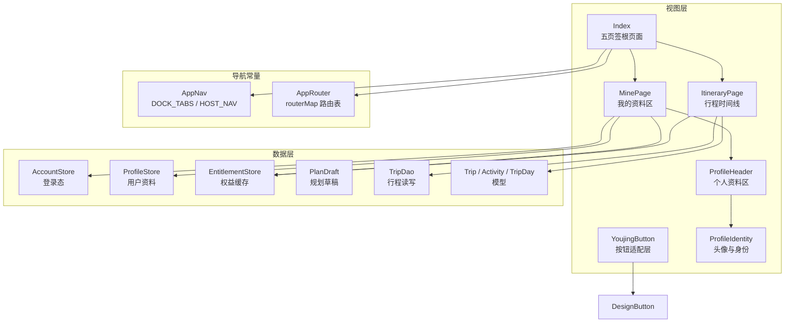
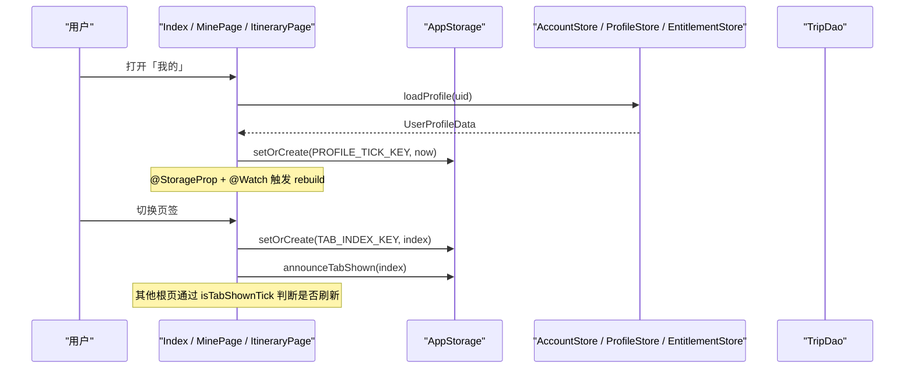
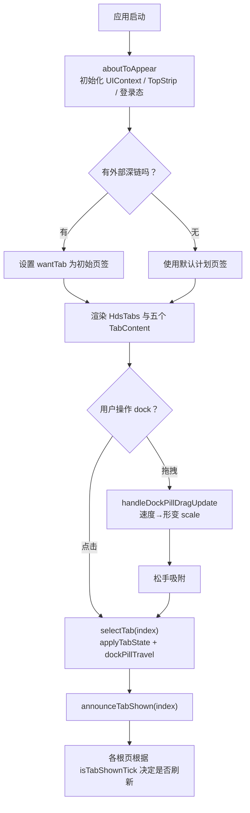
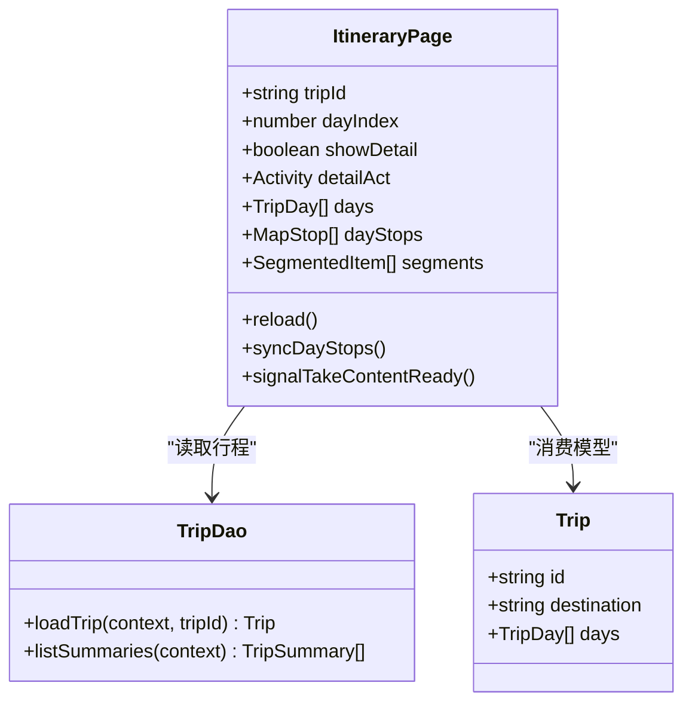
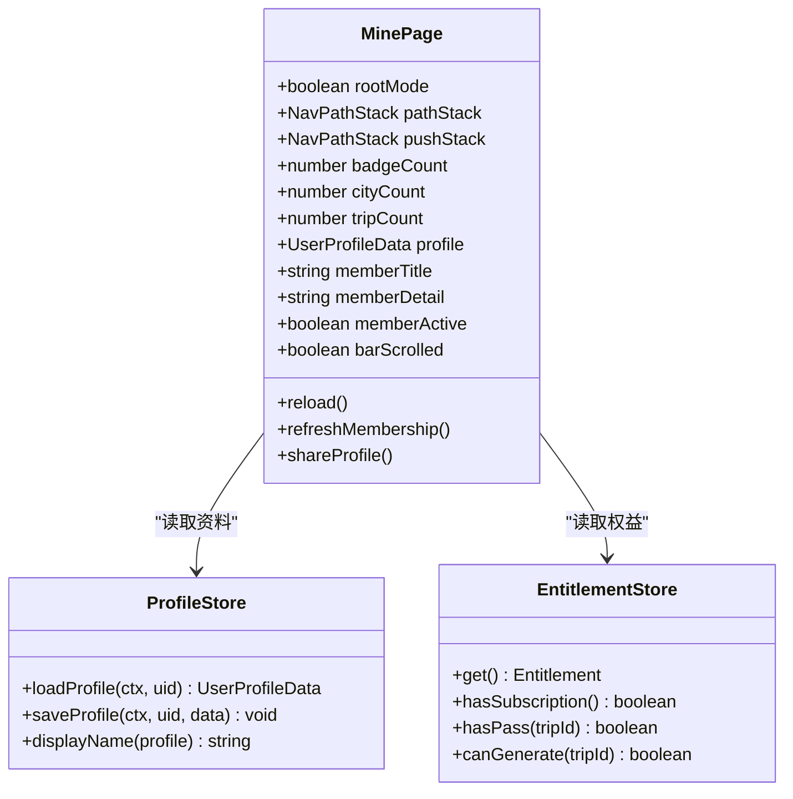
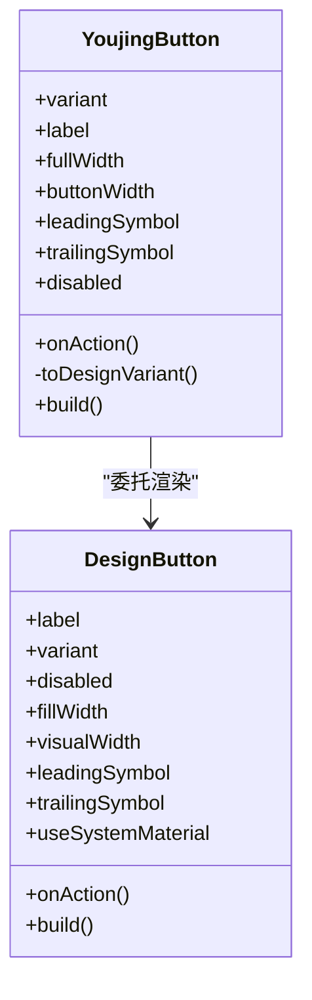
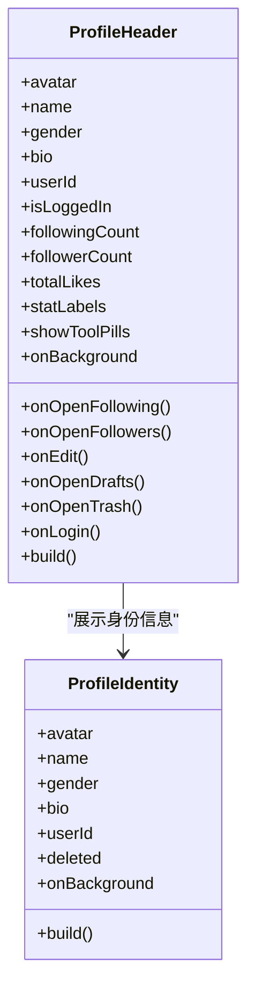
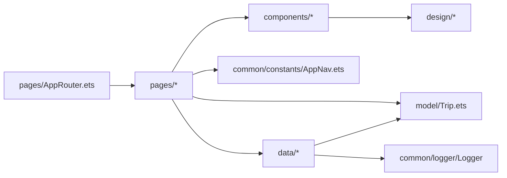

# View 层：ArkTS UI 组件与数据绑定

<cite>
**本文引用的文件**   
- [Index.ets](file://entry/src/main/ets/pages/Index.ets)
- [ItineraryPage.ets](file://entry/src/main/ets/pages/ItineraryPage.ets)
- [MinePage.ets](file://entry/src/main/ets/pages/MinePage.ets)
- [YoujingButton.ets](file://entry/src/main/ets/components/YoujingButton.ets)
- [DesignButton.ets](file://entry/src/main/ets/components/DesignButton.ets)
- [ProfileHeader.ets](file://entry/src/main/ets/components/ProfileHeader.ets)
- [ProfileIdentity.ets](file://entry/src/main/ets/components/ProfileIdentity.ets)
- [AppNav.ets](file://entry/src/main/ets/common/constants/AppNav.ets)
- [AppRouter.ets](file://entry/src/main/ets/pages/AppRouter.ets)
- [PlanDraft.ets](file://entry/src/main/ets/data/PlanDraft.ets)
- [AccountStore.ets](file://entry/src/main/ets/data/AccountStore.ets)
- [ProfileStore.ets](file://entry/src/main/ets/data/ProfileStore.ets)
- [EntitlementStore.ets](file://entry/src/main/ets/data/EntitlementStore.ets)
- [TripReminder.ets](file://entry/src/main/ets/data/TripReminder.ets)
- [TripDao.ets](file://entry/src/main/ets/data/TripDao.ets)
- [Trip.ets](file://entry/src/main/ets/model/Trip.ets)
</cite>

## 目录
1. [引言](#引言)
2. [项目结构](#项目结构)
3. [核心组件](#核心组件)
4. [架构总览](#架构总览)
5. [详细组件分析](#详细组件分析)
6. [依赖关系分析](#依赖关系分析)
7. [性能优化](#性能优化)
8. [常见问题与排错](#常见问题与排错)
9. [结论](#结论)

## 引言
本文聚焦 ArkTS 声明式 UI 的 View 层实现，围绕五个根页签、行程展示页、个人资料页以及 YoujingButton、ProfileHeader 等自定义组件，系统说明以下主题：
- @Entry、@Component、@Builder 的使用方式。
- 页面与组件生命周期：aboutToAppear、onShown、onBackPress 等。
- 数据绑定机制：@State、@Prop、@Link、@Watch 的职责边界。
- MVVM 在 View 层的体现：UI 通过 AppStorage 和 Store 对象与 ViewModel 层通信并触发响应式更新。
- 组件间通信模式：父子传参、兄弟广播、跨层级共享。
- 性能优化技巧：懒加载、条件渲染、列表优化、内存管理。
- 常见陷阱：循环引用、状态同步、动画性能、兼容性。

本仓库的 View 层采用“根页内联 + 二级全屏”的两级导航模式：Index 持有 HdsTabs 五个 TabContent，所有子路由统一 push 到宿主栈 HOST_NAV，全屏覆盖 dock；Tab 根页自身可再持有独立 NavPathStack 用于该页的内部导航。

**章节来源**
- [Index.ets:1-200](file://entry/src/main/ets/pages/Index.ets#L1-L200)
- [AppNav.ets:1-200](file://entry/src/main/ets/common/constants/AppNav.ets#L1-L200)

## 项目结构
View 层按“页面 + 组件 + 设计令牌 + 数据 Store + 模型”分层组织：
- pages：根页面 Index、业务页面 ItineraryPage、MinePage 及向导链页面。
- components：可复用 UI 组件，如 YoujingButton、ProfileHeader、ProfileIdentity、TimelineNode、TripMapView 等。
- common/constants：全局常量与导航栈单例，集中定义 DOCK_TABS、APP_NAV、HOST_NAV、TAB_* 等。
- data：ViewModel 层的数据 Store（AccountStore、ProfileStore、EntitlementStore、PlanDraft、TripDao 等）。
- model：纯数据契约 Trip、Activity、TripDay 等。
- design：颜色、字体、圆角、间距、动效等 Token。

**图示来源**
- [Index.ets:1-200](file://entry/src/main/ets/pages/Index.ets#L1-L200)
- [AppNav.ets:1-200](file://entry/src/main/ets/common/constants/AppNav.ets#L1-L200)
- [AppRouter.ets:1-100](file://entry/src/main/ets/pages/AppRouter.ets#L1-L100)
- [MinePage.ets:1-200](file://entry/src/main/ets/pages/MinePage.ets#L1-L200)
- [ItineraryPage.ets:1-200](file://entry/src/main/ets/pages/ItineraryPage.ets#L1-L200)

**章节来源**
- [Index.ets:1-200](file://entry/src/main/ets/pages/Index.ets#L1-L200)
- [AppNav.ets:1-200](file://entry/src/main/ets/common/constants/AppNav.ets#L1-L200)
- [AppRouter.ets:1-100](file://entry/src/main/ets/pages/AppRouter.ets#L1-L100)

## 核心组件
本节从装饰器、生命周期、数据绑定三个维度总结 View 层关键模式。

### 装饰器与职责
- @Entry：标记应用入口页面。Index 作为根页面，负责启动引导、登录闸门、底部 dock 页签、胶囊玻璃珠动画、深链初始页签、宿主动画钩子等。
- @Component：定义可复用组件。YoujingButton、ProfileHeader、ProfileIdentity、DesignButton 都是 @Component 组件。
- @Builder：定义局部 UI 片段。MinePage 使用 profileHeader、profileHeaderBlock、memberCard、medalCard、body 等 Builder 拆分复杂页面结构。

### 生命周期
- aboutToAppear：Index 中做 UIContext 共享、TopStrip 初始化、登录态水合、默认活动行程初始化；MinePage 在 aboutToAppear 拉取勋章、行程数、个人资料。
- onShown：适用于需要“每次切回都刷新”的场景；本项目根页若只挂 onShown 会错过首次渲染，因此 MinePage 同时用 aboutToAppear 与 dock 广播。
- onBackPress：Index 接管返回逻辑，优先处理宿主栈、弹层守卫、地图格特殊行为，避免误退后台。

### 数据绑定机制
- @State：组件内部私有状态。例如 Index 的 currentTab、dockPillX/Y/W/H；ItineraryPage 的 dayIndex、showDetail、dayStops、barScrolled 等。
- @Prop：父组件向子组件传递属性。YoujingButton 接收 variant、label、fullWidth、buttonWidth、disabled 等；ProfileHeader 接收 avatar、name、gender、bio、statLabels、onBackground 等。
- @Link：双向绑定在本仓库未直接出现于本文目标文件；典型用法是表单输入字段与 State 双向同步。
- @Watch：监听属性变化。Index 监听 tabSwitch 字符串进行运行期切页；MinePage 监听 authState、entitlementTick、PROFILE_TICK_KEY、dockTick 等广播驱动刷新。

**章节来源**
- [Index.ets:201-521](file://entry/src/main/ets/pages/Index.ets#L201-L521)
- [MinePage.ets:1-200](file://entry/src/main/ets/pages/MinePage.ets#L1-L200)
- [ItineraryPage.ets:1-200](file://entry/src/main/ets/pages/ItineraryPage.ets#L1-L200)
- [YoujingButton.ets:1-60](file://entry/src/main/ets/components/YoujingButton.ets#L1-L60)
- [ProfileHeader.ets:1-106](file://entry/src/main/ets/components/ProfileHeader.ets#L1-L106)

## 架构总览
View 层遵循 MVVM 思想：
- View：Index、ItineraryPage、MinePage、YoujingButton、ProfileHeader 等声明式 UI。
- ViewModel：AccountStore、ProfileStore、EntitlementStore、PlanDraft、TripDao 等 Store/DAO，封装状态、持久化、网络或本地数据访问。
- Model：Trip、Activity、TripDay 等纯数据契约。

UI 通过 AppStorage 键与 Store 广播通信，形成单向数据流 + 响应式 UI 重建。

**图示来源**
- [AppNav.ets:1-200](file://entry/src/main/ets/common/constants/AppNav.ets#L1-L200)
- [AccountStore.ets:1-200](file://entry/src/main/ets/data/AccountStore.ets#L1-L200)
- [ProfileStore.ets:1-166](file://entry/src/main/ets/data/ProfileStore.ets#L1-L166)
- [MinePage.ets:1-200](file://entry/src/main/ets/pages/MinePage.ets#L1-L200)

**章节来源**
- [AppNav.ets:1-200](file://entry/src/main/ets/common/constants/AppNav.ets#L1-L200)
- [AccountStore.ets:1-200](file://entry/src/main/ets/data/AccountStore.ets#L1-L200)
- [ProfileStore.ets:1-166](file://entry/src/main/ets/data/ProfileStore.ets#L1-L166)
- [MinePage.ets:1-200](file://entry/src/main/ets/pages/MinePage.ets#L1-L200)

## 详细组件分析

### Index 根页面：五个页签的组织方式
Index 是应用主壳：
- 使用 @Entry + @Component 定义根页面。
- 维护 currentTab、wantTab、tabSwitch、dockNavInset、breakpoint、stripName 等状态与全局桥接。
- 通过 HdsTabsController 控制官方 dock；低 SDK 分支保留 legacy TabsController。
- 外部深链通过 TAB_INDEX_KEY 作为 HdsTabs 初始页签；运行期切页通过 TAB_SWITCH_KEY + @Watch 调用 changeIndex。
- 底部 dock 使用“液态胶囊”玻璃珠动画：记录槽位 Area、计算中心点与槽距、拖拽速度形变、松手 springBounce 落定。
- 二级页全屏化：所有 push 走 HOST_NAV，Index 外层 Navigation 持有转场钩子 longTakeTransitionHook 与 routerMap。
- 返回逻辑：优先处理宿主栈 → 弹层守卫 → 地图格特殊处理 → 非地图页签回到地图。

**图示来源**
- [Index.ets:1-200](file://entry/src/main/ets/pages/Index.ets#L1-L200)
- [Index.ets:201-521](file://entry/src/main/ets/pages/Index.ets#L201-L521)
- [AppNav.ets:1-200](file://entry/src/main/ets/common/constants/AppNav.ets#L1-L200)

**章节来源**
- [Index.ets:1-200](file://entry/src/main/ets/pages/Index.ets#L1-L200)
- [Index.ets:201-521](file://entry/src/main/ets/pages/Index.ets#L201-L521)
- [AppNav.ets:1-200](file://entry/src/main/ets/common/constants/AppNav.ets#L1-L200)

### ItineraryPage：行程时间线展示
ItineraryPage 是屏 8 行程时间线主视图，承担以下职责：
- 接收 tripId 作为 @Prop，进入时从 TripDao.loadTrip 异步加载 Trip 对象。
- 将 Trip.days 映射到本地 days，并生成 Day 分段标签 segments。
- 通过 List + TimelineNode 展示每日活动，配合 MapStop 与 TripMapView 联动。
- 使用 @State 管理 dayIndex、showDetail、detailAct、writingSystem、bookingCount、dayCount、barScrolled、mapRequest 等 UI 状态。
- 使用 @StorageProp('chromeThemeTick') 跟随深浅档切换重建标题内容。
- 使用 @StorageProp(KEY_CURRENT_BREAKPOINT) 控制宽屏最大宽度。
- 一镜到底（long take）注册页面节点 ID，卡片截图交接时由 LongTakeAnimationProperties 控制初值、终值和超时兜底。
- 日历同步、提醒同步、分享导出等能力通过 CalendarSync、TripReminder、ShareExporter 等 Store 协调。

**图示来源**
- [ItineraryPage.ets:1-200](file://entry/src/main/ets/pages/ItineraryPage.ets#L1-L200)
- [TripDao.ets:1-200](file://entry/src/main/ets/data/TripDao.ets#L1-L200)
- [Trip.ets:1-137](file://entry/src/main/ets/model/Trip.ets#L1-L137)

**章节来源**
- [ItineraryPage.ets:1-200](file://entry/src/main/ets/pages/ItineraryPage.ets#L1-L200)
- [TripDao.ets:1-200](file://entry/src/main/ets/data/TripDao.ets#L1-L200)
- [Trip.ets:1-137](file://entry/src/main/ets/model/Trip.ets#L1-L137)

### MinePage：用户信息与概览
MinePage 是「我的」根页，承担：
- 作为 TabContent 根页时自带 HdsNavigation，被 push 时走 HdsNavDestination。
- 通过 @StorageProp(AUTH_STATE_KEY) 显示游客/已登录状态。
- 通过 @StorageProp(EntitlementStore.TICK_KEY) 即时刷新会员卡信息。
- 通过 @StorageProp(PROFILE_TICK_KEY) 刷新用户资料。
- 通过 @StorageProp(TAB_SHOWN_KEY) 在 dock 切回时重取勋章计数、行程数。
- 使用 @Builder 构建 profileHeader、profileHeaderBlock、memberCard、medalCard、body。
- 使用 Scroller 获取绝对滚动偏移，驱动顶栏磨砂开关。

**图示来源**
- [MinePage.ets:1-200](file://entry/src/main/ets/pages/MinePage.ets#L1-L200)
- [ProfileStore.ets:1-166](file://entry/src/main/ets/data/ProfileStore.ets#L1-L166)
- [EntitlementStore.ets:1-200](file://entry/src/main/ets/data/EntitlementStore.ets#L1-L200)

**章节来源**
- [MinePage.ets:1-200](file://entry/src/main/ets/pages/MinePage.ets#L1-L200)
- [ProfileStore.ets:1-166](file://entry/src/main/ets/data/ProfileStore.ets#L1-L166)
- [EntitlementStore.ets:1-200](file://entry/src/main/ets/data/EntitlementStore.ets#L1-L200)

### YoujingButton：按钮适配层
YoujingButton 是业务语义按钮对 DesignButton 的适配层：
- 暴露 YoujingButtonVariant.PRIMARY/SECONDARY/TEXT/GLASS。
- 将 SECONDARY 映射为 OUTLINED，TEXT 映射为 GHOST，GLASS 保持 GLASS。
- 透传 label、fullWidth、buttonWidth、leadingSymbol、trailingSymbol、disabled、onAction。
- build 中直接构造 DesignButton，并把 onAction 包一层空判断后转发。

**图示来源**
- [YoujingButton.ets:1-60](file://entry/src/main/ets/components/YoujingButton.ets#L1-L60)
- [DesignButton.ets:1-139](file://entry/src/main/ets/components/DesignButton.ets#L1-L139)

**章节来源**
- [YoujingButton.ets:1-60](file://entry/src/main/ets/components/YoujingButton.ets#L1-L60)
- [DesignButton.ets:1-139](file://entry/src/main/ets/components/DesignButton.ets#L1-L139)

### ProfileHeader：个人资料区呈现
ProfileHeader 负责展示头像、昵称、性别、简介、统计三列、编辑资料胶囊，以及可选的草稿箱/废纸篓工具胶囊：
- 所有展示字段通过 @Prop 传入。
- 回调事件 onOpenFollowing、onOpenFollowers、onEdit、onOpenDrafts、onOpenTrash、onLogin 由父页面决定跳转逻辑。
- 统计行拆成独立 Row，解决小屏 363vp 放不下原布局的问题。
- 工具胶囊统一走 GlassPillButton，登录态才显示草稿箱/废纸篓。

**图示来源**
- [ProfileHeader.ets:1-106](file://entry/src/main/ets/components/ProfileHeader.ets#L1-L106)
- [ProfileIdentity.ets:1-116](file://entry/src/main/ets/components/ProfileIdentity.ets#L1-L116)

**章节来源**
- [ProfileHeader.ets:1-106](file://entry/src/main/ets/components/ProfileHeader.ets#L1-L106)
- [ProfileIdentity.ets:1-116](file://entry/src/main/ets/components/ProfileIdentity.ets#L1-L116)

### 数据绑定与 MVVM 的具体体现
- @State 用于组件内部状态：Index 的当前页签下标、胶囊位置；ItineraryPage 的当天索引、详情弹窗；MinePage 的资料与会员状态。
- @Prop 用于父子传参：YoujingButton 的变体与文案；ProfileHeader 的用户资料与回调；ItineraryPage 的 tripId。
- @StorageProp/@StorageLink 用于跨组件/跨页面共享：Index 的 TAB_INDEX_KEY、TAB_SWITCH_KEY、BOTTOM_NAV_INSET_KEY、KEY_CURRENT_BREAKPOINT；MinePage 的 AUTH_STATE_KEY、EntitlementStore.TICK_KEY、PROFILE_TICK_KEY、TAB_SHOWN_KEY。
- @Watch 用于监听变化：Index 的 applyTabSwitch；MinePage 的 onDockShown、onEntitlementTick、onProfileTick。
- Store 单向输出：AccountStore.publish 写 AUTH_STATE_KEY；ProfileStore.saveProfile 写 PROFILE_TICK_KEY；EntitlementStore 提供 canExport/canGenerate 供 UI 判断付费墙；PlanDraft 作为跨页草稿单例被多屏写入。

**章节来源**
- [Index.ets:1-200](file://entry/src/main/ets/pages/Index.ets#L1-L200)
- [MinePage.ets:1-200](file://entry/src/main/ets/pages/MinePage.ets#L1-L200)
- [ItineraryPage.ets:1-200](file://entry/src/main/ets/pages/ItineraryPage.ets#L1-L200)
- [AccountStore.ets:1-200](file://entry/src/main/ets/data/AccountStore.ets#L1-L200)
- [ProfileStore.ets:1-166](file://entry/src/main/ets/data/ProfileStore.ets#L1-L166)
- [EntitlementStore.ets:1-200](file://entry/src/main/ets/data/EntitlementStore.ets#L1-L200)
- [PlanDraft.ets:1-77](file://entry/src/main/ets/data/PlanDraft.ets#L1-L77)

## 依赖关系分析
View 层依赖方向清晰：
- pages 依赖 components、common/constants、data、model、utils。
- components 主要依赖 design tokens、utils、基础 UI 组件。
- data.Store 不反向依赖 UI，只依赖 model、config、logger、system API。
- AppRouter 解耦 Index 与各页面，避免根页内联 HdsNavigation 导致 Index ↔ 页面互相 import。

**图示来源**
- [AppRouter.ets:1-100](file://entry/src/main/ets/pages/AppRouter.ets#L1-L100)
- [AppNav.ets:1-200](file://entry/src/main/ets/common/constants/AppNav.ets#L1-L200)
- [Trip.ets:1-137](file://entry/src/main/ets/model/Trip.ets#L1-L137)

**章节来源**
- [AppRouter.ets:1-100](file://entry/src/main/ets/pages/AppRouter.ets#L1-L100)
- [AppNav.ets:1-200](file://entry/src/main/ets/common/constants/AppNav.ets#L1-L200)
- [Trip.ets:1-137](file://entry/src/main/ets/model/Trip.ets#L1-L137)

## 性能优化
View 层在多个文件中体现了 ArkTS 声明式 UI 的性能实践：

- 懒加载与按需刷新
  - MinePage 只在 aboutToAppear 与 dock 广播时刷新，避免根页永远不取数或重复重绘。
  - ItineraryPage 在 onShown 或数据就绪后发出 signalTakeContentReady，让卡片截图提前结束交接。

- 条件渲染
  - ProfileHeader 根据 isLoggedIn 与 showToolPills 决定是否渲染草稿箱/废纸篓。
  - MinePage 根据 profile.profileBackground 是否存在选择背景图叠加或主题色路径。
  - YoujingButton/DesignButton 根据 disabled、materialOn、isPrimary、isGlass 选择样式。

- 列表优化
  - MinePage.body 使用 List + ListItem，明确 edgeEffect、scrollBar、divider、padding bottom，避免多余 space。
  - ItineraryPage 使用 ListScroller.scrollToItemInGroup 把地图落点带回时间线可见区域。

- 动画与合成优化
  - Index 的 dock 胶囊使用 animateTo 与 GPU 合成 scale 形变，避免逐帧直写 W/H 导致重布局与材质重采样。
  - 拖拽速度平滑、停顿检测、边缘阻尼，减少无效抖动。

- 内存与状态清理
  - PlanDraft.fresh 重置单例，防止连做行程时旧 selectedSpots/selectedArea 残留。
  - ItineraryPage 窗口尺寸变化时注销 CustomTransition，避免半截转场状态残留。
  - TripReminder 发布前撤销旧 reminderId，保持幂等。

**章节来源**
- [MinePage.ets:200-430](file://entry/src/main/ets/pages/MinePage.ets#L200-L430)
- [ItineraryPage.ets:1-200](file://entry/src/main/ets/pages/ItineraryPage.ets#L1-L200)
- [Index.ets:201-521](file://entry/src/main/ets/pages/Index.ets#L201-L521)
- [PlanDraft.ets:1-77](file://entry/src/main/ets/data/PlanDraft.ets#L1-L77)
- [TripReminder.ets:1-200](file://entry/src/main/ets/data/TripReminder.ets#L1-L200)

## 常见问题与排错
- 循环引用风险
  - 根页内联 HdsNavigation 后，如果 routerMap 放在 Index 内部，会导致 Index 与页面互相 import。解决方案是把 routerMap 抽到 AppRouter，仅由 Index 引入。
  
  **章节来源**
  - [AppRouter.ets:1-100](file://entry/src/main/ets/pages/AppRouter.ets#L1-L100)

- 状态同步问题
  - 根页只挂 onShown 不会触发首次数据加载，必须同时使用 aboutToAppear；MinePage 正是因 INIT_REPORT 踩坑而补了双重取数。
  - 切页签广播 TAB_SHOWN_KEY 必须带时间戳，否则同一页签连切两次不会触发 @Watch。

  **章节来源**
  - [MinePage.ets:1-200](file://entry/src/main/ets/pages/MinePage.ets#L1-L200)
  - [AppNav.ets:1-200](file://entry/src/main/ets/common/constants/AppNav.ets#L1-L200)

- 动画性能与兼容
  - dock 胶囊形变不能用 W/H 直写，必须用 scale；Index 明确区分 layout 尺寸与 GPU transform。
  - 低 SDK 分支保留 legacy TabsController，但当前 compatibleSdk 26 下恒走 HdsTabs。

  **章节来源**
  - [Index.ets:201-521](file://entry/src/main/ets/pages/Index.ets#L201-L521)

- 导航栈错误
  - 不能把 HOST_NAV 绑到某个根页内部 Navigation，否则该根页的子页会 push 到看不见的栈。Index 外层唯一持有 HOST_NAV。
  - 二级页应 push 到 HOST_NAV，根路由不应再次 push，AppNav.isTabRoot 用于区分。

  **章节来源**
  - [AppNav.ets:1-200](file://entry/src/main/ets/common/constants/AppNav.ets#L1-L200)

- 权限与系统能力
  - TripReminder 受系统代理提醒能力管控，未开通时会返回 blockedByCapability，UI 需给可行动提示而非泛失败。
  - AccountStore.login 永不抛错，取不到 UnionID 退回游客分区，保证首启流程不断。

  **章节来源**
  - [TripReminder.ets:1-200](file://entry/src/main/ets/data/TripReminder.ets#L1-L200)
  - [AccountStore.ets:1-200](file://entry/src/main/ets/data/AccountStore.ets#L1-L200)

## 结论
本项目的 View 层以 ArkTS 声明式 UI 为核心，通过 @Entry、@Component、@Builder 组织页面与组件，通过 @State、@Prop、@StorageProp、@Watch 构建响应式数据流。Index 承担根壳与 dock 交互，ItineraryPage 承载行程时间线，MinePage 聚合用户资料与会员概览，YoujingButton 与 ProfileHeader 则体现可复用组件的最佳实践。MVVM 在 View 层表现为 UI 只关心如何展示与交互，数据与状态变更集中在 Store 层，并通过 AppStorage 广播驱动 UI 重建。在此基础上，项目通过懒加载、条件渲染、List 优化、GPU 合成动画、幂等提醒和严格路由表，降低了常见 UI 陷阱带来的稳定性风险。