# ViewModel 层：状态管理与响应式更新

<cite>
**本文引用的文件**   
- [AccountStore.ets](file://entry/src/main/ets/data/AccountStore.ets)
- [EntitlementStore.ets](file://entry/src/main/ets/data/EntitlementStore.ets)
- [ProfileStore.ets](file://entry/src/main/ets/data/ProfileStore.ets)
- [IapStore.ets](file://entry/src/main/ets/data/IapStore.ets)
- [WeatherStore.ets](file://entry/src/main/ets/data/WeatherStore.ets)
- [MapKitCityStore.ets](file://entry/src/main/ets/data/MapKitCityStore.ets)
- [RoadRouteStore.ets](file://entry/src/main/ets/data/RoadRouteStore.ets)
- [MinePage.ets](file://entry/src/main/ets/pages/MinePage.ets)
- [Index.ets](file://entry/src/main/ets/pages/Index.ets)
- [EntryAbility.ets](file://entry/src/main/ets/entryability/EntryAbility.ets)
</cite>

## 目录
1. [引言](#引言)
2. [项目结构](#项目结构)
3. [核心组件](#核心组件)
4. [架构总览](#架构总览)
5. [详细组件分析](#详细组件分析)
6. [依赖关系分析](#依赖关系分析)
7. [性能与内存注意事项](#性能与内存注意事项)
8. [故障排查指南](#故障排查指南)
9. [结论](#结论)

## 引言
本文聚焦 ArkTS 应用中的 ViewModel 层实现，围绕以下主题展开：
- ArkTS 响应式编程模式：`@Observed`、`@ObjectLink`、`AppStorage`。
- Store 类职责划分：账户、权益、个人资料、内购、天气、地图城市、路线数据。
- 在页面中如何结合 `@State`、`@Prop`、`@Link` 与 Store 协作。
- Store 生命周期、初始化时机、依赖注入、资源清理与泄漏防护。
- 异步数据处理：Promise、async/await、错误处理与加载状态管理。
- 最佳实践：单一职责、状态不可变性、调试技巧与性能优化。

本项目采用“Store 作为领域状态单例 + AppStorage 作为全局广播通道”的轻量 MVVM 风格：Store 负责业务逻辑与持久化，页面通过 `@StorageProp`、`@Watch` 订阅变化并驱动 UI；需要跨组件双向绑定时使用 `@ObjectLink`，需要局部状态时配合 `@State`、`@Prop`、`@Link`。

## 项目结构
ViewModel 相关代码集中在 `entry/src/main/ets/data` 下的 Store 文件，以及部分页面（如 `MinePage`、`Index`）对 `AppStorage` 键的订阅。`EntryAbility` 承担应用级初始化，例如把导航栏高度、窗口尺寸等系统信息写入 `AppStorage`。

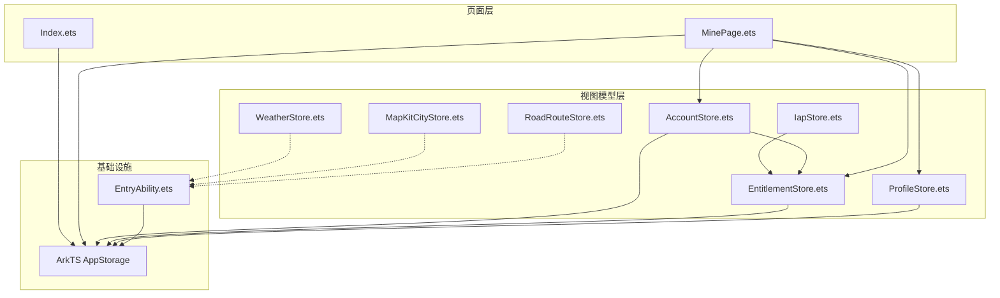

**图示来源**
- [AccountStore.ets:1-213](file://entry/src/main/ets/data/AccountStore.ets#L1-L213)
- [EntitlementStore.ets:1-235](file://entry/src/main/ets/data/EntitlementStore.ets#L1-L235)
- [ProfileStore.ets:1-166](file://entry/src/main/ets/data/ProfileStore.ets#L1-L166)
- [IapStore.ets:1-413](file://entry/src/main/ets/data/IapStore.ets#L1-L413)
- [WeatherStore.ets:1-157](file://entry/src/main/ets/data/WeatherStore.ets#L1-L157)
- [MapKitCityStore.ets:1-179](file://entry/src/main/ets/data/MapKitCityStore.ets#L1-L179)
- [RoadRouteStore.ets:1-118](file://entry/src/main/ets/data/RoadRouteStore.ets#L1-L118)
- [MinePage.ets:29-80](file://entry/src/main/ets/pages/MinePage.ets#L29-L80)
- [Index.ets:23-282](file://entry/src/main/ets/pages/Index.ets#L23-L282)
- [EntryAbility.ets:513-687](file://entry/src/main/ets/entryability/EntryAbility.ets#L513-L687)

**章节来源**
- [AccountStore.ets:1-213](file://entry/src/main/ets/data/AccountStore.ets#L1-L213)
- [EntitlementStore.ets:1-235](file://entry/src/main/ets/data/EntitlementStore.ets#L1-L235)
- [ProfileStore.ets:1-166](file://entry/src/main/ets/data/ProfileStore.ets#L1-L166)
- [IapStore.ets:1-413](file://entry/src/main/ets/data/IapStore.ets#L1-L413)
- [WeatherStore.ets:1-157](file://entry/src/main/ets/data/WeatherStore.ets#L1-L157)
- [MapKitCityStore.ets:1-179](file://entry/src/main/ets/data/MapKitCityStore.ets#L1-L179)
- [RoadRouteStore.ets:1-118](file://entry/src/main/ets/data/RoadRouteStore.ets#L1-L118)
- [MinePage.ets:29-80](file://entry/src/main/ets/pages/MinePage.ets#L29-L80)
- [Index.ets:23-282](file://entry/src/main/ets/pages/Index.ets#L23-L282)
- [EntryAbility.ets:513-687](file://entry/src/main/ets/entryability/EntryAbility.ets#L513-L687)

## 核心组件
本项目的 ViewModel 层由多个职责清晰的 Store 组成：
- `AccountStore`：登录态、游客态、UnionID、idToken、偏好恢复、登出。
- `EntitlementStore`：会员权益缓存、生成权限、导出权限、管理员白名单。
- `ProfileStore`：用户资料读写、显示名、副标题、头像规格、资料刷新广播。
- `IapStore`：内购购买、JWS 校验、BFF 同步权益、沙盒诊断。
- `WeatherStore`：当日首站天气取数、内存与 preferences 双层缓存。
- `MapKitCityStore`：任意城市景点/住宿区检索、区县聚合、酒店供给计数。
- `RoadRouteStore`：相邻站点道路折线、驾车/步行/公交算路、失败回退直线。

这些 Store 共同构成应用的“状态中心”，并通过 `AppStorage` 向页面广播关键事件。

**章节来源**
- [AccountStore.ets:1-213](file://entry/src/main/ets/data/AccountStore.ets#L1-L213)
- [EntitlementStore.ets:1-235](file://entry/src/main/ets/data/EntitlementStore.ets#L1-L235)
- [ProfileStore.ets:1-166](file://entry/src/main/ets/data/ProfileStore.ets#L1-L166)
- [IapStore.ets:1-413](file://entry/src/main/ets/data/IapStore.ets#L1-L413)
- [WeatherStore.ets:1-157](file://entry/src/main/ets/data/WeatherStore.ets#L1-L157)
- [MapKitCityStore.ets:1-179](file://entry/src/main/ets/data/MapKitCityStore.ets#L1-L179)
- [RoadRouteStore.ets:1-118](file://entry/src/main/ets/data/RoadRouteStore.ets#L1-L118)

## 架构总览
Store 层采用“静态单例 + 内部可变状态”的模式，不直接持有 ArkUI 组件实例，避免循环引用。页面通过 `@StorageProp` 订阅 `AppStorage` 中的键，配合 `@Watch` 触发局部刷新或副作用。

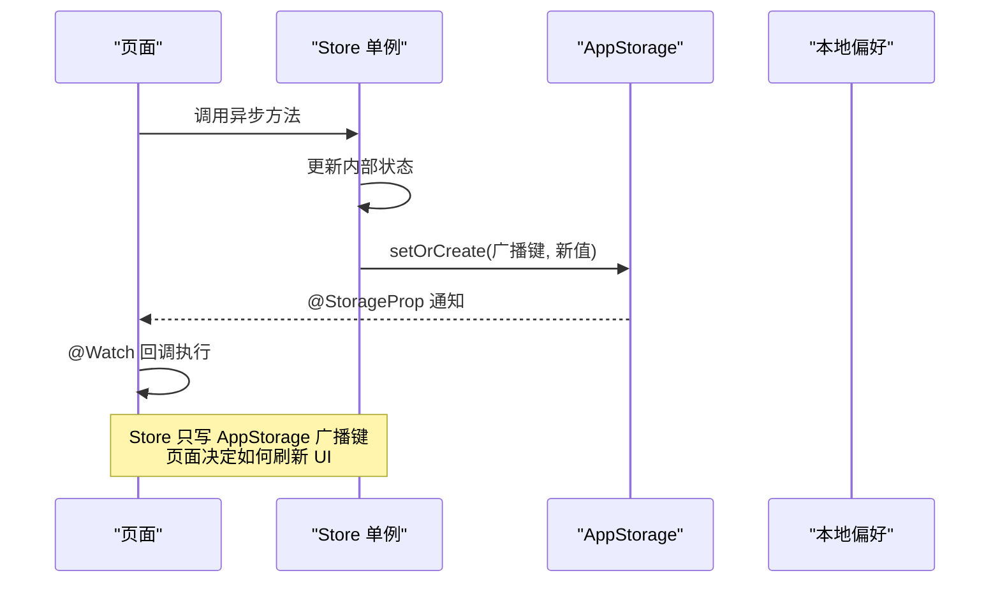

**图示来源**
- [AccountStore.ets:80-110](file://entry/src/main/ets/data/AccountStore.ets#L80-L110)
- [EntitlementStore.ets:200-235](file://entry/src/main/ets/data/EntitlementStore.ets#L200-L235)
- [ProfileStore.ets:110-130](file://entry/src/main/ets/data/ProfileStore.ets#L110-L130)
- [MinePage.ets:71-80](file://entry/src/main/ets/pages/MinePage.ets#L71-L80)

**章节来源**
- [MinePage.ets:29-80](file://entry/src/main/ets/pages/MinePage.ets#L29-L80)
- [Index.ets:706-710](file://entry/src/main/ets/pages/Index.ets#L706-L710)
- [AccountStore.ets:80-110](file://entry/src/main/ets/data/AccountStore.ets#L80-L110)
- [EntitlementStore.ets:200-235](file://entry/src/main/ets/data/EntitlementStore.ets#L200-L235)
- [ProfileStore.ets:110-130](file://entry/src/main/ets/data/ProfileStore.ets#L110-L130)

## 详细组件分析

### 响应式编程模式：@Observed、@ObjectLink、AppStorage
- `@Observed`：用于标记可被对象级响应式跟踪的数据结构。当对象字段发生变化时，依赖该对象的 UI 可以自动刷新。仓库中已有示例在长截屏动画属性中使用 `@Observed`，说明对象级响应式能力已接入基础工具层。
- `@ObjectLink`：用于建立组件之间对同一对象的双向绑定。适合表单编辑、共享实体等场景。由于本项目 Store 多采用静态单例，更常见的做法是“Store 写 `AppStorage` 广播键，页面用 `@StorageProp` + `@Watch` 消费”。
- `AppStorage`：全局状态容器。Store 通过 `setOrCreate` 写入键，页面通过 `@StorageProp` 订阅。典型键包括：
  - 登录态：`AUTH_STATE_KEY`。
  - 权益变更：`EntitlementStore.TICK_KEY`。
  - 资料刷新：`PROFILE_TICK_KEY`。
  - 导航与主题：`TAB_INDEX_KEY`、`isDarkMode`、`chromeThemeTick`、窗口与导航栏尺寸键。

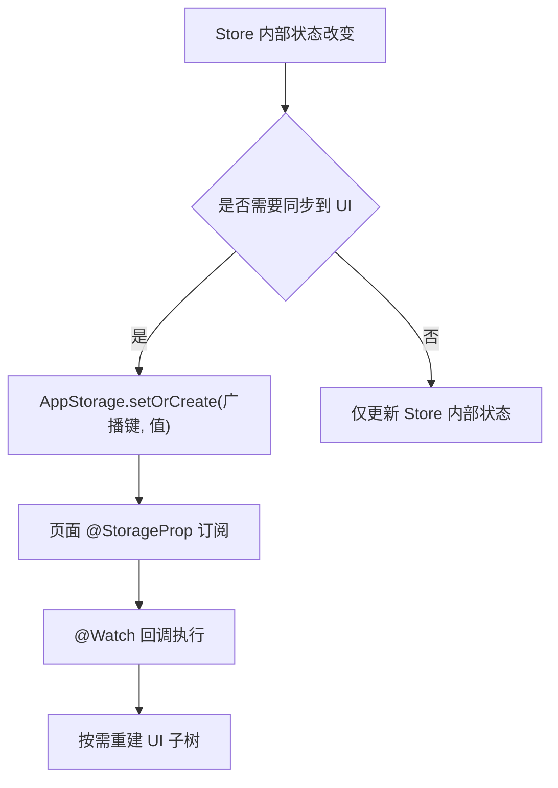

**图示来源**
- [AccountStore.ets:80-110](file://entry/src/main/ets/data/AccountStore.ets#L80-L110)
- [EntitlementStore.ets:200-235](file://entry/src/main/ets/data/EntitlementStore.ets#L200-L235)
- [ProfileStore.ets:110-130](file://entry/src/main/ets/data/ProfileStore.ets#L110-L130)
- [MinePage.ets:71-80](file://entry/src/main/ets/pages/MinePage.ets#L71-L80)
- [Index.ets:706-710](file://entry/src/main/ets/pages/Index.ets#L706-L710)
- [EntryAbility.ets:613-687](file://entry/src/main/ets/entryability/EntryAbility.ets#L613-L687)

**章节来源**
- [longTakeAnimationProperties.ets:49-49](file://entry/src/main/ets/utils/longTake/longTakeAnimationProperties.ets#L49-L49)
- [AccountStore.ets:29-110](file://entry/src/main/ets/data/AccountStore.ets#L29-L110)
- [EntitlementStore.ets:120-235](file://entry/src/main/ets/data/EntitlementStore.ets#L120-L235)
- [ProfileStore.ets:60-130](file://entry/src/main/ets/data/ProfileStore.ets#L60-L130)
- [MinePage.ets:71-80](file://entry/src/main/ets/pages/MinePage.ets#L71-L80)
- [Index.ets:706-710](file://entry/src/main/ets/pages/Index.ets#L706-L710)
- [EntryAbility.ets:613-687](file://entry/src/main/ets/entryability/EntryAbility.ets#L613-L687)

### AccountStore：用户账户状态
职责：
- 静默登录与游客兜底。
- 从偏好恢复 UnionID。
- 维护当前账号分区键和 idToken。
- 将登录态推送到 `AppStorage`，供根页闸门控制。
- 登出后清空偏好、权益缓存。

关键点：
- `init()` 必须在首次读写行程之前完成，因为 `uid()` 是同步读取的 RDB 分区键。
- `login()` 不会抛出阻断性异常；失败时退回游客分区。
- `publish()` 写入 `AUTH_STATE_KEY`，未初始化时写入空串，使根页不渲染登录态相关分支。
- `refreshIdToken()` 只刷新票据，不改变登录态和权益缓存。

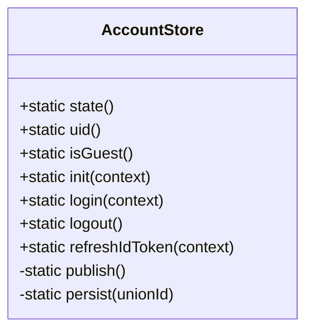

**图示来源**
- [AccountStore.ets:1-213](file://entry/src/main/ets/data/AccountStore.ets#L1-L213)

**章节来源**
- [AccountStore.ets:1-213](file://entry/src/main/ets/data/AccountStore.ets#L1-L213)

### EntitlementStore：会员权益
职责：
- 从 BFF 获取并缓存权益快照。
- 提供 `canGenerate()`、`canExport()`、`hasSubscription()`、`hasPass()` 等权限判断。
- 支持开发模式旁路和管理员无限额度。
- 通过 `TICK_KEY` 广播权益变更。

关键点：
- 权益缓存 TTL 为 5 分钟；过期不等于没额度，而是让服务端做最终判断。
- `mergeQuotaSnapshot()` 严格区分“服务端明确返回 null”和“旧版 BFF 未返回字段”。
- 导出不要求缓存新鲜，但没有任何缓存时拒绝。

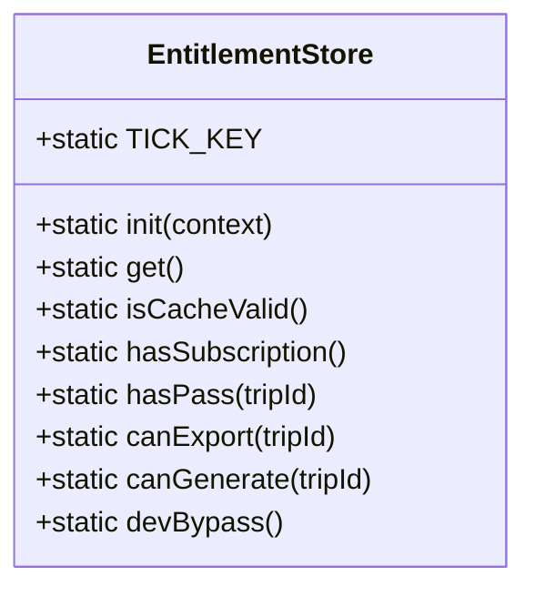

**图示来源**
- [EntitlementStore.ets:1-235](file://entry/src/main/ets/data/EntitlementStore.ets#L1-L235)

**章节来源**
- [EntitlementStore.ets:1-235](file://entry/src/main/ets/data/EntitlementStore.ets#L1-L235)

### ProfileStore：个人资料
职责：
- 按账号维度读写用户资料。
- 提供显示名、副标题、隐私提示。
- 保存资料后通过 `PROFILE_TICK_KEY` 广播，使“我的”等页面回显最新昵称和简介。

关键点：
- 资料结构 `UserProfileData` 与“有据”共享契约同形，便于未来迁移到服务端。
- 读不到或解析失败返回空资料，不阻断页面。
- `avatarOf()` 当前返回符号占位，预留 URL 或 base64 扩展点。

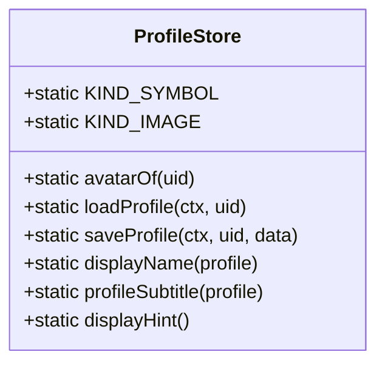

**图示来源**
- [ProfileStore.ets:1-166](file://entry/src/main/ets/data/ProfileStore.ets#L1-L166)

**章节来源**
- [ProfileStore.ets:1-166](file://entry/src/main/ets/data/ProfileStore.ets#L1-L166)

### IapStore：内购状态
职责：
- 购买通行证和订阅。
- 从华为 IAPKit 查询 JWS。
- 将 JWS 发送给 BFF 验签并同步权益。
- 成功后确认发货，失败保留待恢复状态。

关键点：
- 购买令牌本身不是凭据，真正凭据是 JWS。
- 购买流程加锁，防止并发重复购买。
- 对官方错误码进行语义化处理，如取消购买、授权拒绝、沙盒环境诊断。
- 校验成功后才 `finishPurchase`，符合官方“先发货再确认”的要求。

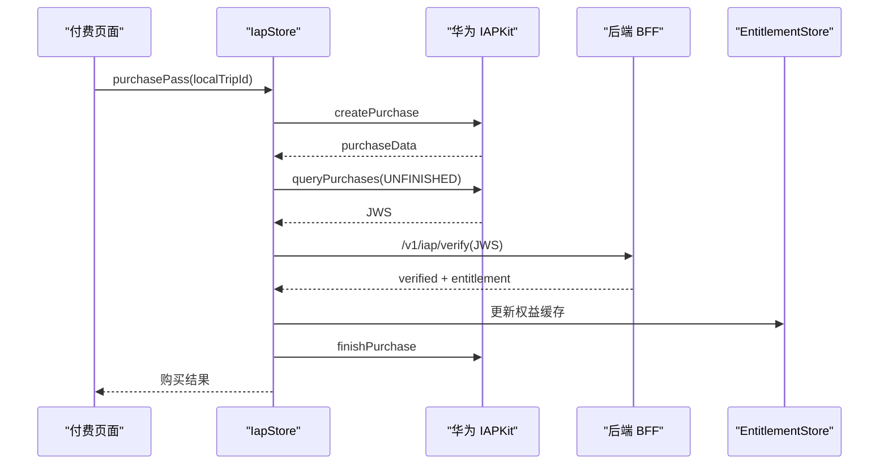

**图示来源**
- [IapStore.ets:1-413](file://entry/src/main/ets/data/IapStore.ets#L1-L413)
- [EntitlementStore.ets:200-235](file://entry/src/main/ets/data/EntitlementStore.ets#L200-L235)

**章节来源**
- [IapStore.ets:1-413](file://entry/src/main/ets/data/IapStore.ets#L1-L413)
- [EntitlementStore.ets:120-235](file://entry/src/main/ets/data/EntitlementStore.ets#L120-L235)

### WeatherStore：天气数据
职责：
- 根据当日首站坐标取 Open-Meteo 天气。
- 使用内存缓存和 preferences 双层缓存，30 分钟内不重复请求。
- 失败或解析失败返回 null，界面不出天气行。

关键点：
- 坐标四舍五入到 0.1°，降低位置精度，减少第三方暴露。
- 缓存 key 包含纬度、经度和日期。
- 偏好层存原始文本，解析失败可重试。

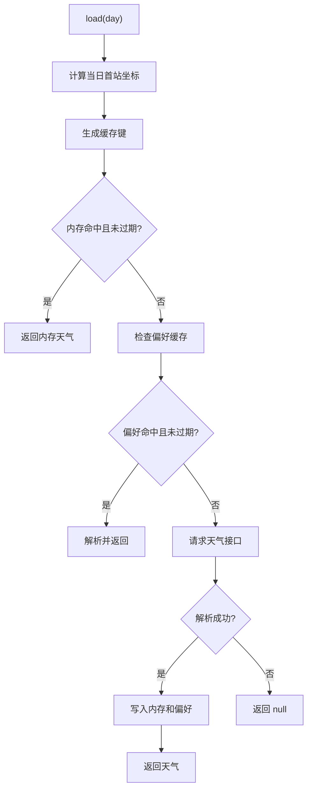

**图示来源**
- [WeatherStore.ets:1-157](file://entry/src/main/ets/data/WeatherStore.ets#L1-L157)

**章节来源**
- [WeatherStore.ets:1-157](file://entry/src/main/ets/data/WeatherStore.ets#L1-L157)

### MapKitCityStore：地图城市信息
职责：
- 调用 Map Kit 地点检索，获取指定城市的景点和住宿区。
- 对区县进行聚合，并结合酒店供给排序候选住宿区。
- 30 分钟内存缓存，不落盘。

关键点：
- 必须带 `cityId` 和 `isCityLimit=true`，否则可能拿到全国结果。
- 地址归属校验防止无效城市返回全球 POI。
- 单个区县酒店查询失败不阻断整座城市加载。

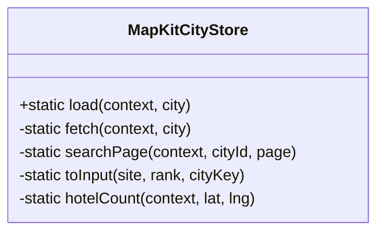

**图示来源**
- [MapKitCityStore.ets:1-179](file://entry/src/main/ets/data/MapKitCityStore.ets#L1-L179)

**章节来源**
- [MapKitCityStore.ets:1-179](file://entry/src/main/ets/data/MapKitCityStore.ets#L1-L179)

### RoadRouteStore：路线数据
职责：
- 计算相邻两站之间的道路折线。
- 支持驾车、步行、公交三种出行方式。
- 失败时返回 null，由调用方回退为直线，保证地图不断线。

关键点：
- 起终点相同直接返回 null。
- 30 分钟内存缓存，key 包含起点、终点和出行方式。
- 公交路线按段落拼接 polyline，再合并为统一坐标序列。

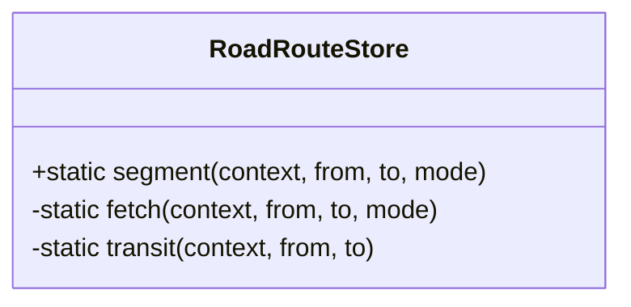

**图示来源**
- [RoadRouteStore.ets:1-118](file://entry/src/main/ets/data/RoadRouteStore.ets#L1-L118)

**章节来源**
- [RoadRouteStore.ets:1-118](file://entry/src/main/ets/data/RoadRouteStore.ets#L1-L118)

### 页面中的响应式绑定示例
虽然本项目主要使用 `@StorageProp` 订阅 Store 广播，但 Store 设计仍兼容 ArkTS 常用绑定模式：

- `@State`：用于组件局部状态，例如表单输入、临时加载标志。
- `@Prop`：父组件向子组件单向传递只读数据。
- `@Link`：父子组件双向绑定简单标量。
- `@ObjectLink`：父子组件双向绑定复杂对象。
- `@StorageProp`：订阅 `AppStorage` 中的全局键。
- `@Watch`：在订阅值变化时执行副作用，例如重新拉取数据。

在本项目中，`MinePage` 通过 `@StorageProp` 订阅 `AUTH_STATE_KEY`、`EntitlementStore.TICK_KEY`、`PROFILE_TICK_KEY`，并在 `@Watch` 回调中刷新资料区和权益展示。`Index` 也订阅 `AUTH_STATE_KEY` 作为根页登录态闸门。

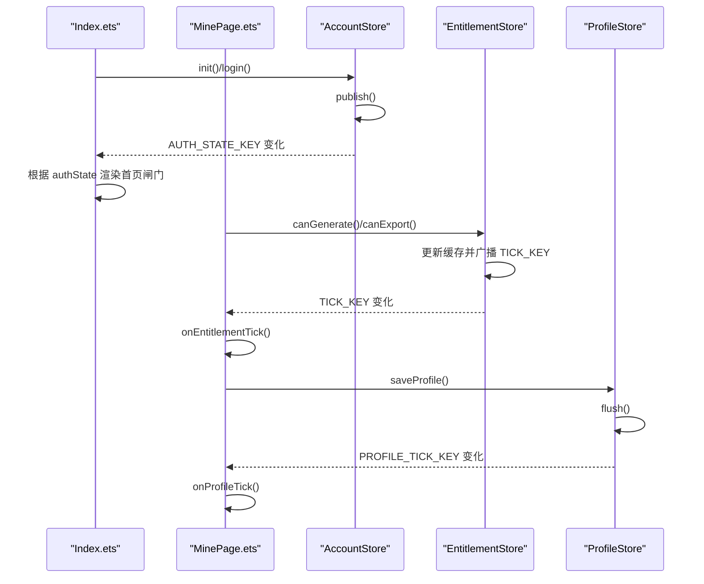

**图示来源**
- [MinePage.ets:71-80](file://entry/src/main/ets/pages/MinePage.ets#L71-L80)
- [Index.ets:706-710](file://entry/src/main/ets/pages/Index.ets#L706-L710)
- [AccountStore.ets:80-110](file://entry/src/main/ets/data/AccountStore.ets#L80-L110)
- [EntitlementStore.ets:200-235](file://entry/src/main/ets/data/EntitlementStore.ets#L200-L235)
- [ProfileStore.ets:110-130](file://entry/src/main/ets/data/ProfileStore.ets#L110-L130)

**章节来源**
- [MinePage.ets:71-80](file://entry/src/main/ets/pages/MinePage.ets#L71-L80)
- [Index.ets:706-710](file://entry/src/main/ets/pages/Index.ets#L706-L710)

## 依赖关系分析
Store 之间存在明确的单向依赖：
- `IapStore` 依赖 `EntitlementStore`，用于同步购买后的权益。
- `AccountStore` 依赖 `EntitlementStore`，用于登录成功后清除权益缓存。
- `ProfileStore` 依赖 `AccountStore`，用于显示名和隐私提示。
- 页面依赖所有 Store，但 Store 不反向依赖页面。

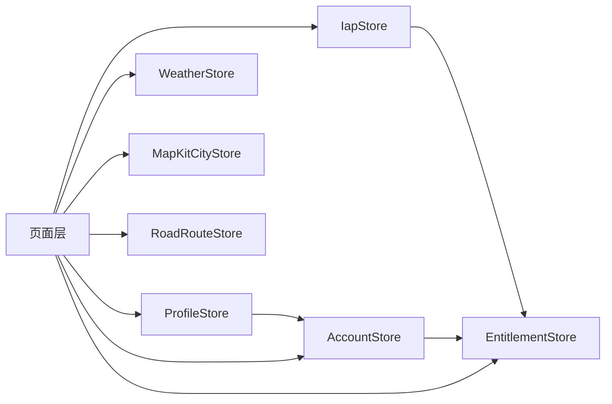

**图示来源**
- [IapStore.ets:1-413](file://entry/src/main/ets/data/IapStore.ets#L1-L413)
- [AccountStore.ets:1-213](file://entry/src/main/ets/data/AccountStore.ets#L1-L213)
- [ProfileStore.ets:1-166](file://entry/src/main/ets/data/ProfileStore.ets#L1-L166)
- [MinePage.ets:29-80](file://entry/src/main/ets/pages/MinePage.ets#L29-L80)

**章节来源**
- [IapStore.ets:1-413](file://entry/src/main/ets/data/IapStore.ets#L1-L413)
- [AccountStore.ets:1-213](file://entry/src/main/ets/data/AccountStore.ets#L1-L213)
- [ProfileStore.ets:1-166](file://entry/src/main/ets/data/ProfileStore.ets#L1-L166)
- [MinePage.ets:29-80](file://entry/src/main/ets/pages/MinePage.ets#L29-L80)

## 性能与内存注意事项
- **缓存策略**：
  - `WeatherStore` 使用内存 + preferences 双层缓存，TTL 30 分钟。
  - `MapKitCityStore` 使用内存 Map 缓存城市数据，TTL 30 分钟。
  - `RoadRouteStore` 使用内存 Map 缓存路段折线，TTL 30 分钟。
  - `EntitlementStore` 使用 preferences 缓存权益，TTL 5 分钟。
- **最小化 UI 重建**：Store 只写 `AppStorage` 中的广播键，页面用 `@StorageProp` + `@Watch` 精确刷新，而不是频繁重建整个页面。
- **避免敏感日志**：`AccountStore.masked()` 对 UnionID 脱敏，idToken 不落盘也不打印。
- **防重入**：`IapStore.purchasing` 防止并发购买。
- **降级策略**：天气、地图、路线失败时返回 null 或默认值，不中断主流程。
- **初始化顺序**：`AccountStore.init()` 必须在行程读写前完成，确保 `uid()` 可用。

**章节来源**
- [WeatherStore.ets:1-157](file://entry/src/main/ets/data/WeatherStore.ets#L1-L157)
- [MapKitCityStore.ets:1-179](file://entry/src/main/ets/data/MapKitCityStore.ets#L1-L179)
- [RoadRouteStore.ets:1-118](file://entry/src/main/ets/data/RoadRouteStore.ets#L1-L118)
- [EntitlementStore.ets:1-235](file://entry/src/main/ets/data/EntitlementStore.ets#L1-L235)
- [AccountStore.ets:1-213](file://entry/src/main/ets/data/AccountStore.ets#L1-L213)
- [IapStore.ets:1-413](file://entry/src/main/ets/data/IapStore.ets#L1-L413)

## 故障排查指南
常见问题与定位建议：

- **登录后仍显示游客**：
  - 检查 `AccountStore.init()` 是否成功恢复 UnionID。
  - 检查 `publish()` 是否正确写入 `AUTH_STATE_KEY`。
  - 查看 `Index` 中 `authState` 是否为空串。

- **生成行程一直走付费墙**：
  - 检查 `EntitlementStore.isCacheValid()` 是否因 TTL 过期导致走服务端判断。
  - 检查 `DeviceTokenStore.hasToken()` 是否影响缓存过期时的放行逻辑。
  - 检查 `ApiConfig.DEV_SKIP_BFF` 是否误开或关闭。

- **内购购买成功但权益未生效**：
  - 检查 `queryPurchases` 是否能找到对应 JWS。
  - 检查 BFF `/v1/iap/verify` 是否返回 `verified: true`。
  - 检查 `finishPurchase` 是否在 BFF 校验成功后调用。

- **天气不显示**：
  - 检查当天活动是否都有可用坐标。
  - 检查 preferences 缓存是否损坏。
  - 检查天气解析是否抛出异常。

- **地图城市无景点**：
  - 检查 `cityId` 是否正确。
  - 检查是否开启 `isCityLimit=true`。
  - 检查地址归属校验是否误删真实景点。

- **路线断线**：
  - 检查起终点是否相同。
  - 检查 Map Kit 鉴权或网络状态。
  - 确认调用方收到 null 后回退为直线。

**章节来源**
- [AccountStore.ets:1-213](file://entry/src/main/ets/data/AccountStore.ets#L1-L213)
- [EntitlementStore.ets:1-235](file://entry/src/main/ets/data/EntitlementStore.ets#L1-L235)
- [IapStore.ets:1-413](file://entry/src/main/ets/data/IapStore.ets#L1-L413)
- [WeatherStore.ets:1-157](file://entry/src/main/ets/data/WeatherStore.ets#L1-L157)
- [MapKitCityStore.ets:1-179](file://entry/src/main/ets/data/MapKitCityStore.ets#L1-L179)
- [RoadRouteStore.ets:1-118](file://entry/src/main/ets/data/RoadRouteStore.ets#L1-L118)

## 结论
本项目的 ViewModel 层以 Store 为中心，将账户、权益、资料、内购、天气、地图城市和路线数据解耦为独立模块。Store 通过 `AppStorage` 广播关键状态，页面通过 `@StorageProp` 和 `@Watch` 订阅并刷新 UI。这种模式在保持 ArkTS 响应式能力的同时，避免了 Store 直接持有 UI 组件，降低了耦合度。

在实际使用中，应坚持以下原则：
- Store 保持单一职责，一个 Store 管理一个领域状态。
- 对外暴露稳定 API，内部状态尽量不可变或由 Store 封装修改。
- 使用缓存和降级策略提升性能和鲁棒性。
- 使用 `AppStorage` 广播键，而不是让 Store 直接操作组件。
- 对异步操作做好错误处理和用户可见反馈。
- 对敏感数据做脱敏和最小化落盘。