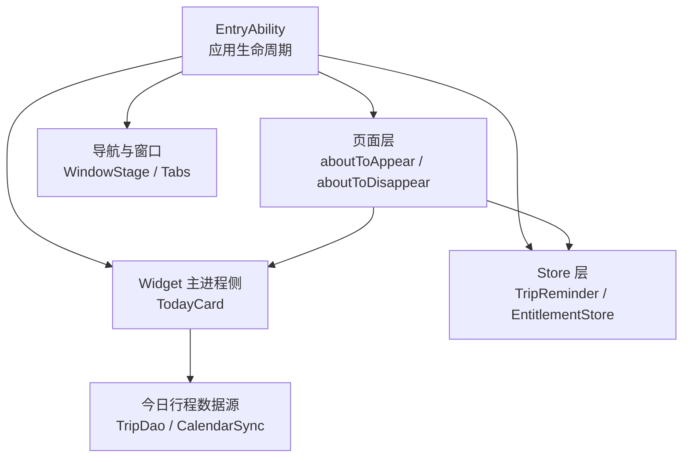
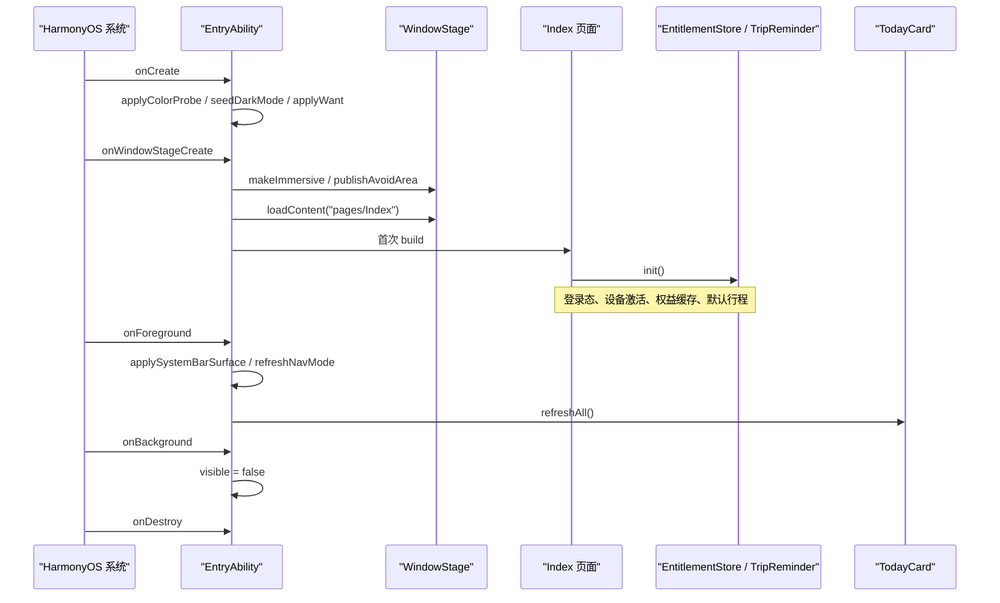
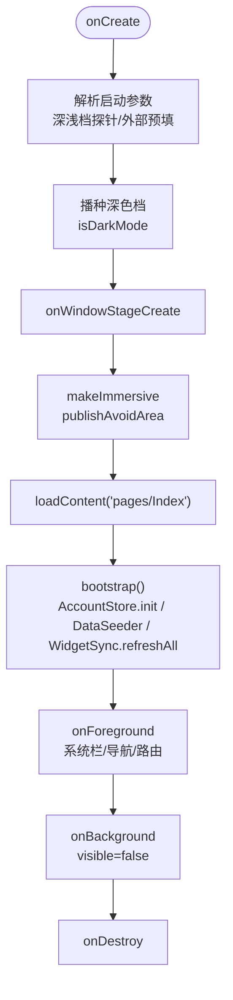
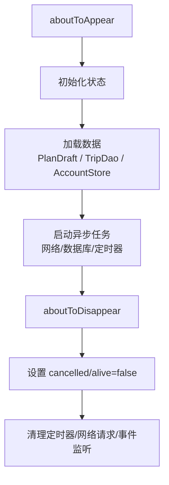
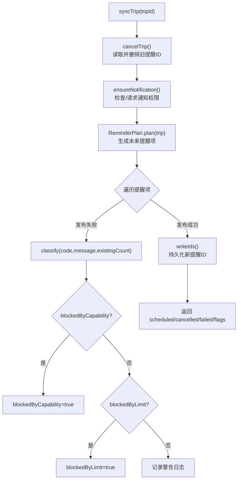
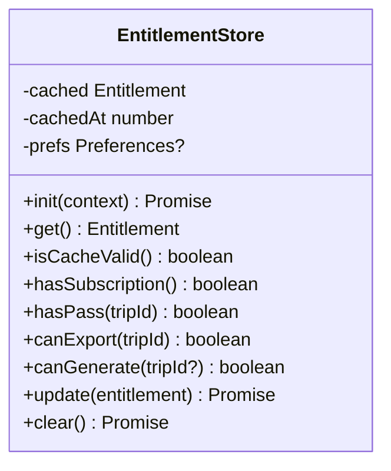
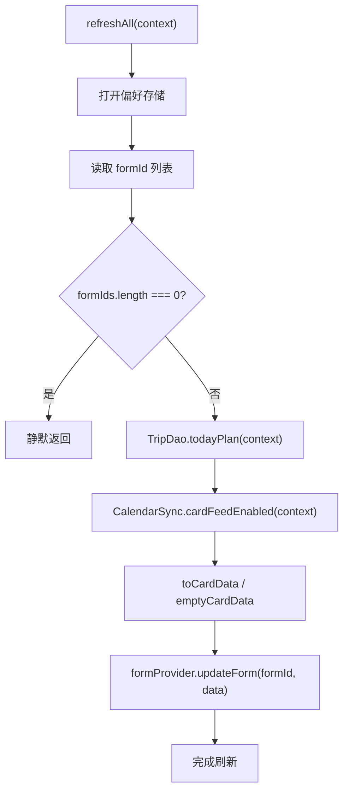
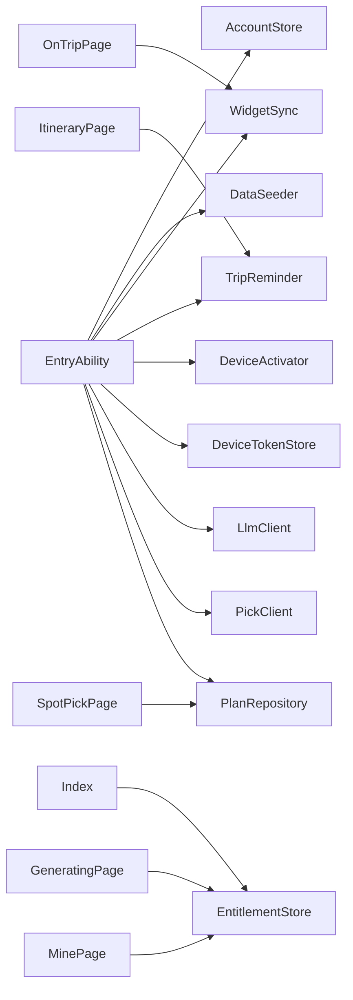

# 生命周期管理与资源控制

<cite>
**本文引用的文件**   
- [EntryAbility.ets](file://entry/src/main/ets/entryability/EntryAbility.ets)
- [TripReminder.ets](file://entry/src/main/ets/data/TripReminder.ets)
- [TodayCard.ets](file://entry/src/main/ets/widget/TodayCard.ets)
- [TodayTripCard.ets](file://entry/src/main/ets/widget/pages/TodayTripCard.ets)
- [EntitlementStore.ets](file://entry/src/main/ets/data/EntitlementStore.ets)
- [Index.ets](file://entry/src/main/ets/pages/Index.ets)
- [TripInputPage.ets](file://entry/src/main/ets/pages/TripInputPage.ets)
- [OnTripPage.ets](file://entry/src/main/ets/pages/OnTripPage.ets)
- [MinePage.ets](file://entry/src/main/ets/pages/MinePage.ets)
- [ExpensePage.ets](file://entry/src/main/ets/pages/ExpensePage.ets)
- [GeneratingPage.ets](file://entry/src/main/ets/pages/GeneratingPage.ets)
- [ItineraryPage.ets](file://entry/src/main/ets/pages/ItineraryPage.ets)
- [SpotPickPage.ets](file://entry/src/main/ets/pages/SpotPickPage.ets)
</cite>

## 目录
1. [引言](#引言)
2. [项目结构](#项目结构)
3. [核心组件](#核心组件)
4. [架构总览](#架构总览)
5. [详细组件分析](#详细组件分析)
6. [依赖关系分析](#依赖关系分析)
7. [性能与内存管理](#性能与内存管理)
8. [异常处理与容错](#异常处理与容错)
9. [调试与排障指南](#调试与排障指南)
10. [结论](#结论)

## 引言
本文面向 HarmonyOS Stage 模型下的「有径」应用，系统性梳理应用级、页面级、Store 级与小部件的生命周期，并围绕定时提醒、实时视图刷新、小部件卡片等关键路径，给出资源初始化、释放、后台任务、异常恢复和调试策略。文档同时说明哪些实现直接对应仓库源码，哪些是通用最佳实践建议。

## 项目结构
本项目的生命周期相关代码集中在以下位置：
- 应用入口：`entry/src/main/ets/entryability/EntryAbility.ets`
- 数据与 Store：`entry/src/main/ets/data/*`，如 `TripReminder.ets`、`EntitlementStore.ets`
- 小部件：`entry/src/main/ets/widget/TodayCard.ets` 与 `entry/src/main/ets/widget/pages/TodayTripCard.ets`
- 主要页面：`entry/src/main/ets/pages/*`，如 `Index.ets`、`TripInputPage.ets`、`OnTripPage.ets`、`MinePage.ets`、`ExpensePage.ets`、`GeneratingPage.ets`、`ItineraryPage.ets`、`SpotPickPage.ets`

**图示来源**
- [EntryAbility.ets:731-804](file://entry/src/main/ets/entryability/EntryAbility.ets#L731-L804)
- [TodayCard.ets:1-107](file://entry/src/main/ets/widget/TodayCard.ets#L1-L107)
- [TripReminder.ets:1-273](file://entry/src/main/ets/data/TripReminder.ets#L1-L273)
- [EntitlementStore.ets:1-235](file://entry/src/main/ets/data/EntitlementStore.ets#L1-L235)

**章节来源**
- [EntryAbility.ets:1-923](file://entry/src/main/ets/entryability/EntryAbility.ets#L1-L923)
- [TodayCard.ets:1-107](file://entry/src/main/ets/widget/TodayCard.ets#L1-L107)

## 核心组件
- **EntryAbility**：负责应用启动、窗口创建、深浅档与系统栏配置、深链与 Skill 预填、前台后台切换、全局错误捕获。
- **TripReminder**：系统级主动提醒管理器，按行程计划发布、撤销、持久化提醒 ID，并区分能力未开通与数量超限等失败原因。
- **Widget.TodayCard（WidgetSync）**：主应用侧向系统卡片进程主动刷新数据，避免等待系统定时刷新。
- **TodayTripCard**：小部件 UI 组件，通过 `@LocalStorageProp` 接收卡片数据，点击后通过 `postCardAction` 拉起主应用。
- **EntitlementStore**：权益与配额缓存，维护 TTL、持久化、状态广播与导出/生成门禁判定。
- **页面组件**：使用 ArkUI 的 `aboutToAppear` 与 `aboutToDisappear` 做数据加载、定时器清理、取消标记设置；部分根页通过 dock 广播在切回时重新取数。

**章节来源**
- [EntryAbility.ets:727-804](file://entry/src/main/ets/entryability/EntryAbility.ets#L727-L804)
- [TripReminder.ets:1-273](file://entry/src/main/ets/data/TripReminder.ets#L1-L273)
- [TodayCard.ets:1-107](file://entry/src/main/ets/widget/TodayCard.ets#L1-L107)
- [TodayTripCard.ets:1-296](file://entry/src/main/ets/widget/pages/TodayTripCard.ets#L1-L296)
- [EntitlementStore.ets:1-235](file://entry/src/main/ets/data/EntitlementStore.ets#L1-L235)

## 架构总览
下图展示应用启动到页面渲染、后台切换、小部件刷新、提醒发布的整体流程。

**图示来源**
- [EntryAbility.ets:727-804](file://entry/src/main/ets/entryability/EntryAbility.ets#L727-L804)
- [Index.ets:234-269](file://entry/src/main/ets/pages/Index.ets#L234-L269)
- [TodayCard.ets:1-107](file://entry/src/main/ets/widget/TodayCard.ets#L1-L107)

## 详细组件分析

### EntryAbility：应用生命周期
EntryAbility 是 Stage 模型的 UIAbility 入口，承担以下职责：
- `onCreate`：解析启动参数、深浅档探针、深色模式播种、外部预填、各类 debug 探针。
- `onWindowStageCreate`：初始化断点中心、全屏布局、避让区高度、导航模式监听、注册系统栏刷新回调、加载首页、注册字体、恢复 colorMode。
- `onWindowStageDestroy`：日志记录窗口销毁。
- `onForeground`：恢复可见性、重设系统栏底色、刷新导航方式、隐藏手势指示条或三键导航栏、消费待路由。
- `onBackground`：置不可见并记录日志。
- `onDestroy`：记录应用销毁。
- `onError`：捕获未处理异常。

重点行为：
- 深浅档判断优先使用 `fresh` 配置，否则回退到资源亮度比较，避免冷启 `config.colorMode` 为 `NOT_SET` 导致全仓浅色。
- 窗口铺满物理屏前先发布避让区高度，防止首帧顶部被裁。
- 回前台必须重新计算导航方式并重置系统栏，因为后台期间系统可能改变导航条显隐。
- `bootstrap` 中先恢复登录态，再种子数据、刷新小部件、路由待处理请求。

**图示来源**
- [EntryAbility.ets:727-804](file://entry/src/main/ets/entryability/EntryAbility.ets#L727-L804)
- [EntryAbility.ets:450-727](file://entry/src/main/ets/entryability/EntryAbility.ets#L450-L727)

**章节来源**
- [EntryAbility.ets:450-923](file://entry/src/main/ets/entryability/EntryAbility.ets#L450-L923)

### 页面生命周期：aboutToAppear 与 aboutToDisappear
ArkUI 页面组件常用生命周期如下：
- `aboutToAppear`：适合数据加载、初始化状态、订阅广播、设置异步任务。
- `aboutToDisappear`：适合清理定时器、取消网络请求、清除标志位、注销事件监听。

本项目中的典型用法：
- `TripInputPage`：在 `aboutToAppear` 中从草稿恢复目的地、日期、人数、预算；在 `aboutToDisappear` 中将 `alive` 设为 `false`，阻止后续异步写已销毁页面状态。
- `Index`：作为根容器，在 `aboutToAppear` 中共享 UIContext、注册栈拦截、初始化同意协议、并行恢复账号、设备票据、默认行程。
- `MinePage`、`ExpensePage`：在 `aboutToAppear` 中读取徽章、行程计数、资料；通过 dock 广播在切回时刷新。
- `GeneratingPage`：在 `aboutToAppear` 中开启进度定时器并启动真实生成流程；在 `aboutToDisappear` 中设置取消标记、清理定时器、复位本地规则引擎开关。
- `OnTripPage`、`ItineraryPage`、`SpotPickPage`：在 `aboutToAppear` 中加载数据，并在需要时结合 store 广播刷新。

**图示来源**
- [TripInputPage.ets:80-140](file://entry/src/main/ets/pages/TripInputPage.ets#L80-L140)
- [Index.ets:234-269](file://entry/src/main/ets/pages/Index.ets#L234-L269)
- [GeneratingPage.ets:1-180](file://entry/src/main/ets/pages/GeneratingPage.ets#L1-L180)

**章节来源**
- [TripInputPage.ets:80-140](file://entry/src/main/ets/pages/TripInputPage.ets#L80-L140)
- [Index.ets:234-269](file://entry/src/main/ets/pages/Index.ets#L234-L269)
- [MinePage.ets:1-180](file://entry/src/main/ets/pages/MinePage.ets#L1-L180)
- [ExpensePage.ets:1-140](file://entry/src/main/ets/pages/ExpensePage.ets#L1-L140)
- [GeneratingPage.ets:1-180](file://entry/src/main/ets/pages/GeneratingPage.ets#L1-L180)
- [OnTripPage.ets:1-160](file://entry/src/main/ets/pages/OnTripPage.ets#L1-L160)
- [ItineraryPage.ets:1-180](file://entry/src/main/ets/pages/ItineraryPage.ets#L1-L180)
- [SpotPickPage.ets:1-180](file://entry/src/main/ets/pages/SpotPickPage.ets#L1-L180)

### Store 生命周期：TripReminder 与 EntitlementStore
#### TripReminder：定时提醒任务管理
`TripReminder` 是系统级提醒管理器，负责：
- 按行程计划发布提醒：出发前倒计时、预约提前、当日晨间播报。
- 幂等撤销旧提醒：先读本地存储的提醒 ID，逐条取消，再写入新 ID。
- 区分失败原因：能力未开通、数量超限、通知开关关闭。
- 持久化提醒 ID：使用 `preferences` 分片 `youjing_reminder`，键前缀 `reminder_ids_`。

**图示来源**
- [TripReminder.ets:1-273](file://entry/src/main/ets/data/TripReminder.ets#L1-L273)

**章节来源**
- [TripReminder.ets:1-273](file://entry/src/main/ets/data/TripReminder.ets#L1-L273)

#### EntitlementStore：权益缓存与释放
`EntitlementStore` 的职责包括：
- 初始化：从 `preferences` 恢复权益 JSON 与缓存时间戳。
- 更新：写入内存缓存、触发 `AppStorage` 广播、持久化到磁盘。
- 清除：清空内存与持久化字段，并触发广播。
- 查询：是否订阅、是否有通行证、是否可导出、是否可生成。
- TTL：5 分钟有效期，过期时根据是否已有设备 Token 决定是否继续放行生成逻辑。

**图示来源**
- [EntitlementStore.ets:1-235](file://entry/src/main/ets/data/EntitlementStore.ets#L1-L235)

**章节来源**
- [EntitlementStore.ets:1-235](file://entry/src/main/ets/data/EntitlementStore.ets#L1-L235)

### 小部件生命周期：TodayCard 与 TodayTripCard
#### TodayCard：主进程侧刷新
`WidgetSync.refreshAll` 在主应用侧调用，步骤为：
1. 打开偏好存储，读取所有 `formId`。
2. 读取今日行程数据。
3. 根据 `CalendarSync.cardFeedEnabled` 决定是否供数。
4. 对每个 `formId` 调用 `formProvider.updateForm` 刷新卡片。

**图示来源**
- [TodayCard.ets:1-107](file://entry/src/main/ets/widget/TodayCard.ets#L1-L107)

**章节来源**
- [TodayCard.ets:1-107](file://entry/src/main/ets/widget/TodayCard.ets#L1-L107)

#### TodayTripCard：卡片 UI 与交互
`TodayTripCard` 是卡片 UI 组件，使用 `@LocalStorageProp` 接收卡片数据，支持 2×2 与 2×4 两种形态，点击空态不跳转，点击非空态通过 `postCardAction` 跳转到行程详情。

关键点：
- 卡片进程与主应用进程共用数据映射。
- 卡片进程没有主应用登录态，刷新前需自行初始化账户分区。
- 点击动作通过卡片框架拉起主应用。

**章节来源**
- [TodayTripCard.ets:1-296](file://entry/src/main/ets/widget/pages/TodayTripCard.ets#L1-L296)

### LiveView 实时视图更新机制
当前仓库中 `LiveViewConfig.ets` 与 `TripLiveView.ets` 已被删除，因此项目中不存在名为 `LiveView` 的实时视图实现。实时视图更新主要通过以下机制实现：
- 小部件 `WidgetSync.refreshAll`：主应用主动刷新系统卡片。
- Store 广播：`EntitlementStore.TICK_KEY` 通过 `AppStorage.setOrCreate` 触发页面刷新。
- 页面 `aboutToAppear` 与 dock 广播：切回页签时重新取数。

如果未来引入 LiveView，建议遵循以下原则：
- 实时更新只在页面可见时生效，`aboutToDisappear` 中取消订阅。
- 使用弱引用或闭包持有上下文，避免循环引用。
- 网络请求与 WebSocket 连接在页面离开时取消。

**章节来源**
- [TodayCard.ets:1-107](file://entry/src/main/ets/widget/TodayCard.ets#L1-L107)
- [EntitlementStore.ets:200-235](file://entry/src/main/ets/data/EntitlementStore.ets#L200-L235)
- [Index.ets:234-269](file://entry/src/main/ets/pages/Index.ets#L234-L269)

## 依赖关系分析

**图示来源**
- [EntryAbility.ets:1-200](file://entry/src/main/ets/entryability/EntryAbility.ets#L1-L200)
- [Index.ets:234-269](file://entry/src/main/ets/pages/Index.ets#L234-L269)
- [GeneratingPage.ets:1-180](file://entry/src/main/ets/pages/GeneratingPage.ets#L1-L180)
- [ItineraryPage.ets:1-180](file://entry/src/main/ets/pages/ItineraryPage.ets#L1-L180)
- [MinePage.ets:1-180](file://entry/src/main/ets/pages/MinePage.ets#L1-L180)
- [OnTripPage.ets:1-160](file://entry/src/main/ets/pages/OnTripPage.ets#L1-L160)
- [SpotPickPage.ets:1-180](file://entry/src/main/ets/pages/SpotPickPage.ets#L1-L180)

**章节来源**
- [EntryAbility.ets:1-200](file://entry/src/main/ets/entryability/EntryAbility.ets#L1-L200)
- [Index.ets:234-269](file://entry/src/main/ets/pages/Index.ets#L234-L269)

## 性能与内存管理
本节提供通用最佳实践建议，结合项目现有实现进行说明：

- **弱引用使用**：在页面组件中避免长期持有 `this` 引用给异步回调；建议使用局部变量或闭包，并在 `aboutToDisappear` 中清空。
- **事件监听器清理**：如 `HOST_NAV.setInterception`、`observe`、`subscribe` 等，应在 `aboutToDisappear` 中注销。
- **定时器清理**：`GeneratingPage` 在 `aboutToDisappear` 中 `clearInterval`，这是正确示范。
- **网络请求取消**：建议使用可取消的请求对象或 `cancelled` 标志位，并在页面离开时中断后续状态更新。
- **Store 生命周期**：`EntitlementStore` 在 `init` 时恢复缓存，在 `update` 时触发广播，在 `clear` 时清理持久化字段；建议在登出或会话结束时调用 `clear`。
- **小部件刷新**：避免频繁调用 `refreshAll`，应合并批量刷新或使用防抖。
- **内存泄漏检测**：使用 DevEco Studio 的 Memory Profiler 观察对象图，重点关注页面实例、定时器、事件监听器、WebSocket 连接。
- **性能分析**：使用 ArkUI Inspector 观察组件重建次数，避免不必要的 `@State` 更新。

[本节为通用指导，不直接分析具体文件]

## 异常处理与容错
项目中的异常处理策略：
- `EntryAbility.onError`：记录未捕获异常，便于崩溃回溯。
- `TripReminder`：对每条提醒发布使用 try/catch，分类失败原因，记录日志，不影响其他提醒发布。
- `EntitlementStore`：读写 preferences 时 catch 异常，降级为内存缓存。
- `GeneratingPage`：区分业务错误码与未知错误，用户可见错误走统一错误页或付费页。
- `TodayCard.refreshAll`：单个 `formId` 刷新失败不影响其他卡片。

容错建议：
- 崩溃恢复：在 `onCreate` 或 `onWindowStageCreate` 中恢复必要状态，如登录态、默认行程、深浅档。
- 数据一致性：Store 更新时先写内存，再写持久化，失败时保留旧值；使用事务或版本号保证一致性。
- 用户体验优化：网络失败时显示友好提示，允许重试；权限拒绝时给出引导而非直接崩溃。

**章节来源**
- [EntryAbility.ets:900-923](file://entry/src/main/ets/entryability/EntryAbility.ets#L900-L923)
- [TripReminder.ets:1-273](file://entry/src/main/ets/data/TripReminder.ets#L1-L273)
- [EntitlementStore.ets:1-235](file://entry/src/main/ets/data/EntitlementStore.ets#L1-L235)
- [GeneratingPage.ets:1-180](file://entry/src/main/ets/pages/GeneratingPage.ets#L1-L180)
- [TodayCard.ets:1-107](file://entry/src/main/ets/widget/TodayCard.ets#L1-L107)

## 调试与排障指南
### 内存泄漏检测
- 使用 DevEco Studio 的 Memory Profiler 抓取快照，对比页面进入和离开前后的对象图。
- 关注长生命周期对象：Ability 实例、Store 单例、定时器、事件监听器、网络客户端。
- 检查是否存在页面组件被全局对象引用导致无法回收。

### 性能分析
- 使用 ArkUI Inspector 观察组件重建频率，避免在高频回调中修改 `@State`。
- 使用 HOG（Heap Object Graph）定位大对象，如图片、地图数据、行程数据。
- 对小部件刷新进行采样，避免频繁调用 `formProvider.updateForm`。

### 日志记录策略
- 使用 `Logger` 记录关键生命周期：`onCreate`、`onWindowStageCreate`、`onForeground`、`onBackground`、`onDestroy`。
- 对 Store 初始化、更新、清除操作记录日志，便于排查缓存问题。
- 对提醒发布、撤销、权限请求记录日志，区分能力未开通与数量超限。
- 对页面加载失败、网络请求失败、权限拒绝记录警告日志，不阻断主流程。

### 常见问题排查
- 深浅档异常：检查 `seedDarkMode` 是否使用 `fresh` 配置，避免冷启误判。
- 系统栏颜色不对：检查 `applySystemBarSurface` 是否在 `onConfigurationUpdate`、`onForeground`、HDS 挂载期后调用。
- 提醒不响：检查通知权限、能力开通、数量上限、代理提醒权限。
- 小部件不刷新：检查 `refreshAll` 是否调用、`formId` 是否存在、`cardFeedEnabled` 是否为真。
- 权益卡住付费页：检查 `EntitlementStore.isCacheValid` 与 `DeviceTokenStore.hasToken` 的组合逻辑。

**章节来源**
- [EntryAbility.ets:450-727](file://entry/src/main/ets/entryability/EntryAbility.ets#L450-L727)
- [TripReminder.ets:1-273](file://entry/src/main/ets/data/TripReminder.ets#L1-L273)
- [EntitlementStore.ets:1-235](file://entry/src/main/ets/data/EntitlementStore.ets#L1-L235)
- [TodayCard.ets:1-107](file://entry/src/main/ets/widget/TodayCard.ets#L1-L107)

## 结论
本项目的生命周期管理以 `EntryAbility` 为核心，结合 ArkUI 页面生命周期、Store 状态管理和系统级小部件刷新机制，形成完整的应用运行闭环。`TripReminder` 和 `EntitlementStore` 提供了可靠的后台任务与权限门控能力，`TodayCard` 和 `TodayTripCard` 实现了主进程与小部件进程的数据同步。在资源管理方面，项目已体现定时器清理、异步取消、异常分类等良好实践；未来可进一步补充弱引用、事件注销、网络请求取消等通用模式，以提升稳定性和可维护性。