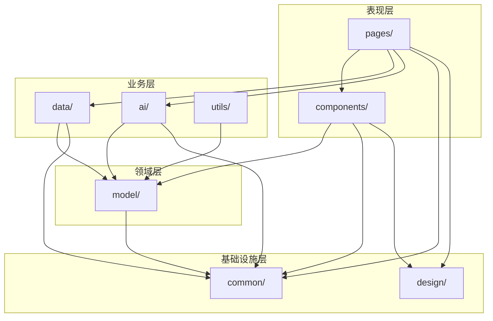
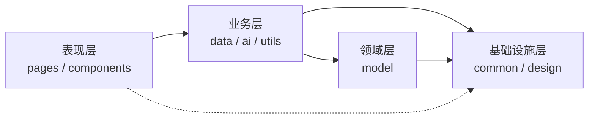
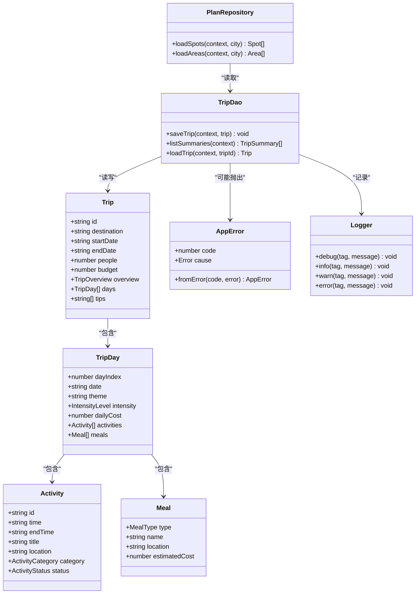
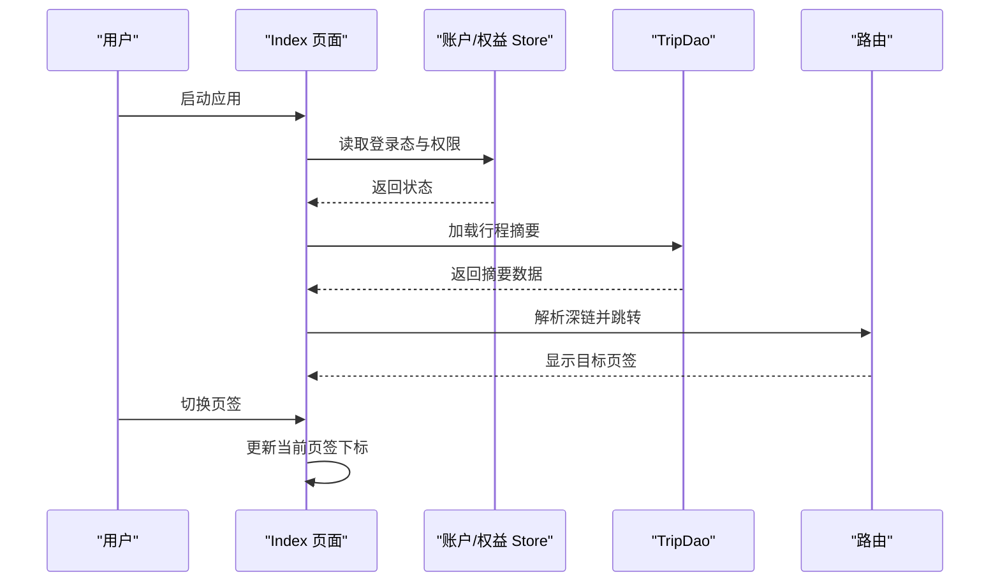
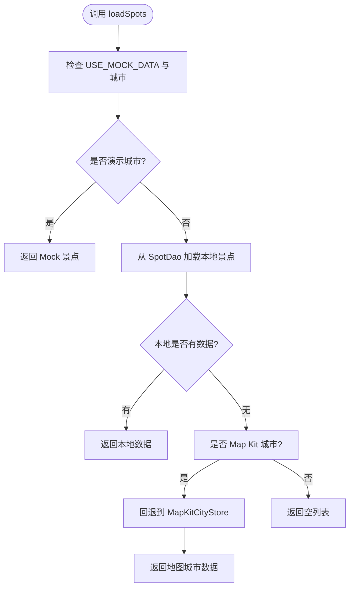
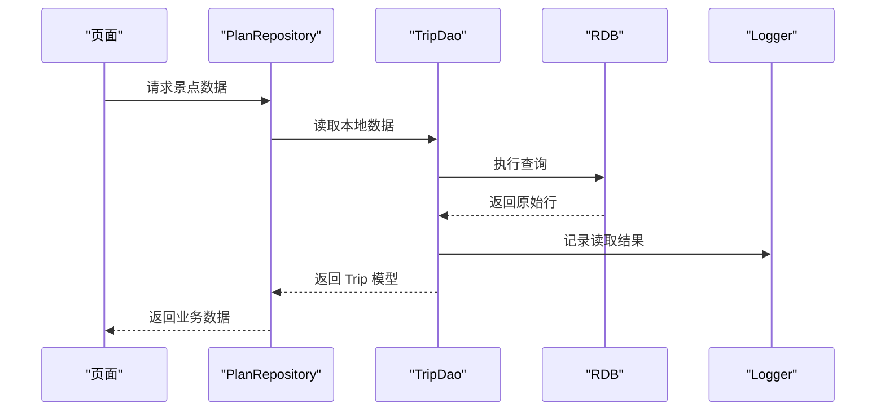
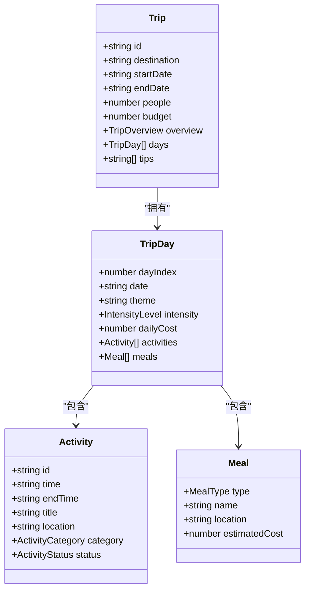
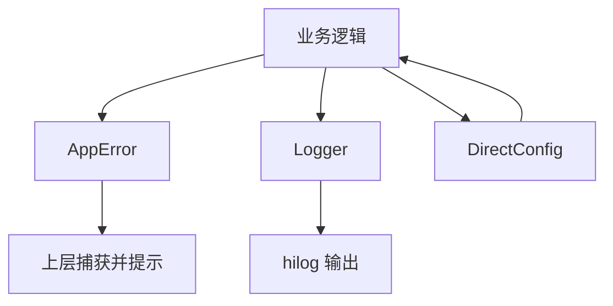
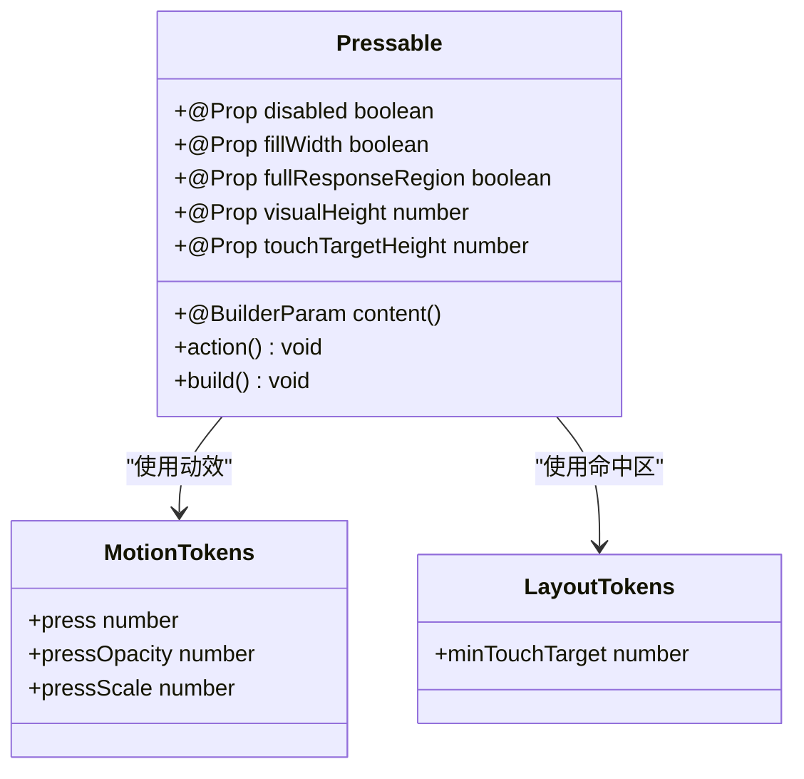
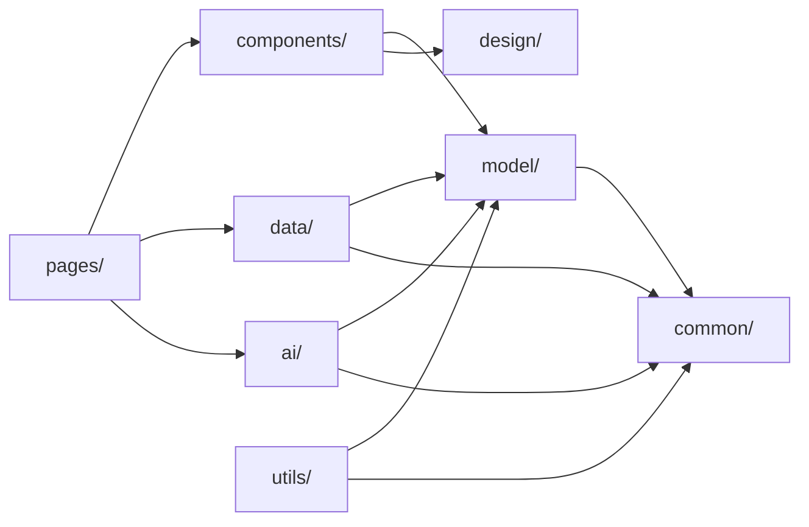

# 分层架构设计

<cite>
**本文引用的文件**   
- [Docs/ARCHITECTURE.md](file://Docs/ARCHITECTURE.md)
- [entry/src/main/ets/pages/Index.ets](file://entry/src/main/ets/pages/Index.ets)
- [entry/src/main/ets/data/PlanRepository.ets](file://entry/src/main/ets/data/PlanRepository.ets)
- [entry/src/main/ets/data/TripDao.ets](file://entry/src/main/ets/data/TripDao.ets)
- [entry/src/main/ets/model/Trip.ets](file://entry/src/main/ets/model/Trip.ets)
- [entry/src/main/ets/common/config/DirectConfig.ets](file://entry/src/main/ets/common/config/DirectConfig.ets)
- [entry/src/main/ets/components/Pressable.ets](file://entry/src/main/ets/components/Pressable.ets)
- [entry/src/main/ets/common/error/AppError.ets](file://entry/src/main/ets/common/error/AppError.ets)
- [entry/src/main/ets/common/logger/Logger.ets](file://entry/src/main/ets/common/logger/Logger.ets)
</cite>

## 目录
1. [引言](#引言)
2. [项目结构](#项目结构)
3. [核心组件](#核心组件)
4. [架构总览](#架构总览)
5. [详细组件分析](#详细组件分析)
6. [依赖分析](#依赖分析)
7. [性能考虑](#性能考虑)
8. [故障排查指南](#故障排查指南)
9. [结论](#结论)
10. [附录：新功能组织清单与反模式对照](#附录新功能组织清单与反模式对照)

## 引言
本文面向「有径」HarmonyOS 工程，把现有代码库沉淀为一份可执行的分层架构设计文档。目标是用四层视角统一理解：表现层、业务层、领域层、基础设施层各自职责、边界、通信方式以及错误处理；同时给出新增功能时的目录组织建议、反模式和重构路径。

工程已有明确架构契约：页面不得直接操作数据库或直连 LLM，所有数据访问必须经 `data/` 层，视觉常量必须走 `design/`，配置和错误码集中在 `common/`。本文在此基础上补充分层通信机制、依赖方向图、典型流程时序图和反模式对照表，帮助读者快速判断一段代码是否“放对了位置”。

## 项目结构
工程主体位于 `entry/src/main/ets/`，采用按职责分目录的组织方式：

| 层级 | 对应目录 | 主要职责 | 典型入口 |
|---|---|---|---|
| 表现层 | `pages/`、`components/` | 路由、页面状态编排、UI 渲染、用户交互 | `Index.ets` |
| 业务层 | `data/`、`ai/`、`utils/` | 数据仓储、DAO、AI 调用、纯函数工具 | `PlanRepository.ets`、`TripDao.ets` |
| 领域层 | `model/` | 行程、景点、区域、天气等核心类型与枚举 | `Trip.ets` |
| 基础设施层 | `common/`、`design/` | 配置、错误码、日志、构建开关、设计 token | `DirectConfig.ets`、`AppError.ets`、`Logger.ets` |

**图表来源**  
- [Docs/ARCHITECTURE.md:1-61](file://Docs/ARCHITECTURE.md#L1-L61)

**章节来源**  
- [Docs/ARCHITECTURE.md:1-61](file://Docs/ARCHITECTURE.md#L1-L61)

## 核心组件
本项目的分层不是抽象概念，而是由若干关键文件承担具体职责：

- **表现层入口**：`Index.ets` 是根页面，负责底部页签、深链、导航栈、顶部条、胶囊 Dock 等 UI 编排，并引用 `data/` 中的 `TripDao`、`AccountStore` 等聚合能力。
- **业务仓储**：`PlanRepository.ets` 提供“规划相关”的数据入口，根据 `MockConfig.USE_MOCK_DATA` 选择 mock 数据或 DAO，并在非内置城市时回退到地图服务。
- **数据访问对象**：`TripDao.ets` 封装 RDB 建表、写事务、读映射、列表摘要查询，对外暴露 `Trip` 模型。
- **领域模型**：`Trip.ets` 定义 `Trip`、`TripDay`、`Activity`、`Meal`、`ActivityCategory`、`ActivityStatus` 等类型，是 AI Schema、存储层、UI 展示的共同契约。
- **基础设施**：`DirectConfig.ets` 提供开发期直连 LLM 的配置；`AppError.ets` 提供统一错误包装；`Logger.ets` 提供统一日志出口。

**章节来源**  
- [entry/src/main/ets/pages/Index.ets:1-200](file://entry/src/main/ets/pages/Index.ets#L1-L200)
- [entry/src/main/ets/data/PlanRepository.ets:1-55](file://entry/src/main/ets/data/PlanRepository.ets#L1-L55)
- [entry/src/main/ets/data/TripDao.ets:1-200](file://entry/src/main/ets/data/TripDao.ets#L1-L200)
- [entry/src/main/ets/model/Trip.ets:1-137](file://entry/src/main/ets/model/Trip.ets#L1-L137)
- [entry/src/main/ets/common/config/DirectConfig.ets:1-33](file://entry/src/main/ets/common/config/DirectConfig.ets#L1-L33)
- [entry/src/main/ets/common/error/AppError.ets:1-20](file://entry/src/main/ets/common/error/AppError.ets#L1-L20)
- [entry/src/main/ets/common/logger/Logger.ets:1-35](file://entry/src/main/ets/common/logger/Logger.ets#L1-L35)

## 架构总览
四层之间遵循单向依赖：

- 表现层只负责 UI 渲染、事件捕获、页面状态编排。
- 业务层组合 DAO、AI 客户端、工具函数，向上暴露用例级 API。
- 领域层只描述“是什么”，不关心“怎么存”“怎么取”。
- 基础设施层被其他三层共享，但不反向依赖业务。

**图表来源**  
- [entry/src/main/ets/model/Trip.ets:1-137](file://entry/src/main/ets/model/Trip.ets#L1-L137)
- [entry/src/main/ets/data/PlanRepository.ets:1-55](file://entry/src/main/ets/data/PlanRepository.ets#L1-L55)
- [entry/src/main/ets/data/TripDao.ets:1-200](file://entry/src/main/ets/data/TripDao.ets#L1-L200)
- [entry/src/main/ets/common/error/AppError.ets:1-20](file://entry/src/main/ets/common/error/AppError.ets#L1-L20)
- [entry/src/main/ets/common/logger/Logger.ets:1-35](file://entry/src/main/ets/common/logger/Logger.ets#L1-L35)

**章节来源**  
- [Docs/ARCHITECTURE.md:1-61](file://Docs/ARCHITECTURE.md#L1-L61)

## 详细组件分析

### 表现层：`Index.ets`
`Index.ets` 是应用根页面，承担以下职责：

- 作为底部页签容器，管理五类根页（计划、行程、地图、费用、我的）。
- 处理冷启深链、运行期切页签、返回手势、Dock 液态胶囊交互。
- 通过 `StorageLink`、`StorageProp` 与系统导航、断点、顶部条、底部导航避让量同步。
- 引用 `data/` 中的 `TripDao`、`AccountStore`、`EntitlementStore` 等聚合能力，但不应在此直接构造 SQL。
- 引用 `design/` 的 Token 与 `components/` 的可复用 UI 构件。

**图表来源**  
- [entry/src/main/ets/pages/Index.ets:1-200](file://entry/src/main/ets/pages/Index.ets#L1-L200)
- [entry/src/main/ets/data/TripDao.ets:1-200](file://entry/src/main/ets/data/TripDao.ets#L1-L200)

**章节来源**  
- [entry/src/main/ets/pages/Index.ets:1-200](file://entry/src/main/ets/pages/Index.ets#L1-L200)

### 业务层：`PlanRepository.ets`
`PlanRepository` 是规划数据的统一入口，体现业务层的典型做法：

- 不直接让页面知道“京都用 mock，其他城用种子库，不支持的城市走 Map Kit”。
- 根据 `MockConfig.USE_MOCK_DATA` 与城市名做数据路由。
- 在本地景点为空且城市属于 Map Kit 支持范围时，回退到 `MapKitCityStore`。
- 对空结果进行日志记录，而不是抛错。

**图表来源**  
- [entry/src/main/ets/data/PlanRepository.ets:1-55](file://entry/src/main/ets/data/PlanRepository.ets#L1-L55)

**章节来源**  
- [entry/src/main/ets/data/PlanRepository.ets:1-55](file://entry/src/main/ets/data/PlanRepository.ets#L1-L55)

### 数据访问层：`TripDao.ets`
`TripDao` 是领域模型与持久化之间的桥梁，职责包括：

- 使用单写通道事务整存整取 `Trip`。
- 将数据库行映射为 `Trip`、`TripDay`、`Activity`、`Meal`。
- 提供列表摘要查询，减少 UI 侧拼装成本。
- 使用 `AppError` 表达错误码，使用 `Logger` 输出结构化日志。

**图表来源**  
- [entry/src/main/ets/data/PlanRepository.ets:1-55](file://entry/src/main/ets/data/PlanRepository.ets#L1-L55)
- [entry/src/main/ets/data/TripDao.ets:1-200](file://entry/src/main/ets/data/TripDao.ets#L1-L200)
- [entry/src/main/ets/common/logger/Logger.ets:1-35](file://entry/src/main/ets/common/logger/Logger.ets#L1-L35)

**章节来源**  
- [entry/src/main/ets/data/TripDao.ets:1-200](file://entry/src/main/ets/data/TripDao.ets#L1-L200)

### 领域层：`Trip.ets`
`Trip.ets` 定义整个行程的核心语义，是 JSON Schema、解析器、DAO、UI 的共同契约。关键约束包括：

- 枚举值使用英文稳定码，中文标签由 UI 层映射。
- 日期格式固定为 `YYYY-MM-DD`，时间固定为 `HH:mm`。
- 金额单位为人民币元，以 number 表示。
- `Trip` 作为聚合根，包含 `TripDay[]`，每个 `TripDay` 包含活动与餐饮。

**图表来源**  
- [entry/src/main/ets/model/Trip.ets:1-137](file://entry/src/main/ets/model/Trip.ets#L1-L137)

**章节来源**  
- [entry/src/main/ets/model/Trip.ets:1-137](file://entry/src/main/ets/model/Trip.ets#L1-L137)

### 基础设施层：配置、错误、日志
基础设施层提供横切关注点：

- `DirectConfig.ets`：开发期直连 LLM 的 URL、Key、模型与最大 token 数，单独成文件以避免污染 `ApiConfig`。
- `AppError.ets`：统一错误包装，携带错误码与原始异常。
- `Logger.ets`：统一日志前缀、域、调试门控，禁止直接调用底层 console。

**图表来源**  
- [entry/src/main/ets/common/config/DirectConfig.ets:1-33](file://entry/src/main/ets/common/config/DirectConfig.ets#L1-L33)
- [entry/src/main/ets/common/error/AppError.ets:1-20](file://entry/src/main/ets/common/error/AppError.ets#L1-L20)
- [entry/src/main/ets/common/logger/Logger.ets:1-35](file://entry/src/main/ets/common/logger/Logger.ets#L1-L35)

**章节来源**  
- [entry/src/main/ets/common/config/DirectConfig.ets:1-33](file://entry/src/main/ets/common/config/DirectConfig.ets#L1-L33)
- [entry/src/main/ets/common/error/AppError.ets:1-20](file://entry/src/main/ets/common/error/AppError.ets#L1-L20)
- [entry/src/main/ets/common/logger/Logger.ets:1-35](file://entry/src/main/ets/common/logger/Logger.ets#L1-L35)

### 组件层示例：`Pressable.ets`
`Pressable.ets` 是一个典型的纯 UI 组件：

- 封装按下反馈、命中区域、禁用态。
- 依赖 `design/` 的布局与动效 token。
- 不包含复杂业务逻辑，也不直接调用 DAO。
- 通过 `action` 回调把点击事件交给调用方处理，符合“组件只表达交互契约”的原则。

**图表来源**  
- [entry/src/main/ets/components/Pressable.ets:1-84](file://entry/src/main/ets/components/Pressable.ets#L1-L84)

**章节来源**  
- [entry/src/main/ets/components/Pressable.ets:1-84](file://entry/src/main/ets/components/Pressable.ets#L1-L84)

## 依赖分析
工程依赖方向由架构契约强制规定：

依赖规则要点：

- 单向流动：上层依赖下层，下层不反向依赖上层。
- 禁止跨层直连：页面不能直接操作 RDB，也不能直接发起 LLM 请求。
- `design/` 与 `common/` 是底层设施，可被多引用，但不能引用业务目录。
- `mock/` 只能被 `data/` 在开启 mock 时使用，UI 层不得直接引用。

**章节来源**  
- [Docs/ARCHITECTURE.md:1-61](file://Docs/ARCHITECTURE.md#L1-L61)

## 性能考虑
分层架构本身有助于性能治理，但实现细节仍需注意：

- **避免在 UI 层做重型计算**：距离、日期、预算、文本转换等应放在 `utils/`。
- **避免在组件中触发网络或数据库 IO**：IO 应放在 `data/` 或 `ai/`。
- **DAO 读取尽量返回 UI 需要的投影**：例如 `TripSummary`，减少页面侧拼装。
- **避免重复重建大对象**：如行程完整树，应在业务层缓存后传给 UI。
- **日志级别要控制**：频繁路径只打 info，debug 信息受构建开关门控。
- **Token 集中可减少样式抖动**：颜色、字号、间距来自单一事实源，便于主题切换与一致性校验。

[本节为通用性能指导，不直接分析具体文件]

## 故障排查指南
常见故障可按层次定位：

| 现象 | 可能原因 | 排查位置 | 修复建议 |
|---|---|---|---|
| 页面崩溃时看不到可读错误 | 直接使用原生 Error 未包装 | 业务层 catch 块 | 使用 `AppError.fromError` 包装，并携带 `ErrorCode` |
| 线上无法查看调试日志 | 误用 `console.log` 或 debug 日志未关闭 | 所有业务文件 | 改用 `Logger.debug/info/warn/error` |
| 本地能查到数据，线上查不到 | 忘记处理空结果或未回退 | `PlanRepository.loadSpots` | 区分 mock、本地空、Map Kit 回退三种分支 |
| 页面直接改数据库 | 违反分层纪律 | `pages/` | 把写入逻辑移到 `data/`，页面只调用仓储 |
| 组件点击无响应 | 命中区域或动画属性顺序错误 | `components/` | 参考 `Pressable.ets` 的 `responseRegion` 与 `.animation()` 位置 |
| 配置字段提交后被覆盖 | 修改了受 skip-worktree 保护的文件 | `common/config/` | 使用专用配置文件或环境变量，不要污染共享配置 |

**章节来源**  
- [entry/src/main/ets/common/error/AppError.ets:1-20](file://entry/src/main/ets/common/error/AppError.ets#L1-L20)
- [entry/src/main/ets/common/logger/Logger.ets:1-35](file://entry/src/main/ets/common/logger/Logger.ets#L1-L35)
- [entry/src/main/ets/data/PlanRepository.ets:1-55](file://entry/src/main/ets/data/PlanRepository.ets#L1-L55)
- [entry/src/main/ets/components/Pressable.ets:1-84](file://entry/src/main/ets/components/Pressable.ets#L1-L84)

## 结论
本工程已经形成清晰的分层结构：`pages` 负责表现，`data` 负责数据与业务编排，`model` 负责领域契约，`common` 与 `design` 提供横切能力。关键在于严格执行单向依赖、禁止跨层直连、统一错误与日志、统一视觉 Token。新增功能时，应优先回答三个问题：

1. 这个逻辑属于 UI 还是业务？
2. 是否需要持久化或远程调用？
3. 是否应该复用现有模型、错误码或日志？

只要答案明确，就能把代码放到正确目录，降低后续维护成本。

[本节为总结性内容，不直接分析具体文件]

## 附录：新功能组织清单与反模式对照

### 新增功能组织清单
假设要实现一个“行程打卡统计”功能，推荐结构如下：

| 层级 | 文件 | 职责 |
|---|---|---|
| 领域层 | `model/CheckinStats.ets` | 定义打卡统计模型 |
| 业务层 | `data/CheckinRepository.ets` | 聚合 DAO、计算统计 |
| 数据层 | `data/CheckinDao.ets` | 访问打卡数据 |
| 表现层 | `pages/CheckinStatsPage.ets` | 展示统计卡片 |
| 组件层 | `components/CheckinStatCard.ets` | 复用统计卡片 |
| 基础设施层 | `common/error/ErrorCode.ets` | 新增错误码段 |
| 基础设施层 | `common/logger/Logger.ets` | 记录统计计算日志 |

### 反模式对照表

| 反模式 | 说明 | 正确做法 |
|---|---|---|
| 页面直接操作 RDB | 在 `pages/` 中写 SQL | 调用 `data/` 中的 DAO 或 Repository |
| 组件包含业务逻辑 | 在 `components/` 中保存用户状态、调网络 | 组件只接收 props 和回调 |
| 领域模型耦合存储 | `model/` 里引入 `relationalStore` | 领域模型只描述数据结构 |
| 配置散落各处 | 多处硬编码 URL、阈值、错误码 | 集中到 `common/config/` 与 `common/constants/` |
| 直接打印 console | 绕过 Logger | 使用 `Logger.info/debug/error` |
| 页面直接引用 mock | UI 层看到测试数据 | mock 仅由 `data/` 在开关打开时读取 |
| 双向依赖 | `common/` 或 `model/` 反向引用 `pages/` | 拆出接口或使用纯类型 |
| Token 先写死再收口 | 页面先写色值，后来才提取 | 新增 Token 先行，再使用 |

[本节为通用规范与对照，不直接分析具体文件]