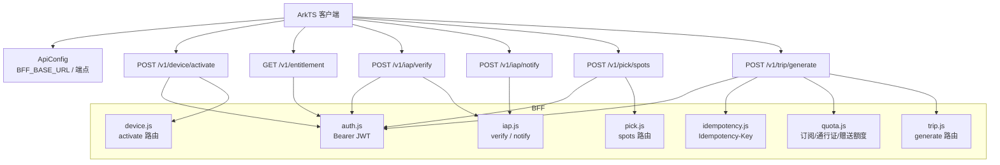
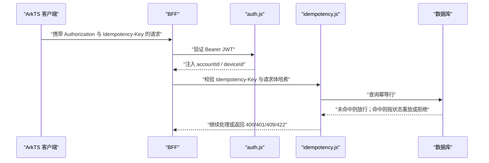
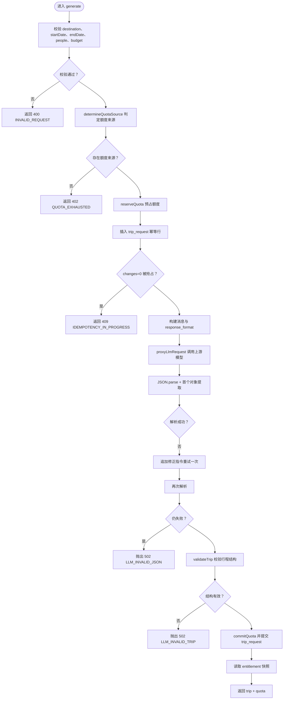
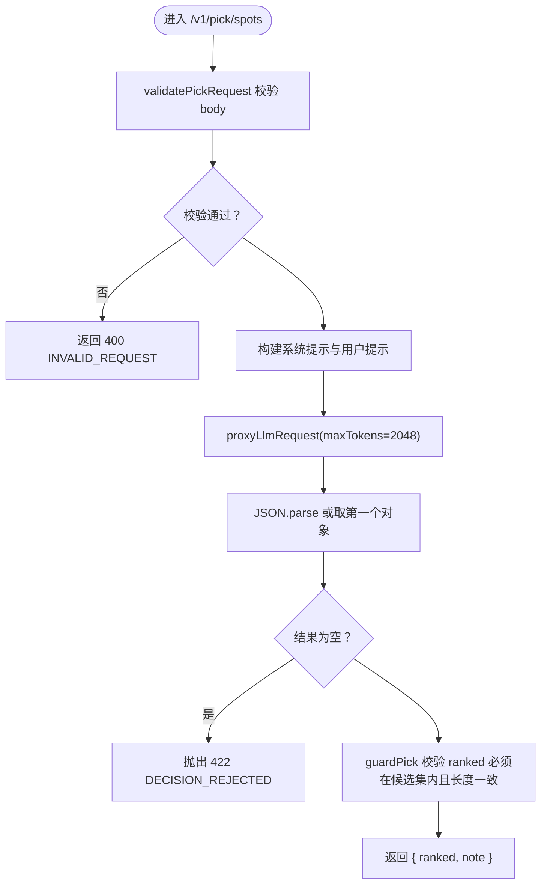
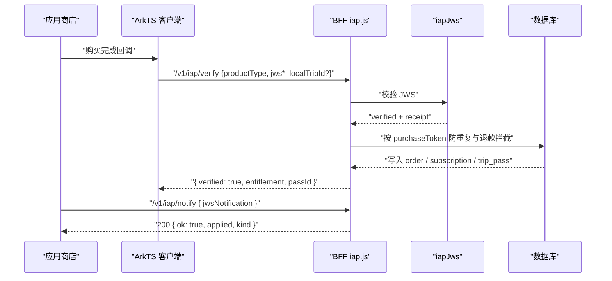

# API 契约参考

<cite>
**本文引用的文件**   
- [bff/src/routes/trip.js](file://bff/src/routes/trip.js)
- [bff/src/routes/pick.js](file://bff/src/routes/pick.js)
- [bff/src/routes/entitlement.js](file://bff/src/routes/entitlement.js)
- [bff/src/routes/device.js](file://bff/src/routes/device.js)
- [bff/src/routes/iap.js](file://bff/src/routes/iap.js)
- [bff/src/middleware/auth.js](file://bff/src/middleware/auth.js)
- [bff/src/middleware/idempotency.js](file://bff/src/middleware/idempotency.js)
- [bff/src/services/quota.js](file://bff/src/services/quota.js)
- [bff/src/services/pickGuard.js](file://bff/src/services/pickGuard.js)
- [bff/src/lib/http-error.js](file://bff/src/lib/http-error.js)
- [entry/src/main/ets/model/Trip.ets](file://entry/src/main/ets/model/Trip.ets)
- [entry/src/main/ets/model/Spot.ets](file://entry/src/main/ets/model/Spot.ets)
- [entry/src/main/ets/model/Area.ets](file://entry/src/main/ets/model/Area.ets)
- [entry/src/main/ets/model/Pick.ets](file://entry/src/main/ets/model/Pick.ets)
- [entry/src/main/ets/model/PlanParams.ets](file://entry/src/main/ets/model/PlanParams.ets)
- [entry/src/main/ets/model/Replan.ets](file://entry/src/main/ets/model/Replan.ets)
- [entry/src/main/ets/model/Weather.ets](file://entry/src/main/ets/model/Weather.ets)
- [entry/src/main/ets/model/Account.ets](file://entry/src/main/ets/model/Account.ets)
- [entry/src/main/ets/ai/TripRequestPayload.ets](file://entry/src/main/ets/ai/TripRequestPayload.ets)
- [entry/src/main/ets/common/config/ApiConfig.ets](file://entry/src/main/ets/common/config/ApiConfig.ets)
- [entry/src/main/ets/common/error/ErrorCode.ets](file://entry/src/main/ets/common/error/ErrorCode.ets)
- [entry/src/main/ets/utils/BffErrorMap.ets](file://entry/src/main/ets/utils/BffErrorMap.ets)
</cite>

## 目录
1. [简介](#简介)
2. [项目结构](#项目结构)
3. [核心端点总览](#核心端点总览)
4. [认证与通用约定](#认证与通用约定)
5. [行程生成接口](#行程生成接口)
6. [景点精选接口](#景点精选接口)
7. [权益查询接口](#权益查询接口)
8. [设备激活接口](#设备激活接口)
9. [应用内购买接口](#应用内购买接口)
10. [数据模型映射](#数据模型映射)
11. [错误码与边界条件](#错误码与边界条件)
12. [版本迁移指南](#版本迁移指南)
13. [性能与幂等特性](#性能与幂等特性)
14. [故障排查](#故障排查)
15. [结论](#结论)

## 简介
本文件为“有径”客户端与服务端（BFF）之间的 API 契约参考，覆盖行程生成、景点精选、权益查询、设备激活与应用内购买等端点。文档从请求参数、响应结构、错误码、示例调用、数据模型映射、边界条件和版本迁移六个维度给出完整说明，既适合后端维护者核对实现，也适合前端 ArkTS 开发者直接作为集成手册使用。

## 项目结构
BFF 基于 Express Router 组织路由，行程生成是核心链路：鉴权 → 幂等键校验 → 额度来源判定 → 预占额度 → LLM 代理 → JSON 解析与行程校验 → 提交额度并返回配额快照。端侧通过 `ApiConfig` 集中配置 BFF 基础地址和端点路径；ArkTS 模型集中在 `entry/src/main/ets/model` 下，作为服务端响应的类型契约。

**图表来源**
- [entry/src/main/ets/common/config/ApiConfig.ets:33-66](file://entry/src/main/ets/common/config/ApiConfig.ets#L33-L66)
- [bff/src/middleware/auth.js:1-25](file://bff/src/middleware/auth.js#L1-L25)
- [bff/src/middleware/idempotency.js:1-122](file://bff/src/middleware/idempotency.js#L1-L122)
- [bff/src/services/quota.js:1-113](file://bff/src/services/quota.js#L1-L113)
- [bff/src/routes/trip.js:1-234](file://bff/src/routes/trip.js#L1-L234)
- [bff/src/routes/pick.js:1-45](file://bff/src/routes/pick.js#L1-L45)
- [bff/src/routes/device.js:1-84](file://bff/src/routes/device.js#L1-L84)
- [bff/src/routes/iap.js:1-192](file://bff/src/routes/iap.js#L1-L192)

**章节来源**
- [entry/src/main/ets/common/config/ApiConfig.ets:1-66](file://entry/src/main/ets/common/config/ApiConfig.ets#L1-L66)
- [bff/src/routes/trip.js:1-234](file://bff/src/routes/trip.js#L1-L234)

## 核心端点总览
| 方法 | 路径 | 用途 | 鉴权 | 幂等 | 主要状态码 |
|---|---|---|---:|---:|---|
| POST | `/v1/trip/generate` | 生成行程 | 需要 | 支持 | 200、400、401、402、409、422、502 |
| POST | `/v1/pick/spots` | AI 精选候选排序 | 需要 | 否 | 200、400、401、422 |
| GET | `/v1/entitlement` | 查询订阅/通行证/赠送额度 | 需要 | 否 | 200、401 |
| POST | `/v1/device/activate` | 设备激活并获取设备票据 | 不需要 | 否 | 200、400、401 |
| POST | `/v1/iap/verify` | 校验收据并开通权益 | 可选或需 Bearer | 否 | 200、400、401、409、503 |
| POST | `/v1/iap/notify` | 接收应用商店回调 | 无显式鉴权头 | 否 | 200、401、503 |

**章节来源**
- [bff/src/routes/trip.js:1-234](file://bff/src/routes/trip.js#L1-L234)
- [bff/src/routes/pick.js:1-45](file://bff/src/routes/pick.js#L1-L45)
- [bff/src/routes/entitlement.js:1-15](file://bff/src/routes/entitlement.js#L1-L15)
- [bff/src/routes/device.js:1-84](file://bff/src/routes/device.js#L1-L84)
- [bff/src/routes/iap.js:1-192](file://bff/src/routes/iap.js#L1-L192)

## 认证与通用约定
- 认证头：`Authorization: Bearer <JWT>`。
- JWT 载荷包含 `accountId` 与 `deviceId`，有效期默认 30 天。
- 缺少头、头格式错误或签名失效时返回 401，业务错误码为 `TOKEN_INVALID`。
- 行程生成必须携带请求头 `Idempotency-Key`，用于同体重放保护。
- 所有 JSON 响应统一采用 `{ error, message }` 或业务对象的结构；错误响应中的 `error` 字段用于上层错误分类。

**图表来源**
- [bff/src/middleware/auth.js:1-25](file://bff/src/middleware/auth.js#L1-L25)
- [bff/src/middleware/idempotency.js:1-122](file://bff/src/middleware/idempotency.js#L1-L122)

**章节来源**
- [bff/src/middleware/auth.js:1-25](file://bff/src/middleware/auth.js#L1-L25)
- [bff/src/middleware/idempotency.js:1-122](file://bff/src/middleware/idempotency.js#L1-L122)

## 行程生成接口

### 基本信息
- 方法：POST
- 路径：`/v1/trip/generate`
- 鉴权：需要
- 幂等：要求请求头 `Idempotency-Key`
- 成功响应：200
- 常见失败：400、401、402、409、422、502

### 请求头
| 名称 | 是否必填 | 类型 | 说明 |
|---|---:|---|---|
| Authorization | 是 | string | `Bearer <JWT>` |
| Idempotency-Key | 是 | string | 客户端生成的唯一键，用于幂等重放 |

### 请求体
| 字段 | 必填 | 类型 | 说明 |
|---|---:|---|---|
| destination | 是 | string | 目的地城市名 |
| startDate | 是 | string | 出发日期，格式 `YYYY-MM-DD` |
| endDate | 是 | string | 返程日期，格式 `YYYY-MM-DD` |
| people | 是 | integer | 出行人数，取值范围 1–30 |
| budget | 是 | integer | 总预算，单位元，非负整数 |
| style | 是 | string | 旅行风格枚举值 |
| stayTier | 是 | string | 住宿偏好档位字符串 |
| transit | 是 | string | 交通方式偏好枚举值 |
| paces | 是 | array | 节奏选项数组，可为空数组表示默认兜底 |
| selectedArea | 是 | object | 选中的住宿区域引用 |
| selectedSpots | 是 | array | 用户选中的景点列表 |
| spots | 是 | array | 完整景点库，供服务端提示词构造 |
| area | 是 | object | 完整住宿区域，供服务端提示词构造 |
| passId | 否 | string | 行程通行证 ID；空串或不传表示未购买 |

端侧构造器会将 `PlanParams.basic` 与风格、交通、节奏、选中项及完整 `Spot[]`、`Area` 组合为 rich 请求载荷。若 `passId` 为空串，则不写入该字段。

### 成功响应
| 字段 | 类型 | 说明 |
|---|---|---|
| trip | object | 生成的行程根对象 |
| quota.source | string | 额度来源：`subscription`、`pass`、`gift`、`admin` |
| quota.remainingToday | number | 当月已用次数，字段名保留历史兼容 |
| quota.giftRemaining | number | 赠送额度剩余 |
| quota.passes | array | 当前账号的通行证列表 |
| quota.subscription | object | 订阅快照，含状态与到期时间 |
| quota.dailyCap | number | 月度上限，当前值为 20 |
| quota.unlimited | boolean | 管理员账号跳过额度门禁 |

### 错误响应
| HTTP 状态码 | 业务错误码 | 含义 |
|---|---|---|
| 400 | `INVALID_REQUEST` | 请求体字段缺失、类型错误或数值越界 |
| 401 | `TOKEN_INVALID` | 缺少或无效的 Bearer 票据 |
| 402 | `QUOTA_EXHAUSTED` | 无可用额度来源 |
| 409 | `IDEMPOTENCY_IN_PROGRESS` | 同一幂等键已有请求在处理中 |
| 422 | `IDEMPOTENCY_KEY_REUSED` | 同一幂等键对应不同请求体 |
| 502 | `LLM_INVALID_JSON` | 模型输出无法解析为合法 JSON |
| 502 | `LLM_INVALID_TRIP` | 模型输出 JSON 通过但行程结构校验失败 |

### 请求示例
- curl：
  - 使用 `curl -X POST` 发送 `application/json` 请求体，并设置 `Authorization` 与 `Idempotency-Key`。
- JavaScript：
  - 使用 `fetch` 发起 POST，将 `TripRequestPayload.buildTripGeneratePayload(...)` 的输出作为请求体。
- ArkTS 客户端：
  - 使用端侧 `TripRequestPayload.buildTripGeneratePayload` 构建载荷，再经 `HttpLlmTransport` 或 `MockLlmTransport` 调用 `/v1/trip/generate`。

### 处理流程

**图表来源**
- [bff/src/routes/trip.js:24-234](file://bff/src/routes/trip.js#L24-L234)
- [bff/src/services/quota.js:1-113](file://bff/src/services/quota.js#L1-L113)

**章节来源**
- [bff/src/routes/trip.js:1-234](file://bff/src/routes/trip.js#L1-L234)
- [entry/src/main/ets/ai/TripRequestPayload.ets:1-75](file://entry/src/main/ets/ai/TripRequestPayload.ets#L1-L75)

## 景点精选接口

### 基本信息
- 方法：POST
- 路径：`/v1/pick/spots`
- 鉴权：需要
- 幂等：不支持
- 成功响应：200
- 常见失败：400、401、422

### 请求体
| 字段 | 必填 | 类型 | 说明 |
|---|---:|---|---|
| city | 是 | string | 城市名 |
| days | 是 | integer | 行程天数，1–30 |
| pace | 是 | string | 节奏描述 |
| interests | 是 | string | 兴趣描述 |
| candidates | 是 | array | 候选景点数组，最多 40 个 |

候选项每个元素必填字段包括：`id`、`name`、`tag`、`brief`、`district`、`popularity`、`suggestedDuration`、`requiresBooking`。

### 成功响应
| 字段 | 类型 | 说明 |
|---|---|---|
| ranked | array | 按服务端逻辑排序后的候选 ID 列表，每项含 `id` 与一句 `reason` |
| note | string | 精选备注 |

### 错误响应
| HTTP 状态码 | 业务错误码 | 含义 |
|---|---|---|
| 400 | `INVALID_REQUEST` | 请求体字段缺失、类型错误或候选数超限 |
| 401 | `TOKEN_INVALID` | 缺少或无效 Bearer 票据 |
| 422 | `DECISION_REJECTED` | 模型输出不是 JSON，或守卫检测到非法决策 |

### 处理流程

**图表来源**
- [bff/src/routes/pick.js:1-45](file://bff/src/routes/pick.js#L1-L45)
- [bff/src/services/pickGuard.js:1-97](file://bff/src/services/pickGuard.js#L1-L97)

**章节来源**
- [bff/src/routes/pick.js:1-45](file://bff/src/routes/pick.js#L1-L45)
- [bff/src/services/pickGuard.js:1-97](file://bff/src/services/pickGuard.js#L1-L97)
- [entry/src/main/ets/model/Pick.ets:1-25](file://entry/src/main/ets/model/Pick.ets#L1-L25)

## 权益查询接口

### 基本信息
- 方法：GET
- 路径：`/v1/entitlement`
- 鉴权：需要
- 幂等：不适用
- 成功响应：200
- 常见失败：401

### 成功响应
| 字段 | 类型 | 说明 |
|---|---|---|
| subscription | object | 当前活跃订阅，含 `status` 与 `periodEnd`；无活跃订阅时为 null |
| passes | array | 当前账号的通行证条目，含 `localTripId`、`status`、`expiresAt` |
| giftRemaining | number | 赠送额度剩余 |
| usedToday | number | 当月成功生成次数，字段名沿用历史兼容 |
| dailyCap | number | 月度上限，当前为 20 |
| unlimited | boolean | 管理员账号可绕过额度门禁 |

### 错误响应
| HTTP 状态码 | 业务错误码 | 含义 |
|---|---|---|
| 401 | `TOKEN_INVALID` | 缺少或无效 Bearer 票据 |

**章节来源**
- [bff/src/routes/entitlement.js:1-15](file://bff/src/routes/entitlement.js#L1-L15)
- [bff/src/services/quota.js:1-113](file://bff/src/services/quota.js#L1-L113)

## 设备激活接口

### 基本信息
- 方法：POST
- 路径：`/v1/device/activate`
- 鉴权：不需要
- 幂等：不适用
- 成功响应：200
- 常见失败：400、401

### 请求体
| 字段 | 必填 | 类型 | 说明 |
|---|---:|---|---|
| deviceId | 是 | string | 设备标识，非空且不超过 128 字符 |
| idToken | 否 | string | 华为身份票据 JWS；提供时用于 UnionID 登录 |
| unionId | 否 | string | 客户端自报 unionId；仅提供时按游客处理，不被信任 |

当提供 `idToken` 时，服务端会校验其签名并使用票据中的 `sub` 作为权威身份；否则根据 `deviceId` 查找或创建匿名账户。

### 成功响应
| 字段 | 类型 | 说明 |
|---|---|---|
| deviceToken | string | 有效期 30 天的 Bearer JWT |
| entitlement | object | 与 `/v1/entitlement` 相同的权益快照 |

### 错误响应
| HTTP 状态码 | 业务错误码 | 含义 |
|---|---|---|
| 400 | `MISSING_DEVICE_ID` | deviceId 缺失、空白或超长 |
| 400 | `INVALID_UNION_ID` | unionId 类型或长度非法 |
| 400 | `INVALID_ID_TOKEN` | idToken 类型或长度非法 |
| 401 | `ID_TOKEN_INVALID` | 华为身份票据验签失败 |

**章节来源**
- [bff/src/routes/device.js:1-84](file://bff/src/routes/device.js#L1-L84)
- [bff/src/middleware/auth.js:1-25](file://bff/src/middleware/auth.js#L1-L25)

## 应用内购买接口

### 基本信息
- 方法：POST
- 路径：`/v1/iap/verify`
- 鉴权：优先使用请求上下文中的 `accountId`；若无，可从 `Authorization: Bearer <JWT>` 解析。
- 幂等：以 JWS 权威 `purchaseToken` 做去重。
- 成功响应：200
- 常见失败：400、401、409、503

#### 请求体
| 字段 | 必填 | 类型 | 说明 |
|---|---:|---|---|
| productType | 是 | string | `pass` 或 `subscription` |
| productId | 否 | string | 订阅商品 ID；默认 `youjing_sub_monthly` |
| jwsPurchaseOrder | 否 | string | 购买订单 JWS；通行证必填，订阅可选 |
| jwsSubscriptionStatus | 否 | string | 订阅状态 JWS；推荐优先提供 |
| localTripId | 仅通行证必填 | string | 通行证绑定的本地行程 ID |

#### 成功响应
| 字段 | 类型 | 说明 |
|---|---|---|
| verified | boolean | 始终为 true，表示校验并入库成功 |
| entitlement | object | 更新后的权益快照 |
| passId | string | 通行证购买时返回绑定的 `localTripId` |

#### 错误响应
| HTTP 状态码 | 业务错误码 | 含义 |
|---|---|---|
| 400 | `MISSING_PARAMS` | 缺少 productType |
| 400 | `UNSUPPORTED_PRODUCT_TYPE` | productType 不是 `pass` 或 `subscription` |
| 400 | `UNKNOWN_PRODUCT_ID` | 未知订阅商品 ID |
| 400 | `INVALID_JWS` | JWS 字段类型或长度非法 |
| 400 | `MISSING_JWS` | 通行证缺少购买 JWS，或订阅缺少两种 JWS |
| 400 | `MISSING_TRIP_ID` | 通行证缺少合法的 `localTripId` |
| 401 | `TOKEN_INVALID` | 缺少有效票据或票据解析失败 |
| 409 | `RECEIPT_ALREADY_USED` | 收据已绑定其他账号 |
| 200 | `verified=false` | 收据未通过校验或已退款 |
| 503 | `IAP_NOT_CONFIGURED` | 部署态未配置根证书或 APP_ID |

#### 通知回调
- 方法：POST
- 路径：`/v1/iap/notify`
- 请求体：`{ jwsNotification }`
- 成功响应：200，`{ ok: true, applied, kind }`
- 失败响应：401 或 503，取决于是否为部署态配置问题。

**图表来源**
- [bff/src/routes/iap.js:1-192](file://bff/src/routes/iap.js#L1-L192)

**章节来源**
- [bff/src/routes/iap.js:1-192](file://bff/src/routes/iap.js#L1-L192)

## 数据模型映射

### Trip 行程根对象
| 字段 | 类型 | 必填 | 说明 |
|---|---|---:|---|
| id | string | 是 | 行程 ID |
| destination | string | 是 | 目的地城市 |
| startDate | string | 是 | 出发日期，`YYYY-MM-DD` |
| endDate | string | 是 | 返程日期，`YYYY-MM-DD` |
| people | number | 是 | 出行人数 |
| budget | number | 是 | 总预算，单位元 |
| categoryBudgets | array | 否 | 分类预算，旧行程可能缺失 |
| style | string | 是 | 旅行风格码 |
| overview | object | 是 | 行程总览摘要 |
| days | array | 是 | 每日行程数组 |
| tips | array | 是 | 小贴士文本数组 |
| passId | string | 否 | 行程通行证 ID |

### Activity 活动节点
| 字段 | 类型 | 必填 | 说明 |
|---|---|---:|---|
| id | string | 是 | 活动 ID |
| time | string | 是 | 开始时间，`HH:mm` |
| endTime | string | 是 | 结束时间，`HH:mm` |
| title | string | 是 | 活动标题 |
| location | string | 是 | POI 场所名 |
| address | string | 是 | 地址 |
| longitude | number | 是 | 经度 |
| latitude | number | 是 | 纬度 |
| status | enum | 是 | 预约状态：`booked`、`not_booked`、`full`、`pending`、`no_need` |
| category | enum | 是 | 活动类型：`transport`、`sight`、`food`、`shop`、`rest`、`hotel`、`other` |
| advanceDays | number | 否 | 需提前几天预约 |
| note | string | 否 | 备注 |
| reason | string | 否 | AI 排期理由 |
| transport | object | 否 | 相邻活动通勤信息 |

### TripDay 单日行程
| 字段 | 类型 | 必填 | 说明 |
|---|---|---:|---|
| dayIndex | number | 是 | 从 1 开始 |
| date | string | 是 | 日期，`YYYY-MM-DD` |
| theme | string | 是 | 当日主题 |
| intensity | enum | 是 | 强度：`low`、`medium`、`high` |
| risk | string | 否 | 风险提示 |
| dailyCost | number | 是 | 当日花费 |
| activities | array | 是 | 活动列表 |
| meals | array | 是 | 餐饮列表 |
| accommodation | string | 否 | 当晚住宿描述 |

### Spot 景点
| 字段 | 类型 | 必填 | 说明 |
|---|---|---:|---|
| id | string | 是 | 景点 ID |
| name | string | 是 | 名称 |
| city | string | 是 | 所在城市 |
| tags | array | 是 | 标签：`must_see`、`classic`、`niche`、`family` |
| brief | string | 是 | 一句话简介 |
| suggestedDuration | number | 是 | 建议游玩时长，分钟 |
| openingHours | string | 否 | 开放时段 |
| popularity | number | 是 | 热度指数 0–100 |
| nearbySpotIds | array | 是 | 周边景点 ID |
| longitude | number | 是 | 经度 |
| latitude | number | 是 | 纬度 |
| district | string | 是 | 所在区 |
| nearestMetro | string | 是 | 最近地铁站 |
| entranceTip | string | 否 | 入口提示 |
| booking | object | 是 | 预约规则组 |
| provenance | object | 是 | 数据来源 |

### Area 住宿区域
| 字段 | 类型 | 必填 | 说明 |
|---|---|---:|---|
| id | string | 是 | 区域 ID |
| name | string | 是 | 区域名 |
| city | string | 是 | 城市 |
| longitude | number | 是 | 经度 |
| latitude | number | 是 | 纬度 |
| description | string | 是 | 一句话描述 |
| anchorStations | array | 是 | 锚定地铁站 |
| metroLines | array | 是 | 途经地铁线路 |
| airportMinutes | number | 是 | 到机场通勤分钟数 |
| trainStationMinutes | number | 是 | 到火车站通勤分钟数 |
| commerceTags | array | 是 | 商圈标签 |
| diningDensity | string | 是 | 餐饮密度 |
| suitableCrowds | array | 是 | 适合人群 |
| priceTier | enum | 是 | 价格档位：`economy`、`comfort`、`luxury` |
| priceRange | string | 否 | 参考价位段文案 |
| group | enum | 是 | 浏览分组：`core`、`commercial`、`metro` |
| source | string | 是 | 数据来源 |
| updatedAt | string | 是 | 更新时间，`YYYY-MM-DD` |

### Replan 重排
| 字段 | 类型 | 必填 | 说明 |
|---|---|---:|---|
| schemaVersion | number | 是 | 重排协议版本 |
| now | string | 是 | 当前时间 |
| skippedId | string | 否 | 跳过站点 ID |
| addStopId | string | 否 | 新增站点 ID |
| replaceStopId | string | 否 | 替换目标站点 ID |
| intentText | string | 否 | P3 对话式自然语言意愿 |
| candidates | array | 否 | 候选活动 |
| day | object | 是 | 当日行程请求体 |

**章节来源**
- [entry/src/main/ets/model/Trip.ets:1-137](file://entry/src/main/ets/model/Trip.ets#L1-L137)
- [entry/src/main/ets/model/Spot.ets:1-69](file://entry/src/main/ets/model/Spot.ets#L1-L69)
- [entry/src/main/ets/model/Area.ets:1-51](file://entry/src/main/ets/model/Area.ets#L1-L51)
- [entry/src/main/ets/model/PlanParams.ets:1-128](file://entry/src/main/ets/model/PlanParams.ets#L1-L128)
- [entry/src/main/ets/model/Replan.ets:1-110](file://entry/src/main/ets/model/Replan.ets#L1-L110)

## 错误码与边界条件

### HTTP 状态码与业务错误码对照
| HTTP 状态码 | 业务错误码 | 适用端点 | 处理建议 |
|---|---|---|---|
| 400 | `INVALID_REQUEST` | 行程生成、景点精选 | 检查必填字段、类型与取值范围 |
| 400 | `MISSING_DEVICE_ID` | 设备激活 | 检查 deviceId |
| 400 | `INVALID_UNION_ID` | 设备激活 | 检查 unionId |
| 400 | `INVALID_ID_TOKEN` | 设备激活 | 检查 idToken |
| 401 | `ID_TOKEN_INVALID` | 设备激活 | 华为票据无效，提示重新登录 |
| 401 | `TOKEN_INVALID` | 所有鉴权端点 | 跳转激活或重新登录 |
| 402 | `QUOTA_EXHAUSTED` | 行程生成 | 引导至付费页 |
| 409 | `IDEMPOTENCY_IN_PROGRESS` | 行程生成 | 等待后重试新 key |
| 409 | `RECEIPT_ALREADY_USED` | IAP verify | 收据已绑定其他账号 |
| 422 | `IDEMPOTENCY_KEY_REUSED` | 行程生成 | 更换 Idempotency-Key |
| 422 | `DECISION_REJECTED` | 景点精选 | 模型输出异常，建议降级或重试 |
| 502 | `LLM_INVALID_JSON` | 行程生成 | 已自动修正一次，仍失败应提示两次失败 |
| 502 | `LLM_INVALID_TRIP` | 行程生成 | 行程结构不符合预期，提示重试 |
| 503 | `IAP_NOT_CONFIGURED` | IAP verify | 部署配置问题，不应向用户暴露内部细节 |

### 端侧错误码映射
端侧 `BffErrorMap` 将 BFF HTTP 错误映射为 ArkTS `ErrorCode`：
- 401 → `CLOUD_TOKEN_INVALID`
- 402 → `CLOUD_QUOTA_EXHAUSTED`
- 429 → `CLOUD_RATE_LIMITED`
- 409 → `CLOUD_IDEMPOTENCY_CONFLICT`
- 5xx 中 `LLM_INVALID_TRIP` 或 `LLM_INVALID_JSON` → `TRIP_GENERATE_RETRY_EXHAUSTED`
- 其他 5xx → `LLM_UNAVAILABLE`
- 其他网络错误 → `NETWORK_REQUEST_FAILED`

### 边界条件处理
- 空值处理：BFF 对字符串字段执行非空与非空字符串校验；对数字字段执行整数与非负校验。
- 类型转换：日期使用 ISO 正则校验，不接受带时分秒或非标准格式。
- 数据验证规则：行程天数 1–30；人数 1–30；预算非负；候选景点最多 40；JWS 最长 8192；deviceId 最长 128；idToken 最长 4096。
- 幂等冲突：同一 `Idempotency-Key` 对应不同请求体会被拒绝，防止旧结果被误重用。
- 权限边界：客户端自报 `unionId` 不被信任；只有验签通过的 `idToken.sub` 才作为权威身份。
- 计费边界：订阅月度上限为 20；赠送额度初始为 3；管理员账号跳过额度门禁但仍记账。

**章节来源**
- [bff/src/lib/http-error.js:1-8](file://bff/src/lib/http-error.js#L1-L8)
- [bff/src/middleware/idempotency.js:1-122](file://bff/src/middleware/idempotency.js#L1-L122)
- [bff/src/routes/device.js:1-84](file://bff/src/routes/device.js#L1-L84)
- [bff/src/routes/iap.js:1-192](file://bff/src/routes/iap.js#L1-L192)
- [bff/src/routes/trip.js:1-234](file://bff/src/routes/trip.js#L1-L234)
- [entry/src/main/ets/common/error/ErrorCode.ets:1-48](file://entry/src/main/ets/common/error/ErrorCode.ets#L1-L48)
- [entry/src/main/ets/utils/BffErrorMap.ets:1-41](file://entry/src/main/ets/utils/BffErrorMap.ets#L1-L41)

## 版本迁移指南

### 废弃字段与兼容层
- `usedToday` 字段名：服务端实际计算的是“当月成功次数”，但为保持端侧 `EntitlementStore.canGenerate()` 直读兼容，字段名保留 `usedToday`，语义改为月度计数。
- `dailyCap` 字段名：同样保留，当前值为月度上限 20。
- `categoryBudgets`：旧行程可能缺失，端侧应允许为空数组。
- `meal.time`、`Activity.advanceDays`、`Activity.reason`、`Activity.transport`、`Spot.openingHours`、`Spot.entranceTip`、`Area.priceRange` 均为可选字段，端侧应按空值渲染默认文案。

### 升级建议
- 客户端在收到 402 时跳转到定价页，而不是把 `QUOTA_EXHAUSTED` 当成普通网络错误。
- 客户端在收到 502 且业务错误码为 `LLM_INVALID_JSON` 或 `LLM_INVALID_TRIP` 时，显示“两次都没排通”的业务提示，而不是“行程服务不可用”。
- 客户端每次调用 `/v1/trip/generate` 都应生成新的 `Idempotency-Key`，并在 409 时等待短暂间隔后重试。
- 客户端不应信任服务端返回的 `quota.usedToday` 以外的任何计费状态，订阅到期后应依赖 `getEntitlement` 刷新快照。
- 新增业务错误码应在 `ErrorCode` 所属区段顺延，不得复用已有码值。

**章节来源**
- [bff/src/services/quota.js:1-113](file://bff/src/services/quota.js#L1-L113)
- [entry/src/main/ets/model/Trip.ets:1-137](file://entry/src/main/ets/model/Trip.ets#L1-L137)
- [entry/src/main/ets/common/error/ErrorCode.ets:1-48](file://entry/src/main/ets/common/error/ErrorCode.ets#L1-L48)
- [entry/src/main/ets/utils/BffErrorMap.ets:1-41](file://entry/src/main/ets/utils/BffErrorMap.ets#L1-L41)

## 性能与幂等特性
- 行程生成采用预占→修正→提交的三段式额度管理：失败路径释放预占，成功路径提交并记录 token 用量。
- 幂等行通过 `idempotency_key` + `account_id` 唯一约束，避免并发重复扣费。
- 模型输出先尝试严格 JSON 解析，失败后提取第一个完整对象，再对长行程追加修正指令重试一次。
- 景点精选限制单次最大 2048 token，减少 LLM 成本。
- IAP 校验以 `purchaseToken` 做幂等，防止收据泄露后被多人复用。

**章节来源**
- [bff/src/routes/trip.js:24-234](file://bff/src/routes/trip.js#L24-L234)
- [bff/src/middleware/idempotency.js:1-122](file://bff/src/middleware/idempotency.js#L1-L122)
- [bff/src/routes/pick.js:1-45](file://bff/src/routes/pick.js#L1-L45)
- [bff/src/routes/iap.js:1-192](file://bff/src/routes/iap.js#L1-L192)

## 故障排查
- 401 频繁出现：检查是否调用了 `/v1/device/activate` 获取 `deviceToken`，并在后续请求带上 `Authorization: Bearer <deviceToken>`。
- 402 一直出现：确认订阅未过期、通行证有效、赠送额度未耗尽；管理员账号测试应绕过额度门禁。
- 409 频繁出现：检查客户端是否复用同一个 `Idempotency-Key`；每次生成应生成新 key。
- 502 `LLM_INVALID_JSON`：模型输出损坏，服务已自动修正一次；若仍失败，属于内容类失败，应提示用户重试。
- 502 `LLM_INVALID_TRIP`：模型输出的行程结构不满足约束，例如天数与日期区间不一致；建议重试。
- IAP verify 返回 503：部署环境未配置根证书或 APP_ID，应由运维修复，不应提示用户“收据无效”。

**章节来源**
- [bff/src/middleware/auth.js:1-25](file://bff/src/middleware/auth.js#L1-L25)
- [bff/src/routes/trip.js:1-234](file://bff/src/routes/trip.js#L1-L234)
- [bff/src/routes/iap.js:1-192](file://bff/src/routes/iap.js#L1-L192)

## 结论
本契约围绕“行程生成”这一核心能力展开，并以设备激活、权益查询、景点精选和应用内购买为支撑面。BFF 承担鉴权、幂等、额度控制、LLM 代理与商业校验职责；ArkTS 端侧负责载荷构造、错误映射与 UI 展示。未来扩展时应遵循现有错误码区段划分、字段可选语义和幂等设计原则，避免引入新的隐式状态与全局可变常量。