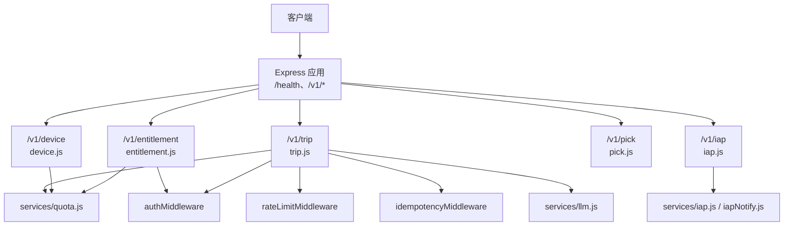
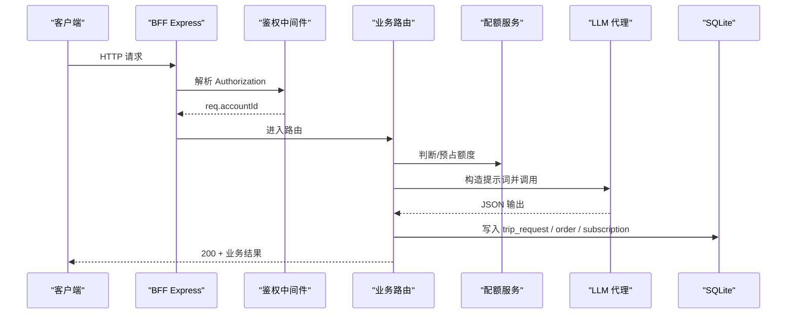
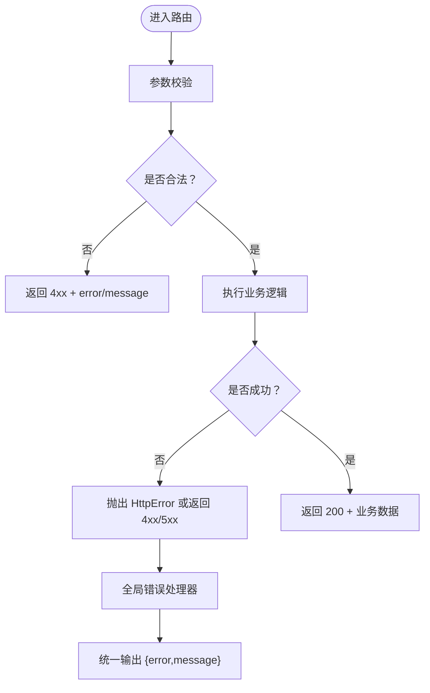
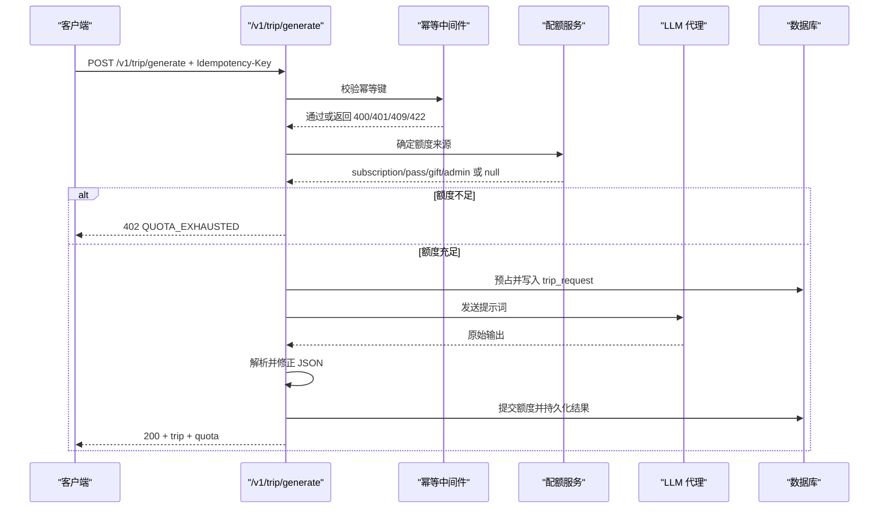
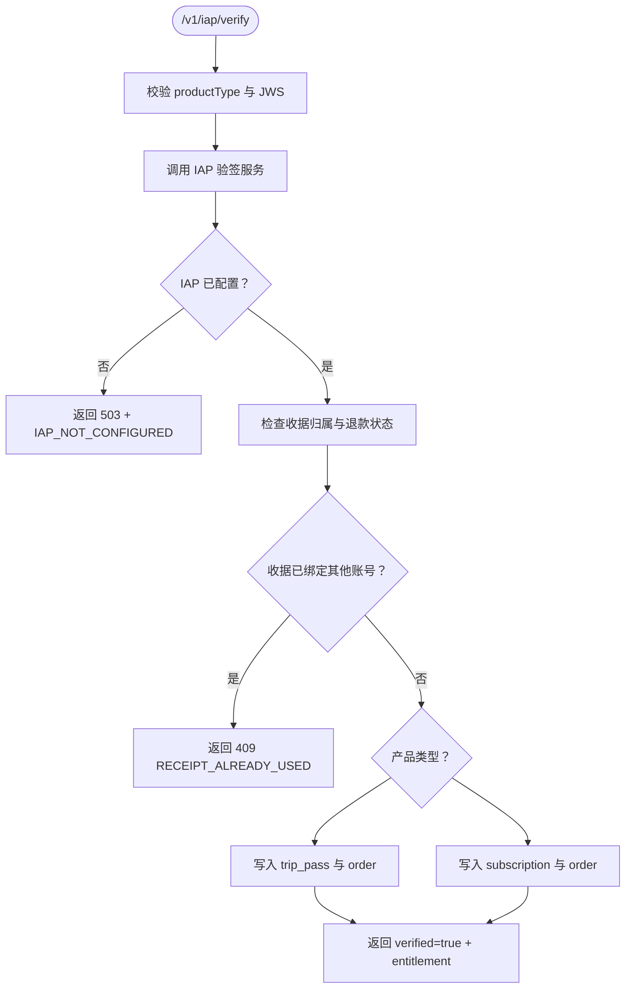
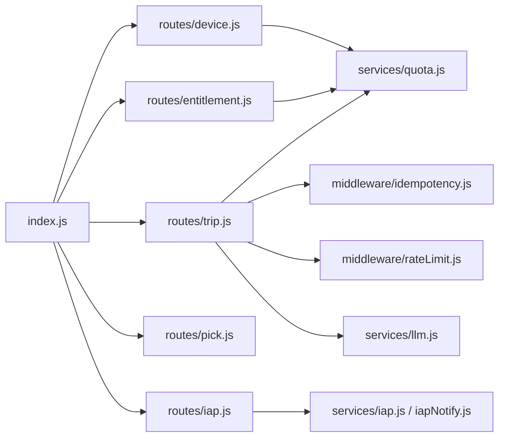

# RESTful API 设计规范

<cite>
**本文引用的文件**
- [bff/src/index.js](file://bff/src/index.js)
- [bff/src/middleware/auth.js](file://bff/src/middleware/auth.js)
- [bff/src/middleware/rateLimit.js](file://bff/src/middleware/rateLimit.js)
- [bff/src/middleware/idempotency.js](file://bff/src/middleware/idempotency.js)
- [bff/src/lib/http-error.js](file://bff/src/lib/http-error.js)
- [bff/src/routes/device.js](file://bff/src/routes/device.js)
- [bff/src/routes/entitlement.js](file://bff/src/routes/entitlement.js)
- [bff/src/routes/iap.js](file://bff/src/routes/iap.js)
- [bff/src/routes/pick.js](file://bff/src/routes/pick.js)
- [bff/src/routes/trip.js](file://bff/src/routes/trip.js)
- [bff/src/services/quota.js](file://bff/src/services/quota.js)
</cite>

## 目录
1. [简介](#简介)
2. [项目结构](#项目结构)
3. [核心组件](#核心组件)
4. [架构总览](#架构总览)
5. [详细端点规范](#详细端点规范)
6. [依赖关系分析](#依赖关系分析)
7. [性能与可靠性考虑](#性能与可靠性考虑)
8. [故障排查指南](#故障排查指南)
9. [结论](#结论)

## 简介
本文档面向客户端与服务端开发者，给出本项目的 RESTful API 设计契约。内容覆盖：URL 命名约定、HTTP 状态码语义、请求响应格式、API 版本管理策略，以及设备管理、权益查询、行程生成、景点精选推荐、内购验证与通知等全部路由的完整规范。文档同时提供错误码、幂等头、鉴权方式、限流策略和最佳实践模式，帮助客户端稳定对接 BFF（Backend for Frontend）服务。

## 项目结构
BFF 服务基于 Express，按功能划分路由模块，并通过中间件统一处理鉴权、限流、幂等和全局错误。

**图示来源**
- [bff/src/index.js:1-55](file://bff/src/index.js#L1-L55)
- [bff/src/routes/device.js:1-84](file://bff/src/routes/device.js#L1-L84)
- [bff/src/routes/entitlement.js:1-15](file://bff/src/routes/entitlement.js#L1-L15)
- [bff/src/routes/trip.js:1-234](file://bff/src/routes/trip.js#L1-L234)
- [bff/src/routes/pick.js:1-45](file://bff/src/routes/pick.js#L1-L45)
- [bff/src/routes/iap.js:1-192](file://bff/src/routes/iap.js#L1-L192)

**章节来源**
- [bff/src/index.js:1-55](file://bff/src/index.js#L1-L55)

## 核心组件
- **Express 入口**：注册健康检查、JSON 解析、数据库连接注入、所有 `/v1` 路由以及全局错误处理。
- **鉴权中间件**：校验 `Authorization: Bearer <JWT>`，将 `accountId`、`deviceId` 挂到请求对象。
- **限流中间件**：按账号固定窗口计数，默认每分钟 10 次；超限返回 429。
- **幂等中间件**：基于 `Idempotency-Key` 与规范化请求体哈希，防止重复提交并支持失败重试。
- **业务路由**：设备激活、权益查询、行程生成、景点精选、内购验证与回调。
- **配额服务**：计算订阅/通行证/赠送额度、预占与结算。

**章节来源**
- [bff/src/index.js:1-55](file://bff/src/index.js#L1-L55)
- [bff/src/middleware/auth.js:1-25](file://bff/src/middleware/auth.js#L1-L25)
- [bff/src/middleware/rateLimit.js:1-47](file://bff/src/middleware/rateLimit.js#L1-L47)
- [bff/src/middleware/idempotency.js:1-122](file://bff/src/middleware/idempotency.js#L1-L122)
- [bff/src/services/quota.js:1-113](file://bff/src/services/quota.js#L1-L113)

## 架构总览
系统采用“客户端 → BFF → 外部服务”的分层模型。BFF 负责鉴权、限流、幂等、参数校验、LLM 调用、IAP 验签与权益结算，客户端无需直接访问下游 LLM 或 IAP 内部细节。

**图示来源**
- [bff/src/index.js:1-55](file://bff/src/index.js#L1-L55)
- [bff/src/middleware/auth.js:1-25](file://bff/src/middleware/auth.js#L1-L25)
- [bff/src/routes/trip.js:1-234](file://bff/src/routes/trip.js#L1-L234)
- [bff/src/services/quota.js:1-113](file://bff/src/services/quota.js#L1-L113)

## 详细端点规范

### URL 命名与版本策略
- **基础路径**：所有业务接口以 `/v1/` 为前缀，例如 `/v1/trip`、`/v1/pick`、`/v1/iap`。
- **资源路径**：使用名词复数表示集合，动词放在路径外（GET/POST），避免在 URL 中嵌入动作。
- **嵌套资源**：当前未出现二级资源；若未来扩展，可采用 `/v1/{parent}/{child}` 形式。
- **版本化**：采用 URL 版本 `/v1/`。后续不兼容变更应引入 `/v2/`，旧版本继续保留以保证向后兼容。

**章节来源**
- [bff/src/index.js:1-55](file://bff/src/index.js#L1-L55)

### HTTP 方法语义
| 方法 | 语义 | 典型用途 |
|---|---|---|
| GET | 读取资源 | 获取权益、健康检查 |
| POST | 创建或触发操作 | 设备激活、行程生成、景点精选、内购验证 |
| POST | 接收第三方回调 | IAP 通知回调 |

**章节来源**
- [bff/src/index.js:1-55](file://bff/src/index.js#L1-L55)

### 鉴权与安全
- **认证头**：除设备激活与 IAP 回调外，受保护路由要求 `Authorization: Bearer <JWT>`。
- **令牌签发**：设备激活成功后返回 JWT，有效期约 30 天。
- **匿名与游客**：设备激活允许无 `idToken` 的匿名激活，但后续受保护接口仍需 JWT。
- **IAP 回调**：不使用 JWT，而是对 `jwsNotification` 做独立签名校验。

**章节来源**
- [bff/src/middleware/auth.js:1-25](file://bff/src/middleware/auth.js#L1-L25)
- [bff/src/routes/device.js:1-84](file://bff/src/routes/device.js#L1-L84)
- [bff/src/routes/iap.js:1-192](file://bff/src/routes/iap.js#L1-L192)

### 限流
- **作用范围**：`/v1/trip` 与 `/v1/pick` 经过限流中间件。
- **粒度**：按 `accountId` 固定窗口计数；未登录时回退到 IP。
- **默认阈值**：每分钟 10 次；可通过环境变量调整。
- **超限响应**：429 + `RATE_LIMITED`。

**章节来源**
- [bff/src/middleware/rateLimit.js:1-47](file://bff/src/middleware/rateLimit.js#L1-L47)

### 幂等
- **适用接口**：行程生成 `/v1/trip/generate`。
- **关键头**：必须携带 `Idempotency-Key`。
- **行为**：相同 key 且相同请求体可重放已成功结果；不同请求体会拒绝复用 key；处理中会返回冲突。
- **响应头**：重放成功时可设置 `Idempotency-Replayed: true`。

**章节来源**
- [bff/src/middleware/idempotency.js:1-122](file://bff/src/middleware/idempotency.js#L1-L122)
- [bff/src/routes/trip.js:1-234](file://bff/src/routes/trip.js#L1-L234)

### 错误模型
- **统一结构**：错误响应包含 `error` 与 `message`。
- **错误码**：使用大写英文短横线字符串，如 `INVALID_REQUEST`、`QUOTA_EXHAUSTED`、`IDEMPOTENCY_IN_PROGRESS`。
- **全局错误处理器**：捕获未处理异常，输出 `error` 与 `message`，默认 500。
- **结构化异常**：业务代码可使用 `HttpError(status, code, message)` 传递状态码与错误码。

**图示来源**
- [bff/src/lib/http-error.js:1-8](file://bff/src/lib/http-error.js#L1-L8)
- [bff/src/index.js:1-55](file://bff/src/index.js#L1-L55)

**章节来源**
- [bff/src/lib/http-error.js:1-8](file://bff/src/lib/http-error.js#L1-L8)
- [bff/src/index.js:1-55](file://bff/src/index.js#L1-L55)

### 请求与响应格式
- **请求体**：使用 JSON，字段命名采用小驼峰，例如 `deviceId`、`startDate`、`endDate`、`productType`、`localTripId`。
- **响应体**：成功响应直接返回业务对象；错误响应统一包裹 `{ error, message }`。
- **分页**：当前端点未实现分页；如需扩展，建议采用 `data`、`page`、`pageSize`、`total` 等字段。
- **日期格式**：行程相关日期使用 ISO 日期字符串 `YYYY-MM-DD`。
- **金额单位**：订单金额以分为单位记录，服务端展示需转换。

**章节来源**
- [bff/src/routes/device.js:1-84](file://bff/src/routes/device.js#L1-L84)
- [bff/src/routes/trip.js:1-234](file://bff/src/routes/trip.js#L1-L234)
- [bff/src/routes/iap.js:1-192](file://bff/src/routes/iap.js#L1-L192)

### 端点清单

#### 设备管理

##### 设备激活
- **方法**：`POST`
- **路径**：`/v1/device/activate`
- **鉴权**：不需要
- **请求体**
  - `deviceId`: 必填，字符串，长度不超过 128。
  - `idToken`: 可选，华为身份票据；用于绑定真实账号。
  - `unionId`: 可选，客户端自报 unionId，不被信任；仅当未提供 `idToken` 时忽略。
- **成功响应**：200
  - `deviceToken`: JWT，客户端保存并在后续请求中携带。
  - `entitlement`: 权益信息。
- **错误响应**
  - 400：缺少或非法 `deviceId`、`unionId`、`idToken`。
  - 401：`idToken` 校验失败。

**章节来源**
- [bff/src/routes/device.js:1-84](file://bff/src/routes/device.js#L1-L84)

#### 权益管理

##### 查询权益
- **方法**：`GET`
- **路径**：`/v1/entitlement`
- **鉴权**：需要 `Authorization: Bearer <JWT>`
- **成功响应**：200
  - `subscription`: 订阅信息或空值。
  - `passes`: 通行证列表。
  - `giftRemaining`: 赠送额度剩余。
  - `usedToday`: 当月已用次数（字段名保留历史兼容）。
  - `dailyCap`: 月度上限。
  - `unlimited`: 管理员账号标记。

**章节来源**
- [bff/src/routes/entitlement.js:1-15](file://bff/src/routes/entitlement.js#L1-L15)
- [bff/src/services/quota.js:1-113](file://bff/src/services/quota.js#L1-L113)

#### 行程生成

##### 生成行程
- **方法**：`POST`
- **路径**：`/v1/trip/generate`
- **鉴权**：需要 `Authorization: Bearer <JWT>`
- **限流**：启用
- **幂等**：必须携带 `Idempotency-Key`
- **请求体**
  - `destination`: 目的地，非空字符串。
  - `startDate`: 起始日期，`YYYY-MM-DD`。
  - `endDate`: 结束日期，`YYYY-MM-DD`，不早于开始日期。
  - `people`: 人数，整数 1–30。
  - `budget`: 预算，非负整数。
  - `passId`: 可选，通行证绑定的本地行程 ID。
- **成功响应**：200
  - `trip`: 行程对象。
  - `quota`: 额度快照，包括来源、当月用量、赠送剩余、通行证、订阅、日/月上限、是否无限。
- **错误响应**
  - 400：参数非法。
  - 401：缺少或无效 JWT。
  - 402：额度耗尽。
  - 409：同一幂等键正在处理或冲突。
  - 422：幂等键被复用但请求体不同。
  - 429：请求过于频繁。
  - 502：模型输出不是合法 JSON 或行程校验失败。

**图示来源**
- [bff/src/routes/trip.js:1-234](file://bff/src/routes/trip.js#L1-L234)
- [bff/src/middleware/idempotency.js:1-122](file://bff/src/middleware/idempotency.js#L1-L122)
- [bff/src/services/quota.js:1-113](file://bff/src/services/quota.js#L1-L113)

**章节来源**
- [bff/src/routes/trip.js:1-234](file://bff/src/routes/trip.js#L1-L234)

#### 景点推荐

##### AI 精选景点
- **方法**：`POST`
- **路径**：`/v1/pick/spots`
- **鉴权**：需要 `Authorization: Bearer <JWT>`
- **限流**：启用
- **请求体**
  - `candidates`: 候选地点 ID 列表。
  - 其他标签类字段由服务端提示词构建；具体字段以校验器为准。
- **成功响应**：200
  - `ranked`: 排序后的景点列表。
- **错误响应**
  - 400：请求参数非法。
  - 422：模型输出无法解析为非 JSON。
  - 429：请求过于频繁。

**章节来源**
- [bff/src/routes/pick.js:1-45](file://bff/src/routes/pick.js#L1-L45)

#### 内购验证与通知

##### 内购验证
- **方法**：`POST`
- **路径**：`/v1/iap/verify`
- **鉴权**：需要 JWT；若未通过中间件鉴权，可从 `Authorization` 头再次解析。
- **请求体**
  - `productType`: 必填，`pass` 或 `subscription`。
  - `productId`: 可选，订阅商品 ID；默认为月度订阅。
  - `jwsPurchaseOrder`: 购买收据 JWS。
  - `jwsSubscriptionStatus`: 订阅状态 JWS。
  - `localTripId`: 通行证购买时需传入。
- **成功响应**：200
  - `verified`: 布尔值。
  - `entitlement`: 更新后的权益。
  - `passId`: 通行证本地 ID（仅通行证场景）。
- **错误响应**
  - 400：缺少参数、不支持的商品类型、未知商品 ID、JWS 非法或缺失。
  - 401：JWT 无效或缺失。
  - 409：收据已绑定其他账号。
  - 503：IAP 配置缺失。

**图示来源**
- [bff/src/routes/iap.js:1-192](file://bff/src/routes/iap.js#L1-L192)

**章节来源**
- [bff/src/routes/iap.js:1-192](file://bff/src/routes/iap.js#L1-L192)

##### 内购通知回调
- **方法**：`POST`
- **路径**：`/v1/iap/notify`
- **鉴权**：不使用 JWT，改为校验 `jwsNotification`。
- **请求体**
  - `jwsNotification`: 必填，IAP 通知载荷的 JWS。
- **成功响应**：200
  - `ok`: 布尔值。
  - `applied`: 是否实际生效。
  - `kind`: 通知类型。
- **错误响应**
  - 400：通知格式非法。
  - 401：通知签名无效。
  - 503：IAP 配置缺失。

**章节来源**
- [bff/src/routes/iap.js:1-192](file://bff/src/routes/iap.js#L1-L192)

#### 健康检查

##### 健康检查
- **方法**：`GET`
- **路径**：`/health`
- **鉴权**：不需要
- **成功响应**：200
  - `status`: `ok`。
  - `db`: `ok`。
- **降级响应**：503
  - `status`: `degraded`。
  - `db`: `error`。

**章节来源**
- [bff/src/index.js:1-55](file://bff/src/index.js#L1-L55)

## 依赖关系分析

**图示来源**
- [bff/src/index.js:1-55](file://bff/src/index.js#L1-L55)
- [bff/src/routes/trip.js:1-234](file://bff/src/routes/trip.js#L1-L234)
- [bff/src/routes/entitlement.js:1-15](file://bff/src/routes/entitlement.js#L1-L15)
- [bff/src/routes/device.js:1-84](file://bff/src/routes/device.js#L1-L84)
- [bff/src/routes/pick.js:1-45](file://bff/src/routes/pick.js#L1-L45)
- [bff/src/routes/iap.js:1-192](file://bff/src/routes/iap.js#L1-L192)
- [bff/src/middleware/idempotency.js:1-122](file://bff/src/middleware/idempotency.js#L1-L122)
- [bff/src/middleware/rateLimit.js:1-47](file://bff/src/middleware/rateLimit.js#L1-L47)
- [bff/src/services/quota.js:1-113](file://bff/src/services/quota.js#L1-L113)

**章节来源**
- [bff/src/index.js:1-55](file://bff/src/index.js#L1-L55)

## 性能与可靠性考虑
- **JSON 解析限制**：请求体限制为 2MB，避免过大负载影响内存。
- **LLM 调用成本**：行程生成与景点精选均调用 LLM，因此启用限流；免费档位有 token 上限，付费档位更高。
- **幂等性**：行程生成通过数据库幂等键防止重复扣费与重复写入。
- **事务一致性**：行程成功时在同一事务中提交额度、更新状态并持久化响应体。
- **多实例限流**：当前限流基于进程内存，多实例部署时各实例独立计数；分布式限流需引入共享存储。

**章节来源**
- [bff/src/index.js:1-55](file://bff/src/index.js#L1-L55)
- [bff/src/routes/trip.js:1-234](file://bff/src/routes/trip.js#L1-L234)
- [bff/src/middleware/rateLimit.js:1-47](file://bff/src/middleware/rateLimit.js#L1-L47)
- [bff/src/middleware/idempotency.js:1-122](file://bff/src/middleware/idempotency.js#L1-L122)

## 故障排查指南
- **401 TOKEN_INVALID**：JWT 缺失、过期或无效；检查设备激活流程与客户端保存的 `deviceToken`。
- **400 INVALID_REQUEST**：参数类型、长度、取值范围不满足约束；核对请求字段命名与数据类型。
- **402 QUOTA_EXHAUSTED**：订阅额度已满、通行证无效、赠送额度用完；检查权益与订阅状态。
- **409 IDEMPOTENCY_IN_PROGRESS**：同一幂等键仍在处理；客户端应轮询或等待后重试新 key。
- **422 IDEMPOTENCY_KEY_REUSED**：同一个幂等键对应了不同请求体；客户端必须为每次语义不同的请求生成新的 key。
- **429 RATE_LIMITED**：请求频率过高；客户端应退避并重试。
- **502 LLM_INVALID_JSON / LLM_INVALID_TRIP**：模型输出不可解析或行程校验失败；检查输入参数与提示词约束。
- **503 IAP_NOT_CONFIGURED**：IAP 根证书或 APP_ID 未正确配置；检查部署环境。

**章节来源**
- [bff/src/middleware/auth.js:1-25](file://bff/src/middleware/auth.js#L1-L25)
- [bff/src/middleware/idempotency.js:1-122](file://bff/src/middleware/idempotency.js#L1-L122)
- [bff/src/middleware/rateLimit.js:1-47](file://bff/src/middleware/rateLimit.js#L1-L47)
- [bff/src/routes/trip.js:1-234](file://bff/src/routes/trip.js#L1-L234)
- [bff/src/routes/iap.js:1-192](file://bff/src/routes/iap.js#L1-L192)

## 结论
本项目 BFF 采用清晰的 RESTful 风格：以 `/v1/` 作为 API 版本前缀，使用名词资源与标准 HTTP 方法；通过中间件统一处理鉴权、限流、幂等与错误；通过统一的 `{error,message}` 错误模型与结构化错误码降低客户端适配成本。设备激活、权益查询、行程生成、景点精选、内购验证与回调共同构成完整的旅行规划与商业化链路。客户端应严格遵循字段命名、日期格式、幂等头和鉴权要求，并在遇到限流、幂等冲突或模型错误时按规范进行退避与重试。