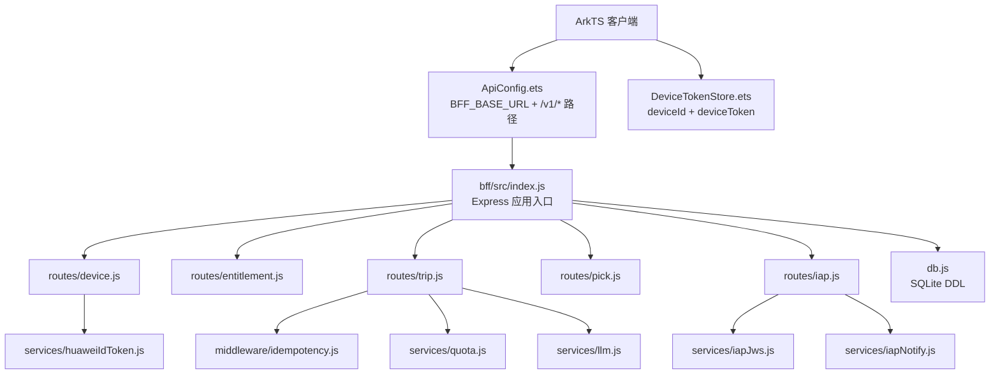
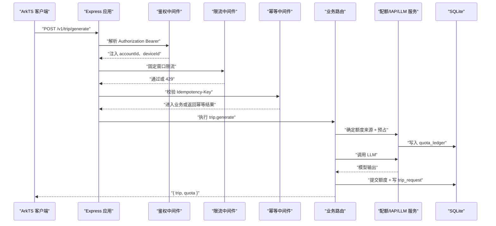
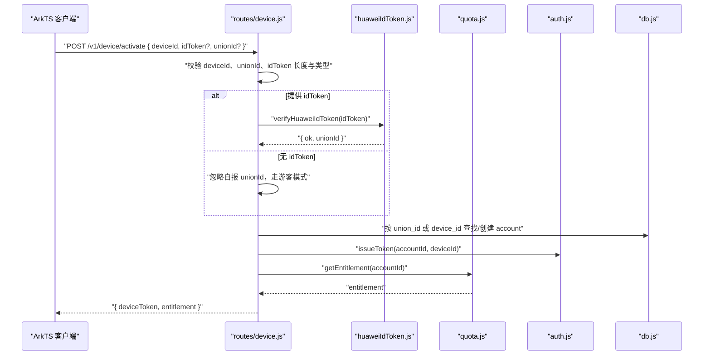
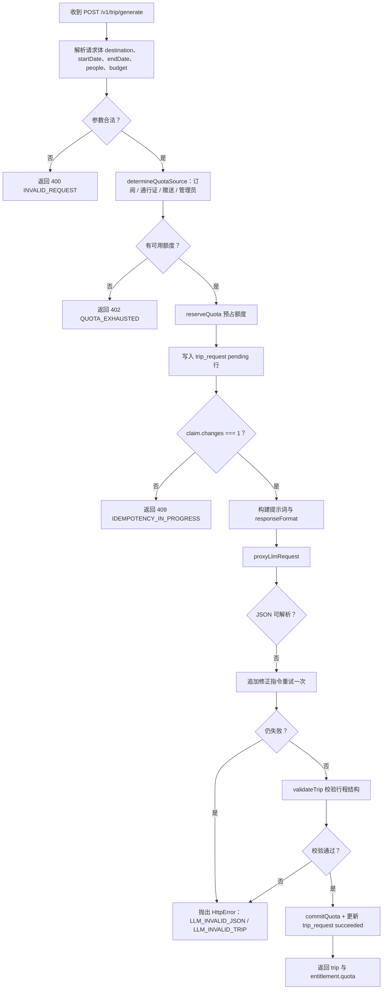
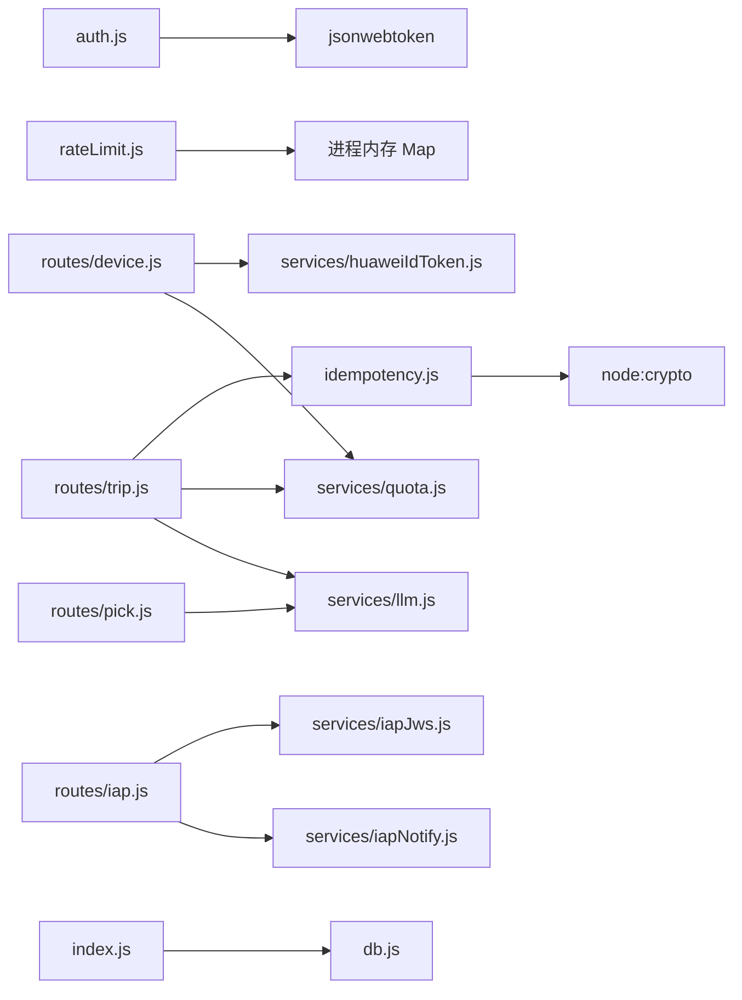

# 前后端通信协议

<cite>
**本文引用的文件**   
- [bff/src/index.js](file://bff/src/index.js)
- [bff/src/middleware/auth.js](file://bff/src/middleware/auth.js)
- [bff/src/middleware/rateLimit.js](file://bff/src/middleware/rateLimit.js)
- [bff/src/middleware/idempotency.js](file://bff/src/middleware/idempotency.js)
- [bff/src/routes/device.js](file://bff/src/routes/device.js)
- [bff/src/routes/entitlement.js](file://bff/src/routes/entitlement.js)
- [bff/src/routes/trip.js](file://bff/src/routes/trip.js)
- [bff/src/routes/pick.js](file://bff/src/routes/pick.js)
- [bff/src/routes/iap.js](file://bff/src/routes/iap.js)
- [bff/src/services/huaweiIdToken.js](file://bff/src/services/huaweiIdToken.js)
- [bff/src/services/quota.js](file://bff/src/services/quota.js)
- [bff/src/lib/http-error.js](file://bff/src/lib/http-error.js)
- [bff/src/db.js](file://bff/src/db.js)
- [entry/src/main/ets/common/config/ApiConfig.ets](file://entry/src/main/ets/common/config/ApiConfig.ets)
- [entry/src/main/ets/data/DeviceTokenStore.ets](file://entry/src/main/ets/data/DeviceTokenStore.ets)
</cite>

## 目录
1. [引言](#引言)
2. [项目结构](#项目结构)
3. [核心组件](#核心组件)
4. [架构总览](#架构总览)
5. [详细组件分析](#详细组件分析)
6. [依赖关系分析](#依赖关系分析)
7. [性能与扩展性](#性能与扩展性)
8. [故障排查指南](#故障排查指南)
9. [结论](#结论)
10. [附录：API 契约与错误码](#附录api-契约与错误码)

## 引言
本文件从代码实现出发，梳理有径 BFF（Backend for Frontend）与 ArkTS 客户端之间的 HTTP 通信协议。重点覆盖：

- RESTful API 设计规范：URL 命名、HTTP 状态码语义、请求响应体结构。
- 认证机制：JWT Token 生成、验证、设备 ID 绑定策略；华为 Account Kit idToken 验签。
- 安全中间件链：鉴权、限流、幂等；IAP 收据签名校验。
- 完整 API 契约：路径、方法、请求头、查询参数、请求体、响应体、错误码。
- 版本管理：以 `/v1` 前缀做 API 版本隔离。
- WebSocket：当前仓库未实现 WebSocket，实时能力通过 HTTP 轮询或平台通知替代。
- 客户端集成示例与错误处理最佳实践。

## 项目结构
后端基于 Express 的 Node.js 服务 `youjing-bff`，前端为 HarmonyOS ArkTS 应用。关键组织方式如下：

- `bff/src/index.js`：Express 应用入口，注册全局中间件、路由与健康检查。
- `bff/src/middleware/`：鉴权、限流、幂等三个横切能力。
- `bff/src/routes/`：按业务域划分设备、权益、行程、景点精选、应用内购买。
- `bff/src/services/`：华为 idToken 验签、配额、IAP JWS 校验、LLM 代理等。
- `bff/src/db.js`：SQLite DDL、迁移与连接初始化。
- `entry/src/main/ets/common/config/ApiConfig.ets`：客户端所有 BFF URL 的唯一来源。
- `entry/src/main/ets/data/DeviceTokenStore.ets`：客户端设备 ID 与 JWT 持久化。

**图表来源**
- [bff/src/index.js:1-55](file://bff/src/index.js#L1-L55)
- [entry/src/main/ets/common/config/ApiConfig.ets:1-66](file://entry/src/main/ets/common/config/ApiConfig.ets#L1-L66)
- [entry/src/main/ets/data/DeviceTokenStore.ets:1-142](file://entry/src/main/ets/data/DeviceTokenStore.ets#L1-L142)

**章节来源**
- [bff/src/index.js:1-55](file://bff/src/index.js#L1-L55)
- [bff/package.json:1-22](file://bff/package.json#L1-L22)
- [entry/src/main/ets/common/config/ApiConfig.ets:1-66](file://entry/src/main/ets/common/config/ApiConfig.ets#L1-L66)

## 核心组件
本节聚焦构成前后端协议的关键模块。

### Express 应用入口
- 加载 `.env`，初始化 SQLite。
- 使用 `express.json({ limit: '2mb', verify })` 解析 JSON，并保留原始字节供 IAP RSA 验签。
- 将 `req.db` 注入到每个请求。
- 注册 `/health` 健康检查。
- 挂载 `/v1/device`、`/v1/entitlement`、`/v1/trip`、`/v1/pick`、`/v1/iap`。
- 统一错误处理中间件把异常转为 `{ error, message }` JSON。

**章节来源**
- [bff/src/index.js:1-55](file://bff/src/index.js#L1-L55)

### 鉴权中间件
- 要求 `Authorization: Bearer <jwt>`。
- 使用 `jsonwebtoken` 验签，成功时把 `accountId`、`deviceId` 挂到请求对象。
- 失败返回 401，错误码 `TOKEN_INVALID`。
- 提供 `issueToken(accountId, deviceId)` 签发 30 天有效 JWT。

**章节来源**
- [bff/src/middleware/auth.js:1-25](file://bff/src/middleware/auth.js#L1-L25)

### 限流中间件
- 基于进程内存 Map 的固定窗口限流。
- 默认每分钟 10 次，可通过环境变量调整。
- 超出返回 429，错误码 `RATE_LIMITED`。
- 明确标注非分布式限流；跨实例需 Redis。

**章节来源**
- [bff/src/middleware/rateLimit.js:1-47](file://bff/src/middleware/rateLimit.js#L1-L47)

### 幂等中间件
- 要求 `Idempotency-Key` 请求头。
- 对请求体做规范化后计算 SHA-256 哈希。
- 用 `(accountId, idempotency_key)` 作为作用域，避免跨用户撞键。
- 支持 `pending`、`failed`、`succeeded` 状态机。
- 同一 key 不同请求体返回 422 `IDEMPOTENCY_KEY_REUSED`。
- 重放成功请求时设置响应头 `Idempotency-Replayed: true`。

**章节来源**
- [bff/src/middleware/idempotency.js:1-122](file://bff/src/middleware/idempotency.js#L1-L122)

### 配额服务
- 订阅额度按月上限 20 次。
- 赠送额度初始 3 次。
- 管理员账户标记为 `unlimited`。
- 提供预占、提交、释放额度的事务化操作。

**章节来源**
- [bff/src/services/quota.js:1-113](file://bff/src/services/quota.js#L1-L113)

### 数据库初始化
- 定义 account、subscription、trip_pass、quota_ledger、trip_request、order、iap_notify_event 表。
- 开启 WAL 模式与外键约束。
- 提供列级增量迁移逻辑。

**章节来源**
- [bff/src/db.js:1-136](file://bff/src/db.js#L1-L136)

## 架构总览
整体调用链是“客户端 → BFF Express → 业务路由 → 中间件 + 外部服务”。

**图表来源**
- [bff/src/index.js:1-55](file://bff/src/index.js#L1-L55)
- [bff/src/middleware/auth.js:1-25](file://bff/src/middleware/auth.js#L1-L25)
- [bff/src/middleware/rateLimit.js:1-47](file://bff/src/middleware/rateLimit.js#L1-L47)
- [bff/src/middleware/idempotency.js:1-122](file://bff/src/middleware/idempotency.js#L1-L122)
- [bff/src/routes/trip.js:1-234](file://bff/src/routes/trip.js#L1-L234)

## 详细组件分析

### 设备激活与认证流程
设备激活接口负责建立“设备标识 + 可选华为账号”与本地账户的映射，并返回 JWT。

**图表来源**
- [bff/src/routes/device.js:1-84](file://bff/src/routes/device.js#L1-L84)
- [bff/src/services/huaweiIdToken.js:1-161](file://bff/src/services/huaweiIdToken.js#L1-L161)
- [bff/src/middleware/auth.js:1-25](file://bff/src/middleware/auth.js#L1-L25)
- [bff/src/services/quota.js:1-113](file://bff/src/services/quota.js#L1-L113)

#### 设备 ID 绑定策略
- 客户端首次启动由 `DeviceTokenStore.ensureDeviceId()` 生成 UUID 并持久化。
- 激活时携带 `deviceId`；若提供 `idToken`，服务端以华为 idToken 的 `sub` 作为 `unionId`。
- 带华为账号的账户记录 `union_id` 唯一；匿名账户使用 `anon-deviceId` 形式。
- 重复激活会更新 `device_id` 和 `last_seen_at`。
- JWT 同时包含 `accountId` 与 `deviceId`，后续受保护接口只要求 Bearer Token。

**章节来源**
- [entry/src/main/ets/data/DeviceTokenStore.ets:1-142](file://entry/src/main/ets/data/DeviceTokenStore.ets#L1-L142)
- [bff/src/routes/device.js:1-84](file://bff/src/routes/device.js#L1-L84)
- [bff/src/services/huaweiIdToken.js:1-161](file://bff/src/services/huaweiIdToken.js#L1-L161)
- [bff/src/middleware/auth.js:1-25](file://bff/src/middleware/auth.js#L1-L25)

#### 华为 idToken 验签要点
- 仅接受 RS256 或 PS256，拒绝 `none` 及 HS* 算法。
- 从官方 JWKS 拉取公钥，缓存 10 分钟，超时 5 秒。
- 校验 `iss`、`aud`、`exp`、`sub`。
- `sub` 直接作为 `unionId`，请求体中的 `unionId` 不被信任。
- 未配置 `HUAWEI_CLIENT_ID` 时返回 `NOT_CONFIGURED`。

**章节来源**
- [bff/src/services/huaweiIdToken.js:1-161](file://bff/src/services/huaweiIdToken.js#L1-L161)

### 行程生成接口
`POST /v1/trip/generate` 是本系统最核心的商业链路接口。

**图表来源**
- [bff/src/routes/trip.js:1-234](file://bff/src/routes/trip.js#L1-L234)
- [bff/src/services/quota.js:1-113](file://bff/src/services/quota.js#L1-L113)
- [bff/src/middleware/idempotency.js:1-122](file://bff/src/middleware/idempotency.js#L1-L122)

#### 请求校验与行为
- 日期必须为 `YYYY-MM-DD`，范围 2020-01-01 至 2100-12-31。
- 行程天数 1–30，人数 1–30，预算为非负整数。
- 免费档最多 8192 token，付费档最多 16384 token。
- 模型输出先严格 JSON 解析，失败则尝试提取第一个完整 JSON 对象；仍失败则发起一次修正调用。
- 修正后仍不是合法 JSON 或行程校验失败，返回 502 业务错误码。

**章节来源**
- [bff/src/routes/trip.js:1-234](file://bff/src/routes/trip.js#L1-L234)

### 景点精选接口
`POST /v1/pick/spots` 用于 AI 精选候选景点排序。

- 不扣生成额度，但仍经过鉴权和限流。
- 请求体验证通过后调用 LLM，最大 2048 token。
- 输出必须是 JSON，否则返回 422 `DECISION_REJECTED`。
- 对模型输出做白名单守卫，只允许传入候选 ID 列表中的值。

**章节来源**
- [bff/src/routes/pick.js:1-45](file://bff/src/routes/pick.js#L1-L45)

### 权益查询接口
`GET /v1/entitlement` 返回账户当前权益快照。

- 需要鉴权中间件。
- 返回订阅信息、通行证列表、赠送剩余次数、本月已用次数、月度上限、是否管理员。

**章节来源**
- [bff/src/routes/entitlement.js:1-15](file://bff/src/routes/entitlement.js#L1-L15)
- [bff/src/services/quota.js:1-113](file://bff/src/services/quota.js#L1-L113)

### 应用内购买接口
`/v1/iap` 下有两个重要子接口：

#### 收据验证
`POST /v1/iap/verify`

- 支持 `pass` 与 `subscription` 两种商品类型。
- 订阅产品仅允许 `youjing_sub_monthly`、`youjing_sub_yearly`。
- JWS 字段长度上限 8192。
- 未配置 IAP 根证书或 APP_ID 返回 503 `IAP_NOT_CONFIGURED`。
- 收据只能绑定一个账号；重复绑定其他账号返回 409 `RECEIPT_ALREADY_USED`。
- 退款收据再次兑换返回 200 且 `verified: false`。
- 成功后返回 `verified: true`、`entitlement`、可选 `passId`。

#### 支付回调
`POST /v1/iap/notify`

- 接收华为 v3 通知，请求体含 `jwsNotification`。
- 原始字节经 RSA 验签，不能依赖 `express.json` 重序列化后的 body。
- 部署态问题返回 503，其他验签失败返回 401。
- 成功回调返回 200 并确认应用生效。

**章节来源**
- [bff/src/routes/iap.js:1-192](file://bff/src/routes/iap.js#L1-L192)

### 客户端集成点
客户端通过 `ApiConfig` 统一配置 BFF 地址与端点，并通过 `DeviceTokenStore` 管理设备标识与 JWT。

- `ApiConfig.BFF_BASE_URL` 指向 BFF 服务。
- `ApiConfig.LLM_CHAT_ENDPOINT` 对应 `/v1/trip/generate`。
- 开发态 `DEV_SKIP_BFF` 可在未部署 BFF 时绕过权益门禁并使用本地 Mock。
- `DirectConfig` 提供直连 LLM 的开发兜底方案，不上架。

**章节来源**
- [entry/src/main/ets/common/config/ApiConfig.ets:1-66](file://entry/src/main/ets/common/config/ApiConfig.ets#L1-L66)
- [entry/src/main/ets/data/DeviceTokenStore.ets:1-142](file://entry/src/main/ets/data/DeviceTokenStore.ets#L1-L142)

## 依赖关系分析

**图表来源**
- [bff/src/middleware/auth.js:1-25](file://bff/src/middleware/auth.js#L1-L25)
- [bff/src/middleware/rateLimit.js:1-47](file://bff/src/middleware/rateLimit.js#L1-L47)
- [bff/src/middleware/idempotency.js:1-122](file://bff/src/middleware/idempotency.js#L1-L122)
- [bff/src/routes/device.js:1-84](file://bff/src/routes/device.js#L1-L84)
- [bff/src/routes/trip.js:1-234](file://bff/src/routes/trip.js#L1-L234)
- [bff/src/routes/pick.js:1-45](file://bff/src/routes/pick.js#L1-L45)
- [bff/src/routes/iap.js:1-192](file://bff/src/routes/iap.js#L1-L192)
- [bff/src/db.js:1-136](file://bff/src/db.js#L1-L136)

### 耦合与内聚
- 路由层低耦合，主要依赖中间件与 services。
- 配额逻辑集中在 `quota.js`，被行程、权益查询、购买等多处复用。
- 幂等性与额度预占共享 `trip_request` 与 `quota_ledger` 表，形成强一致性边界。
- IAP 验签与通知解耦为 JWS 与通知两个 service，便于测试与部署差异处理。

### 外部依赖
- `express`：HTTP 服务与中间件。
- `better-sqlite3`：同步 SQLite 访问，适合单进程 BFF。
- `jsonwebtoken`：JWT 签发与验证。
- `uuid`：UUID 生成（包声明存在）。
- `dotenv`：环境变量加载。
- 华为 OpenID Connect JWKS：本地验签 idToken。

**章节来源**
- [bff/package.json:1-22](file://bff/package.json#L1-L22)
- [bff/src/db.js:1-136](file://bff/src/db.js#L1-L136)
- [bff/src/services/huaweiIdToken.js:1-161](file://bff/src/services/huaweiIdToken.js#L1-L161)

## 性能与扩展性
- 限流为进程内固定窗口，简单高效但不可水平扩展；多实例场景应改用 Redis。
- SQLite 使用 WAL 模式提升并发读性能，但仍是单机存储；未来可扩展到 MySQL/PostgreSQL。
- 行程生成可能触发两次 LLM 调用（初次 + 修正），应在客户端侧做好幂等与超时控制。
- IAP 通知要求保留原始请求体，避免 JSON 序列化破坏 RSA 签名。
- JWKS 缓存减少外部网络抖动对鉴权的影响。

[本节为通用指导，不直接分析具体文件]

## 故障排查指南

### 常见错误分类
- 客户端参数错误：400，如 `INVALID_REQUEST`、`MISSING_DEVICE_ID`、`INVALID_JWS`。
- 身份错误：401，如 `TOKEN_INVALID`、`ID_TOKEN_INVALID`。
- 权限不足：402，如 `QUOTA_EXHAUSTED`。
- 资源冲突：409，如 `IDEMPOTENCY_IN_PROGRESS`、`RECEIPT_ALREADY_USED`。
- 语义错误：422，如 `IDEMPOTENCY_KEY_REUSED`、`DECISION_REJECTED`。
- 外部服务失败：502，如 `LLM_INVALID_JSON`、`LLM_INVALID_TRIP`。
- 部署态问题：503，如 `IAP_NOT_CONFIGURED`。
- 通用内部错误：500，由全局错误中间件统一包装。

### 排查步骤
1. 确认客户端基础 URL 是否指向正确 BFF。
2. 确认 `Authorization` 头是否为 `Bearer <jwt>`。
3. 对耗时接口确认是否携带 `Idempotency-Key`。
4. 检查 `quota` 返回的 `usedToday`、`dailyCap`、`giftRemaining`。
5. 对 IAP 相关错误区分 503（未配置）与 401/200 verified:false（收据无效）。
6. 查看日志中 `[device]`、`[trip]`、`[pick]`、`[iap]`、`[health]`、`[error]` 标签。

**章节来源**
- [bff/src/index.js:1-55](file://bff/src/index.js#L1-L55)
- [bff/src/lib/http-error.js:1-8](file://bff/src/lib/http-error.js#L1-L8)
- [bff/src/routes/device.js:1-84](file://bff/src/routes/device.js#L1-L84)
- [bff/src/routes/trip.js:1-234](file://bff/src/routes/trip.js#L1-L234)
- [bff/src/routes/iap.js:1-192](file://bff/src/routes/iap.js#L1-L192)

## 结论
本项目的通信协议以 BFF 为中心，围绕设备激活、JWT 鉴权、配额管理、行程生成、景点精选与应用内购买展开。协议强调：

- 明确的 `/v1` 版本前缀。
- 严格的参数校验与错误码。
- 幂等性保证长耗时、高成本操作。
- 面向部署差异的 fail-closed 设计。
- 客户端集中式 URL 与票据管理。

WebSocket 在当前仓库中不存在；如需实时推送，建议新增独立通道并在协议文档中单独约定连接、消息格式与断线重连策略。

[本节为总结性内容，不直接分析具体文件]

## 附录：API 契约与错误码

### 通用规范
- 所有业务 API 以 `/v1` 开头。
- 认证接口位于 `/v1/device`，无需鉴权。
- 受保护接口需要 `Authorization: Bearer <jwt>`。
- 响应体统一为 JSON。
- 错误响应体结构为 `{ error: string, message: string }`。
- 健康检查 `GET /health` 返回 `{ status, db }`。

**章节来源**
- [bff/src/index.js:1-55](file://bff/src/index.js#L1-L55)
- [bff/src/middleware/auth.js:1-25](file://bff/src/middleware/auth.js#L1-L25)
- [bff/src/lib/http-error.js:1-8](file://bff/src/lib/http-error.js#L1-L8)

### 接口清单

| 方法 | 路径 | 鉴权 | 限流 | 幂等 | 用途 | 主要请求体 | 主要响应体 |
|---|---|---:|---:|---:|---|---|---|
| POST | `/v1/device/activate` | 否 | 否 | 否 | 设备激活、获取 JWT | `deviceId`, `idToken?`, `unionId?` | `deviceToken`, `entitlement` |
| GET | `/v1/entitlement` | 是 | 否 | 否 | 查询权益 | 无 | `subscription`, `passes`, `giftRemaining`, `usedToday`, `dailyCap`, `unlimited` |
| POST | `/v1/trip/generate` | 是 | 是 | 是 | 生成行程 | `destination`, `startDate`, `endDate`, `people`, `budget`, `passId?` | `trip`, `quota` |
| POST | `/v1/pick/spots` | 是 | 是 | 否 | AI 精选景点 | `candidates`, 用户偏好字段 | `ranked` 列表 |
| POST | `/v1/iap/verify` | 可选 | 否 | 否 | 验证应用内购买收据 | `productType`, `productId?`, `jwsPurchaseOrder?`, `jwsSubscriptionStatus?`, `localTripId?` | `verified`, `entitlement`, `passId?` |
| POST | `/v1/iap/notify` | 否 | 否 | 否 | 华为支付回调 | `jwsNotification` | `ok`, `applied`, `kind` |
| GET | `/health` | 否 | 否 | 否 | 健康检查 | 无 | `status`, `db` |

**章节来源**
- [bff/src/routes/device.js:1-84](file://bff/src/routes/device.js#L1-L84)
- [bff/src/routes/entitlement.js:1-15](file://bff/src/routes/entitlement.js#L1-L15)
- [bff/src/routes/trip.js:1-234](file://bff/src/routes/trip.js#L1-L234)
- [bff/src/routes/pick.js:1-45](file://bff/src/routes/pick.js#L1-L45)
- [bff/src/routes/iap.js:1-192](file://bff/src/routes/iap.js#L1-L192)
- [bff/src/index.js:1-55](file://bff/src/index.js#L1-L55)

### 请求头规范

| 请求头 | 必需 | 说明 |
|---|---:|---|
| `Authorization` | 受保护接口必填 | `Bearer <jwt>`，JWT 包含 `accountId`、`deviceId` |
| `Idempotency-Key` | 幂等接口必填 | 客户端生成的唯一键，用于幂等与重放 |
| Content-Type | 多数接口 | `application/json` |
| `Idempotency-Replayed` | 响应头 | 当幂等重放成功时返回 `true` |

**章节来源**
- [bff/src/middleware/auth.js:1-25](file://bff/src/middleware/auth.js#L1-L25)
- [bff/src/middleware/idempotency.js:1-122](file://bff/src/middleware/idempotency.js#L1-L122)

### 错误码汇总

| 错误码 | HTTP 状态码 | 含义 | 常见修复 |
|---|---:|---|---|
| `TOKEN_INVALID` | 401 | JWT 缺失、格式错误或已过期 | 重新激活设备或刷新票据 |
| `ID_TOKEN_INVALID` | 401 | 华为 idToken 验签失败 | 检查华为登录流程与证书配置 |
| `MISSING_DEVICE_ID` | 400 | 缺少或非法 `deviceId` | 确保客户端生成并传递设备 ID |
| `INVALID_UNION_ID` | 400 | 自报 `unionId` 非法 | 优先使用 `idToken.sub` |
| `INVALID_REQUEST` | 400 | 行程或其他请求参数不合法 | 检查日期、人数、预算、枚举值 |
| `UNSUPPORTED_PRODUCT_TYPE` | 400 | 不支持的商品类型 | 使用 `pass` 或 `subscription` |
| `UNKNOWN_PRODUCT_ID` | 400 | 未知订阅商品 ID | 仅使用允许的产品 ID |
| `INVALID_JWS` / `MISSING_JWS` | 400 | 收据字段非法或缺失 | 检查 JWS 字符串与长度 |
| `QUOTA_EXHAUSTED` | 402 | 额度已用尽 | 等待月度重置或开通订阅 |
| `IDEMPOTENCY_IN_PROGRESS` | 409 | 同一幂等键正在处理 | 稍后重试或使用新 key |
| `RECEIPT_ALREADY_USED` | 409 | 收据已绑定其他账号 | 检查账号与收据归属 |
| `IDEMPOTENCY_KEY_REUSED` | 422 | 同一幂等键对应不同请求体 | 更换 `Idempotency-Key` |
| `DECISION_REJECTED` | 422 | 模型输出不是 JSON | 检查模型输出与客户端解析 |
| `LLM_INVALID_JSON` | 502 | 模型输出无法解析为 JSON | 重试或降低行程复杂度 |
| `LLM_INVALID_TRIP` | 502 | 行程结构校验失败 | 检查行程天数与字段 |
| `IAP_NOT_CONFIGURED` | 503 | IAP 验签未配置 | 部署时配置根证书与 APP_ID |
| `NOTIFY_BAD_FORMAT` | 400 | 支付回调格式非法 | 检查华为通知 payload |
| `INTERNAL_ERROR` | 500 | 未分类内部错误 | 查看服务端日志 |

**章节来源**
- [bff/src/middleware/auth.js:1-25](file://bff/src/middleware/auth.js#L1-L25)
- [bff/src/middleware/rateLimit.js:1-47](file://bff/src/middleware/rateLimit.js#L1-L47)
- [bff/src/middleware/idempotency.js:1-122](file://bff/src/middleware/idempotency.js#L1-L122)
- [bff/src/routes/device.js:1-84](file://bff/src/routes/device.js#L1-L84)
- [bff/src/routes/trip.js:1-234](file://bff/src/routes/trip.js#L1-L234)
- [bff/src/routes/pick.js:1-45](file://bff/src/routes/pick.js#L1-L45)
- [bff/src/routes/iap.js:1-192](file://bff/src/routes/iap.js#L1-L192)

### 版本管理与向后兼容
- 当前所有业务接口位于 `/v1`。
- 新增大版本时应引入 `/v2` 等新路径，而不是直接修改 `/v1`。
- 现有字段名 `usedToday`、`dailyCap` 在配额服务中保留历史命名，尽管实际语义改为“按月”，以避免客户端升级前出现字段缺失。
- 数据库列采用增量迁移，新增字段不会破坏旧库。

**章节来源**
- [bff/src/index.js:1-55](file://bff/src/index.js#L1-L55)
- [bff/src/services/quota.js:1-113](file://bff/src/services/quota.js#L1-L113)
- [bff/src/db.js:1-136](file://bff/src/db.js#L1-L136)

### WebSocket 说明
当前仓库未实现 WebSocket。实时通信需求可通过以下方式替代：

- 短轮询：客户端定期调用 `/v1/entitlement` 或专用状态查询接口。
- 平台通知：结合华为推送或系统通知完成状态变更提醒。
- 若未来引入 WebSocket，应新增独立路径、连接握手协议、心跳、断线重连与消息版本字段。

[本节为概念性说明，不涉及具体 WebSocket 源码]

### 客户端集成最佳实践
1. 启动时调用 `DeviceTokenStore.init()` 并 `ensureDeviceId()`。
2. 首次进入应用调用 `/v1/device/activate`，保存 `deviceToken`。
3. 所有受保护请求附加 `Authorization: Bearer <token>`。
4. 调用 `/v1/trip/generate` 时必须生成随机 `Idempotency-Key`。
5. 遇到 401 时触发重新激活流程，不要静默重试。
6. 遇到 429 时指数退避，显示“请求太频繁，请稍后再试”。
7. 遇到 402 时跳转付费或订阅页面。
8. 对 IAP 回调保持幂等，依据 `purchase_token` 去重。
9. 始终解析统一错误结构 `{ error, message }`，不要假设状态码即可判断业务结果。

**章节来源**
- [entry/src/main/ets/data/DeviceTokenStore.ets:1-142](file://entry/src/main/ets/data/DeviceTokenStore.ets#L1-L142)
- [entry/src/main/ets/common/config/ApiConfig.ets:1-66](file://entry/src/main/ets/common/config/ApiConfig.ets#L1-L66)
- [bff/src/middleware/rateLimit.js:1-47](file://bff/src/middleware/rateLimit.js#L1-L47)
- [bff/src/routes/iap.js:1-192](file://bff/src/routes/iap.js#L1-L192)