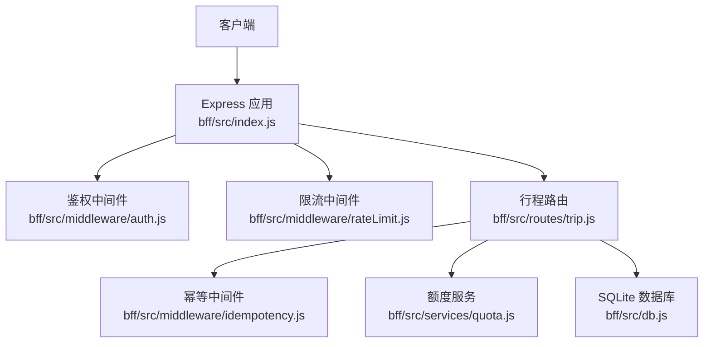
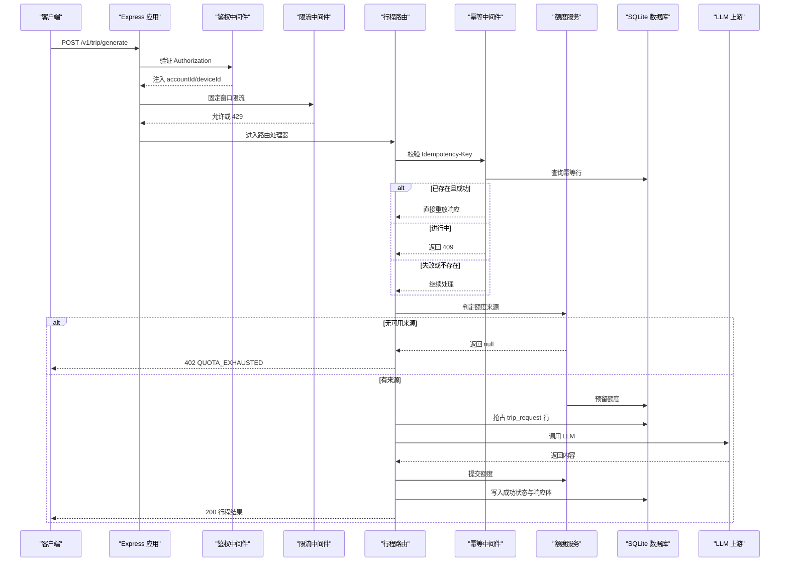
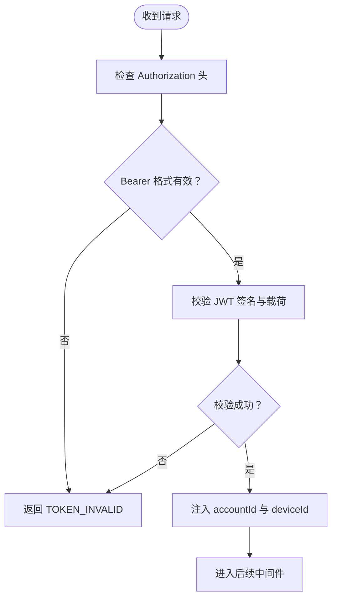
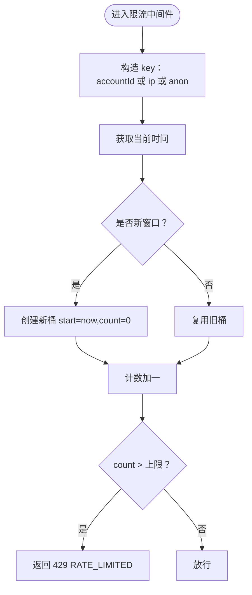
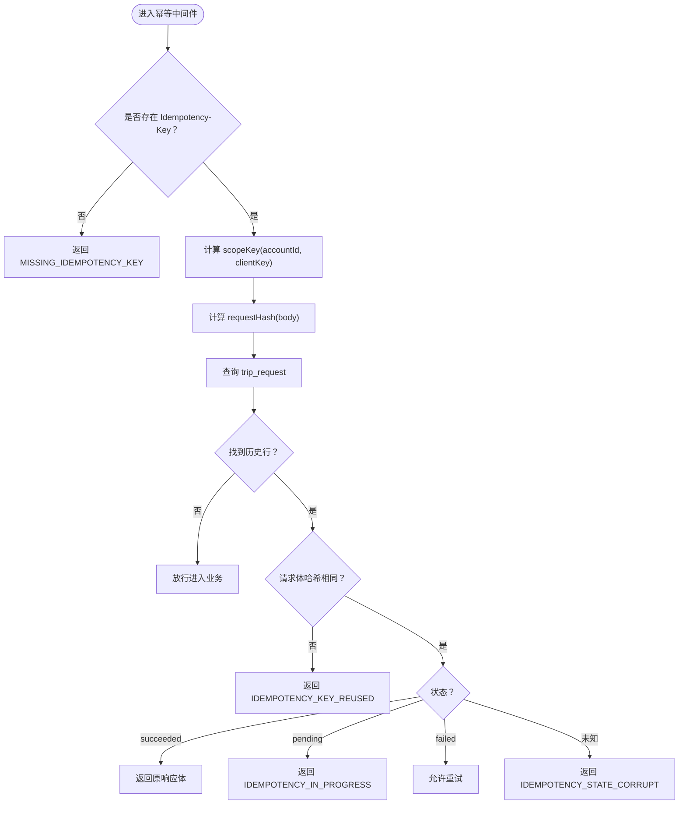
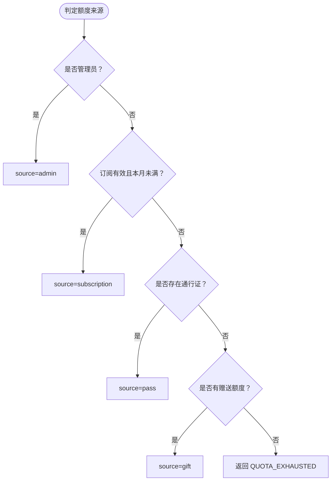
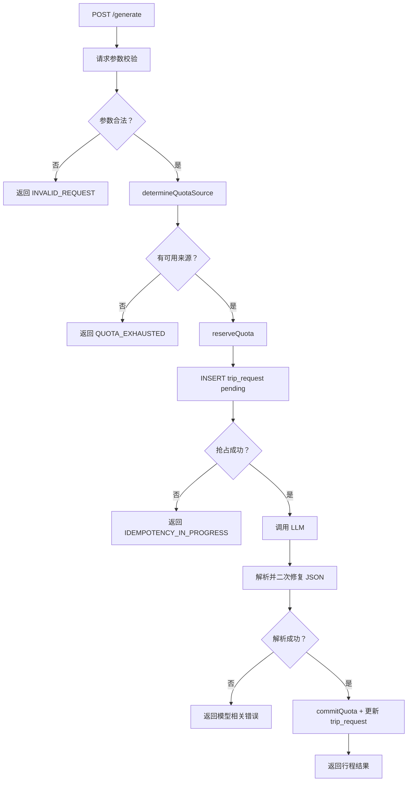
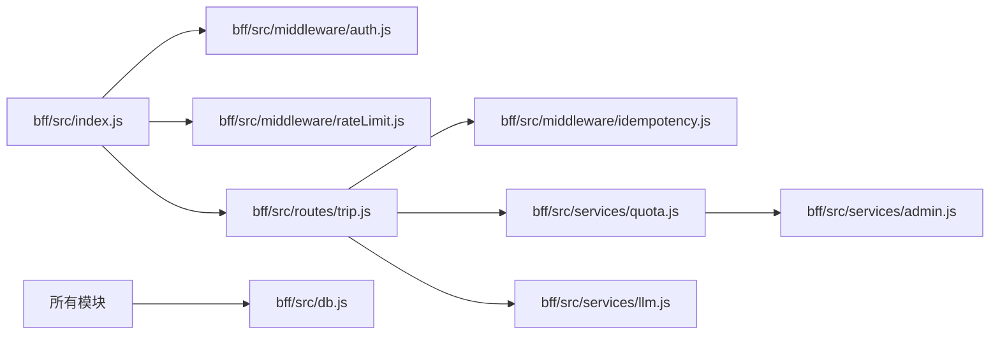

# 安全中间件

<cite>
**本文引用的文件**   
- [bff/src/index.js](file://bff/src/index.js)
- [bff/src/middleware/auth.js](file://bff/src/middleware/auth.js)
- [bff/src/middleware/rateLimit.js](file://bff/src/middleware/rateLimit.js)
- [bff/src/middleware/idempotency.js](file://bff/src/middleware/idempotency.js)
- [bff/src/services/quota.js](file://bff/src/services/quota.js)
- [bff/src/routes/trip.js](file://bff/src/routes/trip.js)
- [bff/src/db.js](file://bff/src/db.js)
- [bff/test/idempotency.test.js](file://bff/test/idempotency.test.js)
- [bff/test/rate-limit.test.js](file://bff/test/rate-limit.test.js)
- [bff/test/quota-window.test.js](file://bff/test/quota-window.test.js)
</cite>

## 目录
1. [引言](#引言)
2. [项目结构](#项目结构)
3. [核心组件](#核心组件)
4. [架构总览](#架构总览)
5. [详细组件分析](#详细组件分析)
6. [依赖关系分析](#依赖关系分析)
7. [性能考虑](#性能考虑)
8. [故障排查指南](#故障排查指南)
9. [结论](#结论)

## 引言
本文面向 BFF（后端前置服务）中的“安全中间件”能力，围绕以下目标展开：
- 请求签名机制：说明当前 JWT 认证流程、时间窗口与防重放设计现状。
- 限流保护：解释账号级固定窗口限流、部署侧 IP 限流职责边界。
- 幂等性保证：说明 Idempotency-Key 唯一请求标识、去重存储、重复请求处理策略。
- 额度管理系统：说明订阅/通行证/赠送额度的检查、免费额度计算与超额处理。
- 中间件配置选项：阈值、白名单、监控指标的可调项。
- 错误响应格式：统一错误码、消息与调试信息。
- 性能优化：缓存策略、异步处理、连接池与数据库 WAL 模式。

需要特别说明的是：仓库当前未实现基于 HMAC 的请求签名；认证采用 JWT，限流为进程内存固定窗口，IP 限流属于网关或反向代理的职责。幂等性和额度管理已有较完整实现。

## 项目结构
BFF 的安全能力集中在 Express 应用初始化、三个中间件、配额服务与路由装配中：
- 应用入口装配 `/v1/trip`、`/v1/pick` 等路由，并挂载鉴权与限流中间件。
- 鉴权中间件解析 `Authorization: Bearer <JWT>`，注入账号和设备标识。
- 限流中间件按账号维度做固定窗口计数，超出返回 429。
- 幂等中间件校验 `Idempotency-Key`，通过 SQLite 表去重与状态机控制。
- 配额服务根据订阅、通行证、赠送额度判断可用来源，并维护预留、提交、释放状态。
- 行程生成路由在扣费前做参数校验，调用 LLM，并在事务中结算额度与幂等结果。

**图表来源**
- [bff/src/index.js:1-55](file://bff/src/index.js#L1-L55)
- [bff/src/middleware/auth.js:1-25](file://bff/src/middleware/auth.js#L1-L25)
- [bff/src/middleware/rateLimit.js:1-47](file://bff/src/middleware/rateLimit.js#L1-L47)
- [bff/src/middleware/idempotency.js:1-122](file://bff/src/middleware/idempotency.js#L1-L122)
- [bff/src/services/quota.js:1-113](file://bff/src/services/quota.js#L1-L113)
- [bff/src/routes/trip.js:1-200](file://bff/src/routes/trip.js#L1-L200)
- [bff/src/db.js:1-136](file://bff/src/db.js#L1-L136)

**章节来源**
- [bff/src/index.js:1-55](file://bff/src/index.js#L1-L55)

## 核心组件
- 鉴权中间件：负责 JWT 校验、载荷注入和无效票据的错误响应。
- 限流中间件：按账号固定窗口限制请求次数，默认每分钟 10 次。
- 幂等中间件：校验 `Idempotency-Key`，规范化请求体哈希，避免同键不同体复用。
- 额度服务：查询订阅、通行证、赠送额度，决定扣费来源，并提供预留、提交、释放能力。
- 行程路由：在限额与幂等之后发起模型调用，并在事务中持久化结果。

**章节来源**
- [bff/src/middleware/auth.js:1-25](file://bff/src/middleware/auth.js#L1-L25)
- [bff/src/middleware/rateLimit.js:1-47](file://bff/src/middleware/rateLimit.js#L1-L47)
- [bff/src/middleware/idempotency.js:1-122](file://bff/src/middleware/idempotency.js#L1-L122)
- [bff/src/services/quota.js:1-113](file://bff/src/services/quota.js#L1-L113)
- [bff/src/routes/trip.js:1-200](file://bff/src/routes/trip.js#L1-L200)

## 架构总览
下图展示一次行程生成的端到端流程，包括鉴权、限流、幂等、额度、模型调用与事务结算。

**图表来源**
- [bff/src/index.js:1-55](file://bff/src/index.js#L1-L55)
- [bff/src/middleware/auth.js:1-25](file://bff/src/middleware/auth.js#L1-L25)
- [bff/src/middleware/rateLimit.js:1-47](file://bff/src/middleware/rateLimit.js#L1-L47)
- [bff/src/middleware/idempotency.js:1-122](file://bff/src/middleware/idempotency.js#L1-L122)
- [bff/src/services/quota.js:1-113](file://bff/src/services/quota.js#L1-L113)
- [bff/src/routes/trip.js:1-200](file://bff/src/routes/trip.js#L1-L200)

## 详细组件分析

### 鉴权中间件与请求签名
当前 BFF 不使用 HMAC 请求签名，而是使用 JWT 作为身份凭证。

- 认证流程
  - 要求 `Authorization: Bearer <token>`。
  - 使用环境变量配置的密钥校验 JWT。
  - 成功后向请求注入 `accountId` 与 `deviceId`。
  - 失败返回 `TOKEN_INVALID`。
- 时间戳验证与防重放
  - 当前实现未显式校验 JWT `exp` 字段以外的时间窗口。
  - 没有基于时间戳与签名的防重放机制。
  - 如需防重放，建议结合服务端随机 Nonce + 时间窗口 + HMAC 签名，但需先补充客户端签名生成与传输规范。
- 可配置项
  - `JWT_SECRET`：JWT 签名密钥。
  - 令牌签发函数用于登录流程返回短期或长期凭证。

**图表来源**
- [bff/src/middleware/auth.js:1-25](file://bff/src/middleware/auth.js#L1-L25)

**章节来源**
- [bff/src/middleware/auth.js:1-25](file://bff/src/middleware/auth.js#L1-L25)

### 限流保护
当前限流是“账号固定窗口”中间件，不是 IP 限流，也不是分布式限流。

- 限流维度
  - 优先使用 `accountId`；未登录时回退到 `req.ip` 或匿名键。
  - 每个进程维护一个 `Map` 桶，记录窗口起始时间与计数。
- 阈值与窗口
  - 默认每分钟 10 次。
  - 可通过 `RATE_LIMIT_PER_MINUTE` 与 `RATE_LIMIT_WINDOW_MS` 调整。
- 行为
  - 超过上限返回 429，错误码 `RATE_LIMITED`。
  - 测试覆盖超阈后等待窗口恢复、重置计数器。
- 部署边界
  - 多实例部署下每进程独立计数，不具备跨实例一致性。
  - IP 级限流应由网关或反向代理承担。

**图表来源**
- [bff/src/middleware/rateLimit.js:1-47](file://bff/src/middleware/rateLimit.js#L1-L47)

**章节来源**
- [bff/src/middleware/rateLimit.js:1-47](file://bff/src/middleware/rateLimit.js#L1-L47)
- [bff/test/rate-limit.test.js:1-44](file://bff/test/rate-limit.test.js#L1-L44)

### 幂等性保证
幂等中间件通过客户端提供的 `Idempotency-Key` 与服务端规范化请求体哈希，结合 SQLite 的幂等表完成去重与状态机控制。

- 唯一请求标识
  - 客户端必须提供非空 `Idempotency-Key`。
  - 服务端将 `accountId/deviceId` 与客户端 key 组合成作用域键，防止跨用户撞键。
- 请求体归一化
  - 对象键排序、忽略 `undefined` 键，数组保持顺序。
  - 对归一化后的请求体计算 SHA-256 哈希。
- 去重存储
  - 使用 `trip_request` 表的 `idempotency_key` 唯一索引。
  - 首次请求插入 `pending`，成功写入 `succeeded` 与响应体，失败写入 `failed`。
- 重复请求处理
  - 已成功：原样返回首次响应，并设置 `Idempotency-Replayed` 头。
  - 进行中：返回 409，提示稍后重试。
  - 失败且请求体相同：允许重新走业务逻辑。
  - 失败且请求体不同：返回 422，禁止复用 key。
  - 缺少 key 或缺少账号标识：分别返回 400 与 401。

**图表来源**
- [bff/src/middleware/idempotency.js:1-122](file://bff/src/middleware/idempotency.js#L1-L122)

**章节来源**
- [bff/src/middleware/idempotency.js:1-122](file://bff/src/middleware/idempotency.js#L1-L122)
- [bff/test/idempotency.test.js:1-161](file://bff/test/idempotency.test.js#L1-L161)

### 额度管理系统
额度系统由配额服务与行程路由共同实现，支持订阅、通行证、赠送额度与管理员白名单。

- 会员权益检查
  - 查询活跃订阅，同时校验 `status='active'` 与 `period_end >= now`。
  - 查询活跃通行证，并映射到本地行程 ID。
  - 汇总赠送额度账本，计算剩余赠送次数。
  - 管理员账号通过 `ADMIN_ACCOUNT_IDS` 环境变量启用无限额度。
- 免费额度计算
  - 免费档对应赠送额度来源。
  - 订阅与通行证被视为付费档，不享受免费 token 上限。
  - 免费档最大输出 token 为 8192，付费档为 16384。
- 超额处理
  - 订阅当月成功次数达到 20 次后，不再使用订阅来源。
  - 若无通行证或赠送额度，则返回 402 `QUOTA_EXHAUSTED`。
- 额度状态机
  - `reserved`：预留失败额度。
  - `committed`：提交成功，计入月度用量。
  - `released`：失败释放，允许同键重试。

**图表来源**
- [bff/src/services/quota.js:1-113](file://bff/src/services/quota.js#L1-L113)
- [bff/src/routes/trip.js:1-200](file://bff/src/routes/trip.js#L1-L200)

**章节来源**
- [bff/src/services/quota.js:1-113](file://bff/src/services/quota.js#L1-L113)
- [bff/test/quota-window.test.js:1-112](file://bff/test/quota-window.test.js#L1-L112)
- [bff/src/routes/trip.js:1-200](file://bff/src/routes/trip.js#L1-L200)

### 接口级配额控制
行程生成接口在多个阶段进行配额控制：

1. 鉴权通过后进入限流中间件，防止高频调用放大成本。
2. 幂等中间件确保同一语义请求不会重复产生副作用。
3. 路由层先做请求参数校验，避免坏请求触发模型调用。
4. 调用额度服务确定来源，若不可用直接拒绝。
5. 预留额度并抢占幂等行，并发下只有一个请求能拿到 `pending` 行。
6. 模型调用成功后在事务内提交额度、写入成功状态与响应体。
7. 失败路径释放额度，避免占用永久额度。

**图表来源**
- [bff/src/routes/trip.js:1-200](file://bff/src/routes/trip.js#L1-L200)
- [bff/src/services/quota.js:1-113](file://bff/src/services/quota.js#L1-L113)

**章节来源**
- [bff/src/routes/trip.js:1-200](file://bff/src/routes/trip.js#L1-L200)

## 依赖关系分析
- 应用入口依赖所有中间件与路由。
- 行程路由依赖幂等中间件、额度服务、提示词构建器、JSON 提取器与 HTTP 错误封装。
- 额度服务依赖管理员判断与 SQLite 查询。
- 数据库初始化负责建表、WAL 模式与外键约束，并兼容旧库字段迁移。

**图表来源**
- [bff/src/index.js:1-55](file://bff/src/index.js#L1-L55)
- [bff/src/routes/trip.js:1-200](file://bff/src/routes/trip.js#L1-L200)
- [bff/src/services/quota.js:1-113](file://bff/src/services/quota.js#L1-L113)
- [bff/src/db.js:1-136](file://bff/src/db.js#L1-L136)

**章节来源**
- [bff/src/index.js:1-55](file://bff/src/index.js#L1-L55)
- [bff/src/db.js:1-136](file://bff/src/db.js#L1-L136)

## 性能考虑
- 缓存策略
  - 限流中间件使用进程内 `Map` 做固定窗口计数，无外部缓存。
  - 幂等重放依赖 SQLite，适合单机或单副本部署；分布式场景应引入 Redis 或共享 KV。
- 异步处理
  - 行程生成主流程为异步，等待 LLM 返回；中间件本身同步执行。
  - 长时间任务会占用进程连接与内存，应避免在限流之外出现长尾请求。
- 连接池与数据库
  - SQLite 使用 WAL 模式与外键约束。
  - 没有显式连接池；每次写操作通常通过预编译语句执行。
  - 数据库路径可通过 `DB_PATH` 环境变量调整，便于容器卷挂载。
- 可扩展点
  - 限流升级为 Redis 固定窗口或令牌桶。
  - 幂等表增加 TTL 清理策略，避免历史数据膨胀。
  - 额度查询增加缓存层，减少频繁读取订阅与通行证表。

[本节为通用性能讨论，不直接分析具体代码片段]

## 故障排查指南
- 鉴权失败
  - 现象：返回 `TOKEN_INVALID`。
  - 可能原因：缺少 `Authorization` 头、Bearer 格式错误、JWT 密钥不一致或票据过期。
  - 定位：检查 `bff/src/middleware/auth.js`。
- 限流触发
  - 现象：返回 429 `RATE_LIMITED`。
  - 可能原因：账号请求频率超过 `RATE_LIMIT_PER_MINUTE`，或窗口未结束。
  - 定位：检查 `bff/src/middleware/rateLimit.js` 与测试用例。
- 幂等冲突
  - 现象：返回 `IDEMPOTENCY_IN_PROGRESS` 或 `IDEMPOTENCY_KEY_REUSED`。
  - 可能原因：同一 key 正在处理中，或同一 key 被用于不同请求体。
  - 定位：检查 `bff/src/middleware/idempotency.js` 与测试用例。
- 额度耗尽
  - 现象：返回 402 `QUOTA_EXHAUSTED`。
  - 可能原因：订阅月度次数用尽、无通行证、赠送额度耗尽。
  - 定位：检查 `bff/src/services/quota.js` 与配额窗口测试。
- 数据库异常
  - 现象：健康检查返回 `degraded` 或数据库初始化失败。
  - 可能原因：WAL 文件损坏、只读文件系统、路径不可写。
  - 定位：检查 `bff/src/db.js` 与应用入口健康检查。

**章节来源**
- [bff/src/middleware/auth.js:1-25](file://bff/src/middleware/auth.js#L1-L25)
- [bff/src/middleware/rateLimit.js:1-47](file://bff/src/middleware/rateLimit.js#L1-L47)
- [bff/src/middleware/idempotency.js:1-122](file://bff/src/middleware/idempotency.js#L1-L122)
- [bff/src/services/quota.js:1-113](file://bff/src/services/quota.js#L1-L113)
- [bff/src/db.js:1-136](file://bff/src/db.js#L1-L136)
- [bff/src/index.js:1-55](file://bff/src/index.js#L1-L55)

## 结论
当前 BFF 的安全中间件以 JWT 鉴权、账号级固定窗口限流、SQLite 幂等表与配额状态机为核心：
- 尚未实现 HMAC 请求签名与时间戳防重放；如需加强，应在网关或 BFF 新增签名校验层。
- 限流为进程内存实现，适合单实例防护；分布式限流应引入共享存储。
- 幂等性设计完善，覆盖重放、冲突、失败重试与状态损坏保护。
- 额度管理区分订阅、通行证、赠送与管理员白名单，按月计费口径与产品文案一致。
- 错误响应统一使用 `error` 与 `message` 字段，便于客户端集中处理。
- 性能方面可进一步引入分布式缓存、连接池与异步队列，以支撑更高并发与更稳定的大模型调用链路。