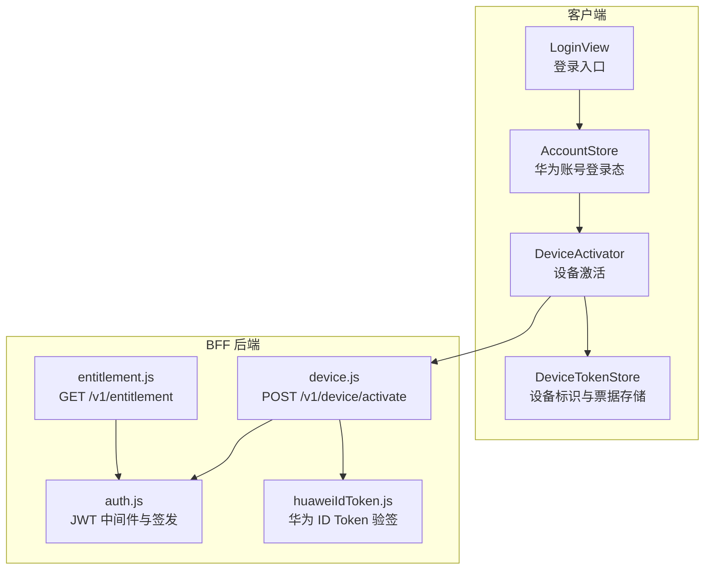
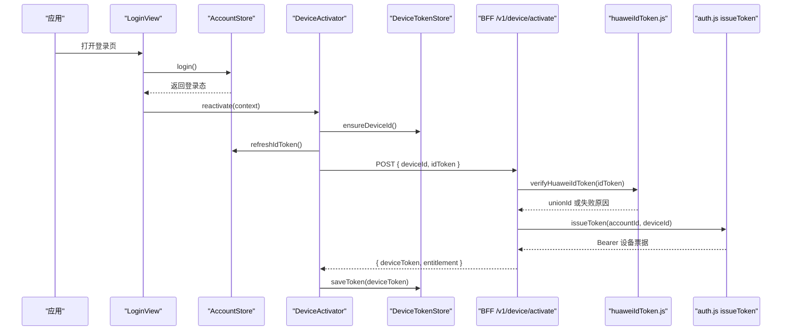
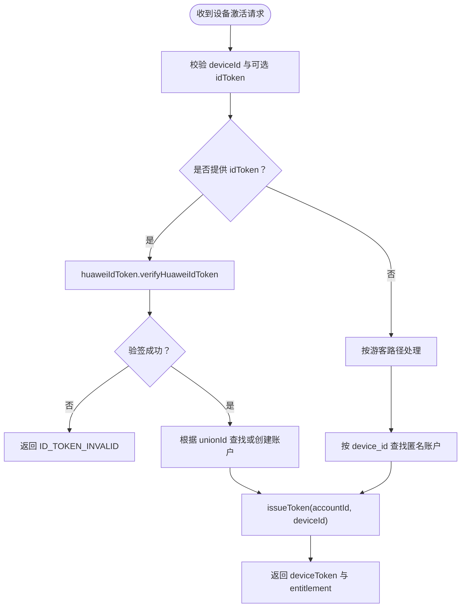
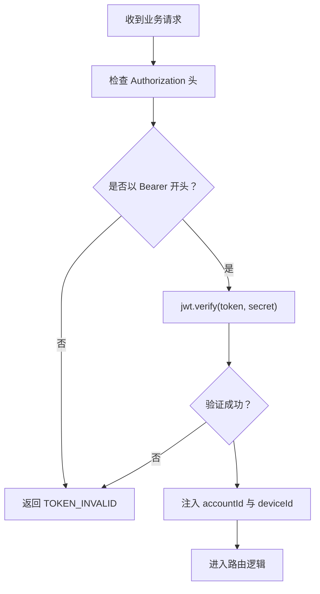
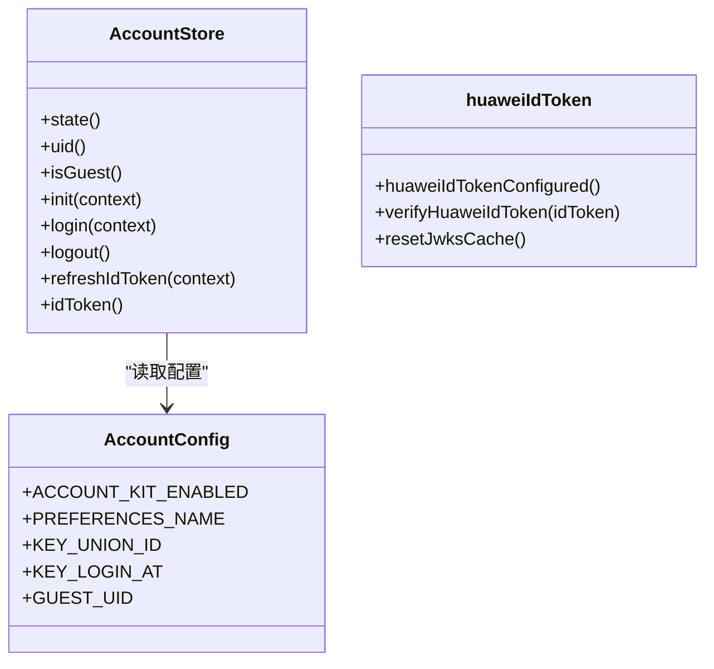
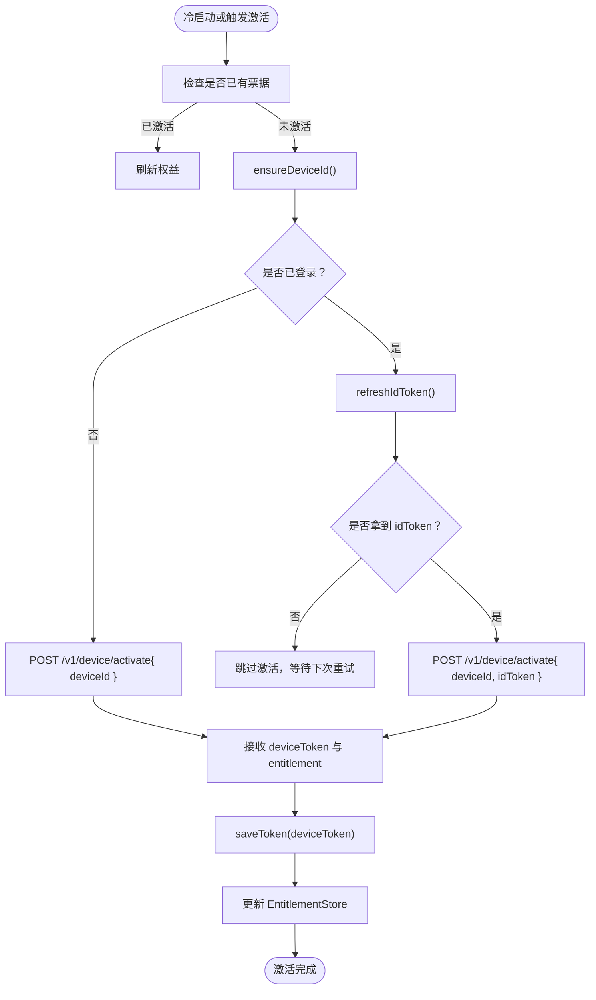
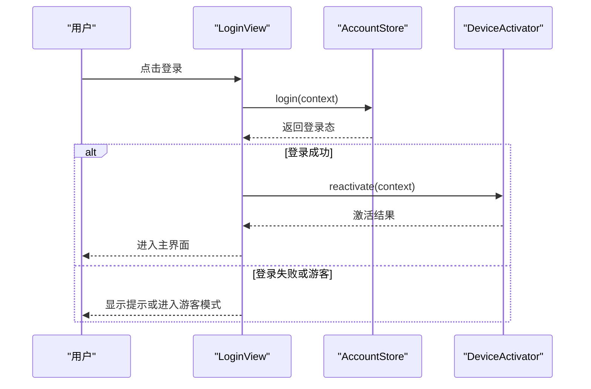
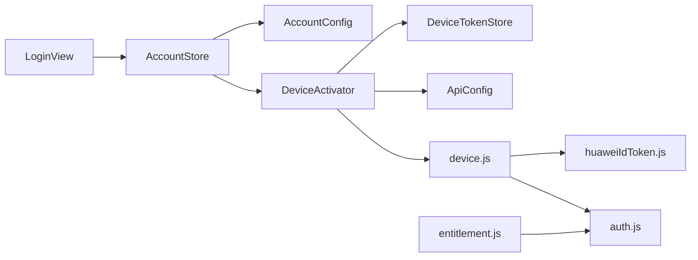

# 认证机制

<cite>
**本文引用的文件**   
- [bff/src/middleware/auth.js](file://bff/src/middleware/auth.js)
- [bff/src/routes/device.js](file://bff/src/routes/device.js)
- [bff/src/services/huaweiIdToken.js](file://bff/src/services/huaweiIdToken.js)
- [bff/src/routes/entitlement.js](file://bff/src/routes/entitlement.js)
- [entry/src/main/ets/data/DeviceActivator.ets](file://entry/src/main/ets/data/DeviceActivator.ets)
- [entry/src/main/ets/data/DeviceTokenStore.ets](file://entry/src/main/ets/data/DeviceTokenStore.ets)
- [entry/src/main/ets/data/AccountStore.ets](file://entry/src/main/ets/data/AccountStore.ets)
- [entry/src/main/ets/common/config/AccountConfig.ets](file://entry/src/main/ets/common/config/AccountConfig.ets)
- [entry/src/main/ets/model/Account.ets](file://entry/src/main/ets/model/Account.ets)
- [entry/src/main/ets/pages/LoginView.ets](file://entry/src/main/ets/pages/LoginView.ets)
- [entry/src/main/ets/common/config/ApiConfig.ets](file://entry/src/main/ets/common/config/ApiConfig.ets)
</cite>

## 目录
1. [引言](#引言)
2. [项目结构中的认证相关模块](#项目结构中的认证相关模块)
3. [核心组件](#核心组件)
4. [架构总览](#架构总览)
5. [详细组件分析](#详细组件分析)
6. [依赖关系分析](#依赖关系分析)
7. [性能与安全特性](#性能与安全特性)
8. [故障排查指南](#故障排查指南)
9. [结论](#结论)

## 引言
本文件说明本项目在客户端与服务端之间的完整认证机制，覆盖以下目标：
- JWT Token 生成流程：设备 ID 绑定、用户身份关联、签名算法与有效期。
- Token 验证机制：中间件解析、权限注入、过期处理。
- 华为账号集成：ID Token 获取、服务端验签、本地存储策略。
- 设备激活流程：首次启动检测、设备 ID 生成、云端注册。
- Token 刷新策略：Refresh Token 的当前实现状态与自动续期建议。
- 客户端集成示例：登录流程、Token 存储、请求头注入位置。
- 安全考虑：Token 泄露防护、设备指纹校验、会话与会话失效处理。

本项目采用“设备票据 + 华为账号 ID Token”的组合模型：客户端使用华为账号静默登录取得 ID Token，调用 BFF 的设备激活接口换取 Bearer 设备票据；后续业务请求携带该票据，由 BFF 的 JWT 中间件完成身份注入和基础鉴权。

## 项目结构中的认证相关模块
认证相关代码分布在两端：
- 后端 BFF（Node.js）：JWT 签发与验证、华为 ID Token 验签、设备激活路由、权益查询路由。
- 前端客户端（ArkTS/HarmonyOS）：华为账号登录态管理、设备 ID 与票据持久化、设备激活与权益刷新。

**图示来源**
- [entry/src/main/ets/pages/LoginView.ets:1-120](file://entry/src/main/ets/pages/LoginView.ets#L1-L120)
- [entry/src/main/ets/data/AccountStore.ets:1-120](file://entry/src/main/ets/data/AccountStore.ets#L1-L120)
- [entry/src/main/ets/data/DeviceActivator.ets:1-159](file://entry/src/main/ets/data/DeviceActivator.ets#L1-L159)
- [entry/src/main/ets/data/DeviceTokenStore.ets:1-142](file://entry/src/main/ets/data/DeviceTokenStore.ets#L1-L142)
- [bff/src/routes/device.js:1-84](file://bff/src/routes/device.js#L1-L84)
- [bff/src/middleware/auth.js:1-25](file://bff/src/middleware/auth.js#L1-L25)
- [bff/src/services/huaweiIdToken.js:1-161](file://bff/src/services/huaweiIdToken.js#L1-L161)
- [bff/src/routes/entitlement.js:1-15](file://bff/src/routes/entitlement.js#L1-L15)

**章节来源**
- [entry/src/main/ets/pages/LoginView.ets:1-120](file://entry/src/main/ets/pages/LoginView.ets#L1-L120)
- [bff/src/routes/device.js:1-84](file://bff/src/routes/device.js#L1-L84)
- [bff/src/middleware/auth.js:1-25](file://bff/src/middleware/auth.js#L1-L25)

## 核心组件
| 组件 | 职责 | 关键行为 |
|---|---|---|
| `AccountStore` | 华为账号登录态管理 | 静默登录、UnionID 持久化、idToken 刷新、游客态兜底。 |
| `AccountConfig` | 账号配置 | 是否启用 Account Kit、偏好分区名、键名、游客 UID。 |
| `DeviceTokenStore` | 设备标识与票据存储 | 生成并持久化 UUID 设备 ID，保存 BFF 返回的设备票据与激活时间。 |
| `DeviceActivator` | 设备激活与权益刷新 | 调用 BFF `/v1/device/activate`，失败时清理票据并触发重新激活。 |
| `authMiddleware` | JWT 中间件 | 解析 `Authorization: Bearer`，验证 JWT，注入 `accountId` 与 `deviceId`。 |
| `issueToken` | JWT 签发 | 使用 `jwt.sign` 签发包含账户和设备信息的令牌，默认 30 天。 |
| `verifyHuaweiIdToken` | 华为 ID Token 验签 | 从 JWKS 拉取公钥，校验 RS256/PS256、iss、aud、exp、sub。 |
| `LoginView` | 登录 UI | 聚合隐私同意、调用 `AccountStore.login`，成功后触发设备重新激活。 |

**章节来源**
- [entry/src/main/ets/data/AccountStore.ets:1-213](file://entry/src/main/ets/data/AccountStore.ets#L1-L213)
- [entry/src/main/ets/common/config/AccountConfig.ets:1-29](file://entry/src/main/ets/common/config/AccountConfig.ets#L1-L29)
- [entry/src/main/ets/data/DeviceTokenStore.ets:1-142](file://entry/src/main/ets/data/DeviceTokenStore.ets#L1-L142)
- [entry/src/main/ets/data/DeviceActivator.ets:1-159](file://entry/src/main/ets/data/DeviceActivator.ets#L1-L159)
- [bff/src/middleware/auth.js:1-25](file://bff/src/middleware/auth.js#L1-L25)
- [bff/src/services/huaweiIdToken.js:1-161](file://bff/src/services/huaweiIdToken.js#L1-L161)
- [entry/src/main/ets/pages/LoginView.ets:1-120](file://entry/src/main/ets/pages/LoginView.ets#L1-L120)

## 架构总览
认证体系围绕两条主链路运行：
1. **登录与设备激活链路**：客户端通过华为账号静默登录拿到 idToken，向 BFF 申请 deviceToken。
2. **受保护请求链路**：客户端在 Authorization 头中携带 deviceToken，BFF 用 JWT 中间件解析并注入账户上下文。

**图示来源**
- [entry/src/main/ets/pages/LoginView.ets:1-120](file://entry/src/main/ets/pages/LoginView.ets#L1-L120)
- [entry/src/main/ets/data/AccountStore.ets:1-120](file://entry/src/main/ets/data/AccountStore.ets#L1-L120)
- [entry/src/main/ets/data/DeviceActivator.ets:1-159](file://entry/src/main/ets/data/DeviceActivator.ets#L1-L159)
- [entry/src/main/ets/data/DeviceTokenStore.ets:1-142](file://entry/src/main/ets/data/DeviceTokenStore.ets#L1-L142)
- [bff/src/routes/device.js:1-84](file://bff/src/routes/device.js#L1-L84)
- [bff/src/services/huaweiIdToken.js:1-161](file://bff/src/services/huaweiIdToken.js#L1-L161)
- [bff/src/middleware/auth.js:1-25](file://bff/src/middleware/auth.js#L1-L25)

## 详细组件分析

### JWT Token 生成流程
JWT 在后端由 `issueToken` 生成，载荷包含 `accountId` 和 `deviceId`，默认有效期为 30 天。密钥来自环境变量 `JWT_SECRET`，开发环境有默认值用于本地调试。

**图示来源**
- [bff/src/routes/device.js:1-84](file://bff/src/routes/device.js#L1-L84)
- [bff/src/services/huaweiIdToken.js:1-161](file://bff/src/services/huaweiIdToken.js#L1-L161)
- [bff/src/middleware/auth.js:1-25](file://bff/src/middleware/auth.js#L1-L25)

关键点：
- 设备 ID 由客户端生成并持久化，服务器端不再生成。
- 已登录用户的身份绑定来自华为 ID Token 验签后的 `unionId`，而非客户端自报字段。
- 未提供有效 idToken 的请求会走匿名账户路径，避免同一设备上的游客会话串号。
- JWT 签名使用 `jsonwebtoken`，载荷只含账户和设备标识，不包含敏感用户信息。

**章节来源**
- [bff/src/middleware/auth.js:1-25](file://bff/src/middleware/auth.js#L1-L25)
- [bff/src/routes/device.js:1-84](file://bff/src/routes/device.js#L1-L84)

### Token 验证机制
所有需要认证的请求应携带 `Authorization: Bearer <deviceToken>`。`authMiddleware` 负责：
- 检查 Authorization 头是否存在且以 `Bearer ` 开头。
- 使用相同密钥验证 JWT。
- 将 `accountId` 和 `deviceId` 写入请求对象，供下游路由判断权限。
- 验证失败返回 `TOKEN_INVALID`，表示票据缺失、格式错误或已失效。

**图示来源**
- [bff/src/middleware/auth.js:1-25](file://bff/src/middleware/auth.js#L1-L25)

当前实现没有独立的权限角色系统；权限判断更多依赖设备激活后返回的 `entitlement`。例如 `/v1/entitlement` 路由在通过 JWT 中间件后，再根据 `req.accountId` 查询配额与权益。

**章节来源**
- [bff/src/middleware/auth.js:1-25](file://bff/src/middleware/auth.js#L1-L25)
- [bff/src/routes/entitlement.js:1-15](file://bff/src/routes/entitlement.js#L1-L15)

### 华为账号集成
客户端侧使用华为账号静默登录，仅持久化 UnionID，不直接上传手机号或邮箱等敏感信息。服务端侧则对华为下发的 ID Token 进行本地验签。

#### 客户端：登录态与 idToken
- `AccountConfig` 定义是否启用真实账号登录、偏好分区名、键名和游客 UID。
- `AccountStore` 维护当前登录态快照，支持：
  - `init()`：恢复上次 UnionID。
  - `login()`：静默登录，失败时退回游客态。
  - `refreshIdToken()`：重新获取 idToken，但不改变登录分区。
  - `logout()`：清除 UnionID 与登录时间戳，回到游客态。
- `lastIdToken` 只在内存中保留，不落盘、不在日志中打印。

#### 服务端：ID Token 验签
`huaweiIdToken.js` 实现了完整的 OpenID Connect ID Token 本地验签流程：
- 从环境变量读取 `HUAWEI_CLIENT_ID`、`HUAWEI_JWKS_URL`、`HUAWEI_ISSUER`。
- 缓存官方 JWKS，TTL 为 10 分钟，带超时。
- 仅接受 RS256 或 PS256，拒绝 none 与 HS* 算法。
- 校验 kid、JWK、签名、exp、iss、aud、sub。
- 成功时返回 `{ ok: true, unionId }`，其中 `sub` 被视为唯一用户标识。

**图示来源**
- [entry/src/main/ets/data/AccountStore.ets:1-213](file://entry/src/main/ets/data/AccountStore.ets#L1-L213)
- [entry/src/main/ets/common/config/AccountConfig.ets:1-29](file://entry/src/main/ets/common/config/AccountConfig.ets#L1-L29)
- [bff/src/services/huaweiIdToken.js:1-161](file://bff/src/services/huaweiIdToken.js#L1-L161)

**章节来源**
- [entry/src/main/ets/data/AccountStore.ets:1-213](file://entry/src/main/ets/data/AccountStore.ets#L1-L213)
- [entry/src/main/ets/common/config/AccountConfig.ets:1-29](file://entry/src/main/ets/common/config/AccountConfig.ets#L1-L29)
- [bff/src/services/huaweiIdToken.js:1-161](file://bff/src/services/huaweiIdToken.js#L1-L161)

### 设备激活流程
设备激活是商业化能力的前置条件：只有获得 `deviceToken` 和有效 `entitlement`，客户端才能继续调用受保护的 BFF 接口。

**图示来源**
- [entry/src/main/ets/data/DeviceActivator.ets:1-159](file://entry/src/main/ets/data/DeviceActivator.ets#L1-L159)
- [entry/src/main/ets/data/DeviceTokenStore.ets:1-142](file://entry/src/main/ets/data/DeviceTokenStore.ets#L1-L142)

要点：
- 如果已有票据，还会刷新权益，因为权益缓存 TTL 较短。
- 已登录但未拿到 idToken 时不会降级为游客，而是放弃本次激活。
- 若 BFF 未配置，开发期会跳过激活，避免阻塞主流程。
- 激活成功后同时保存设备票据和权益信息。

**章节来源**
- [entry/src/main/ets/data/DeviceActivator.ets:1-159](file://entry/src/main/ets/data/DeviceActivator.ets#L1-L159)
- [entry/src/main/ets/data/DeviceTokenStore.ets:1-142](file://entry/src/main/ets/data/DeviceTokenStore.ets#L1-L142)

### Token 刷新策略
当前实现采用“短期设备票据 + 主动刷新”的模式，而不是传统的双 Token（Access Token + Refresh Token）方案：
- 设备票据由 `issueToken` 签发，默认有效期 30 天。
- 客户端没有后台自动续期逻辑；当 BFF 返回 401 或设备激活失败时，`DeviceActivator.reactivate` 会清掉旧票据并重新激活。
- 权益刷新接口 `/v1/entitlement` 会复用现有 deviceToken；若返回 401，客户端也会清理票据。

因此，当前可理解为：
- 设备票据本身充当访问凭证。
- “刷新”发生在激活流程被触发时，而不是基于一个独立 Refresh Token 的自动续期。

如果需要引入 Refresh Token，建议在现有设备票据之外增加刷新令牌，并在客户端加入定时或前缀过期的刷新逻辑，同时在服务端实现刷新接口的幂等性与吊销策略。

**章节来源**
- [bff/src/middleware/auth.js:1-25](file://bff/src/middleware/auth.js#L1-L25)
- [entry/src/main/ets/data/DeviceActivator.ets:1-159](file://entry/src/main/ets/data/DeviceActivator.ets#L1-L159)

### 客户端集成示例：登录、存储与请求头注入

#### 登录流程
`LoginView` 是用户可见的登录入口：
- 要求用户勾选隐私协议与用户协议。
- 调用 `AccountStore.login` 执行静默登录。
- 登录成功后调用 `DeviceActivator.reactivate` 重新激活设备。
- 登录失败或退回到游客态时，给出提示。

**图示来源**
- [entry/src/main/ets/pages/LoginView.ets:1-120](file://entry/src/main/ets/pages/LoginView.ets#L1-L120)
- [entry/src/main/ets/data/AccountStore.ets:1-120](file://entry/src/main/ets/data/AccountStore.ets#L1-L120)
- [entry/src/main/ets/data/DeviceActivator.ets:1-159](file://entry/src/main/ets/data/DeviceActivator.ets#L1-L159)

#### Token 存储
设备票据由 `DeviceTokenStore` 管理：
- 首次启动时生成 UUID 作为 `deviceId`，并持久化到 ArkData preferences。
- 激活成功后保存 `deviceToken` 与激活时间。
- 登出或票据失效时调用 `clear()` 删除 token 与激活时间。
- 提供 `hasToken()`、`isActivated()`、`getToken()` 等方法供上层使用。

#### 请求头注入
设备激活成功后，客户端在需要鉴权的请求中注入 Authorization 头：
- 激活响应刷新 `DeviceTokenStore`。
- 权益刷新接口显式带上 `Authorization: Bearer ${DeviceTokenStore.getToken()}`。
- 其他受保护 API 应在网络层统一注入该头，使 BFF 的 `authMiddleware` 能解析出 `accountId` 和 `deviceId`。

**章节来源**
- [entry/src/main/ets/pages/LoginView.ets:1-120](file://entry/src/main/ets/pages/LoginView.ets#L1-L120)
- [entry/src/main/ets/data/DeviceTokenStore.ets:1-142](file://entry/src/main/ets/data/DeviceTokenStore.ets#L1-L142)
- [entry/src/main/ets/data/DeviceActivator.ets:1-159](file://entry/src/main/ets/data/DeviceActivator.ets#L1-L159)
- [bff/src/middleware/auth.js:1-25](file://bff/src/middleware/auth.js#L1-L25)

### 安全考虑

#### Token 泄露防护
- 设备票据是 Bearer 类型，应始终通过 HTTPS 传输。
- 客户端不应把 token 写入日志、错误消息或分享数据。
- 票据失效时应主动清理，避免旧票据长期驻留。

#### 设备指纹验证
- 设备 ID 由客户端生成，不是服务端信任源；真正信任的是 BFF 内部生成的 `accountId`。
- 匿名激活使用 `anon-${deviceId}` 形式的 unionId，防止匿名用户占用他人账户。
- 华为账号激活时，服务器会把 `deviceId` 写入对应账户记录，实现设备与账户的关联。

#### 会话管理
- 当前没有独立会话表；会话语义由 JWT 生命周期和设备票据有效性表达。
- 票据过期或缺失时，客户端通过 `reactivate` 重新激活。
- 华为账号切换或登出时，客户端清除账号偏好并刷新权益缓存，避免跨用户状态污染。

**章节来源**
- [bff/src/routes/device.js:1-84](file://bff/src/routes/device.js#L1-L84)
- [bff/src/middleware/auth.js:1-25](file://bff/src/middleware/auth.js#L1-L25)
- [entry/src/main/ets/data/DeviceTokenStore.ets:1-142](file://entry/src/main/ets/data/DeviceTokenStore.ets#L1-L142)
- [entry/src/main/ets/data/AccountStore.ets:1-213](file://entry/src/main/ets/data/AccountStore.ets#L1-L213)

## 依赖关系分析
认证相关模块之间的依赖如下：

**图示来源**
- [entry/src/main/ets/pages/LoginView.ets:1-120](file://entry/src/main/ets/pages/LoginView.ets#L1-L120)
- [entry/src/main/ets/data/AccountStore.ets:1-213](file://entry/src/main/ets/data/AccountStore.ets#L1-L213)
- [entry/src/main/ets/common/config/AccountConfig.ets:1-29](file://entry/src/main/ets/common/config/AccountConfig.ets#L1-L29)
- [entry/src/main/ets/data/DeviceActivator.ets:1-159](file://entry/src/main/ets/data/DeviceActivator.ets#L1-L159)
- [entry/src/main/ets/data/DeviceTokenStore.ets:1-142](file://entry/src/main/ets/data/DeviceTokenStore.ets#L1-L142)
- [entry/src/main/ets/common/config/ApiConfig.ets:1-66](file://entry/src/main/ets/common/config/ApiConfig.ets#L1-L66)
- [bff/src/routes/device.js:1-84](file://bff/src/routes/device.js#L1-L84)
- [bff/src/services/huaweiIdToken.js:1-161](file://bff/src/services/huaweiIdToken.js#L1-L161)
- [bff/src/middleware/auth.js:1-25](file://bff/src/middleware/auth.js#L1-L25)
- [bff/src/routes/entitlement.js:1-15](file://bff/src/routes/entitlement.js#L1-L15)

耦合特点：
- 客户端登录态与设备激活解耦：`AccountStore` 只负责账号分区，`DeviceActivator` 负责票据。
- 服务端验签与签发分离：`huaweiIdToken.js` 只做华为 ID Token 验签，`auth.js` 只做 BFF 内部 JWT 签发与验证。
- 路由层组合依赖：`device.js` 同时依赖华为 ID Token 验签与 JWT 签发。

**章节来源**
- [bff/src/routes/device.js:1-84](file://bff/src/routes/device.js#L1-L84)
- [bff/src/services/huaweiIdToken.js:1-161](file://bff/src/services/huaweiIdToken.js#L1-L161)
- [bff/src/middleware/auth.js:1-25](file://bff/src/middleware/auth.js#L1-L25)
- [entry/src/main/ets/data/DeviceActivator.ets:1-159](file://entry/src/main/ets/data/DeviceActivator.ets#L1-L159)

## 性能与安全特性
- JWKS 缓存：华为公钥缓存 10 分钟，减少每次验签都请求官方 JWKS 的网络开销。
- 公钥轮换容错：找不到 kid 时强制刷新一次 JWKS，降低公钥轮换期间的误拒率。
- 失败关闭策略：缺少配置、JWKS 不可用、kid 不存在、签名无效、issuer/audience/exp 不符，一律返回验签失败。
- 客户端票据持久化：设备 ID 和票据写入 ArkData preferences，冷启动后可恢复。
- 开发模式隔离：BFF 未配置时可跳过激活，便于本地 Mock 开发。

**章节来源**
- [bff/src/services/huaweiIdToken.js:1-161](file://bff/src/services/huaweiIdToken.js#L1-L161)
- [entry/src/main/ets/data/DeviceTokenStore.ets:1-142](file://entry/src/main/ets/data/DeviceTokenStore.ets#L1-L142)
- [entry/src/main/ets/data/DeviceActivator.ets:1-159](file://entry/src/main/ets/data/DeviceActivator.ets#L1-L159)

## 故障排查指南
| 现象 | 可能原因 | 排查建议 |
|---|---|---|
| 登录后无法调用受保护接口 | 未携带 Authorization 头或 deviceToken 为空 | 检查 `DeviceTokenStore.hasToken()` 与请求头注入逻辑。 |
| 返回 TOKEN_INVALID | JWT 缺失、格式错误或密钥不一致 | 检查 BFF 的 `JWT_SECRET` 与客户端携带的 deviceToken。 |
| 设备激活失败 | BFF 未配置、idToken 无效、HTTP 非 2xx | 查看 `DeviceActivator` 日志，确认 `ApiConfig.BFF_BASE_URL` 与华为账号配置。 |
| 权益刷新返回 401 | deviceToken 已失效 | 触发 `DeviceActivator.reactivate` 清理旧票据并重新激活。 |
| 华为 ID Token 验签失败 | kid 不存在、算法非法、签名错误、aud/iss/exp 不符 | 检查 `HUAWEI_CLIENT_ID`、`HUAWEI_ISSUER`、证书指纹与客户端 idToken。 |
| 登录态异常 | 偏好分片损坏或未初始化 | 检查 `AccountStore.init()` 是否在数据读写前执行。 |

**章节来源**
- [bff/src/middleware/auth.js:1-25](file://bff/src/middleware/auth.js#L1-L25)
- [bff/src/services/huaweiIdToken.js:1-161](file://bff/src/services/huaweiIdToken.js#L1-L161)
- [entry/src/main/ets/data/DeviceActivator.ets:1-159](file://entry/src/main/ets/data/DeviceActivator.ets#L1-L159)
- [entry/src/main/ets/data/DeviceTokenStore.ets:1-142](file://entry/src/main/ets/data/DeviceTokenStore.ets#L1-L142)
- [entry/src/main/ets/data/AccountStore.ets:1-213](file://entry/src/main/ets/data/AccountStore.ets#L1-L213)

## 结论
本项目的认证机制以“华为账号身份 + 设备票据”为核心：客户端通过华为账号静默登录取得 idToken，服务端严格验签后将 unionId 与设备 ID 绑定，签发 JWT 设备票据；后续请求由 JWT 中间件注入账户上下文，结合权益数据控制功能访问。

当前实现更适合“设备级访问令牌 + 账号身份证明”的场景，尚未实现独立的 Refresh Token 自动续期。未来若需增强安全性与可用性，可补充 Refresh Token、Token 黑名单、设备指纹绑定、最小权限授权等机制，但应保持现有设计中对敏感字段不落盘、对失败场景 fail-closed 的安全基调。