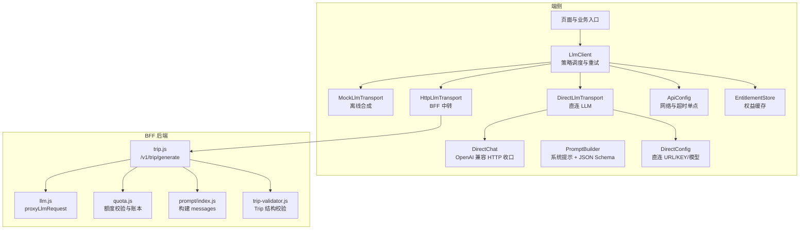
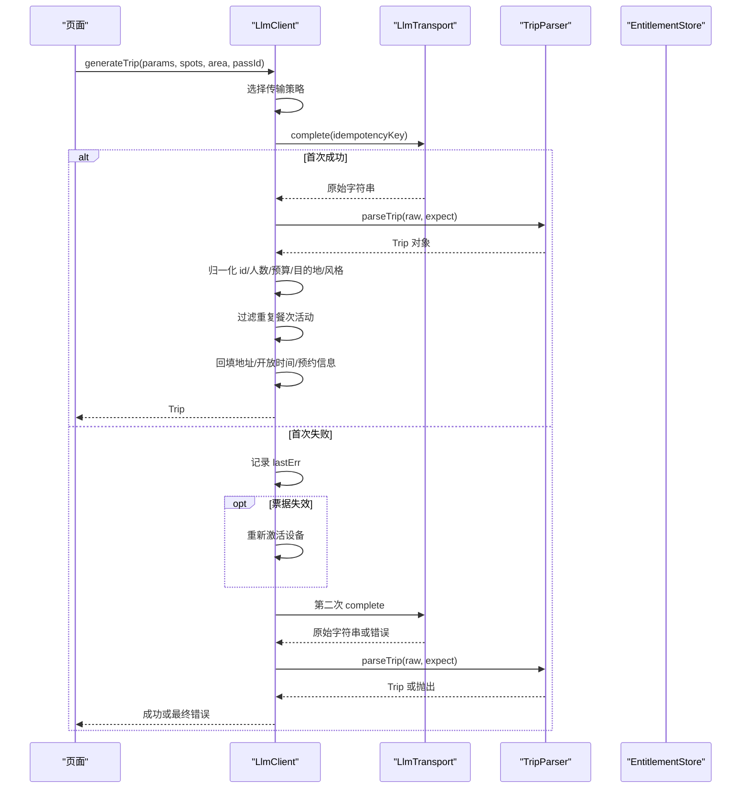
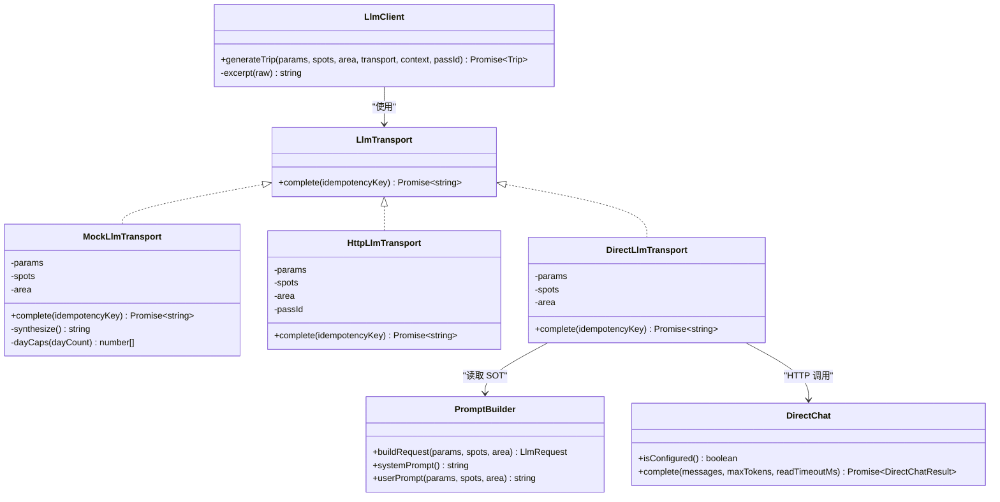
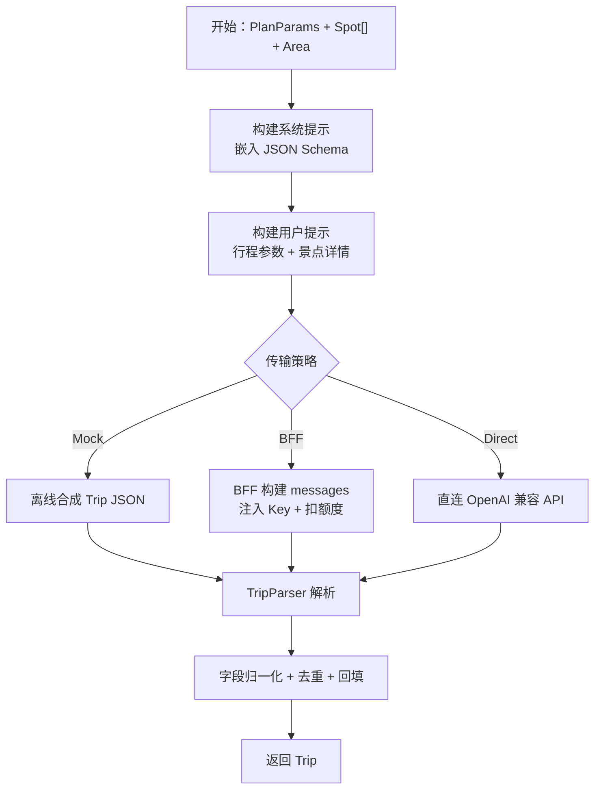
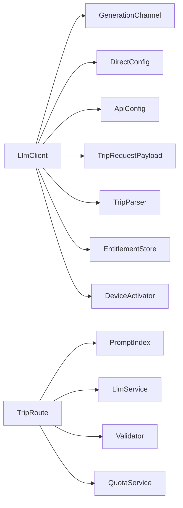

# LLM 提供商插件

<cite>
**本文引用的文件**   
- [LlmClient.ets](file://entry/src/main/ets/ai/LlmClient.ets)
- [PromptBuilder.ets](file://entry/src/main/ets/ai/PromptBuilder.ets)
- [DirectChat.ets](file://entry/src/main/ets/ai/DirectChat.ets)
- [TripRequestPayload.ets](file://entry/src/main/ets/ai/TripRequestPayload.ets)
- [ApiConfig.ets](file://entry/src/main/ets/common/config/ApiConfig.ets)
- [DirectConfig.ets](file://entry/src/main/ets/common/config/DirectConfig.ets)
- [MockConfig.ets](file://entry/src/main/ets/common/config/MockConfig.ets)
- [BffErrorMap.ets](file://entry/src/main/ets/utils/BffErrorMap.ets)
- [EntitlementStore.ets](file://entry/src/main/ets/data/EntitlementStore.ets)
- [llm.js](file://bff/src/services/llm.js)
- [trip.js](file://bff/src/routes/trip.js)
- [quota.js](file://bff/src/services/quota.js)
- [LLM接入方案-2026-10-26.md](file://Docs/LLM接入方案-2026-10-26.md)
</cite>

## 目录
1. [引言](#引言)
2. [项目结构](#项目结构)
3. [核心组件](#核心组件)
4. [架构总览](#架构总览)
5. [详细组件分析](#详细组件分析)
6. [依赖关系分析](#依赖关系分析)
7. [性能与可靠性](#性能与可靠性)
8. [故障排查指南](#故障排查指南)
9. [新增第三方 LLM 提供商开发流程](#新增第三方-llm-提供商开发流程)
10. [测试用例编写指南](#测试用例编写指南)
11. [结论](#结论)

## 引言
本文面向需要扩展或维护“有径”应用 LLM 能力的工程师，系统性说明端侧 `LlmClient` 的插件化机制、三种传输策略的设计取舍、后端 BFF 的转发与安全逻辑，以及 Prompt 适配层。文档同时给出新增 OpenAI、Claude 等第三方 LLM 的可操作路径：从接口定义、具体 provider 实现、配置开关到重试、超时、错误码映射和测试方法。

## 项目结构
当前仓库采用“端侧 ArkTS + BFF Node.js”的双端协作结构：
- 端侧（HarmonyOS / ArkTS）负责提示词构造、传输策略选择、结果守卫与 UI 状态编排。
- BFF（Node.js / Express）负责鉴权、配额扣减、上游 LLM 调用与幂等保护。

图表来源
- [LlmClient.ets:1-482](file://entry/src/main/ets/ai/LlmClient.ets#L1-L482)
- [PromptBuilder.ets:1-187](file://entry/src/main/ets/ai/PromptBuilder.ets#L1-L187)
- [DirectChat.ets:1-136](file://entry/src/main/ets/ai/DirectChat.ets#L1-L136)
- [ApiConfig.ets:1-66](file://entry/src/main/ets/common/config/ApiConfig.ets#L1-L66)
- [DirectConfig.ets:1-33](file://entry/src/main/ets/common/config/DirectConfig.ets#L1-L33)
- [EntitlementStore.ets:1-200](file://entry/src/main/ets/data/EntitlementStore.ets#L1-L200)
- [trip.js:1-234](file://bff/src/routes/trip.js#L1-L234)
- [llm.js:1-98](file://bff/src/services/llm.js#L1-L98)
- [quota.js:1-113](file://bff/src/services/quota.js#L1-L113)

章节来源
- [LLM接入方案-2026-10-26.md:1-154](file://Docs/LLM接入方案-2026-10-26.md#L1-L154)

## 核心组件
- `LlmTransport` 接口：统一抽象一次完整请求的生命周期，对外只暴露带幂等键的完成方法。
- `MockLlmTransport`：离线确定性合成合法行程 JSON，用于本地闭环验证与回归。
- `HttpLlmTransport`：把业务参数发送给 BFF `/v1/trip/generate`，由后端拼装提示词、注入 Key、扣额度并返回已解析行程。
- `DirectLlmTransport`：开发期兜底直连 OpenAI 兼容 API，复用 `PromptBuilder` 作为提示词单源。
- `PromptBuilder`：提供系统提示、用户提示与 JSON Schema，是提示词的事实来源（SOT）。
- `DirectChat`：封装端侧直连 HTTP 调用的通用能力，供生成与精选共用。
- `LlmClient`：策略选择、重试、票据失效恢复、字段归一化与最终 `Trip` 对象返回。
- BFF 层：`trip.js` 路由负责幂等、额度、提示词组装、上游 LLM 调用与响应持久化；`llm.js` 提供超时、限流与上游错误透传；`quota.js` 管理订阅/通行证/赠送额度与月度上限。

章节来源
- [LlmClient.ets:1-482](file://entry/src/main/ets/ai/LlmClient.ets#L1-L482)
- [PromptBuilder.ets:1-187](file://entry/src/main/ets/ai/PromptBuilder.ets#L1-L187)
- [DirectChat.ets:1-136](file://entry/src/main/ets/ai/DirectChat.ets#L1-L136)
- [llm.js:1-98](file://bff/src/services/llm.js#L1-L98)
- [trip.js:1-234](file://bff/src/routes/trip.js#L1-L234)
- [quota.js:1-113](file://bff/src/services/quota.js#L1-L113)

## 架构总览
端侧通过 `LlmClient.generateTrip` 决定使用哪种传输策略：
1. 若传入自定义 transport，则优先使用该实现。
2. 否则按优先级：直连配置有效 → 本地开发环境 → BFF 中转 → 本地合成。
3. 成功后进入解析、字段修复、去重与回填阶段。
4. 失败最多重试一次；票据失效时尝试重新激活设备；额度用尽时直接中断重试。

图表来源
- [LlmClient.ets:250-482](file://entry/src/main/ets/ai/LlmClient.ets#L250-L482)

## 详细组件分析

### LlmClient 与策略模式
`LlmClient` 将“提示词如何发送”和“结果如何治理”解耦：
- 策略接口 `LlmTransport.complete` 屏蔽了本地合成、BFF 转发和直连 LLM 的差异。
- 默认策略选择由运行环境与配置决定，不改变调用方代码。
- 重试逻辑位于 `LlmClient` 而非策略内部，使重试语义（次数、条件、错误分类）集中可控。
- 解析后的 `Trip` 在落库前做大量防御性修复：重写主键、覆盖用户输入值、剔除重复餐次活动、统一费用合计、回填景点元数据、重铸活动 ID。

图表来源
- [LlmClient.ets:1-482](file://entry/src/main/ets/ai/LlmClient.ets#L1-L482)
- [PromptBuilder.ets:1-187](file://entry/src/main/ets/ai/PromptBuilder.ets#L1-L187)
- [DirectChat.ets:1-136](file://entry/src/main/ets/ai/DirectChat.ets#L1-L136)

章节来源
- [LlmClient.ets:1-482](file://entry/src/main/ets/ai/LlmClient.ets#L1-L482)

### MockTransport：离线确定性合成
`MockLlmTransport` 根据计划天数、节奏档位与所选景点生成结构合法的 `Trip` JSON：
- 多档节奏按天段分配每日活动上限，避免点击顺序影响输出。
- 通勤段基于坐标估算，不再写死步行/地铁/打车时间。
- 每餐固定午餐与晚餐，日成本随活动数量递增。
- 地图城市来源的景点明确标注“预约信息未获取”，与真实模型行为一致。
- 该实现用于本地回归，保证“响应→守卫→Trip”链路等价。

章节来源
- [LlmClient.ets:1-200](file://entry/src/main/ets/ai/LlmClient.ets#L1-L200)

### HttpTransport：BFF 中转
`HttpLlmTransport` 把业务参数序列化为 `TripGeneratePayload`，发送到 BFF：
- 请求头包含 Content-Type、可选 Authorization 设备票据、可选 Idempotency-Key。
- 连接超时与读取超时来自 `ApiConfig`。
- 非 2xx 响应经 `BffErrorMap` 转为端侧错误码。
- 成功响应中的 `quota` 会合并到 `EntitlementStore`，修正订阅到期、用量与管理员无限标识。
- 返回给 `LlmClient` 的是服务端已解析的 `trip` 对象，再被序列化后交给 `TripParser`。

章节来源
- [LlmClient.ets:201-340](file://entry/src/main/ets/ai/LlmClient.ets#L201-L340)
- [TripRequestPayload.ets:1-75](file://entry/src/main/ets/ai/TripRequestPayload.ets#L1-L75)
- [BffErrorMap.ets:1-41](file://entry/src/main/ets/utils/BffErrorMap.ets#L1-L41)
- [EntitlementStore.ets:1-200](file://entry/src/main/ets/data/EntitlementStore.ets#L1-L200)

### DirectTransport：开发期直连
`DirectLlmTransport` 仅在 `DirectConfig.URL` 与 `DirectConfig.KEY` 均非空时启用：
- 使用 `PromptBuilder.buildRequest` 构造系统提示与用户提示。
- 通过 `DirectChat` 发送 OpenAI 兼容请求，携带 `Authorization: Bearer`。
- 读取超时由调用方传入，模型名、最大 token 与 response_format 取自 `DirectConfig`。
- 该路径不走 BFF 鉴权与额度系统，因此配合 `ApiConfig.DEV_SKIP_BFF` 跳过权限门禁。

章节来源
- [LlmClient.ets:340-420](file://entry/src/main/ets/ai/LlmClient.ets#L340-L420)
- [DirectChat.ets:1-136](file://entry/src/main/ets/ai/DirectChat.ets#L1-L136)
- [DirectConfig.ets:1-33](file://entry/src/main/ets/common/config/DirectConfig.ets#L1-L33)
- [ApiConfig.ets:1-66](file://entry/src/main/ets/common/config/ApiConfig.ets#L1-L66)

### PromptBuilder 与适配层设计
`PromptBuilder` 是提示词的单一事实来源：
- `buildRequest` 产出包含系统提示、用户提示与是否启用严格 JSON Schema 的请求结构。
- 系统提示内嵌完整 `TripSchema.TRIP_JSON_SCHEMA`，构成“第一层防线”。
- 用户提示拼装目的地、日期、人数、预算、风格、住宿区域、交通偏好、节奏与选中景点详情。
- 对于地图服务区县、预约信息缺失、开放时段等边界，提示词显式约束模型不得编造。
- 对第三方 LLM 的适配主要在 BFF 层：不同 provider 通过环境变量切换 baseUrl、model 与鉴权 Key，但消息结构与 response_format 保持 OpenAI 兼容形态。

图表来源
- [PromptBuilder.ets:1-187](file://entry/src/main/ets/ai/PromptBuilder.ets#L1-L187)
- [LlmClient.ets:1-482](file://entry/src/main/ets/ai/LlmClient.ets#L1-L482)
- [llm.js:1-98](file://bff/src/services/llm.js#L1-L98)

章节来源
- [PromptBuilder.ets:1-187](file://entry/src/main/ets/ai/PromptBuilder.ets#L1-L187)

## 依赖关系分析
- `LlmClient` 依赖：
  - `GenerationChannel` 判断是否本地环境。
  - `DirectConfig` 控制直连开关。
  - `ApiConfig` 提供 BFF 地址、端点、超时与模型配置。
  - `TripRequestPayload` 定义端侧发往 BFF 的业务载荷。
  - `TripParser` 进行类型守卫与结构校验。
  - `EntitlementStore` 更新服务端回传的权益快照。
  - `DeviceActivator` 处理票据失效与额度用尽时的恢复。
- BFF 依赖：
  - `prompt/index.js` 构建 messages。
  - `llm.js` 统一访问上游 LLM。
  - `trip-validator.js` 校验生成的 trip。
  - `quota.js` 决定免费/订阅/通行证/管理员额度来源。

图表来源
- [LlmClient.ets:1-482](file://entry/src/main/ets/ai/LlmClient.ets#L1-L482)
- [trip.js:1-234](file://bff/src/routes/trip.js#L1-L234)
- [llm.js:1-98](file://bff/src/services/llm.js#L1-L98)
- [quota.js:1-113](file://bff/src/services/quota.js#L1-L113)

章节来源
- [LlmClient.ets:1-482](file://entry/src/main/ets/ai/LlmClient.ets#L1-L482)
- [trip.js:1-234](file://bff/src/routes/trip.js#L1-L234)

## 性能与可靠性
- 重试机制：
  - `LlmClient` 最多重试一次；外部网络、限流、额度耗尽、票据失效等外部原因原样上抛，只有内容问题才包装为“重试耗尽”。
  - BFF 对非法 JSON 进行一次修正调用，提升长行程场景成功率。
- 超时控制：
  - 端侧直连与 BFF 中转均设置连接超时与读取超时；平台级超时码 2300025 被识别为 `NETWORK_TIMEOUT`。
  - BFF 上游 LLM 默认 45 秒超时，防止连接挂起占用幂等行。
- 错误分类：
  - BFF 的 401、402、429、409 与 5xx 错误被映射为清晰的端侧错误码。
  - 5xx 中区分“上游/网络问题”和“模型输出不合格”，对应不同用户文案。
- 幂等保护：
  - 客户端传 `Idempotency-Key`，BFF 通过数据库唯一键与状态机避免并发双扣费与双写。
- 额度与配额：
  - 订阅按月限额，赠送额度独立统计，通行证可放行特定行程，管理员账号具备无限标记。

章节来源
- [LlmClient.ets:250-482](file://entry/src/main/ets/ai/LlmClient.ets#L250-L482)
- [BffErrorMap.ets:1-41](file://entry/src/main/ets/utils/BffErrorMap.ets#L1-L41)
- [llm.js:1-98](file://bff/src/services/llm.js#L1-L98)
- [trip.js:1-234](file://bff/src/routes/trip.js#L1-L234)
- [quota.js:1-113](file://bff/src/services/quota.js#L1-L113)

## 故障排查指南
- “LLM 端点未配置”：检查 `ApiConfig.BFF_BASE_URL` 与 `ApiConfig.LLM_CHAT_ENDPOINT`。
- “直连 LLM 未配置”：检查 `DirectConfig.URL` 与 `DirectConfig.KEY`。
- “请求超时”：确认 `ApiConfig.READ_TIMEOUT_MS` 是否足够；直连场景下注意下游模型首字延迟。
- “额度已用尽”：查看 `EntitlementStore` 缓存是否过期；BFF 返回 402 时应刷新权益。
- “票据失效”：`LlmClient` 会尝试重新激活设备；仍失败需检查登录态与 `x-youjing-token` 或 Bearer 票据。
- “模型输出不是合法 JSON”：BFF 会发起修正调用；若仍失败，查看提示词规则与 Schema 是否变更。
- “行程结构校验失败”：检查 `prompt/trip-validator.js` 的规则是否与 `PromptBuilder` 同步。

章节来源
- [LlmClient.ets:201-482](file://entry/src/main/ets/ai/LlmClient.ets#L201-L482)
- [DirectChat.ets:1-136](file://entry/src/main/ets/ai/DirectChat.ets#L1-L136)
- [ApiConfig.ets:1-66](file://entry/src/main/ets/common/config/ApiConfig.ets#L1-L66)
- [DirectConfig.ets:1-33](file://entry/src/main/ets/common/config/DirectConfig.ets#L1-L33)
- [EntitlementStore.ets:1-200](file://entry/src/main/ets/data/EntitlementStore.ets#L1-L200)

## 新增第三方 LLM 提供商开发流程

### 总体思路
现有代码已经以“传输策略 + 提示词 SOT + BFF 上游代理”的方式实现插件化：
- 如果要走端侧直连：新增一个 OpenAI 兼容 provider 的配置项，并在 `DirectChat` 或新的 `DirectXxxTransport` 中切换 model、endpoint 与 response_format。
- 如果要走 BFF 代理：在 `llm.js` 中增加 provider 选择逻辑，并通过环境变量切换 baseUrl、apiKey、model。
- 如果要在端侧保留独立 provider：实现新的 `LlmTransport`，并在 `LlmClient` 的策略选择中注册。

### 步骤一：定义 Transport 接口
当前接口已在 `LlmClient.ets` 中定义：
- 统一方法：`complete(idempotencyKey?: string): Promise<string>`。
- 返回值是原始字符串，后续由 `TripParser` 做类型守卫。

新增 provider 时不应修改该接口，以保持 `LlmClient` 与策略解耦。

章节来源
- [LlmClient.ets:1-482](file://entry/src/main/ets/ai/LlmClient.ets#L1-L482)

### 步骤二：实现具体 Provider
推荐两种落地方式：

#### 方式 A：BFF 层新增 provider（推荐生产环境）
- 在 `bff/src/services/llm.js` 中新增 provider 配置函数，例如根据环境变量选择 DeepSeek、OpenAI 或 Claude。
- 保持 `proxyLlmRequest` 的统一契约：返回 `{ content, usage }`。
- 通过 `process.env.LLM_PROVIDER` 或类似变量切换 provider。
- 安全验证集中在 BFF：API Key 不落端侧，仅由后端注入 Authorization。

示例说明（不展示具体代码）：
- 新增 `openaiConfig()`、`claudeConfig()` 等函数。
- 在 `proxyLlmRequest` 中按 provider 选择 baseUrl、headers 与 body 构造。
- 对 Claude 等不支持 `json_object` 的 provider，调整 `response_format` 或改用 `json_schema`。

章节来源
- [llm.js:1-98](file://bff/src/services/llm.js#L1-L98)

#### 方式 B：端侧新增 DirectProviderTransport
- 新建 `DirectOpenaiTransport` 或 `DirectClaudeTransport`，实现 `LlmTransport`。
- 复用 `PromptBuilder.buildRequest` 构造 system/user 消息。
- 使用 `http.createHttp()` 发送 OpenAI 兼容请求，或在 `DirectChat` 基础上扩展。
- 在 `LlmClient` 的策略选择中加入新 provider 的开关。

章节来源
- [LlmClient.ets:340-420](file://entry/src/main/ets/ai/LlmClient.ets#L340-L420)
- [DirectChat.ets:1-136](file://entry/src/main/ets/ai/DirectChat.ets#L1-L136)

### 步骤三：在配置中声明启用方式
- 生产环境推荐通过 BFF 环境变量启用 provider，避免 Key 进入发布包。
- 开发期可使用 `DirectConfig` 或 `ApiConfig` 临时调试。
- 若新增端侧 provider，应新增独立配置文件，遵循 `DirectConfig.ets` 的 skip-worktree 防误提交约定。

章节来源
- [DirectConfig.ets:1-33](file://entry/src/main/ets/common/config/DirectConfig.ets#L1-L33)
- [ApiConfig.ets:1-66](file://entry/src/main/ets/common/config/ApiConfig.ets#L1-L66)
- [MockConfig.ets:1-15](file://entry/src/main/ets/common/config/MockConfig.ets#L1-L15)

### 步骤四：PromptBuilder 适配
- 如果第三方 provider 支持 `json_schema`，保持 `PromptBuilder.systemPrompt()` 中嵌入的 JSON Schema。
- 如果不支持，需在 BFF 层将 `response_format` 改为 `json_object`，并依赖 `parseTripContent` 的 JSON 提取与修正重试。
- 如果 provider 对 system/user 角色或温度参数有特殊要求，应在 provider 适配器中调整，不要改动 `PromptBuilder`。

章节来源
- [PromptBuilder.ets:1-187](file://entry/src/main/ets/ai/PromptBuilder.ets#L1-L187)
- [trip.js:1-234](file://bff/src/routes/trip.js#L1-L234)
- [llm.js:1-98](file://bff/src/services/llm.js#L1-L98)

### 步骤五：错误处理、重试与超时
- 端侧：
  - 继承现有 `AppError` 与 `ErrorCode` 体系。
  - 对 401、402、429、超时、网络异常分别处理。
- BFF 层：
  - 透传 429 限流错误。
  - 对超时抛 504。
  - 对上游非 2xx 返回 502，并附带错误码。
- 重试：
  - 端侧 `LlmClient` 控制主链重试。
  - BFF 对非法 JSON 做一次修正调用。

章节来源
- [LlmClient.ets:250-482](file://entry/src/main/ets/ai/LlmClient.ets#L250-L482)
- [llm.js:1-98](file://bff/src/services/llm.js#L1-L98)
- [BffErrorMap.ets:1-41](file://entry/src/main/ets/utils/BffErrorMap.ets#L1-L41)

### 步骤六：BFF 安全验证
- API Key 必须保存在 BFF 环境变量，不得硬编码或进入端侧发布包。
- 所有 LLM 请求必须经过 BFF `/v1/trip/generate`，由 BFF 注入 Authorization。
- 使用 `Idempotency-Key` 防止并发重复扣额与重复写入。
- 额度校验在调用上游 LLM 前执行，失败直接返回 402。
- 管理员账号可通过白名单获得无限标记，但仍正常统计用量。

章节来源
- [trip.js:1-234](file://bff/src/routes/trip.js#L1-L234)
- [llm.js:1-98](file://bff/src/services/llm.js#L1-L98)
- [quota.js:1-113](file://bff/src/services/quota.js#L1-L113)

## 测试用例编写指南

### 单元测试重点
- `PromptBuilder`：
  - 验证系统提示包含 JSON Schema。
  - 验证用户提示包含 PlanParams、Spot、Area 的关键字段。
  - 验证 MapKit 来源的景点不会错误表达预约信息。
- `MockLlmTransport`：
  - 验证多天行程的天数与日期连续性。
  - 验证每餐午餐与晚餐存在。
  - 验证活动 ID 与时间格式。
- `HttpLlmTransport`：
  - 未配置 BFF 端点时返回 `LLM_UNAVAILABLE`。
  - 非 2xx 响应映射到正确 ErrorCode。
  - 成功响应能正确合并 quota 到 `EntitlementStore`。
- `DirectChat`：
  - 未配置直连 URL/KEY 时报 `LLM_UNAVAILABLE`。
  - 非 2xx 返回错误。
  - 响应缺少 choices[0].message.content 时报错。
  - 平台超时码 2300025 映射为 `NETWORK_TIMEOUT`。
- BFF：
  - `buildLlmRequestBody` 正确填充 model、max_tokens、response_format。
  - `proxyLlmRequest` 超时抛 504。
  - 上游 429 透传 429。
  - 上游非 2xx 抛 502。
  - 成功响应能取出 content 与 usage。

### 集成测试重点
- `/v1/trip/generate`：
  - 校验请求参数边界：destination、startDate、endDate、people、budget、dayCount。
  - 幂等键冲突返回 409。
  - 额度用尽返回 402。
  - 上游 LLM 超时返回 504。
  - 模型输出非法 JSON 触发修正调用。
  - 修正后仍非法返回 502。
  - 成功返回 trip 与 quota。
- 端到端：
  - 直连模式：无 BFF 时直连 LLM，返回合法 Trip。
  - BFF 模式：带票据与额度，返回 trip 与 quota。
  - Mock 模式：本地合成 Trip，UI 渲染正常。

章节来源
- [PromptBuilder.ets:1-187](file://entry/src/main/ets/ai/PromptBuilder.ets#L1-L187)
- [LlmClient.ets:1-482](file://entry/src/main/ets/ai/LlmClient.ets#L1-L482)
- [DirectChat.ets:1-136](file://entry/src/main/ets/ai/DirectChat.ets#L1-L136)
- [llm.js:1-98](file://bff/src/services/llm.js#L1-L98)
- [trip.js:1-234](file://bff/src/routes/trip.js#L1-L234)

## 结论
当前 LLM 插件化机制以 `LlmTransport` 接口为核心，将离线合成、BFF 中转与直连 LLM 三种策略统一到同一调用契约中。`PromptBuilder` 作为提示词 SOT，确保端侧与 BFF 共享一致的 JSON Schema 与业务规则；BFF 承担密钥管理、额度控制、幂等保护与上游容错。新增第三方 LLM 提供商时，优先推荐在 BFF 层实现 provider 切换，保持端侧稳定；若需要端侧直连调试，可在 `DirectChat` 或新增 `DirectXxxTransport` 中扩展。测试应覆盖提示词构造、传输策略、错误映射、重试、超时、幂等与额度校验，确保上线后可观测、可降级、可回归。