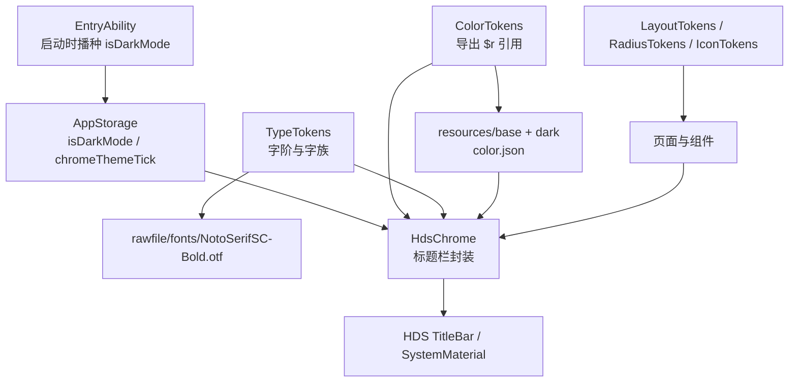
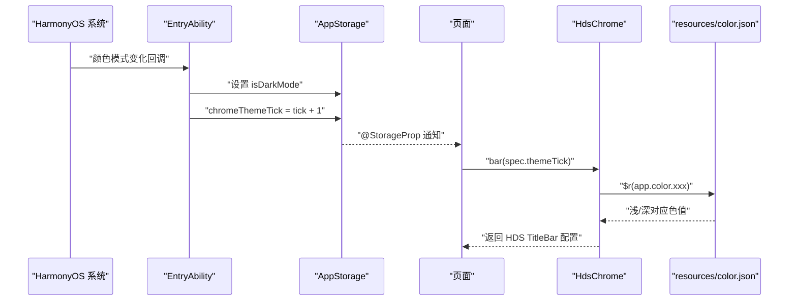
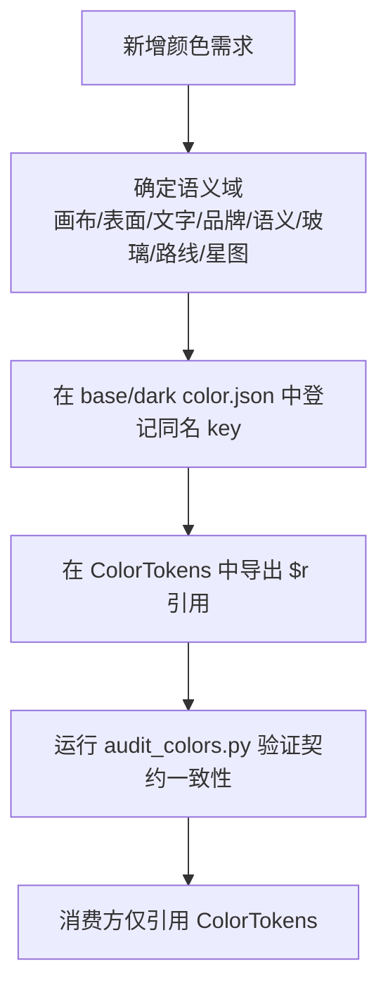
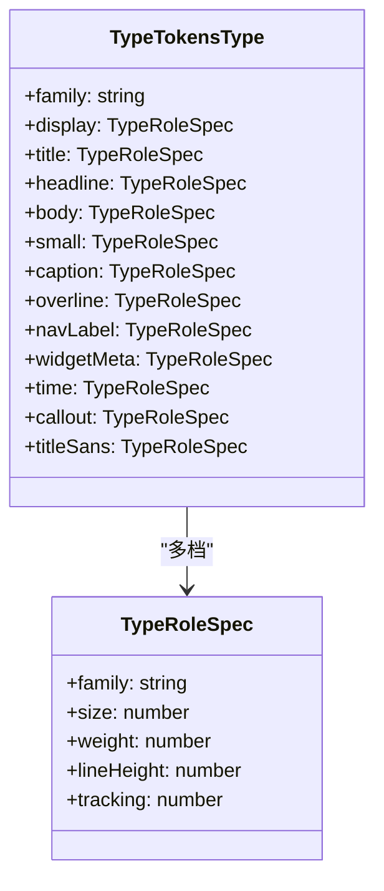
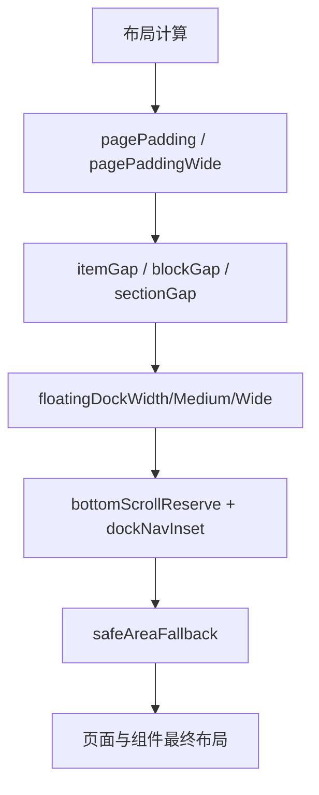
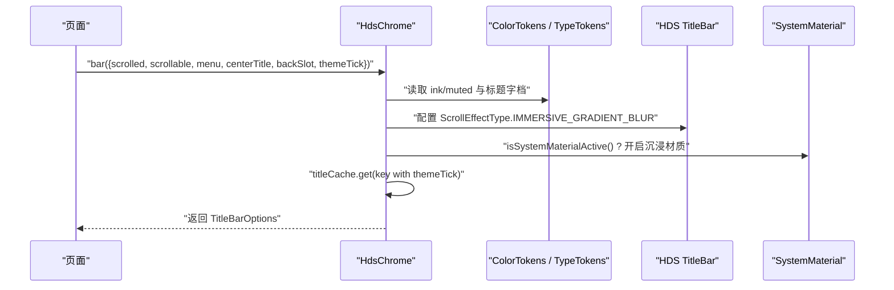
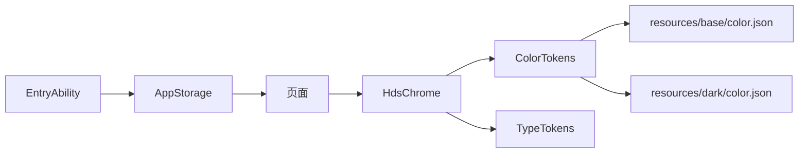

# 主题系统定制

<cite>
**本文引用的文件**   
- [ColorTokens.ets](file://entry/src/main/ets/design/ColorTokens.ets)
- [TypeTokens.ets](file://entry/src/main/ets/design/TypeTokens.ets)
- [LayoutTokens.ets](file://entry/src/main/ets/design/LayoutTokens.ets)
- [RadiusTokens.ets](file://entry/src/main/ets/design/RadiusTokens.ets)
- [IconTokens.ets](file://entry/src/main/ets/design/IconTokens.ets)
- [HdsChrome.ets](file://entry/src/main/ets/design/HdsChrome.ets)
- [EntryAbility.ets](file://entry/src/main/ets/entryability/EntryAbility.ets)
- [color.json（浅色）](file://entry/src/main/resources/base/element/color.json)
- [color.json（深色）](file://entry/src/main/resources/dark/element/color.json)
- [Index.ets](file://entry/src/main/ets/pages/Index.ets)
- [2026-11-07-表现层全量对齐-差异表.md](file://Docs/superpowers/specs/2026-11-07-表现层全量对齐-差异表.md)
</cite>

## 目录
1. [引言](#引言)
2. [项目结构](#项目结构)
3. [核心组件](#核心组件)
4. [架构总览](#架构总览)
5. [详细组件分析](#详细组件分析)
6. [依赖关系分析](#依赖关系分析)
7. [性能与可维护性](#性能与可维护性)
8. [故障排查指南](#故障排查指南)
9. [结论](#结论)
10. [附录：品牌定制与最佳实践](#附录品牌定制与最佳实践)

## 引言
本文件系统性梳理本项目在 HarmonyOS 应用中的主题体系，重点说明 DesignTokens 的颜色、字体、布局与圆角规范；解释 HdsChrome 如何消费这些 token 完成 HDS 标题栏的主题适配；并给出深色模式切换、动态主题切换、HarmonyOS 系统主题集成以及品牌定制流程的实践方法。文档同时覆盖实现细节、数据结构、调用链路与性能注意事项，便于不同技术背景的读者理解与扩展。

## 项目结构
主题相关代码集中在 `entry/src/main/ets/design` 下的若干 token 文件，以及资源目录 `entry/src/main/resources/{base,dark}/element/color.json`。页面通过 `@StorageProp('isDarkMode')` 和 `chromeThemeTick` 响应深浅档变化；`HdsChrome` 是 HDS 官方标题栏的封装，负责滚动模糊、材质、菜单图标颜色与自绘标题行。

**图表来源**
- [EntryAbility.ets:580-617](file://entry/src/main/ets/entryability/EntryAbility.ets#L580-L617)
- [ColorTokens.ets:1-200](file://entry/src/main/ets/design/ColorTokens.ets#L1-L200)
- [TypeTokens.ets:1-94](file://entry/src/main/ets/design/TypeTokens.ets#L1-L94)
- [HdsChrome.ets:1-200](file://entry/src/main/ets/design/HdsChrome.ets#L1-L200)
- [HdsChrome.ets:200-294](file://entry/src/main/ets/design/HdsChrome.ets#L200-L294)

**章节来源**
- [ColorTokens.ets:1-200](file://entry/src/main/ets/design/ColorTokens.ets#L1-L200)
- [TypeTokens.ets:1-94](file://entry/src/main/ets/design/TypeTokens.ets#L1-L94)
- [LayoutTokens.ets:1-257](file://entry/src/main/ets/design/LayoutTokens.ets#L1-L257)
- [RadiusTokens.ets:1-43](file://entry/src/main/ets/design/RadiusTokens.ets#L1-L43)
- [IconTokens.ets:1-12](file://entry/src/main/ets/design/IconTokens.ets#L1-L12)
- [HdsChrome.ets:1-294](file://entry/src/main/ets/design/HdsChrome.ets#L1-L294)
- [EntryAbility.ets:580-617](file://entry/src/main/ets/entryability/EntryAbility.ets#L580-L617)

## 核心组件
- ColorTokens：颜色语义化入口，把业务语义映射到 resources 资源名；浅色与深色两套 color.json 由系统按 ColorMode 自动切换。
- TypeTokens：封闭九档字阶，限定字号集合、字重、行高、字距与字族。
- LayoutTokens：间距、尺寸、浮动 dock、滚动预留、安全区等具名布局常量。
- RadiusTokens：八值圆角集合，禁止插值。
- IconTokens：图标尺寸与画布、描边等图标设计变量。
- HdsChrome：HDS 标题栏配置封装，统一处理滚动模糊、材质、菜单图标色、自绘标题行与内容让位。
- EntryAbility：冷启播种 isDarkMode，监听系统配置变化更新 AppStorage，并为 HdsChrome 提供 themeTick 以刷新标题缓存。

**章节来源**
- [ColorTokens.ets:1-200](file://entry/src/main/ets/design/ColorTokens.ets#L1-L200)
- [TypeTokens.ets:1-94](file://entry/src/main/ets/design/TypeTokens.ets#L1-L94)
- [LayoutTokens.ets:1-257](file://entry/src/main/ets/design/LayoutTokens.ets#L1-L257)
- [RadiusTokens.ets:1-43](file://entry/src/main/ets/design/RadiusTokens.ets#L1-L43)
- [IconTokens.ets:1-12](file://entry/src/main/ets/design/IconTokens.ets#L1-L12)
- [HdsChrome.ets:1-294](file://entry/src/main/ets/design/HdsChrome.ets#L1-L294)
- [EntryAbility.ets:580-617](file://entry/src/main/ets/entryability/EntryAbility.ets#L580-L617)

## 架构总览
主题系统的运行路径如下：
1. 应用启动时，EntryAbility 读取当前系统颜色模式，写入 AppStorage 的 isDarkMode，并在档位变化时递增 chromeThemeTick。
2. 页面订阅 isDarkMode 与 chromeThemeTick，从而触发局部或全局重建。
3. 所有 UI 通过 ColorTokens、TypeTokens、LayoutTokens、RadiusTokens、IconTokens 获取设计变量，避免硬编码色值与尺寸。
4. HdsChrome 根据 scrolled、scrollable、menu、centerTitle、backSlot、themeTick 等参数生成 HDS 标题栏，使用 ColorTokens.ink 控制标题与图标颜色，使用 TypeTokens 的 serif/sans 控制标题字族。
5. 当系统切换深浅档时，$r 引用自动解析为 resources/dark 中的同名色值；若 HdsChrome 标题未刷新，则依赖 themeTick 强制重建 ComponentContent。

**图表来源**
- [EntryAbility.ets:580-617](file://entry/src/main/ets/entryability/EntryAbility.ets#L580-L617)
- [HdsChrome.ets:1-200](file://entry/src/main/ets/design/HdsChrome.ets#L1-L200)
- [HdsChrome.ets:200-294](file://entry/src/main/ets/design/HdsChrome.ets#L200-L294)
- [ColorTokens.ets:1-200](file://entry/src/main/ets/design/ColorTokens.ets#L1-L200)

## 详细组件分析

### ColorTokens 颜色语义化体系
ColorTokens 将颜色分为多个语义域：
- 画布与表面：canvas、surfaceElevated、surfaceSubtle、surfacePanel、surfaceSunken、skeletonBase、skeletonHighlight。
- 文字与图标：ink、body、muted、faint、icon、onDark、onDarkDegraded。
- 品牌与语义：primary、primaryPress、primaryTint、primaryGlowEdge、onPrimary、brandSolid、onBrand、chipSolid、dangerTint、accentMention、success、warning、danger、like、bookmark。
- 线与遮罩：hairline、borderSubtle、hairlineStrong、separator、modalScrim。
- 玻璃与栏面：barShadow、glassBarSurface、glassBarBorder、glassBarBg、glassCardBg、glassSegmentBg、glassSegmentBorder、glassPillFill、glassPillRim。
- 路线图与星图：routePath、routePathSoft、routeNodeFill、routeNodeStroke、routeContour、routeWater、routeLand、routeGold、routeBgTop、routeBgBottom、starInk、starRing、starIcon、starGold、starBadge、starBgTop、starBgBottom。
- 兼容别名：secondary、tertiary、sunken、brand、brandTint、brandPress、barSurface、barBorder、barTabSelectedBg。

关键约束：
- 色值全部来自 resources/base 与 resources/dark 中的 color.json；ColorTokens 只导出 $r 引用。
- 深浅两档同名 key 由系统自动切换，页面零分支。
- 新增语义色必须在两份 color.json 成对登记，并在契约 ledger 同步。
- 状态表达允许 opacity：禁用态 0.45、按下态 0.92，但需遵循 Pressable 与差异表的交互配方。

**图表来源**
- [ColorTokens.ets:1-200](file://entry/src/main/ets/design/ColorTokens.ets#L1-L200)
- [color.json（浅色）:1-284](file://entry/src/main/resources/base/element/color.json#L1-L284)
- [color.json（深色）:1-284](file://entry/src/main/resources/dark/element/color.json#L1-L284)

**章节来源**
- [ColorTokens.ets:1-200](file://entry/src/main/ets/design/ColorTokens.ets#L1-L200)
- [color.json（浅色）:1-284](file://entry/src/main/resources/base/element/color.json#L1-L284)
- [color.json（深色）:1-284](file://entry/src/main/resources/dark/element/color.json#L1-L284)
- [2026-11-07-表现层全量对齐-差异表.md:1-135](file://Docs/superpowers/specs/2026-11-07-表现层全量对齐-差异表.md#L1-L135)

### TypeTokens 字体规范
TypeTokens 定义封闭九档字阶，包括 display、title、headline、body、small、caption、overline、navLabel、widgetMeta、time、callout、titleSans。每个档位指定 family、size、weight、lineHeight、tracking。

重要规范：
- 字号仅允许 10/11/12/14/16/18/21/32，不存在中间值。
- 字距全局 0；数字走 tabular feature `'tnum' on`。
- serif 字族 NotoSerifSC 已打包并通过 EntryAbility 注册，唯一例外是金额 hero 用 sans。
- overline 与 time 的 lineHeight 写 0，表示“不设行高”，不能直接传入 `.lineHeight(0)`。
- callout 是 small 的语义别名，titleSans 是 21/650/28 sans 的控件标题档。

**图表来源**
- [TypeTokens.ets:1-94](file://entry/src/main/ets/design/TypeTokens.ets#L1-L94)

**章节来源**
- [TypeTokens.ets:1-94](file://entry/src/main/ets/design/TypeTokens.ets#L1-L94)
- [EntryAbility.ets:916-917](file://entry/src/main/ets/entryability/EntryAbility.ets#L916-L917)
- [2026-11-07-表现层全量对齐-差异表.md:1-135](file://Docs/superpowers/specs/2026-11-07-表现层全量对齐-差异表.md#L1-L135)

### LayoutTokens 间距与尺寸体系
LayoutTokens 集中了屏幕内边距、区块间隙、分段控件高度、底部 Tab 栏高、浮动 dock 宽度与间距、滚动预留、最小命中区、地图浮层内缩、吸顶头带高等具名值。它强调：
- 通用间距阶梯：itemGap、blockGap、sectionGap。
- 浮动 dock 三档宽度 small/medium/large，并固定 barHeight 与 bottomMargin。
- 底部滚动预留 94vp，必须配合 dockNavInset 使用。
- 安全区兜底 safeAreaFallback=12，用于 env(safe-area-inset-bottom, 12px)。
- 与 IconSizes 联动，control/display 大小影响全仓图标渲染与命中区域。

**图表来源**
- [LayoutTokens.ets:1-257](file://entry/src/main/ets/design/LayoutTokens.ets#L1-L257)

**章节来源**
- [LayoutTokens.ets:1-257](file://entry/src/main/ets/design/LayoutTokens.ets#L1-L257)

### RadiusTokens 圆角半径体系
RadiusTokens 提供封闭八值：none、media、capsule、reason、card、hero、dock、pill，外加 floatingBar 与 lg 两个有据同名档。不允许插值，也不允许随意加宽或收紧。

用途示例：
- media 用于媒体与卡内嵌套。
- capsule 用于胶囊与输入。
- card 与 hero 用于卡片与面板。
- pill 用于按钮、徽标、头像等圆角元素。

**章节来源**
- [RadiusTokens.ets:1-43](file://entry/src/main/ets/design/RadiusTokens.ets#L1-L43)

### IconTokens 图标尺寸
IconTokens 提供 compact、standard 等图标尺寸常量；LayoutTokens 还暴露 IconSizes.control 与 IconSizes.display，二者并存但职责不同：搬运组件用 IconTokens，原生件用 IconSizes。

**章节来源**
- [IconTokens.ets:1-12](file://entry/src/main/ets/design/IconTokens.ets#L1-L12)
- [LayoutTokens.ets:201-257](file://entry/src/main/ets/design/LayoutTokens.ets#L201-L257)

### HdsChrome 主题适配机制
HdsChrome 是对 HDS 官方导航标题栏的单点配置封装，主要职责包括：
- 滚动效果：IMMERSIVE_GRADIENT_BLUR，blurRadius 在滚动后生效，静止时为 0，避免白底白图标问题。
- 材质：当系统支持时启用沉浸式材质（materialType 与 materialLevel）。
- 标题行：自绘主标题与副标题，根页使用 title 档，子页使用 headline 档；主标题使用 ink，副标题使用 muted；根页左内缩 base，子页让出返回键位 BACK_SLOT_END_VP。
- 菜单图标颜色：统一使用 ColorTokens.ink，解决透明栏下默认白色图标不可见的问题。
- 内容让位：contentTopInset(statusBarHeightVp, bottomRowVp) 返回 statusBarHeight + MINI_TITLE_BAR_VP + bottomRowVp，确保滚动容器原点从窗口 0 起算且不被栏体遮挡。
- 标题缓存与主题刷新：titleContentOf 使用 Map 缓存 ComponentContent，key 包含 mainTitle、subTitle、backSlot、centerTitle、themeTick；themeTick 由 EntryAbility 在深浅档变化时递增，保证旧缓存失效并重建新实例。

**图表来源**
- [HdsChrome.ets:1-200](file://entry/src/main/ets/design/HdsChrome.ets#L1-L200)
- [HdsChrome.ets:200-294](file://entry/src/main/ets/design/HdsChrome.ets#L200-L294)
- [ColorTokens.ets:1-200](file://entry/src/main/ets/design/ColorTokens.ets#L1-L200)
- [TypeTokens.ets:1-94](file://entry/src/main/ets/design/TypeTokens.ets#L1-L94)

**章节来源**
- [HdsChrome.ets:1-294](file://entry/src/main/ets/design/HdsChrome.ets#L1-L294)

## 依赖关系分析
主题体系的依赖方向清晰：页面与组件消费 DesignTokens；HdsChrome 同时消费 ColorTokens 与 TypeTokens，并间接依赖 resources/color.json；EntryAbility 负责初始化 isDarkMode 与 chromeThemeTick，为 HdsChrome 的标题刷新提供驱动。

**图表来源**
- [EntryAbility.ets:580-617](file://entry/src/main/ets/entryability/EntryAbility.ets#L580-L617)
- [HdsChrome.ets:1-294](file://entry/src/main/ets/design/HdsChrome.ets#L1-L294)
- [ColorTokens.ets:1-200](file://entry/src/main/ets/design/ColorTokens.ets#L1-L200)
- [TypeTokens.ets:1-94](file://entry/src/main/ets/design/TypeTokens.ets#L1-L94)

**章节来源**
- [Index.ets:40-43](file://entry/src/main/ets/pages/Index.ets#L40-L43)
- [Index.ets:661-678](file://entry/src/main/ets/pages/Index.ets#L661-L678)
- [Index.ets:842-858](file://entry/src/main/ets/pages/Index.ets#L842-L858)

## 性能与可维护性
- 颜色加载：ColorTokens 使用 $r 引用，深浅档切换由系统自动解析，页面无需分支判断，减少运行时条件。
- 标题缓存：HdsChrome.titleCache 基于 key 复用 ComponentContent，避免重复构建；themeTick 变化时强制失效，保证深浅档切换后标题重建。
- 滚动模糊：仅在 scrolled=true 时设置 blurRadius，避免静止态空糊。
- 材质门控：isSystemMaterialActive() 防止低版本设备 import hdsMaterial 导致崩溃。
- 字号约束：ALLOWED_FONT_SIZES 限制字号集合，audit_type.py 钉住过 line-height 语义，降低误用风险。
- 圆角约束：ALLOWED_RADII 限制圆角集合，避免随意插值破坏视觉一致性。
- 布局收敛：LayoutTokens 集中管理 dock、滚动预留、安全区，避免多处硬编码造成错位。

[本节为通用性能建议，不直接分析具体代码片段]

## 故障排查指南
常见主题相关问题与定位方法：
- 标题颜色不随深浅切换：检查是否传入了正确的 themeTick；确认 HdsChrome.bar 使用了 ColorTokens.ink 而非硬编码色值。
- 顶部内容被栏体遮挡：确认页面 contentTopInset 使用了 statusBarHeightVp + MINI_TITLE_BAR_VP + bottomRowVp，并确保 enableComponentSafeArea=false。
- 深浅档切换后标题仍为浅色：检查 EntryAbility.seedDarkMode 是否递增 chromeThemeTick；确认页面 @StorageProp('chromeThemeTick') 正确传递给 HdsChrome。
- 菜单图标不可见：透明栏下 HDS 默认图标为白色，应使用 ColorTokens.ink。
- 滚动模糊无效：确认 scrollable 不为 false，且 scrolled=true 时才给 blurRadius；originalStyle 与 scrollEffectStyle 均需配置。
- 浮动 dock 压住钉底按钮：使用 LayoutTokens.floatingDockClearance 与 dockNavInset 组合，避免手工留空不足。
- 字体渲染异常：确认 NotoSerifSC 已在 EntryAbility 中注册；正文与站点名使用 sans，serif 仅用于标题。

**章节来源**
- [HdsChrome.ets:1-200](file://entry/src/main/ets/design/HdsChrome.ets#L1-L200)
- [HdsChrome.ets:200-294](file://entry/src/main/ets/design/HdsChrome.ets#L200-L294)
- [EntryAbility.ets:580-617](file://entry/src/main/ets/entryability/EntryAbility.ets#L580-L617)
- [EntryAbility.ets:916-917](file://entry/src/main/ets/entryability/EntryAbility.ets#L916-L917)

## 结论
本项目的主题体系以 DesignTokens 为核心，通过 ColorTokens、TypeTokens、LayoutTokens、RadiusTokens、IconTokens 将视觉与布局规范抽象为可维护的设计变量；HdsChrome 作为 HDS 标题栏的统一封装，负责滚动模糊、材质、菜单图标与标题行的主题适配；EntryAbility 负责深浅档播种与主题切换驱动。该体系兼顾 HarmonyOS 系统主题能力与品牌定制扩展性，适合在多团队、多页面的场景下保持一致的视觉语言与可演进的主题架构。

[本节为总结性内容，不直接分析具体代码片段]

## 附录：品牌定制与最佳实践

### 深色模式切换实现要点
- 启动阶段：EntryAbility.onCreate 调用 seedDarkMode，冷启即播种 isDarkMode。
- 配置变化：onConfigurationUpdate 中再次 seedDarkMode(newConfig)，保持实时切换一致。
- 标题刷新：每次深浅档变化时递增 chromeThemeTick，使 HdsChrome.titleContentOf 的缓存键变化，重建标题 ComponentContent。
- 阴影门控：深色模式下关闭 elevation，避免与暗色背景冲突。

**章节来源**
- [EntryAbility.ets:580-617](file://entry/src/main/ets/entryability/EntryAbility.ets#L580-L617)
- [HdsChrome.ets:200-294](file://entry/src/main/ets/design/HdsChrome.ets#L200-L294)

### 动态主题切换方案
- 使用 AppStorage 的 isDarkMode 作为主题状态源。
- 使用 chromeThemeTick 作为 HdsChrome 标题重建触发器。
- 页面通过 @StorageProp('isDarkMode') 与 @StorageProp('chromeThemeTick') 响应主题变化。
- 对于非 HdsChrome 的自定义标题或复杂标题，可在状态变化时重建组件树或使用 Watch 重新构建选项。

**章节来源**
- [EntryAbility.ets:580-617](file://entry/src/main/ets/entryability/EntryAbility.ets#L580-L617)
- [HdsChrome.ets:1-200](file://entry/src/main/ets/design/HdsChrome.ets#L1-L200)

### HarmonyOS 系统主题集成
- 资源层面：resources/base 与 resources/dark 下的 color.json 同名 key 自动随系统 ColorMode 切换。
- 组件层面：HdsChrome 使用 ColorTokens.ink 与 ColorTokens.muted，确保菜单图标与标题文字在不同背景下可读。
- 材质层面：isSystemMaterialActive() 开启沉浸式材质，使栏体与内容融合更自然。
- 字体层面：NotoSerifSC 通过 rawfile 注册，确保 serif 标题在所有页面可用。

**章节来源**
- [color.json（浅色）:1-284](file://entry/src/main/resources/base/element/color.json#L1-L284)
- [color.json（深色）:1-284](file://entry/src/main/resources/dark/element/color.json#L1-L284)
- [HdsChrome.ets:1-200](file://entry/src/main/ets/design/HdsChrome.ets#L1-L200)
- [EntryAbility.ets:916-917](file://entry/src/main/ets/entryability/EntryAbility.ets#L916-L917)

### 品牌定制流程
要替换品牌色、字体家族与圆角半径等设计变量，推荐按以下步骤操作：
1. 品牌色替换：
   - 在 resources/base 与 resources/dark 的 color.json 中修改 primary、primaryPress、primaryTint、brandSolid、onBrand 等 key。
   - 如需新增品牌变体，新增同名 key 并在 ColorTokens 中导出 $r 引用。
   - 运行 audit_colors.py 校验契约一致性。
2. 字体家族替换：
   - 如需替换 serif 字族，先在 EntryAbility 中注册新的 rawfile 字体，再修改 TypeTokens.family 与 TYPE_FONT_FAMILY_SERIF。
   - 注意：正文、站点名、数字应保持 sans；serif 仅用于标题。
3. 圆角半径替换：
   - 在 RadiusTokens 中调整对应档位的数值；如新增半径，需同步 ALLOWED_RADII 白名单。
   - 谨慎评估对现有卡片、按钮、头像的影响。
4. 布局变量替换：
   - 在 LayoutTokens 中调整 pagePadding、segmentedControlHeight、floatingDockWidth 等具名值。
   - 确保滚动预留与 dock 让位逻辑不受影响。
5. 回归验证：
   - 运行 audit_* 系列工具，检查颜色对比、几何尺寸、字体、滚动行为等。
   - 手动验收深浅档切换、滚动模糊、材质、dock 布局与标题行。

**章节来源**
- [ColorTokens.ets:1-200](file://entry/src/main/ets/design/ColorTokens.ets#L1-L200)
- [TypeTokens.ets:1-94](file://entry/src/main/ets/design/TypeTokens.ets#L1-L94)
- [RadiusTokens.ets:1-43](file://entry/src/main/ets/design/RadiusTokens.ets#L1-L43)
- [LayoutTokens.ets:1-257](file://entry/src/main/ets/design/LayoutTokens.ets#L1-L257)
- [EntryAbility.ets:916-917](file://entry/src/main/ets/entryability/EntryAbility.ets#L916-L917)

### 主题配置文件示例
以下示例描述主题配置的关键字段，供品牌定制参考：

- 颜色配置（resources/base 与 resources/dark）
  - canvas：画布底色
  - surface_elevated / surface_subtle / surface_panel / surface_sunken：表面阶梯
  - ink / body / muted / faint / icon：文字与图标色
  - primary / primary_press / primary_tint / brand_solid / on_brand：品牌主色与反色
  - success / warning / danger / like / bookmark：语义色
  - glass_bar_surface / glass_bar_border / glass_card_bg / glass_segment_bg / glass_pill_fill / glass_pill_rim：玻璃栏面与卡片背景
- 字体配置（TypeTokens）
  - fontFamily：无衬线字族
  - fontFamilySerif：衬线字族
  - tabularFeature：数字等宽特性
  - display / title / headline / body / small / caption / overline / navLabel / widgetMeta / time / callout / titleSans：字阶规格
- 布局配置（LayoutTokens）
  - pagePadding / itemGap / blockGap / sectionGap：基础间距
  - segmentedControlHeight / tabBarHeight：控件高度
  - floatingDockWidth / floatingDockMediumWidth / floatingDockWideWidth：浮动 dock 宽度
  - bottomScrollReserve / floatingDockClearance / safeAreaFallback：滚动与安全区
- 圆角配置（RadiusTokens）
  - none / media / capsule / reason / card / hero / dock / pill / floatingBar / lg

[本节为概念性配置示例，不直接分析具体代码片段]

### 最佳实践
- 优先使用 DesignTokens，禁止在页面与组件中硬编码颜色、字号、圆角与间距。
- 新增颜色必须在两份 color.json 成对登记，并同步契约。
- 深浅档切换尽量依赖系统资源自动切换；仅在必要时使用 AppStorage 状态。
- HdsChrome 标题行使用 ColorTokens.ink 与 TypeTokens 的 serif/sans，避免内置 mainTitle 带来的字体不一致。
- 滚动模糊只在滚动后生效，静止态不给 blurRadius。
- 浮动 dock 与钉底按钮的让位使用 LayoutTokens 派生值，不要手工估算。
- 图标尺寸区分 IconTokens 与 IconSizes，搬运组件与原生组件各归其主。
- 圆角与字号使用 ALLOWED_RADII 与 ALLOWED_FONT_SIZES 白名单，避免越界。

[本节为通用最佳实践，不直接分析具体代码片段]