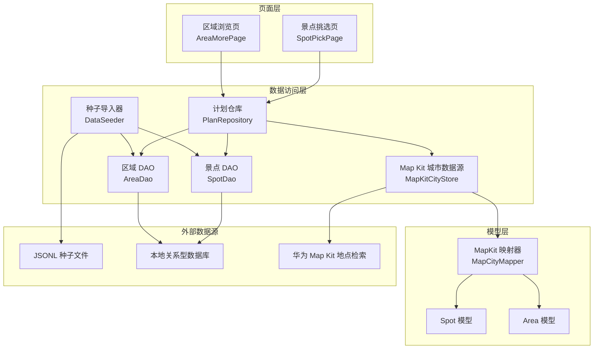
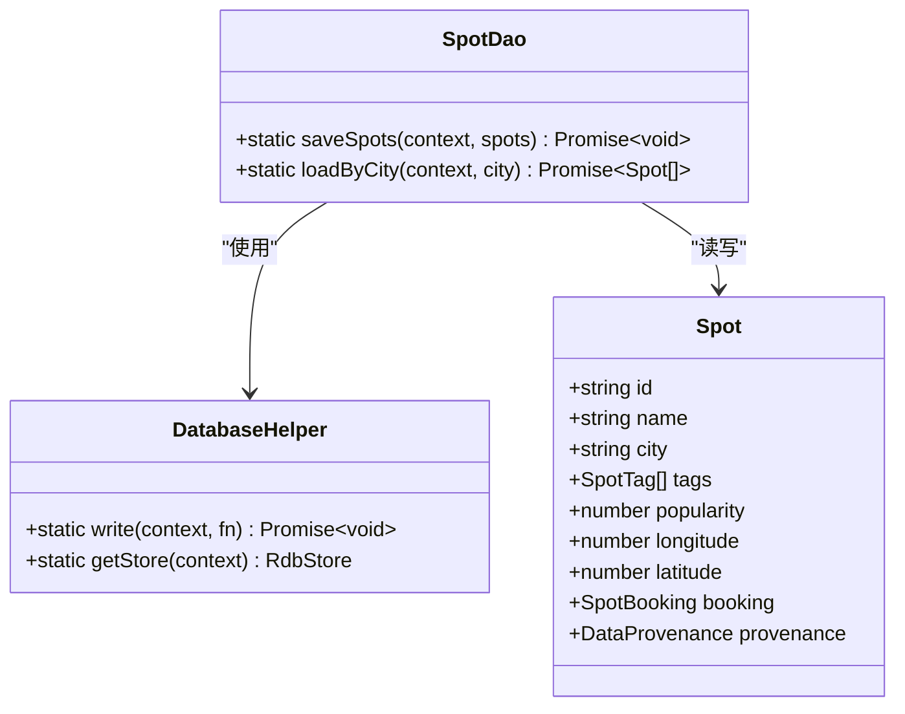
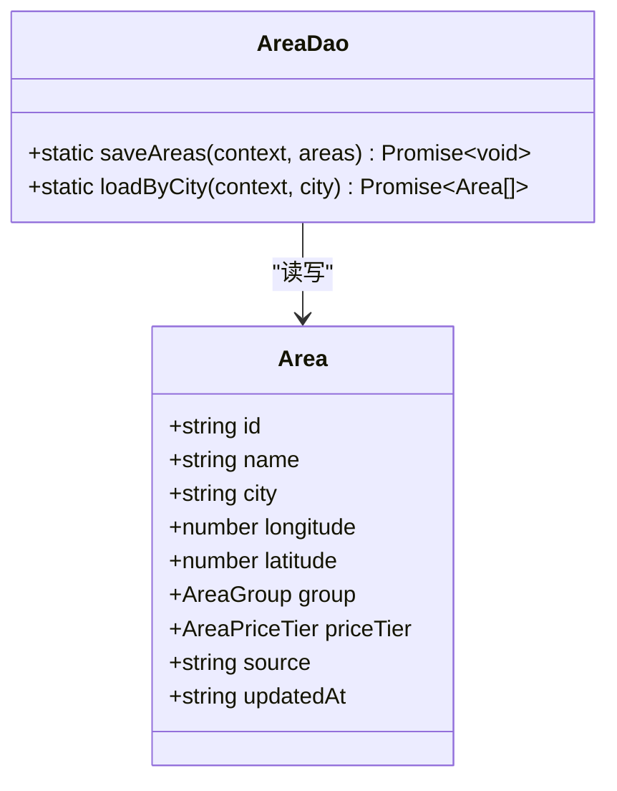
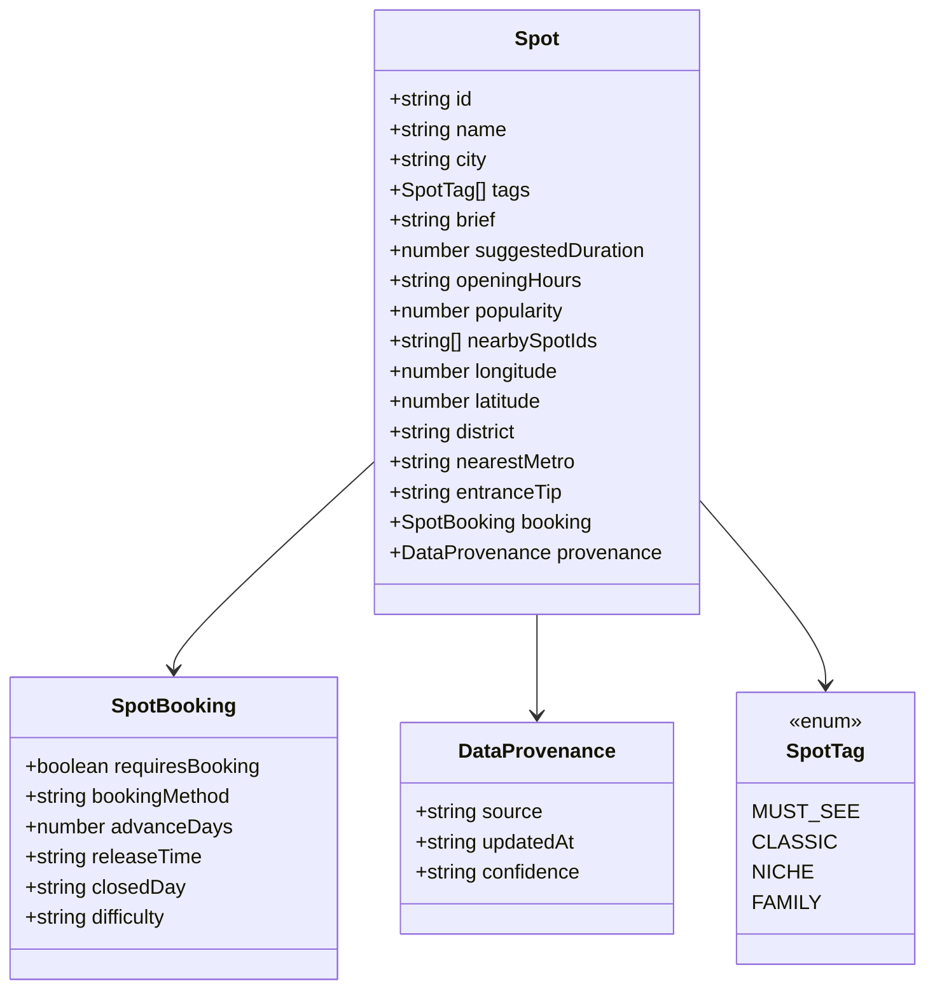
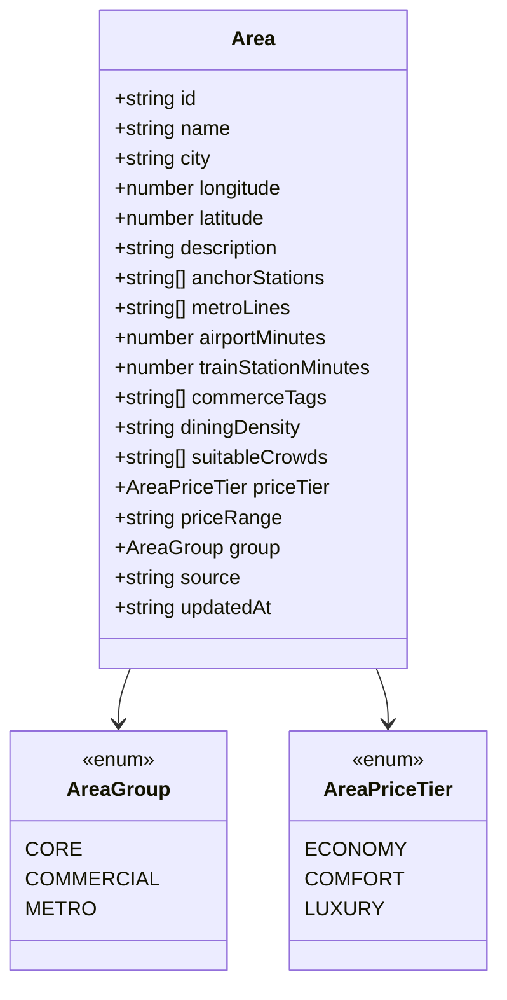
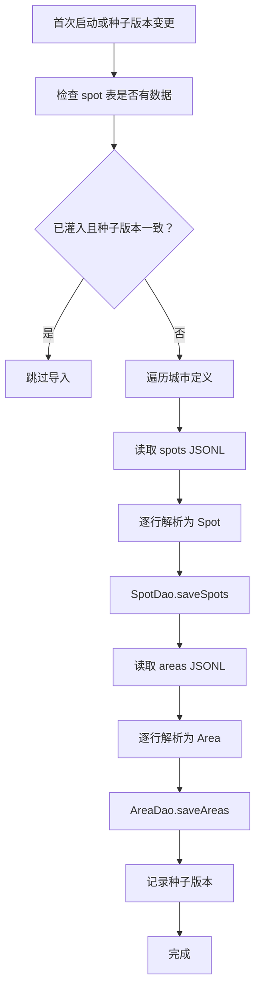
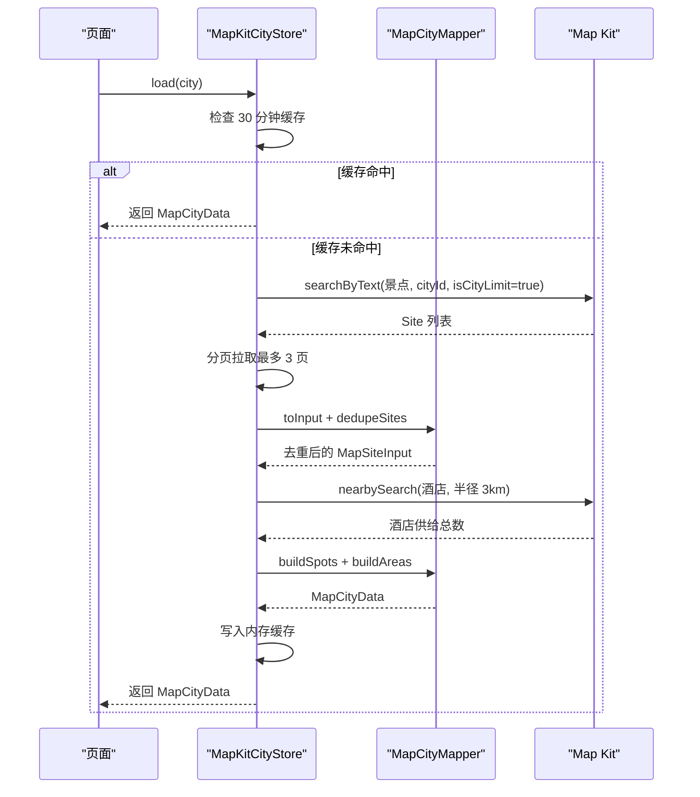
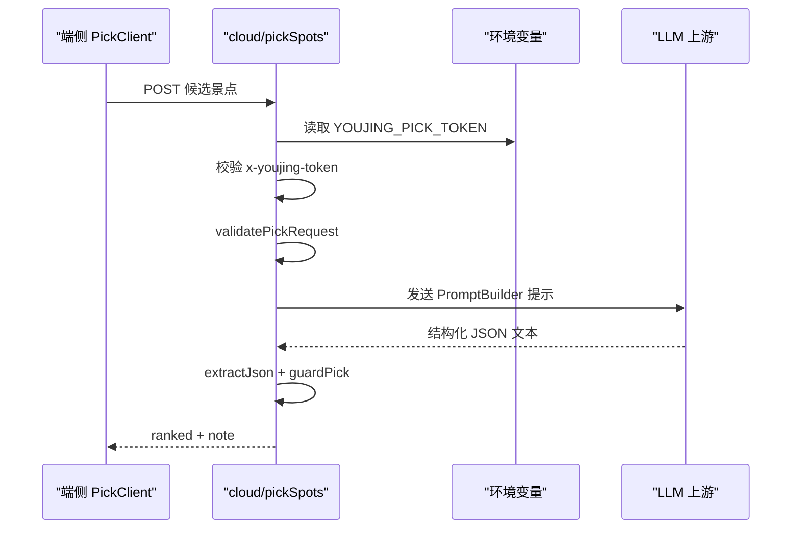
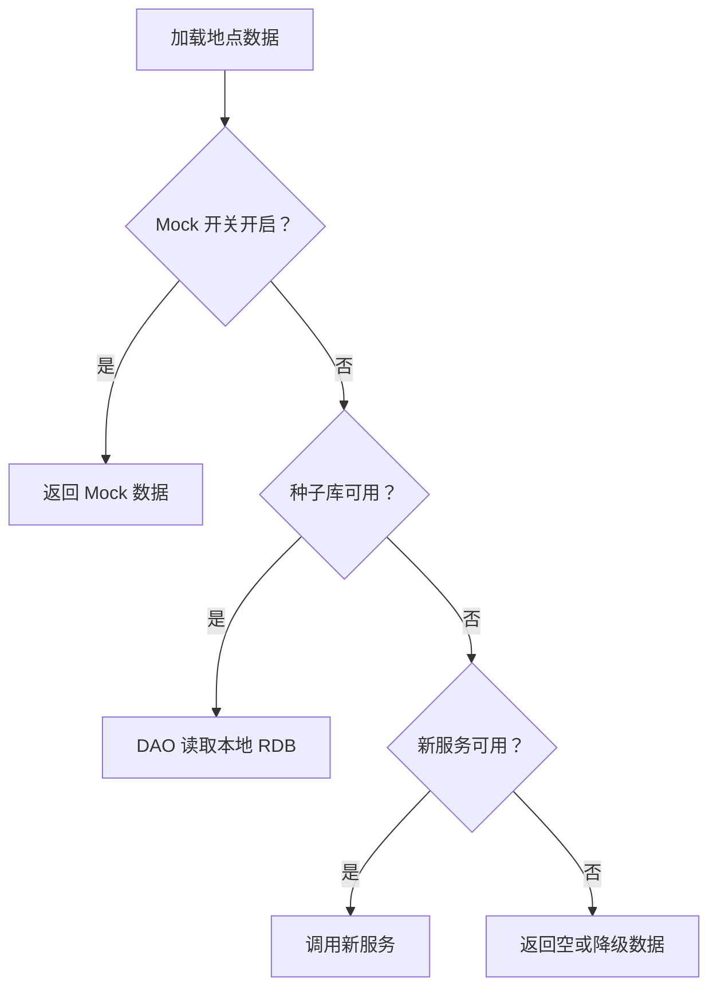
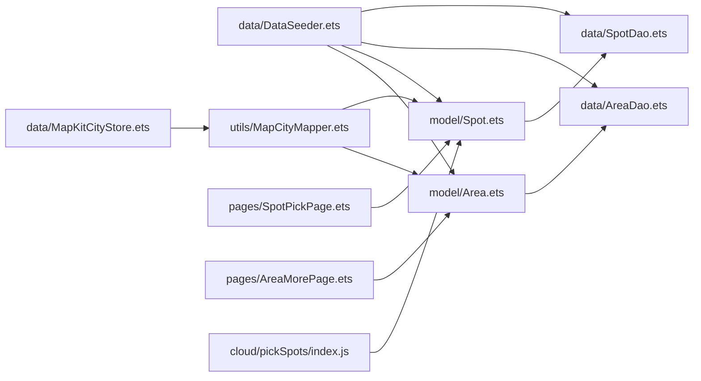

# 地点数据源扩展

<cite>
**本文引用的文件**   
- [SpotDao.ets](file://entry/src/main/ets/data/SpotDao.ets)
- [AreaDao.ets](file://entry/src/main/ets/data/AreaDao.ets)
- [Spot.ets](file://entry/src/main/ets/model/Spot.ets)
- [Area.ets](file://entry/src/main/ets/model/Area.ets)
- [DataSeeder.ets](file://entry/src/main/ets/data/DataSeeder.ets)
- [MapKitCityStore.ets](file://entry/src/main/ets/data/MapKitCityStore.ets)
- [MapCityMapper.ets](file://entry/src/main/ets/utils/MapCityMapper.ets)
- [MockData.ets](file://entry/src/main/ets/mock/MockData.ets)
- [MockConfig.ets](file://entry/src/main/ets/common/config/MockConfig.ets)
- [PickClient.ets](file://entry/src/main/ets/ai/PickClient.ets)
- [Index.ets（景点挑选页）](file://entry/src/main/ets/pages/SpotPickPage.ets)
- [AreaMorePage.ets](file://entry/src/main/ets/pages/AreaMorePage.ets)
- [index.js（cloud/pickSpots）](file://cloud/pickSpots/index.js)
- [trip.js（bff 行程路由）](file://bff/src/routes/trip.js)
- [MapKit 地点检索探针](file://Docs/MapKit地点检索探针-2026-10-31.md)
</cite>

## 目录

1. [引言](#引言)
2. [项目结构与数据分层](#项目结构与数据分层)
3. [核心抽象：SpotDao 与 AreaDao](#核心抽象spotdao-与-areadao)
4. [统一数据模型接口](#统一数据模型接口)
5. [种子库与 Map Kit 双通道](#种子库与-map-kit-双通道)
6. [云端函数 cloud/pickSpots 与数据同步机制](#云端函数-cloudpickspots-与数据同步机制)
7. [接入新地点服务的步骤](#接入新地点服务的步骤)
8. [缓存策略、增量更新与离线支持](#缓存策略增量更新与离线支持)
9. [Mock 数据源与测试方法](#mock-数据源与测试方法)
10. [版本管理与迁移策略](#版本管理与迁移策略)
11. [依赖关系分析](#依赖关系分析)
12. [性能与排错指南](#性能与排错指南)
13. [结论](#结论)

## 引言

本项目的地点数据体系围绕“景点”和“住宿区域”两类实体构建。它同时支持两种来源：

- **内置种子库**：基于 `entry/src/main/ets/resources/rawfile/seed/*.jsonl`，覆盖北上广深等首批城市，提供稳定的离线候选。
- **Map Kit 地点检索**：面向任意城市，通过华为地图服务动态获取景点与住宿区聚合结果。

DAO 层屏蔽了底层数据库差异；种子导入负责把 JSONL 清洗后写入本地关系型存储；Map Kit 通道则走内存缓存，不写 RDB。两者最终都映射到统一的 `Spot` 与 `Area` 模型，使页面、AI 精选、地图展示不需要关心数据来源。

## 项目结构与数据分层

地点数据在代码中的组织遵循“模型 → DAO → 数据源 → 页面”的分层方式：

**图表来源**
- [SpotPickPage.ets:1-200](file://entry/src/main/ets/pages/SpotPickPage.ets#L1-L200)
- [AreaMorePage.ets:1-200](file://entry/src/main/ets/pages/AreaMorePage.ets#L1-L200)
- [SpotDao.ets:1-100](file://entry/src/main/ets/data/SpotDao.ets#L1-L100)
- [AreaDao.ets:1-75](file://entry/src/main/ets/data/AreaDao.ets#L1-L75)
- [DataSeeder.ets:1-200](file://entry/src/main/ets/data/DataSeeder.ets#L1-L200)
- [MapKitCityStore.ets:1-179](file://entry/src/main/ets/data/MapKitCityStore.ets#L1-L179)
- [MapCityMapper.ets:1-200](file://entry/src/main/ets/utils/MapCityMapper.ets#L1-L200)

**章节来源**
- [SpotPickPage.ets:1-200](file://entry/src/main/ets/pages/SpotPickPage.ets#L1-L200)
- [AreaMorePage.ets:1-200](file://entry/src/main/ets/pages/AreaMorePage.ets#L1-L200)
- [MapKit 地点检索探针:1-151](file://Docs/MapKit地点检索探针-2026-10-31.md#L1-L151)

## 核心抽象：SpotDao 与 AreaDao

### SpotDao：景点数据访问层

`SpotDao` 是景点数据的唯一持久化入口。它承担两项职责：

1. **批量 upsert**：将一组 `Spot` 对象转为 SQLite 行，按 `id` 冲突替换。
2. **按城市读取**：查询指定城市的景点，并按热度降序返回。

| 方法 | 输入 | 输出 | 行为 |
|---|---|---|---|
| `saveSpots` | 应用上下文、景点列表 | `Promise<void>` | 遍历景点并调用 `insertSync`，冲突策略为替换 |
| `loadByCity` | 应用上下文、城市名 | `Promise<Spot[]>` | 执行 SQL 查询，解析标签、周边 ID、预约规则与溯源信息 |

写入时会把复杂字段序列化为字符串：

- `tags`：景点标签数组转 JSON 字符串。
- `nearbySpotIds`：周边景点 ID 数组转 JSON 字符串。
- `booking.requiresBooking`：布尔值转 `0` 或 `1`。
- `provenance.confidence`：可信度可能为空，空时落空串。

读取时再逆向还原。若 JSON 解析失败，标签和周边 ID 会回退为空数组，避免坏数据导致启动崩溃。

**图表来源**
- [SpotDao.ets:1-100](file://entry/src/main/ets/data/SpotDao.ets#L1-L100)
- [Spot.ets:1-69](file://entry/src/main/ets/model/Spot.ets#L1-L69)

### AreaDao：住宿区域数据访问层

`AreaDao` 的职责与 `SpotDao` 对称，但用于住宿区域：

| 方法 | 输入 | 输出 | 行为 |
|---|---|---|---|
| `saveAreas` | 应用上下文、区域列表 | `Promise<void>` | 按 `id` 冲突替换写入 |
| `loadByCity` | 应用上下文、城市名 | `Promise<Area[]>` | 按 `grp` 和 `id` 排序，保证候选切片可复现 |

关键设计点：

- 排序显式包含分组键和 ID，注释明确说明这是为了避免 SQLite 隐式行序影响屏 5 的候选切片。
- 所有数组字段如锚定站、地铁线路、商圈标签、适合人群，都以 JSON 字符串持久化。
- 价格区间 `priceRange` 可为空，读取时代码做了空串判断。

**图表来源**
- [AreaDao.ets:1-75](file://entry/src/main/ets/data/AreaDao.ets#L1-L75)
- [Area.ets:1-51](file://entry/src/main/ets/model/Area.ets#L1-L51)

### DAO 模式如何屏蔽底层差异

DAO 层隐藏了以下实现细节：

- 调用方只关心 `Spot` 和 `Area` 对象，不需要知道字段被序列化成了 JSON 字符串。
- 调用方不需要直接操作 `relationalStore.RdbStore`，而是通过 `DatabaseHelper` 统一管理连接。
- 解析异常不会向上抛出；错误数据会被降级为空数组或空字符串。
- 查询顺序由 DAO 层固定，UI 层无需关心 SQLite 默认排序行为。

**章节来源**
- [SpotDao.ets:1-100](file://entry/src/main/ets/data/SpotDao.ets#L1-L100)
- [AreaDao.ets:1-75](file://entry/src/main/ets/data/AreaDao.ets#L1-L75)

## 统一数据模型接口

### Spot 模型

`Spot` 是景点的统一契约类型。它的字段既是 UI 展示输入，也是 AI 提示词构造输入。

| 字段 | 含义 | 是否必填 | 备注 |
|---|---|---:|---|
| `id` | 景点唯一标识 | 是 | 不同来源应稳定 |
| `name` | 景点名称 | 是 | 不能为空 |
| `city` | 所在城市 | 是 | 首批北上广深，后续扩展到任意城市 |
| `tags` | 标签集合 | 是 | 四值封闭枚举 |
| `brief` | 一句话简介 | 否 | Map Kit 可用摘要填充 |
| `suggestedDuration` | 建议游玩时长（分钟） | 是 | 最小值为 1 |
| `openingHours` | 每日一致开放时段 | 否 | Map Kit 城市有，其他来源留空 |
| `popularity` | 热度指数 | 是 | 组内排序键 |
| `nearbySpotIds` | 周边景点 ID | 是 | 规划阶段串联用 |
| `longitude` / `latitude` | GCJ02 坐标 | 是 | 中国大陆地图显示需要 |
| `district` | 所在区 | 是 | 区域聚合与远郊过滤依据 |
| `nearestMetro` | 最近地铁站 | 否 | 种子阶段常为空 |
| `entranceTip` | 入口提示 | 否 | 可选补充信息 |
| `booking` | 预约规则 | 是 | 所有硬信息需带“以官方为准”标注 |
| `provenance` | 数据来源 | 是 | 包括来源、更新时间、可信度 |

**图表来源**
- [Spot.ets:1-69](file://entry/src/main/ets/model/Spot.ets#L1-L69)

### Area 模型

`Area` 表示住宿区域推荐位置，不是真实房源或预订库存。

| 字段 | 含义 | 是否必填 | 备注 |
|---|---|---:|---|
| `id` | 区域唯一标识 | 是 | |
| `name` | 区域名称 | 是 | |
| `city` | 城市 | 是 | |
| `longitude` / `latitude` | 中心坐标 | 是 | 无坐标时 seed 逻辑会跳过落点 |
| `description` | 一句话描述 | 否 | 种子阶段通常为空 |
| `anchorStations` | 锚定地铁站 | 是 | 最多 1–3 个 |
| `metroLines` | 途经地铁线路 | 是 | |
| `airportMinutes` | 到机场通勤分钟 | 是 | 非负整数 |
| `trainStationMinutes` | 到火车站通勤分钟 | 是 | 非负整数 |
| `commerceTags` | 商圈标签 | 是 | |
| `diningDensity` | 餐饮密度 | 是 | 高/中/低 |
| `suitableCrowds` | 适合人群 | 是 | |
| `priceTier` | 价格档位 | 是 | 经济/舒适/豪华 |
| `priceRange` | 参考价位段文案 | 否 | 预算协同启用前仅展示 |
| `group` | 浏览分组 | 是 | 核心区/商圈/地铁站 |
| `source` | 数据来源 | 是 | |
| `updatedAt` | 更新时间 | 是 | 格式为日期 |

**图表来源**
- [Area.ets:1-51](file://entry/src/main/ets/model/Area.ets#L1-L51)

**章节来源**
- [Spot.ets:1-69](file://entry/src/main/ets/model/Spot.ets#L1-L69)
- [Area.ets:1-51](file://entry/src/main/ets/model/Area.ets#L1-L51)

## 种子库与 Map Kit 双通道

### 种子库流程

种子库位于 `entry/src/main/ets/resources/rawfile/seed/`，每个城市一对文件：

- `spots_*.jsonl`：景点记录，每行一个 JSON 对象。
- `areas_*.jsonl`：住宿区域记录，每行一个 JSON 对象。

导入过程如下：

**图表来源**
- [DataSeeder.ets:1-200](file://entry/src/main/ets/data/DataSeeder.ets#L1-L200)
- [DataSeeder.ets:201-340](file://entry/src/main/ets/data/DataSeeder.ets#L201-L340)
- [SpotDao.ets:1-100](file://entry/src/main/ets/data/SpotDao.ets#L1-L100)
- [AreaDao.ets:1-75](file://entry/src/main/ets/data/AreaDao.ets#L1-L75)

关键点：

- 种子结构有 `SEED_DATE` 和 `SEED_VERSION`。当本地已有数据且版本一致时跳过导入。
- 坐标来自 v2 地理编码：POI 名或片区锚定站经地理编码得到 WGS84，再转换为 GCJ02。
- 没有坐标的行不会让启动崩溃：景点回退到区中心近似坐标，片区可能不落点。
- 标签、价格档位、分组都经过白名单校验，未知值丢弃或回退默认值。

### Map Kit 城市数据源

`MapKitCityStore` 负责从华为地图服务拉取任意城市的地点数据。它与种子库的区别在于：

- 结果只放内存缓存，TTL 为 30 分钟。
- 不写 RDB，不写持久缓存文件。
- 检索必须带 `cityId` 且 `isCityLimit=true`。
- 评分不可用，预约字段不可用。
- 对重复 POI 做名称包含、距离和区县前缀去重。
- 通过酒店供给数量决定住宿区域候选排序。

**图表来源**
- [MapKitCityStore.ets:1-179](file://entry/src/main/ets/data/MapKitCityStore.ets#L1-L179)
- [MapCityMapper.ets:1-200](file://entry/src/main/ets/utils/MapCityMapper.ets#L1-L200)
- [MapKit 地点检索探针:1-151](file://Docs/MapKit地点检索探针-2026-10-31.md#L1-L151)

**章节来源**
- [DataSeeder.ets:1-200](file://entry/src/main/ets/data/DataSeeder.ets#L1-L200)
- [DataSeeder.ets:201-340](file://entry/src/main/ets/data/DataSeeder.ets#L201-L340)
- [MapKitCityStore.ets:1-179](file://entry/src/main/ets/data/MapKitCityStore.ets#L1-L179)
- [MapCityMapper.ets:1-200](file://entry/src/main/ets/utils/MapCityMapper.ets#L1-L200)
- [MapKit 地点检索探针:1-151](file://Docs/MapKit地点检索探针-2026-10-31.md#L1-L151)

## 云端函数 cloud/pickSpots 与数据同步机制

`cloud/pickSpots` 不是地点数据源，而是**候选地点精选云函数**。它的作用是把端侧筛选出的景点候选交给大模型进行排序和理由生成。

### 主要职责

| 阶段 | 行为 |
|---|---|
| 鉴权 | 校验 `x-youjing-token` 是否匹配环境变量配置 |
| 请求体解析 | 支持普通文本和 Base64 编码请求体 |
| 参数校验 | 校验城市、天数、节奏、兴趣、候选列表 |
| 调用上游 LLM | 使用 PromptBuilder 生成的系统提示和用户提示 |
| 结果守卫 | 确保 ranked 列表覆盖全部候选、ID 不重复、原因长度受控 |
| 响应 | 返回 `ranked` 和可选 `note` |

**图表来源**
- [index.js（cloud/pickSpots）:1-200](file://cloud/pickSpots/index.js#L1-L200)
- [index.js（cloud/pickSpots）:201-241](file://cloud/pickSpots/index.js#L201-L241)

### 与地点数据的关系

地点数据本身不从该云端函数同步。`cloud/pickSpots` 消费的是已经存在于端侧的数据：

1. 种子库或 Map Kit 提供 `Spot`。
2. 页面根据标签、热度、用户选择构造候选。
3. `PickClient` 把候选发送到云端。
4. 云端返回排序结果和推荐理由。
5. 端侧重新按排名渲染景点列表。

因此，这个函数的关键约束是：**候选 ID 必须来自客户端已有的 Spot**。如果 Spot 的 `id` 不稳定或缺失，云端守卫会拒绝请求。

**章节来源**
- [index.js（cloud/pickSpots）:1-200](file://cloud/pickSpots/index.js#L1-L200)
- [index.js（cloud/pickSpots）:201-241](file://cloud/pickSpots/index.js#L201-L241)
- [SpotPickPage.ets:1-200](file://entry/src/main/ets/pages/SpotPickPage.ets#L1-L200)

## 接入新地点服务的步骤

要接入新的地点服务，不应直接修改页面，而应按“模型不变、DAO 可扩展、数据源可插拔”的方式扩展。

### 第一步：确认数据模型是否需要扩展

当前 `Spot` 和 `Area` 已经覆盖了景点和住宿区域的核心语义。新增服务应先判断是否能复用现有字段：

- 新增字段属于 UI 展示层还是数据层？
- 是否只是来源不同但语义相同？
- 是否应该新增独立模型，例如“路线”“餐厅”“交通节点”？

如果只需要扩展字段，应在模型接口上增加可选字段，并在 DAO 层处理旧数据的兼容。

### 第二步：定义数据获取接口

当前数据获取主要由 `PlanRepository` 对外暴露。新增服务应遵循以下原则：

- 对外暴露统一方法，例如 `loadSpots(context, city)` 和 `loadAreas(context, city)`。
- 内部根据城市类型、配置开关或环境决定走种子库、Map Kit 还是新服务。
- 返回类型必须是 `Spot[]` 和 `Area[]`，保持下游页面和 AI 精选不受影响。

### 第三步：实现数据获取逻辑

如果是本地数据源：

1. 解析 JSON、CSV 或其他格式。
2. 校验坐标范围。
3. 转换为目标坐标系（本项目中国大陆地图期望 GCJ02）。
4. 填充 `provenance.source` 和 `provenance.updatedAt`。
5. 调用 `SpotDao.saveSpots` 或 `AreaDao.saveAreas`。

如果是远程数据源：

1. 先查内存缓存，避免重复请求。
2. 失败时返回降级数据或空列表，不能阻塞主流程。
3. 对重复 POI 做去重。
4. 对缺失字段采用保守默认值，不在 UI 上伪装事实。

### 第四步：处理地理位置坐标转换

本项目有两类坐标场景：

| 场景 | 坐标系 | 说明 |
|---|---|---|
| 种子库 | GCJ02 | 直接写入 RDB，供 Map Kit 在中国大陆显示 |
| Map Kit 原始结果 | 地图 SDK 返回坐标 | 由 Map Kit 服务处理显示，应用层直接使用 |
| 第三方服务 | 可能为 WGS84 | 需要转换为 GCJ02 后再入库 |

坐标校验应至少检查：

- 是否为数值。
- 是否在合理范围。
- 是否有效（例如不能是 0 或未设置）。
- 是否与城市地理范围大致匹配。

### 第五步：注册到数据源路由

新增服务应作为数据源之一被注入到上层仓库，而不是让页面直接感知。典型路由逻辑是：

**图表来源**
- [MockConfig.ets:1-15](file://entry/src/main/ets/common/config/MockConfig.ets#L1-L15)
- [DataSeeder.ets:1-200](file://entry/src/main/ets/data/DataSeeder.ets#L1-L200)
- [MapKitCityStore.ets:1-179](file://entry/src/main/ets/data/MapKitCityStore.ets#L1-L179)

**章节来源**
- [Spot.ets:1-69](file://entry/src/main/ets/model/Spot.ets#L1-L69)
- [Area.ets:1-51](file://entry/src/main/ets/model/Area.ets#L1-L51)
- [MockConfig.ets:1-15](file://entry/src/main/ets/common/config/MockConfig.ets#L1-L15)
- [DataSeeder.ets:1-200](file://entry/src/main/ets/data/DataSeeder.ets#L1-L200)
- [MapKitCityStore.ets:1-179](file://entry/src/main/ets/data/MapKitCityStore.ets#L1-L179)

## 缓存策略、增量更新与离线支持

### 种子库缓存

种子库的“缓存”本质上是本地 RDB。它的特点是：

- 首启时一次性灌入。
- 版本一致时跳过。
- 版本变化时整表 upsert，同 `id` 行被替换。
- 已安装用户不需要清数据即可拿到新坐标或新字段。

这种策略适合低频更新、强一致的静态数据。

### Map Kit 缓存

Map Kit 城市数据使用进程内 `Map<string, CachedCity>`：

| 特性 | 策略 |
|---|---|
| 存储位置 | 进程内存 |
| TTL | 30 分钟 |
| 持久化 | 不写 RDB |
| 失效条件 | 过期、进程退出 |
| 适用场景 | 许可边界未确认前的临时数据源 |

设计注释明确指出：在许可边界未确认前，不持久化 Map Kit 检索结果。

### 增量更新机制

当前种子库不是严格意义上的增量更新，而是：

- 如果本地已有数据且种子版本一致：跳过。
- 如果种子版本变化：整表 upsert。
- 如果本地没有数据：全量灌入。

未来如果需要真正的增量更新，可以考虑：

- 在 `provenance.updatedAt` 上做时间戳比较。
- 使用 `id` 哈希或版本号作为增量键。
- 保留删除标记，避免服务端删掉数据后客户端无法清理。
- 对 Map Kit 结果做分区缓存，例如按城市或区县维度。

### 离线支持

| 数据源 | 离线能力 | 限制 |
|---|---|---|
| 种子库 | 完整离线 | 依赖首启灌入和本地 RDB |
| Map Kit | 短期离线 | 依赖 30 分钟内存缓存 |
| 云端精选 | 无离线 | 网络失败时端侧保留确定性排序 |
| BFF 行程生成 | 无离线 | 依赖后端 LLM 和配额系统 |

**章节来源**
- [DataSeeder.ets:1-200](file://entry/src/main/ets/data/DataSeeder.ets#L1-L200)
- [MapKitCityStore.ets:1-179](file://entry/src/main/ets/data/MapKitCityStore.ets#L1-L179)

## Mock 数据源与测试方法

### Mock 数据现状

`MockData.ets` 提供京都主题的 Mock 景点和住宿区域数据，主要用于早期 UI 占位。它定义了：

- `MockSpots.CULTURE`
- `MockSpots.FOOD`
- `MockSpots.NATURE`
- `MockAreas.PICKS`

这些数据结构已经遵循 `Spot` 和 `Area` 的模型契约，便于后期与真实数据对齐。

### Mock 开关

`MockConfig.USE_MOCK_DATA` 是单点开关。当前值为 `false`，发布前必须确保关闭。注释明确要求该开关在后续阶段接入 data 层路由后生效。

### 测试建议

#### 单元测试 DAO

重点验证：

- `SpotDao.loadByCity` 能正确解析 JSON 字符串字段。
- 标签解析失败时回退为空数组。
- 周边 ID 解析失败时回退为空数组。
- `AreaDao.loadByCity` 的排序结果稳定。
- 空字符串价格区间不会变成非法值。

#### 单元测试映射逻辑

`MapCityMapper` 是纯逻辑模块，适合做断言测试：

- 重复 POI 是否被去重。
- 同名但距离超过阈值是否保留。
- 标签映射是否符合 POI 类型。
- 营业时间归并是否只接受每日一致的时段。
- 城市地址归属校验是否阻止全球结果混入。

#### 单元测试云端函数

`cloud/pickSpots/index.js` 导出 `_test` 钩子，暴露：

- `validatePickRequest`
- `candidateIdsOf`
- `guardPick`
- `parseBody`
- `headerOf`

测试应覆盖：

- 合法请求正常返回。
- 缺少 `candidates` 时报错。
- 候选 ID 重复时报错。
- ranked 列表遗漏候选时报错。
- reason 超长时被截断或拒绝。
- 非 JSON 响应体被提取失败。
- token 不匹配返回 401。

#### 集成测试建议

- 验证种子库首启灌入是否成功。
- 验证种子版本升级是否触发回填。
- 验证 Map Kit 城市检索是否只返回目标城市。
- 验证页面在无网情况下是否回退到确定性排序。

**章节来源**
- [MockData.ets:1-100](file://entry/src/main/ets/mock/MockData.ets#L1-L100)
- [MockConfig.ets:1-15](file://entry/src/main/ets/common/config/MockConfig.ets#L1-L15)
- [index.js（cloud/pickSpots）:201-241](file://cloud/pickSpots/index.js#L201-L241)

## 版本管理与迁移策略

### 种子版本管理

`DataSeeder` 使用两个常量控制种子版本：

| 常量 | 含义 |
|---|---|
| `SEED_DATE` | 种子数据日期 |
| `SEED_VERSION` | 种子结构版本 |

当 `SEED_VERSION` 改变时，已安装用户的本地数据会被视为“版本不一致”，从而触发整表 upsert。这保证了字段变更、坐标变更或数据管线变更后，客户端能自动刷新。

### 数据溯源

所有地点数据都带有 `provenance`：

| 字段 | 用途 |
|---|---|
| `source` | 区分种子、Map Kit、Mock 或其他来源 |
| `updatedAt` | 数据更新时间，可用于审计和迁移判断 |
| `confidence` | 可信度，帮助界面决定是否强调“以官方为准” |

### 迁移策略

当前迁移策略可以总结为：

1. **向后兼容优先**：DAO 读取时对空值和非法值做降级。
2. **枚举白名单**：未知枚举值不回退为 undefined，而是回退默认值。
3. **整表 upsert**：版本变化时不尝试复杂增量合并。
4. **幂等写入**：同一 `id` 多次写入不会产生重复数据。
5. **可观测性**：日志记录灌入数量、失败行、检索耗时和候选区县统计。

未来若引入更复杂的迁移需求，建议：

- 为每张表维护独立的 schema version。
- 使用迁移脚本而非直接在业务逻辑里改表结构。
- 对关键字段建立索引，例如 `city`、`id`、`source`。
- 对 Map Kit 结果引入独立缓存表，与种子库解耦。

**章节来源**
- [DataSeeder.ets:1-200](file://entry/src/main/ets/data/DataSeeder.ets#L1-L200)
- [DataSeeder.ets:201-340](file://entry/src/main/ets/data/DataSeeder.ets#L201-L340)
- [Spot.ets:1-69](file://entry/src/main/ets/model/Spot.ets#L1-L69)
- [Area.ets:1-51](file://entry/src/main/ets/model/Area.ets#L1-L51)

## 依赖关系分析

**图表来源**
- [SpotDao.ets:1-100](file://entry/src/main/ets/data/SpotDao.ets#L1-L100)
- [AreaDao.ets:1-75](file://entry/src/main/ets/data/AreaDao.ets#L1-L75)
- [DataSeeder.ets:1-200](file://entry/src/main/ets/data/DataSeeder.ets#L1-L200)
- [MapKitCityStore.ets:1-179](file://entry/src/main/ets/data/MapKitCityStore.ets#L1-L179)
- [MapCityMapper.ets:1-200](file://entry/src/main/ets/utils/MapCityMapper.ets#L1-L200)
- [SpotPickPage.ets:1-200](file://entry/src/main/ets/pages/SpotPickPage.ets#L1-L200)
- [AreaMorePage.ets:1-200](file://entry/src/main/ets/pages/AreaMorePage.ets#L1-L200)
- [index.js（cloud/pickSpots）:1-200](file://cloud/pickSpots/index.js#L1-L200)

### 耦合分析

- **模型与 DAO 紧耦合**：DAO 直接读写 `Spot` 和 `Area`，这是合理的，因为它们是领域数据契约。
- **DAO 与数据库实现松耦合**：调用方通过 `DatabaseHelper` 访问 RDB，DAO 封装了具体 SQL。
- **Map Kit 与业务逻辑分离**：`MapCityMapper` 不依赖地图 SDK，可离线编译和测试。
- **云端函数与端侧模型弱耦合**：云端只消费候选对象的必要字段，不依赖完整 `Spot` 模型。

### 潜在风险

- 如果 `Spot.id` 不稳定，云端精选会失败。
- 如果新增服务返回的坐标不在 GCJ02，地图显示会偏移。
- Map Kit 缓存只在进程内存中，重启后丢失。
- 当前没有统一的缓存失效 API，新增数据源需要自行管理 TTL。

**章节来源**
- [MapCityMapper.ets:1-200](file://entry/src/main/ets/utils/MapCityMapper.ets#L1-L200)
- [MapKitCityStore.ets:1-179](file://entry/src/main/ets/data/MapKitCityStore.ets#L1-L179)

## 性能与排错指南

### 性能特征

| 组件 | 复杂度与性能要点 |
|---|---|
| `SpotDao.saveSpots` | O(n)，逐条 insertSync，适合种子级数据量 |
| `SpotDao.loadByCity` | 按 city 查询，结果按 popularity 排序，适合城市级候选 |
| `AreaDao.loadByCity` | 按 grp、id 排序，保证屏 5 候选可复现 |
| `MapKitCityStore.load` | 30 分钟内存缓存，避免重复网络请求 |
| `MapKitCityStore.fetch` | 最多 3 页 × 20 条景点，再加多个区县酒店查询 |
| `MapCityMapper.dedupeSites` | 对输入列表做近邻去重，复杂度取决于候选规模 |

### 常见问题排查

| 现象 | 可能原因 | 处理建议 |
|---|---|---|
| 景点列表为空 | 种子未灌入、城市无数据、DAO 查询失败 | 检查种子版本、spot 表计数、日志 |
| 地图点位偏几百米 | 使用了 WGS84 坐标 | 转换为 GCJ02 |
| 任意城市检索出现国外景点 | 未传 `cityId` 或 `isCityLimit=false` | 强制城市限定 |
| Map Kit 结果重复 | POI 名称相似或地址相近 | 检查去重逻辑和距离阈值 |
| 云端精选返回 401 | token 未配置或不匹配 | 检查 `YOUJING_PICK_TOKEN` |
| 云端精选返回 422 | 候选 ID 重复、字段非法、ranked 不完整 | 检查端侧候选构造和云端守卫 |
| 页面加载失败但仍显示部分内容 | 异步加载失败未阻断渲染 | 检查页面 catch 分支和 fallback 状态 |

### 日志与可观测性

项目中多处使用 Logger 记录关键路径：

- 种子灌入的城市、spots 数量、areas 数量。
- Map Kit 检索原始条目数、去重后数量、耗时。
- 候选区县统计和住宿区顺序。
- 云端函数调用的上游错误码和消息。

建议在新增数据源时同样记录：

- 数据来源。
- 输入城市。
- 返回条目数。
- 失败原因。
- 是否命中缓存。

**章节来源**
- [SpotDao.ets:1-100](file://entry/src/main/ets/data/SpotDao.ets#L1-L100)
- [AreaDao.ets:1-75](file://entry/src/main/ets/data/AreaDao.ets#L1-L75)
- [MapKitCityStore.ets:1-179](file://entry/src/main/ets/data/MapKitCityStore.ets#L1-L179)
- [index.js（cloud/pickSpots）:201-241](file://cloud/pickSpots/index.js#L201-L241)

## 结论

本项目的地点数据源扩展机制以 DAO 模式为核心，通过 `SpotDao` 和 `AreaDao` 屏蔽了种子库与 Map Kit 的差异。种子库提供稳定离线基础，Map Kit 提供任意城市扩展能力，二者共享统一的 `Spot` 与 `Area` 模型。

对于新地点服务的接入，建议遵循以下原则：

1. 尽量复用现有数据模型，避免过早拆分领域概念。
2. 新增服务作为数据源实现，而不是修改页面。
3. 严格处理坐标系统和坐标校验。
4. 为远程数据源设计内存缓存和超时保护。
5. 为本地数据源设计版本号和迁移策略。
6. 对云端函数做严格的参数守卫和结果守卫。
7. 使用 Mock 数据支撑早期 UI 开发，并确保正式发布前关闭。

这套机制在当前阶段平衡了稳定性、可测试性和扩展性：种子库保证基本体验，Map Kit 打开任意城市能力，云端函数负责排序增强，DAO 和模型保证数据契约清晰。未来接入新服务时，只要遵守这些边界，就能在不破坏现有页面的前提下扩展地点数据能力。