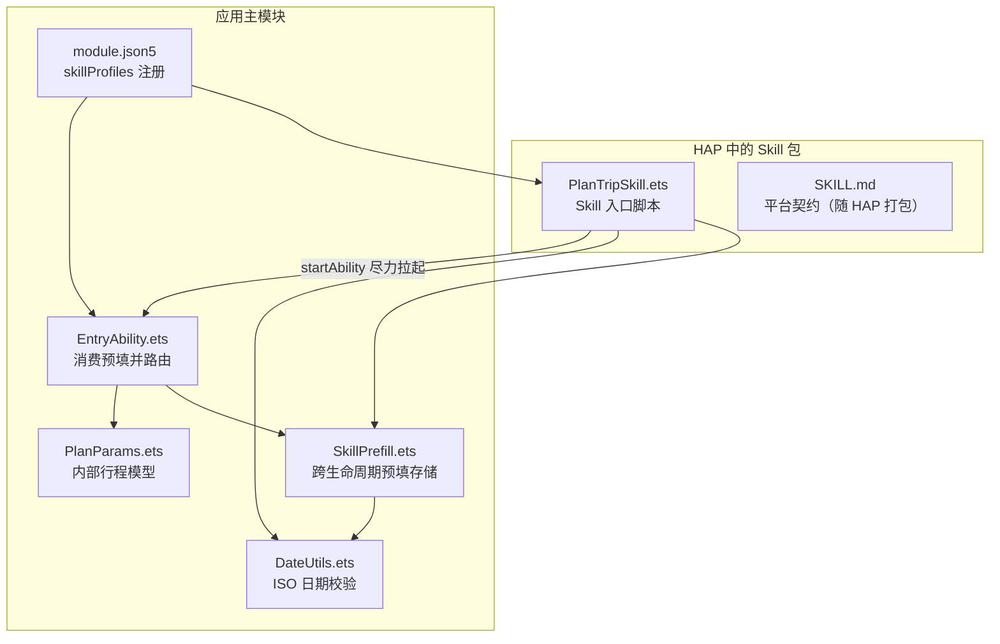
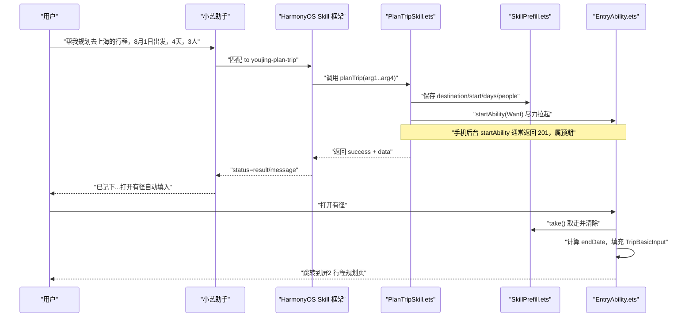
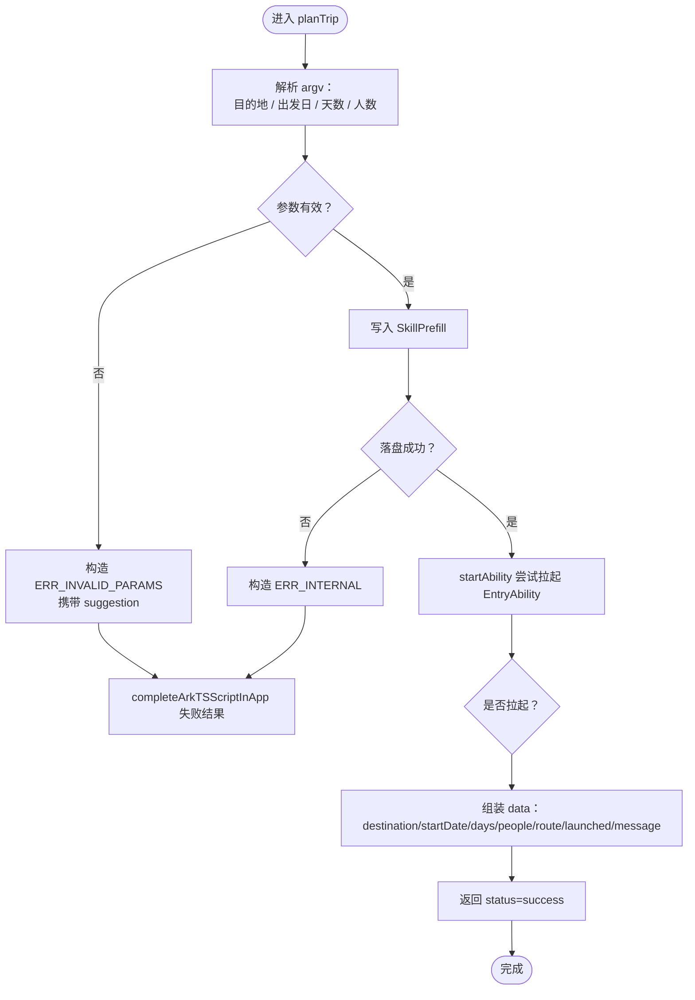
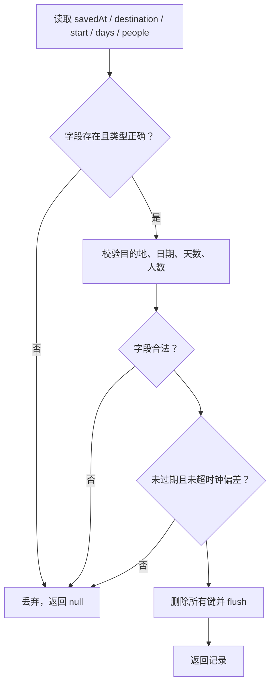
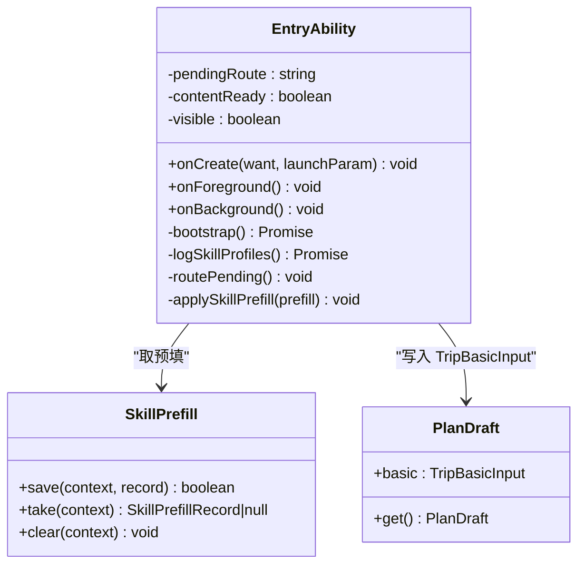
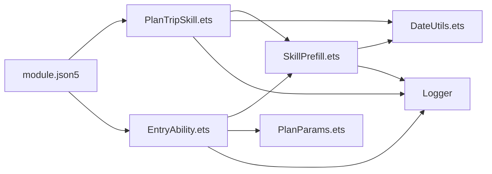

# 小艺 Skill 集成

<cite>
**本文引用的文件**   
- [PlanTripSkill.ets](file://entry/skills/youjing-plan-trip/scripts/PlanTripSkill.ets)
- [SkillPrefill.ets](file://entry/src/main/ets/data/SkillPrefill.ets)
- [EntryAbility.ets](file://entry/src/main/ets/entryability/EntryAbility.ets)
- [module.json5](file://entry/src/main/module.json5)
- [小艺Skill接入清单.md](file://Docs/小艺Skill接入清单.md)
- [DateUtils.ets](file://entry/src/main/ets/utils/DateUtils.ets)
- [PlanParams.ets](file://entry/src/main/ets/model/PlanParams.ets)
</cite>

## 目录
1. [引言](#引言)
2. [项目结构](#项目结构)
3. [核心组件](#核心组件)
4. [架构总览](#架构总览)
5. [详细组件分析](#详细组件分析)
6. [依赖关系分析](#依赖关系分析)
7. [性能与可靠性特征](#性能与可靠性特征)
8. [调试与排错](#调试与排错)
9. [新 Skill 类型接入指南](#新-skill-类型接入指南)
10. [结论](#结论)

## 引言
本文件面向需要在「有径」中新增或维护小艺 Skill 集成的开发者，聚焦以下目标：
- 解释 `PlanTripSkill.ets` 的脚本结构与执行流程。
- 说明 `SkillPrefill.ets` 如何将小艺助手传入的参数转换为应用内部行程规划参数。
- 描述 Skill 的注册、发现与生命周期管理。
- 明确预填参数的数据格式、验证规则和错误处理。
- 给出新的 Skill 类型接入方法：意图识别、参数提取、结果回传。
- 总结与鸿蒙系统 Skill 框架的交互协议及调试建议。

当前实现是“应用内 Skill（app skill）”路径，不走旧版 IntentsKit；Skill 入口脚本位于 HAP 内的 `skills/youjing-plan-trip/scripts/PlanTripSkill.ets`，并通过 `module.json5` 的 `skillProfiles` 声明。

**章节来源**
- [小艺Skill接入清单.md:1-40](file://Docs/小艺Skill接入清单.md#L1-L40)

## 项目结构
围绕小艺 Skill 的核心文件分布如下：

**图表来源**
- [PlanTripSkill.ets:1-179](file://entry/skills/youjing-plan-trip/scripts/PlanTripSkill.ets#L1-L179)
- [SkillPrefill.ets:1-117](file://entry/src/main/ets/data/SkillPrefill.ets#L1-L117)
- [EntryAbility.ets:789-923](file://entry/src/main/ets/entryability/EntryAbility.ets#L789-L923)
- [module.json5:1-133](file://entry/src/main/module.json5#L1-L133)
- [DateUtils.ets:1-40](file://entry/src/main/ets/utils/DateUtils.ets#L1-L40)
- [PlanParams.ets:1-128](file://entry/src/main/ets/model/PlanParams.ets#L1-L128)

**章节来源**
- [PlanTripSkill.ets:1-20](file://entry/skills/youjing-plan-trip/scripts/PlanTripSkill.ets#L1-L20)
- [SkillPrefill.ets:1-20](file://entry/src/main/ets/data/SkillPrefill.ets#L1-L20)
- [module.json5:1-24](file://entry/src/main/module.json5#L1-L24)
- [小艺Skill接入清单.md:1-20](file://Docs/小艺Skill接入清单.md#L1-L20)

## 核心组件
本集成由四个关键部分组成：

| 组件 | 职责 | 关键行为 |
|---|---|---|
| `PlanTripSkill` | 小艺调用的脚本入口 | 解析位置参数、校验目的地/日期/天数/人数、写入预填、尝试拉起应用、返回小艺结果 |
| `SkillPrefill` | 跨生命周期的预填存储 | 使用 Preferences 持久化，取后即删，带两小时过期和字段校验 |
| `EntryAbility` | 应用启动与路由中心 | 冷启/热启消费预填，计算结束日期并填充内部行程草稿，推入行程输入页 |
| `module.json5` | Skill 注册与权限声明 | 声明 `youjing-plan-trip`、入口 Ability、版本、能力实体与动作 |

**章节来源**
- [PlanTripSkill.ets:85-179](file://entry/skills/youjing-plan-trip/scripts/PlanTripSkill.ets#L85-L179)
- [SkillPrefill.ets:34-117](file://entry/src/main/ets/data/SkillPrefill.ets#L34-L117)
- [EntryAbility.ets:877-916](file://entry/src/main/ets/entryability/EntryAbility.ets#L877-L916)
- [module.json5:13-24](file://entry/src/main/module.json5#L13-L24)

## 架构总览
小艺 Skill 的端到端流程如下：

**图表来源**
- [PlanTripSkill.ets:85-179](file://entry/skills/youjing-plan-trip/scripts/PlanTripSkill.ets#L85-L179)
- [SkillPrefill.ets:34-117](file://entry/src/main/ets/data/SkillPrefill.ets#L34-L117)
- [EntryAbility.ets:789-916](file://entry/src/main/ets/entryability/EntryAbility.ets#L789-L916)
- [module.json5:13-24](file://entry/src/main/module.json5#L13-L24)

## 详细组件分析

### PlanTripSkill：Skill 入口脚本
`PlanTripSkill` 是一个薄适配层，负责把小艺助手按 SKILL.md 调用的 `planTrip` 函数，转成应用可消费的预填数据。

#### 执行流程

**图表来源**
- [PlanTripSkill.ets:85-179](file://entry/skills/youjing-plan-trip/scripts/PlanTripSkill.ets#L85-L179)

#### 参数解析规则
- 位置参数顺序固定为：目的地、出发日、天数、人数。
- 目的地只接受：北京、上海、广州、深圳。
- 出发日必须通过 ISO 日期校验；非法日期会被拒绝。
- 天数默认值为 3，范围 1–30。
- 人数默认值为 2，范围 1–30。
- 空字符串用于天数和人数时回退到默认值；越界或非整数视为非法。

#### 返回值约定
- 成功：`code=0`，`result.status='result'`，`result.data` 包含目的地、开始日期、天数、人数、路由、是否拉起和用户可见消息。
- 参数非法：`code=-1`，`result.status='failed'`，`errCode='ERR_INVALID_PARAMS'`，附带 `suggestion`。
- 内部错误：`errCode='ERR_INTERNAL'`，例如预填持久化失败。

#### 与 UIAbility 的关系
- 脚本会构造 `Want` 并调用 `startAbility`。
- 在手机上，后台应用无权拉起 UIAbility，因此通常会得到 201 错误；这不是异常分支，而是主路径的一部分。
- 真正的主路径是：先写预填，等用户主动打开应用后由 `EntryAbility` 消费。

**章节来源**
- [PlanTripSkill.ets:21-84](file://entry/skills/youjing-plan-trip/scripts/PlanTripSkill.ets#L21-L84)
- [PlanTripSkill.ets:85-179](file://entry/skills/youjing-plan-trip/scripts/PlanTripSkill.ets#L85-L179)

### SkillPrefill：预填数据层
`SkillPrefill` 是小艺 Skill 与应用之间的跨生命周期通道。它解决的核心问题是：小艺脚本不能可靠地拉起前台界面，所以需要把参数落到本地存储，等待应用下次启动或回到前台时再消费。

#### 数据结构
预填记录包含以下字段：

| 字段 | 类型 | 含义 |
|---|---|---|
| `destination` | string | 目的地城市 |
| `start` | string | ISO 格式的出发日期 |
| `days` | number | 旅行天数 |
| `people` | number | 同行人数 |
| `savedAt` | number | 保存时间戳 |

该结构同时定义在 `SkillPrefill.ets` 中，并被 `PlanTripSkill.ets` 和 `EntryAbility.ets` 共同消费。

#### 存储机制
- 使用 ArkTS 的 Preferences API，分片名为 `youjing_skill_prefill`。
- `save` 同步写入五个键，然后 flush。
- `take` 读取全部字段，立即删除所有键，再做可用性检查。
- `clear` 提供清理接口，供深链等其他通道避免重复消费。

#### 可用性与过期策略
一条预填只有在以下条件全部满足时才被视为有效：
- 目的地非空。
- 出发日是合法的 ISO 日期。
- 天数是 1–30 的整数。
- 人数是 1–30 的整数。
- 保存时间不超过当前时间加上时钟偏差容差。
- 保存时间与当前时间的差值不超过两小时。

这意味着：隔天的预填不会触发自动跳转；同一天多次请求以后一次为准。

**图表来源**
- [SkillPrefill.ets:55-117](file://entry/src/main/ets/data/SkillPrefill.ets#L55-L117)

**章节来源**
- [SkillPrefill.ets:1-117](file://entry/src/main/ets/data/SkillPrefill.ets#L1-L117)

### EntryAbility：注册发现与消费入口
`EntryAbility` 承担三个与 Skill 相关的关键职责：
1. 作为 Skill 的目标 Ability。
2. 查询自身注册的 Skill 列表（调试用）。
3. 在合适时机消费 `SkillPrefill` 中的预填，并跳转到行程输入页。

#### 注册与发现
- `module.json5` 的 `skillProfiles` 声明了 `youjing-plan-trip`，指向 `EntryAbility` 和 `PlanTripSkill.ets`。
- 构建后，HAP 中包含 Skill 契约和脚本入口。
- 应用启动时在 debug 模式下调用 `skillManager.getSkillInfosForSelf`，打印已注册 Skill 名称和数量。

#### 预填消费时机
预填消费发生在两个阶段：
- **冷启动**：`loadContent` 回调完成后调用 `bootstrap()`，设置 `contentReady=true`，随后 `routePending()` 尝试消费预填。
- **热启动或从后台返回**：`onForeground()` 将 `visible=true`，刷新导航与系统栏状态后再次 `routePending()`。

只有当页面已经挂载且用户真正可见时才会消费预填，避免后台被 Skill 绑起后立即消费，导致进程被杀后预填丢失。

#### 预填到内部参数的转换
消费预填时，`EntryAbility` 会把 `SkillPrefillRecord` 转为内部行程模型：
- `destination` → 目的地
- `start` → 开始日期
- `endDate` = `start` 加上 `days - 1`
- `people` → 人数
- `budget` → 固定为默认预算，因为 Skill 没有预算参数，且这是一段新行程

随后写入 `PlanDraft.basic`，并路由到 `TripInput`。

**图表来源**
- [EntryAbility.ets:789-916](file://entry/src/main/ets/entryability/EntryAbility.ets#L789-L916)
- [SkillPrefill.ets:34-117](file://entry/src/main/ets/data/SkillPrefill.ets#L34-L117)
- [PlanParams.ets:74-96](file://entry/src/main/ets/model/PlanParams.ets#L74-L96)

**章节来源**
- [module.json5:13-24](file://entry/src/main/module.json5#L13-L24)
- [EntryAbility.ets:789-916](file://entry/src/main/ets/entryability/EntryAbility.ets#L789-L916)

### 预填参数数据格式、验证规则与错误处理

#### 外部参数（小艺 → PlanTripSkill）
| 参数 | 位置 | 类型 | 默认值 | 校验规则 |
|---|---|---|---|---|
| `arg1` | 目的地 | string | 无 | 必填；必须是北京、上海、广州、深圳之一 |
| `arg2` | 出发日 | string | 无 | 必填；必须是真实存在的 ISO 日期 |
| `arg3` | 天数 | string | 3 | 可选；1–30 的整数 |
| `arg4` | 人数 | string | 2 | 可选；1–30 的整数 |

#### 内部存储参数（PlanTripSkill → SkillPrefill）
| 字段 | 类型 | 约束 |
|---|---|---|
| `destination` | string | 非空，且在允许城市集合中 |
| `start` | string | ISO 日期，经 `DateUtils.isValidIsoDate` 校验 |
| `days` | number | 1–30 的整数 |
| `people` | number | 1–30 的整数 |
| `savedAt` | number | 当前时间戳 |

#### 内部行程参数（EntryAbility → PlanDraft）
| 字段 | 来源 | 说明 |
|---|---|---|
| `destination` | `prefill.destination` | 目的地 |
| `startDate` | `prefill.start` | 开始日期 |
| `endDate` | `start` + `days - 1` | 结束日期 |
| `people` | `prefill.people` | 人数 |
| `budget` | 默认预算 | Skill 不传预算，新行程不继承上一段草稿 |

#### 错误分类
| 错误场景 | 错误码 | 行为 |
|---|---|---|
| 目的地为空 | `ERR_INVALID_PARAMS` | 返回 suggestion，提示用户选择支持城市 |
| 目的地不支持 | `ERR_INVALID_PARAMS` | 返回 suggestion，列出支持城市 |
| 出发日非法 | `ERR_INVALID_PARAMS` | 返回 suggestion，要求提供 ISO 日期 |
| 天数越界或非整数 | `ERR_INVALID_PARAMS` | 返回 suggestion，要求 1–30 |
| 人数越界或非整数 | `ERR_INVALID_PARAMS` | 返回 suggestion，要求 1–30 |
| 预填持久化失败 | `ERR_INTERNAL` | 不认为任务完成，让用户手动填写 |
| 返回结果失败 | 日志记录 | 不影响 Skill 主路径，因为参数已落入预填 |

**章节来源**
- [PlanTripSkill.ets:21-84](file://entry/skills/youjing-plan-trip/scripts/PlanTripSkill.ets#L21-L84)
- [PlanTripSkill.ets:85-179](file://entry/skills/youjing-plan-trip/scripts/PlanTripSkill.ets#L85-L179)
- [SkillPrefill.ets:104-117](file://entry/src/main/ets/data/SkillPrefill.ets#L104-L117)
- [EntryAbility.ets:891-916](file://entry/src/main/ets/entryability/EntryAbility.ets#L891-L916)
- [PlanParams.ets:74-96](file://entry/src/main/ets/model/PlanParams.ets#L74-L96)

## 依赖关系分析

**图表来源**
- [PlanTripSkill.ets:1-20](file://entry/skills/youjing-plan-trip/scripts/PlanTripSkill.ets#L1-L20)
- [SkillPrefill.ets:1-20](file://entry/src/main/ets/data/SkillPrefill.ets#L1-L20)
- [EntryAbility.ets:1-40](file://entry/src/main/ets/entryability/EntryAbility.ets#L1-L40)
- [module.json5:1-24](file://entry/src/main/module.json5#L1-L24)

### 耦合与内聚
- `PlanTripSkill` 与 `SkillPrefill` 强耦合：前者是后者唯一的写入方。
- `EntryAbility` 与 `SkillPrefill` 弱耦合：只读一次并消费，之后不再关心来源。
- 日期合法性统一依赖 `DateUtils`，避免多处实现不一致。
- `PlanParams` 定义内部行程模型，`EntryAbility` 消费 Skill 预填后映射到该模型。

### 外部依赖
- HarmonyOS `@kit.AbilityKit`：Ability、Want、SkillManager。
- HarmonyOS `@kit.ArkData`：Preferences 持久化。
- HarmonyOS `@kit.BasicServicesKit`：BusinessError。
- 小艺开放平台：负责导入 SKILL.md、绑定 bundleName、版本管理和真机测试。

**章节来源**
- [PlanTripSkill.ets:1-20](file://entry/skills/youjing-plan-trip/scripts/PlanTripSkill.ets#L1-L20)
- [SkillPrefill.ets:1-20](file://entry/src/main/ets/data/SkillPrefill.ets#L1-L20)
- [EntryAbility.ets:1-40](file://entry/src/main/ets/entryability/EntryAbility.ets#L1-L40)

## 性能与可靠性特征
- **预填写入是同步操作**：`save` 使用 `getPreferencesSync`、`putSync`、`flushSync`，保证 Skill 脚本返回前数据已落盘。
- **预填读取是幂等的单次消费**：`take` 先读，再删除，再校验，最后返回记录；即使多次调用也不会重复消费。
- **过期保护防止误跳转**：超过两小时的预填不会触发自动跳转，避免隔天打开 App 突然跳到行程输入页。
- **时钟偏差容差**：允许最多五分钟的时钟偏差，提高多设备或多进程环境下的一致性。
- **UI 不可见不消费**：只有 `visible=true` 且 `contentReady=true` 时才消费预填，避免后台被绑起后短暂存活期间误触发。
- **startAbility 失败是预期路径**：手机上 201 错误不会改变最终结果，因为主路径依赖预填而不是直接拉起界面。

[本节为通用设计分析，不直接引用具体代码行]

## 调试与排错

### 常见现象与定位方式

| 现象 | 可能原因 | 排查步骤 |
|---|---|---|
| 小艺说“已记下”，但打开 App 没有跳转 | 预填已过期、字段无效、或用户不是在前台打开 | 检查保存时间是否超过两小时；确认 `destination` 和 `start` 是否合法 |
| 小艺直接报错，没有进入 App | 目的地不在支持列表中，或日期/天数/人数非法 | 检查 `ERR_INVALID_PARAMS` 的 `suggestion` |
| 控制台没有打印 Skill 注册信息 | 非 debug 构建或未安装对应 HAP | 确认 debug 构建，查看 `Skill 注册 N 个: ...` 日志 |
| 小艺无法找到 Skill | bundleName、Skill 名或版本不一致 | 核对 `com.youjing.app`、`youjing-plan-trip`、`1.0.0` |
| 预填被重复消费 | 其他通道未清理或逻辑异常 | 检查深链或其他入口是否调用 `SkillPrefill.clear` |
| 页面跳转但人数 chip 不高亮 | 人数不是 1/2/4，但预填带了 3、5 等值 | 确认人数补全和高亮逻辑覆盖该值 |

### 关键日志标签
- `Skill.PlanTrip`：PlanTripSkill 的错误和结果上报。
- `Data.SkillPrefill`：预填写入、读取、丢弃和清理。
- `EntryAbility`：Ability 生命周期、Skill 注册查询、预填消费。

### 调试建议
1. 先在“仅自己可用”范围发布，跑通真机测试链路。
2. 用小艺说出完整话术，包括目的地、日期、天数、人数。
3. 观察小艺回复中的 `message`，确认 `launched` 是否为 `false`。
4. 打开应用后检查屏2 是否显示正确的目的地、日期范围和人数。
5. 如果只想验证入口而不触发跳转，可在平台侧测试“不调用的情况”，例如缺少日期或目的地不支持。
6. 修改 Skill 脚本或 SKILL.md 后，务必提升 `skillProfiles.version` 并重新构建 HAP。

**章节来源**
- [小艺Skill接入清单.md:41-120](file://Docs/小艺Skill接入清单.md#L41-L120)
- [PlanTripSkill.ets:85-179](file://entry/skills/youjing-plan-trip/scripts/PlanTripSkill.ets#L85-L179)
- [SkillPrefill.ets:34-117](file://entry/src/main/ets/data/SkillPrefill.ets#L34-L117)
- [EntryAbility.ets:846-876](file://entry/src/main/ets/entryability/EntryAbility.ets#L846-L876)

## 新 Skill 类型接入指南

### 适用前提
- 你使用的是 HarmonyOS 7.0 真机和 Beta 版小艺 App。
- 应用 bundleName 为 `com.youjing.app`。
- 你理解应用内 Skill 是通过 HAP 中的契约文件和脚本被小艺发现和调用。

### 接入步骤

#### 1. 新建 Skill 契约
创建类似 `SKILL.md` 的文件，至少包含：
- YAML 头部：`name`、`description`。
- 触发场景：典型话术和“不要调用的情况”。
- 场景定义：函数名、exec-cli 示例、参数 Schema、返回值 Schema。

注意：平台会根据契约识别意图，而不是靠手工槽位。

#### 2. 编写入口脚本
新建一个 `.ets` 脚本，放在 `skills/<your-skill>/scripts/` 下。脚本应：
- 导出一个异步函数，签名与小艺平台调用的函数一致。
- 解析位置参数或命名参数。
- 校验输入并返回结构化错误。
- 如需跨生命周期传递数据，使用 `SkillPrefill` 类似的 Preferences 通道。
- 尝试拉起 UIAbility，但不要把 UI 拉起当作唯一成功条件。
- 使用 `scriptManager.completeArkTSScriptInApp` 返回结果。

#### 3. 注册 Skill
在 `entry/src/main/module.json5` 中添加新的 `skillProfiles` 项：
- `name`：Skill 标识。
- `abilityName`：目标 Ability。
- `srcEntries`：脚本入口。
- `version`：版本号。

#### 4. 消费预填数据
在 `EntryAbility` 或对应 Ability 中：
- 在 `bootstrap` 和 `onForeground` 中消费预填。
- 只在 `contentReady` 且 `visible` 时消费。
- 将外部参数映射到内部业务模型。
- 路由到对应页面。

#### 5. 发布与迭代
- 首次发布到“仅自己可用”。
- 真机测试通过后，再选择“发布到小艺”或“上架 Skill 广场”。
- 后续改动契约或脚本时，提升版本号并重新构建 HAP。

### 意图识别、参数提取与结果回传

| 阶段 | 责任方 | 输出 |
|---|---|---|
| 意图识别 | 小艺平台根据 SKILL.md 的触发场景 | 决定调用哪个 Skill 和函数 |
| 参数提取 | 小艺平台根据 exec-cli 和 JSON Schema | 生成 `arg1`、`arg2` 等参数 |
| 参数校验 | 你的 Skill 脚本 | 成功参数或 `ERR_INVALID_PARAMS` |
| 业务处理 | 应用内部逻辑 | 预填、路由、生成或查询 |
| 结果回传 | Skill 脚本通过 `completeArkTSScriptInApp` | `status=result` 或 `status=failed` |

### 与鸿蒙系统 Skill 框架的交互协议要点
- 入口函数通过 `scriptManager.ArkTSScriptInfo` 获取上下文和请求上下文。
- 成功返回 `code=0`，失败返回 `code=-1`。
- `result` 是对象，平台根据 SKILL.md 的 Schema 解析。
- 拉起 UIAbility 使用 `context.startAbility`，但需接受 201 限制。
- 应用侧可通过 `skillManager.getSkillInfosForSelf` 查询自身注册的 Skill。

**章节来源**
- [小艺Skill接入清单.md:1-40](file://Docs/小艺Skill接入清单.md#L1-L40)
- [小艺Skill接入清单.md:41-120](file://Docs/小艺Skill接入清单.md#L41-L120)
- [PlanTripSkill.ets:85-179](file://entry/skills/youjing-plan-trip/scripts/PlanTripSkill.ets#L85-L179)
- [EntryAbility.ets:846-876](file://entry/src/main/ets/entryability/EntryAbility.ets#L846-L876)
- [module.json5:13-24](file://entry/src/main/module.json5#L13-L24)

## 结论
本项目的小艺 Skill 集成采用“脚本入口 + 契约文件 + 应用内预填 + Ability 消费”的分层设计。`PlanTripSkill.ets` 负责轻量校验和回传，`SkillPrefill.ets` 负责可靠的跨生命周期数据传输，`EntryAbility.ets` 负责消费并路由到内部行程模型。该设计把平台能力、系统权限限制和应用业务流程解耦，使 Skill 既能在 PC/2in1 上尽量拉起界面，也能在手机后台场景中稳定工作。

新增 Skill 时应遵循相同模式：用 SKILL.md 表达意图，用脚本做参数校验和业务封装，用 Preferences 类通道传递跨生命周期数据，并在 Ability 的前台可见时机消费。发布流程则围绕 bundleName、Skill 名、版本号和小艺开放平台控制台逐步推进。

[本节为总结性内容，不直接引用具体代码行]