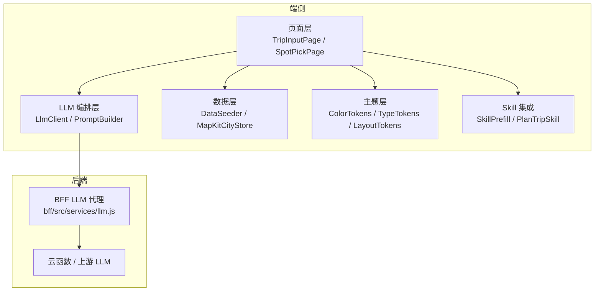
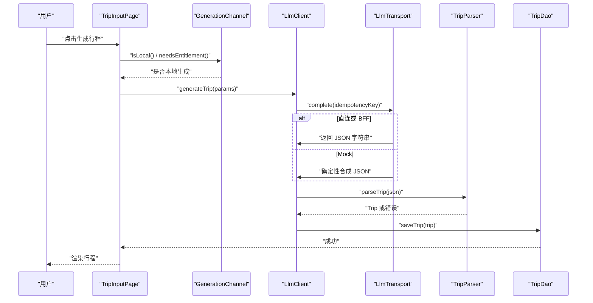
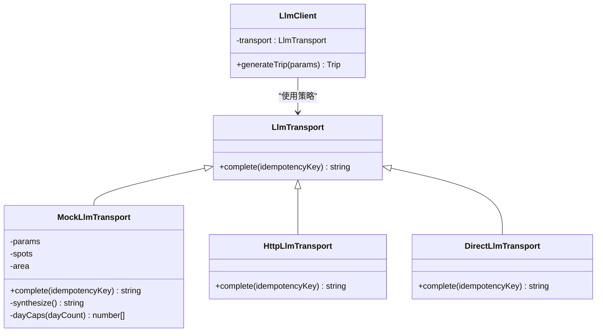
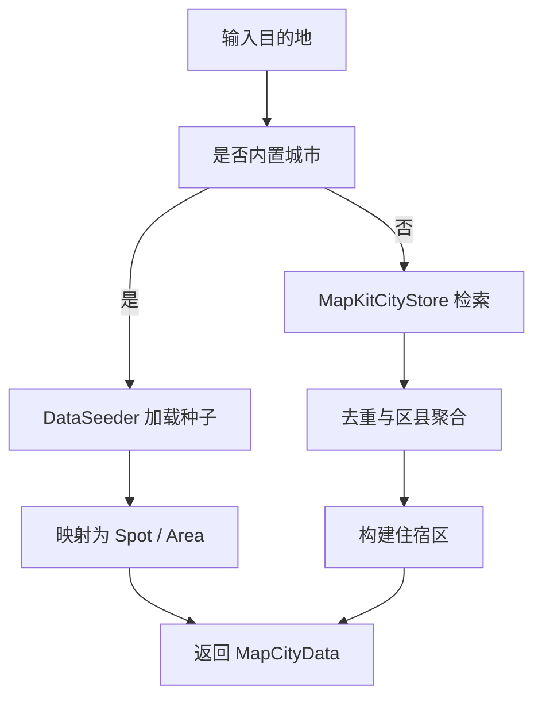
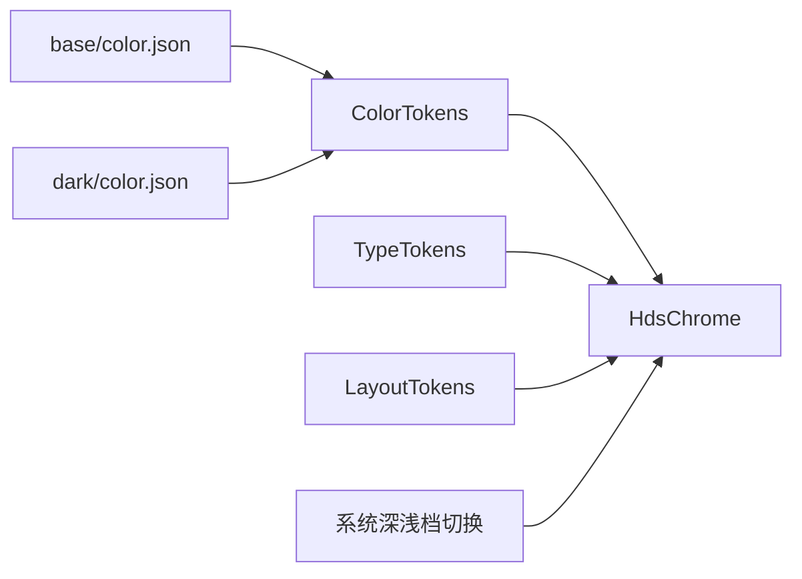
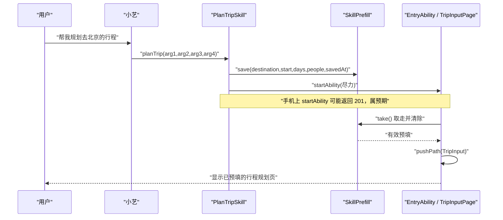
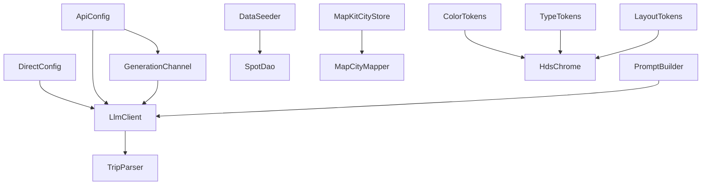

# 扩展点设计

<cite>
**本文引用的文件列表**   
- [entry/src/main/ets/ai/LlmClient.ets](file://entry/src/main/ets/ai/LlmClient.ets)
- [entry/src/main/ets/common/config/DirectConfig.ets](file://entry/src/main/ets/common/config/DirectConfig.ets)
- [entry/src/main/ets/common/config/ApiConfig.ets](file://entry/src/main/ets/common/config/ApiConfig.ets)
- [entry/src/main/ets/utils/GenerationChannel.ets](file://entry/src/main/ets/utils/GenerationChannel.ets)
- [bff/src/services/llm.js](file://bff/src/services/llm.js)
- [Docs/LLM接入方案-2026-10-26.md](file://Docs/LLM接入方案-2026-10-26.md)
- [entry/src/main/ets/data/DataSeeder.ets](file://entry/src/main/ets/data/DataSeeder.ets)
- [entry/src/main/ets/data/MapKitCityStore.ets](file://entry/src/main/ets/data/MapKitCityStore.ets)
- [entry/src/main/ets/design/ColorTokens.ets](file://entry/src/main/ets/design/ColorTokens.ets)
- [entry/src/main/ets/design/LayoutTokens.ets](file://entry/src/main/ets/design/LayoutTokens.ets)
- [entry/src/main/ets/design/TypeTokens.ets](file://entry/src/main/ets/design/TypeTokens.ets)
- [entry/src/main/ets/design/HdsChrome.ets](file://entry/src/main/ets/design/HdsChrome.ets)
- [entry/src/main/ets/data/SkillPrefill.ets](file://entry/src/main/ets/data/SkillPrefill.ets)
- [entry/skills/youjing-plan-trip/scripts/PlanTripSkill.ets](file://entry/skills/youjing-plan-trip/scripts/PlanTripSkill.ets)
- [Docs/小艺Skill接入清单.md](file://Docs/小艺Skill接入清单.md)
- [entry/src/main/ets/pages/TripInputPage.ets](file://entry/src/main/ets/pages/TripInputPage.ets)
</cite>

## 目录
1. [引言](#引言)
2. [项目结构与扩展点总览](#项目结构与扩展点总览)
3. [核心扩展点](#核心扩展点)
4. [架构总览](#架构总览)
5. [详细组件分析](#详细组件分析)
6. [依赖关系分析](#依赖关系分析)
7. [性能与约束](#性能与约束)
8. [测试策略](#测试策略)
9. [故障排查](#故障排查)
10. [结论](#结论)

## 引言
本文面向“有径”项目的系统扩展点，围绕四个方向给出接口、配置、实现指南与限制：
- LLM 提供商插件化：通过传输抽象 + 策略选择新增 OpenAI、Claude 等后端。
- 地点数据源可替换：种子库与 Map Kit 的抽象职责，以及接入新地点服务的边界。
- 主题系统定制：DesignTokens 的颜色、字体、间距体系，深色模式与品牌定制方式。
- Skill 集成点：小艺助手 Skill 的注册、参数校验与预填机制。

这些扩展点共同构成应用的可插拔层：业务页不直接关心模型供应商、地图服务或配色资源，只消费稳定契约。

## 项目结构与扩展点总览
项目采用按领域分层组织：
- 端侧入口与页面在 `entry/src/main/ets` 下，其中 `ai/` 负责 LLM 编排，`data/` 负责本地数据与种子，`design/` 暴露 DesignTokens 与 Chrome。
- BFF 在 `bff/` 中提供 LLM 代理、配额、鉴权等后端能力。
- 文档位于 `Docs/`，记录 LLM 接入方案与小艺 Skill 接入清单。

图表来源
- [entry/src/main/ets/pages/TripInputPage.ets:1-200](file://entry/src/main/ets/pages/TripInputPage.ets#L1-L200)
- [entry/src/main/ets/ai/LlmClient.ets:1-120](file://entry/src/main/ets/ai/LlmClient.ets#L1-L120)
- [bff/src/services/llm.js:1-98](file://bff/src/services/llm.js#L1-L98)

章节来源
- [Docs/LLM接入方案-2026-10-26.md:1-154](file://Docs/LLM接入方案-2026-10-26.md#L1-L154)

## 核心扩展点
本节列出每个扩展点的契约位置、职责和扩展方式。

| 扩展点 | 关键文件 | 契约或入口 | 扩展方式 | 默认行为 |
|---|---|---|---|---|
| LLM 提供商插件 | `LlmClient.ets`、`DirectConfig.ets`、`ApiConfig.ets`、`GenerationChannel.ets` | `LlmTransport` 接口；直连配置单点；生成渠道判断 | 新增 `LlmTransport` 实现并调整优先级 | Mock → Direct → BFF → 本地合成 |
| 地点数据源 | `DataSeeder.ets`、`MapKitCityStore.ets` | 种子行结构；`MapSiteInput` / `MapCityData` | 新增城市数据源映射逻辑，保持产出结构 | 内置种子优先，任意城市走 Map Kit |
| 主题系统 | `ColorTokens.ets`、`TypeTokens.ets`、`LayoutTokens.ets`、`HdsChrome.ets` | Token 导出对象 | 修改 color.json 双档、Token 字段 | 浅色 / 深色自动切换 |
| Skill 集成 | `SkillPrefill.ets`、`PlanTripSkill.ets`、`module.json5`（注册声明） | `planTrip(info, ...argv)` | 扩展示例城市或参数校验 | 四参落盘后由 App 启动时消费 |

章节来源
- [entry/src/main/ets/ai/LlmClient.ets:1-120](file://entry/src/main/ets/ai/LlmClient.ets#L1-L120)
- [entry/src/main/ets/common/config/DirectConfig.ets:1-33](file://entry/src/main/ets/common/config/DirectConfig.ets#L1-L33)
- [entry/src/main/ets/common/config/ApiConfig.ets:1-66](file://entry/src/main/ets/common/config/ApiConfig.ets#L1-L66)
- [entry/src/main/ets/utils/GenerationChannel.ets:1-44](file://entry/src/main/ets/utils/GenerationChannel.ets#L1-L44)
- [entry/src/main/ets/data/DataSeeder.ets:1-200](file://entry/src/main/ets/data/DataSeeder.ets#L1-L200)
- [entry/src/main/ets/data/MapKitCityStore.ets:1-179](file://entry/src/main/ets/data/MapKitCityStore.ets#L1-L179)
- [entry/src/main/ets/design/ColorTokens.ets:1-200](file://entry/src/main/ets/design/ColorTokens.ets#L1-L200)
- [entry/src/main/ets/design/TypeTokens.ets:1-94](file://entry/src/main/ets/design/TypeTokens.ets#L1-L94)
- [entry/src/main/ets/design/LayoutTokens.ets:1-200](file://entry/src/main/ets/design/LayoutTokens.ets#L1-L200)
- [entry/src/main/ets/design/HdsChrome.ets:1-200](file://entry/src/main/ets/design/HdsChrome.ets#L1-L200)
- [entry/src/main/ets/data/SkillPrefill.ets:1-117](file://entry/src/main/ets/data/SkillPrefill.ets#L1-L117)
- [entry/skills/youjing-plan-trip/scripts/PlanTripSkill.ets:1-179](file://entry/skills/youjing-plan-trip/scripts/PlanTripSkill.ets#L1-L179)

## 架构总览
LLM 生成链路不是单一调用，而是“提示词构造 → 传输选择 → 响应解析 → 守卫 → 落库 → 渲染”的多层管线。地点数据则分为“内置种子”和“任意城市 Map Kit 检索”，主题系统通过资源文件与 Token 层统一对外暴露。

图表来源
- [entry/src/main/ets/pages/TripInputPage.ets:1-200](file://entry/src/main/ets/pages/TripInputPage.ets#L1-L200)
- [entry/src/main/ets/utils/GenerationChannel.ets:1-44](file://entry/src/main/ets/utils/GenerationChannel.ets#L1-L44)
- [entry/src/main/ets/ai/LlmClient.ets:1-120](file://entry/src/main/ets/ai/LlmClient.ets#L1-L120)

## 详细组件分析

### LLM 提供商插件化
#### 接口定义
LLM 插件化的核心是 `LlmTransport` 接口：
- 方法：`complete(idempotencyKey?: string): Promise<string>`
- 返回值：服务端或本地合成的完整 Trip JSON 字符串。
- 典型实现：
  - `MockLlmTransport`：离线闭环，按请求参数确定性地合成合法 Trip JSON。
  - `HttpLlmTransport`：经 BFF 中转，BFF 内部构建 prompt、注入 Key、扣减配额、转发 LLM。
  - `DirectLlmTransport`：开发期端侧直连 OpenAI 兼容 `chat/completions`，仅在 `DirectConfig.URL` 与 `KEY` 都非空时启用。

图表来源
- [entry/src/main/ets/ai/LlmClient.ets:1-120](file://entry/src/main/ets/ai/LlmClient.ets#L1-L120)

#### 配置注册机制
- `ApiConfig`：集中定义 BFF 基础地址、LLM 端点、模型名、超时、重排地址、天气地址、开发旁路开关等。
- `DirectConfig`：开发期端侧直连 LLM 的配置单点，包含 URL、KEY、MODEL、MAX_TOKENS。
- `GenerationChannel`：决定本次生成走本地规则引擎还是 BFF，屏蔽业务层对配置的重复读取。

配置示例说明：
- BFF 未配置时，`GenerationChannel.isLocal()` 为真，生成走本地合成。
- 直连模式要求 `DirectConfig.URL` 与 `DirectConfig.KEY` 同时非空，否则回退到 BFF 或 Mock。
- 上架前生产 Key 不应进入发布包；当前文档明确直连为开发兜底，生产应迁至云函数或 BFF。

章节来源
- [entry/src/main/ets/common/config/ApiConfig.ets:1-66](file://entry/src/main/ets/common/config/ApiConfig.ets#L1-L66)
- [entry/src/main/ets/common/config/DirectConfig.ets:1-33](file://entry/src/main/ets/common/config/DirectConfig.ets#L1-L33)
- [entry/src/main/ets/utils/GenerationChannel.ets:1-44](file://entry/src/main/ets/utils/GenerationChannel.ets#L1-L44)

#### 新增提供商实现指南
以新增一个 Claude 提供商为例：
1. 新建 `ClaudeLlmTransport`，实现 `LlmTransport.complete`。
2. 在传输选择逻辑中加入 Claude 端点与鉴权头构造。
3. 若 Claude 支持 JSON Schema，复用 `PromptBuilder.buildRequest`；否则根据端点能力决定是否开启 strict schema。
4. 在优先级链中插入 Claude 通道：例如直连 OpenAI 不可用时尝试 Claude，仍失败再回退 BFF。
5. 增加配置项：如 `CLAUDE_BASE_URL`、`CLAUDE_MODEL`，并通过 `ApiConfig` 或专用 Config 暴露。
6. 添加测试：覆盖成功、超时、429、非 2xx、JSON 解析失败、重试耗尽路径。

注意：
- 当前仓库已存在 OpenAI 兼容形态的直连与 BFF 代理；新增 Claude 时应尽量复用已有 HTTP 封装、错误映射与用量日志。
- 如果新模型不支持 `response_format: json_schema`，需要回到提示词层保证输出可被 `TripParser` 解析。

章节来源
- [entry/src/main/ets/ai/LlmClient.ets:1-120](file://entry/src/main/ets/ai/LlmClient.ets#L1-L120)
- [bff/src/services/llm.js:1-98](file://bff/src/services/llm.js#L1-L98)
- [Docs/LLM接入方案-2026-10-26.md:1-154](file://Docs/LLM接入方案-2026-10-26.md#L1-L154)

### 地点数据源可替换
#### 两种数据源职责
- 种子库：`DataSeeder` 负责首次安装时从内置 JSONL 文件导入景点与区域，带版本管理、坐标合法性校验、去重与幂等。
- Map Kit 任意城市：`MapKitCityStore` 负责按城市检索景点与住宿区，结果仅内存缓存，TTL 30 分钟，不写 RDB。

图表来源
- [entry/src/main/ets/data/DataSeeder.ets:1-200](file://entry/src/main/ets/data/DataSeeder.ets#L1-L200)
- [entry/src/main/ets/data/MapKitCityStore.ets:1-179](file://entry/src/main/ets/data/MapKitCityStore.ets#L1-L179)

#### 接入新地点服务
新增地点服务建议遵循以下契约：
- 输入：城市名或城市标识。
- 输出：`MapCityData`，包含景点集合与住宿区集合。
- 约束：
  - 结果仅内存缓存，避免许可边界不清导致的持久化风险。
  - 检索必须限制城市范围，防止拿到全球结果。
  - 评分、预约字段不可得时，映射层需降级处理，并在界面标注“以官方为准”。
- 兼容性：
  - 与 PromptBuilder 共用同一套 Spot/Area 语义，确保提示词中的字段描述一致。
  - 对于 MapKit 来源，PromptBuilder 会如实告知模型“预约信息未获取”。

章节来源
- [entry/src/main/ets/data/DataSeeder.ets:1-200](file://entry/src/main/ets/data/DataSeeder.ets#L1-L200)
- [entry/src/main/ets/data/MapKitCityStore.ets:1-179](file://entry/src/main/ets/data/MapKitCityStore.ets#L1-L179)

### 主题系统定制
#### DesignTokens 颜色体系
`ColorTokens` 将颜色资源收敛为语义化 token，包括画布、表面、文字、品牌、状态、玻璃栏面、路线图、星图等。深浅色由 `resources/base/color.json` 与 `resources/dark/color.json` 两套资源文件配合系统 ColorMode 自动切换。

定制要点：
- 所有颜色值通过 `$r('app.color.xxx')` 引用，不要在页面硬编码十六进制。
- 品牌色集中在 `primary`、`brandSolid`、`onBrand`、`brandTint` 等字段。
- 深色模式不需要页面分支，只需维护两份 color.json。

#### 字体体系
`TypeTokens` 定义九档封闭字阶，包括 display、title、headline、body、small、caption、overline、navLabel、widgetMeta、time、titleSans。字族默认使用 HarmonyOS Sans 与 NotoSerifSC，数字使用 tabular feature。

定制要点：
- 不允许随意插入中间字号。
- serif 不得用于控件标题、站点名、数字。
- 金额 hero 虽用 display 档，但走 sans 字族。

#### 布局与间距
`LayoutTokens` 集中页面内边距、网格基线、浮动 dock 尺寸、滚动预留、地图浮层内缩、行程主轴宽度等。它让不同窗口断点下的布局有唯一参考。

#### 主题切换与 HdsChrome
`HdsChrome` 是 HDS 官方顶栏的单点配置，负责标题字体、图标颜色、模糊渐变、返回键占位等。由于官方标题内容不随系统深浅档实时重建，需要通过 `themeTick` 强制重新挂载，使标题与图标跟随当前主题。

图表来源
- [entry/src/main/ets/design/ColorTokens.ets:1-200](file://entry/src/main/ets/design/ColorTokens.ets#L1-L200)
- [entry/src/main/ets/design/TypeTokens.ets:1-94](file://entry/src/main/ets/design/TypeTokens.ets#L1-L94)
- [entry/src/main/ets/design/LayoutTokens.ets:1-200](file://entry/src/main/ets/design/LayoutTokens.ets#L1-L200)
- [entry/src/main/ets/design/HdsChrome.ets:1-200](file://entry/src/main/ets/design/HdsChrome.ets#L1-L200)

章节来源
- [entry/src/main/ets/design/ColorTokens.ets:1-200](file://entry/src/main/ets/design/ColorTokens.ets#L1-L200)
- [entry/src/main/ets/design/TypeTokens.ets:1-94](file://entry/src/main/ets/design/TypeTokens.ets#L1-L94)
- [entry/src/main/ets/design/LayoutTokens.ets:1-200](file://entry/src/main/ets/design/LayoutTokens.ets#L1-L200)
- [entry/src/main/ets/design/HdsChrome.ets:1-200](file://entry/src/main/ets/design/HdsChrome.ets#L1-L200)

### Skill 集成点
#### 注册与入口
小艺 Skill 通过 `module.json5` 的 `skillProfiles` 注册，脚本入口为 `PlanTripSkill.ets`，对外暴露 `planTrip(info, ...argv)`。平台侧通过 `SKILL.md` 识别触发场景与参数 Schema。

#### 预填机制
由于手机系统禁止后台应用拉起 UIAbility，Skill 主路径是：
1. 校验目的地、出发日、天数、人数。
2. 将四参写入 `SkillPrefill`，保存时间戳。
3. 尽力拉起 `EntryAbility`；失败视为预期，不改变成功返回。
4. 用户打开 App 后，`EntryAbility` 消费预填并推入行程规划页。

图表来源
- [entry/skills/youjing-plan-trip/scripts/PlanTripSkill.ets:1-179](file://entry/skills/youjing-plan-trip/scripts/PlanTripSkill.ets#L1-L179)
- [entry/src/main/ets/data/SkillPrefill.ets:1-117](file://entry/src/main/ets/data/SkillPrefill.ets#L1-L117)
- [Docs/小艺Skill接入清单.md:1-200](file://Docs/小艺Skill接入清单.md#L1-L200)

#### 扩展 Skill 的最佳实践
- 不要假设 `startAbility` 能成功拉起前台页面。
- 所有外部参数必须先校验再落盘。
- 预填记录必须有有效期，避免隔天误消费。
- 扩展城市白名单时，同步更新页面默认选项与错误提示。
- 若新增参数，需要同步更新 `SKILL.md` 与 `module.json5` 中 Skill 版本。

章节来源
- [entry/skills/youjing-plan-trip/scripts/PlanTripSkill.ets:1-179](file://entry/skills/youjing-plan-trip/scripts/PlanTripSkill.ets#L1-L179)
- [entry/src/main/ets/data/SkillPrefill.ets:1-117](file://entry/src/main/ets/data/SkillPrefill.ets#L1-L117)
- [Docs/小艺Skill接入清单.md:1-200](file://Docs/小艺Skill接入清单.md#L1-L200)

## 依赖关系分析
LLM 相关依赖呈“配置 → 渠道 → 传输 → 提示词 → 解析”的单向依赖：
- `LlmClient` 依赖 `ApiConfig`、`DirectConfig`、`GenerationChannel`、`PromptBuilder`、`TripParser`。
- BFF 的 `llm.js` 依赖环境变量与上游 LLM。
- 地点数据依赖 `DataSeeder`（内置）、`MapKitCityStore`（Map Kit）。
- 主题依赖 `ColorTokens`、`TypeTokens`、`LayoutTokens`，并被 `HdsChrome` 与页面消费。

图表来源
- [entry/src/main/ets/ai/LlmClient.ets:1-120](file://entry/src/main/ets/ai/LlmClient.ets#L1-L120)
- [entry/src/main/ets/common/config/ApiConfig.ets:1-66](file://entry/src/main/ets/common/config/ApiConfig.ets#L1-L66)
- [entry/src/main/ets/common/config/DirectConfig.ets:1-33](file://entry/src/main/ets/common/config/DirectConfig.ets#L1-L33)
- [entry/src/main/ets/utils/GenerationChannel.ets:1-44](file://entry/src/main/ets/utils/GenerationChannel.ets#L1-L44)
- [entry/src/main/ets/data/DataSeeder.ets:1-200](file://entry/src/main/ets/data/DataSeeder.ets#L1-L200)
- [entry/src/main/ets/data/MapKitCityStore.ets:1-179](file://entry/src/main/ets/data/MapKitCityStore.ets#L1-L179)
- [entry/src/main/ets/design/HdsChrome.ets:1-200](file://entry/src/main/ets/design/HdsChrome.ets#L1-L200)

## 性能与约束
### LLM 生成
- 直连与 BFF 都需要考虑网络超时、限流与重试。
- 直连模式适合快速验证模型质量；生产 Key 应迁移至云端。
- Mock 模式零成本、可回归，但不代表真实模型体验。
- 生成链路包含解析失败重试一次，仍失败则降级到错误屏。

### 地点数据
- Map Kit 结果仅内存缓存，TTL 30 分钟，避免无许可边界的持久化。
- 查询分页、去重、区县供给统计会影响整体耗时，需关注并发与失败分支。
- 种子库首启导入是 I/O 密集操作，应按版本幂等执行。

### 主题系统
- 颜色、字体、布局全部通过 Token 访问，避免散乱硬编码。
- 深浅档切换依赖资源文件与 `themeTick`，不要在各页面自行判断深浅。

章节来源
- [Docs/LLM接入方案-2026-10-26.md:1-154](file://Docs/LLM接入方案-2026-10-26.md#L1-L154)
- [entry/src/main/ets/data/MapKitCityStore.ets:1-179](file://entry/src/main/ets/data/MapKitCityStore.ets#L1-L179)
- [entry/src/main/ets/design/HdsChrome.ets:1-200](file://entry/src/main/ets/design/HdsChrome.ets#L1-L200)

## 测试策略
### LLM 扩展测试
- 单元测试：
  - 验证 `PromptBuilder.buildRequest` 输出的 system/user 结构。
  - 验证各 `LlmTransport` 的错误分支：超时、429、非 2xx、JSON 解析失败、重试耗尽。
- 集成测试：
  - Mock 端点：确认错误码映射与文案。
  - BFF 端点：确认消息体包含 model、max_tokens、response_format。
  - 直连端点：确认 URL、KEY、Model、MaxTokens 生效。
- 回归测试：
  - 保持 `USE_MOCK_DATA=true` 时零影响。
  - 临时关闭 mock 后复验失败路径。
  - 真模型短行程小额度验证字段填充率。

### 地点数据测试
- 种子数据：
  - 验证版本升级后 upsert 行为。
  - 验证非法坐标、缺失字段行被跳过。
- Map Kit：
  - 验证城市限制、分页终止、去重、酒店供给失败不阻断整城。
  - 验证 TTL 命中与过期刷新。

### Skill 测试
- 参数校验：
  - 空目的地、非法日期、越界天数、越界人数。
  - 不在白名单的城市。
- 跨生命周期：
  - 预填写入成功但 `startAbility` 失败。
  - 超过两小时预填被丢弃。
  - App 冷启动与热启动均能消费预填。

章节来源
- [entry/src/main/ets/ai/LlmClient.ets:1-120](file://entry/src/main/ets/ai/LlmClient.ets#L1-L120)
- [bff/src/services/llm.js:1-98](file://bff/src/services/llm.js#L1-L98)
- [entry/src/main/ets/data/DataSeeder.ets:1-200](file://entry/src/main/ets/data/DataSeeder.ets#L1-L200)
- [entry/src/main/ets/data/MapKitCityStore.ets:1-179](file://entry/src/main/ets/data/MapKitCityStore.ets#L1-L179)
- [entry/skills/youjing-plan-trip/scripts/PlanTripSkill.ets:1-179](file://entry/skills/youjing-plan-trip/scripts/PlanTripSkill.ets#L1-L179)
- [entry/src/main/ets/data/SkillPrefill.ets:1-117](file://entry/src/main/ets/data/SkillPrefill.ets#L1-L117)

## 故障排查
- LLM 直连不可用：
  - 检查 `DirectConfig.URL` 与 `DirectConfig.KEY` 是否同时非空。
  - 检查 `ApiConfig.BFF_BASE_URL` 是否为空，因为空值会让 `GenerationChannel.isLocal()` 走本地合成。
  - 核对连接超时与读取超时是否与生成任务体量匹配。
- BFF 上游限流：
  - 观察 BFF 日志中 429 是否透出；端侧应有专门文案引导等待。
- 地点数据为空：
  - 检查种子库是否已灌入且版本匹配。
  - 检查 Map Kit 是否返回空结果，或城市归属校验过滤掉结果。
- 主题未切换：
  - 检查是否通过 `HdsChrome.themeTick` 重建标题内容。
  - 检查颜色是否来自 `ColorTokens`，而非硬编码。
- Skill 无法拉起页面：
  - 手机端 `startAbility` 返回 201 是预期，重点检查预填是否写入成功。
  - 检查预填是否超过两小时或被清理。

章节来源
- [entry/src/main/ets/common/config/DirectConfig.ets:1-33](file://entry/src/main/ets/common/config/DirectConfig.ets#L1-L33)
- [entry/src/main/ets/common/config/ApiConfig.ets:1-66](file://entry/src/main/ets/common/config/ApiConfig.ets#L1-L66)
- [entry/src/main/ets/utils/GenerationChannel.ets:1-44](file://entry/src/main/ets/utils/GenerationChannel.ets#L1-L44)
- [entry/src/main/ets/data/MapKitCityStore.ets:1-179](file://entry/src/main/ets/data/MapKitCityStore.ets#L1-L179)
- [entry/src/main/ets/design/HdsChrome.ets:1-200](file://entry/src/main/ets/design/HdsChrome.ets#L1-L200)
- [entry/skills/youjing-plan-trip/scripts/PlanTripSkill.ets:1-179](file://entry/skills/youjing-plan-trip/scripts/PlanTripSkill.ets#L1-L179)

## 结论
本项目的扩展点以“稳定契约 + 可替换实现”为核心：
- LLM 通过 `LlmTransport` 抽象解耦模型供应商，配合 `GenerationChannel` 控制生成渠道。
- 地点数据通过种子库与 Map Kit 分工，既保障常见城市体验，又允许任意城市接入。
- 主题系统通过 DesignTokens 与资源文件双档，实现深浅模式与品牌定制。
- Skill 通过脚本入口与预填存储桥接系统与应用，绕过后台拉起限制。

扩展开发应遵循：
- 不破坏现有契约。
- 所有外部配置集中管理。
- 所有失败路径可观测、可降级。
- 所有视觉变化通过 Token 表达。
- 所有扩展都有对应单测或集成用例。