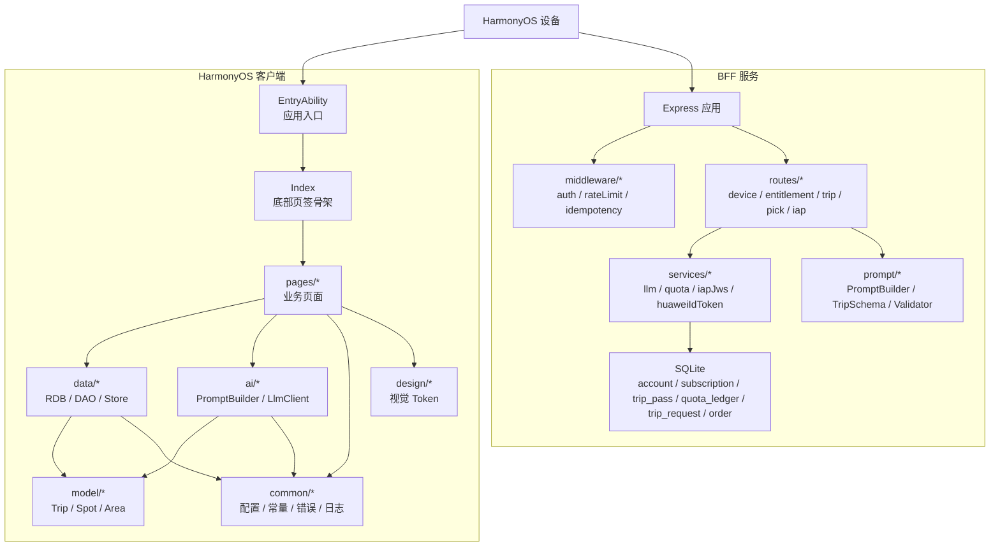
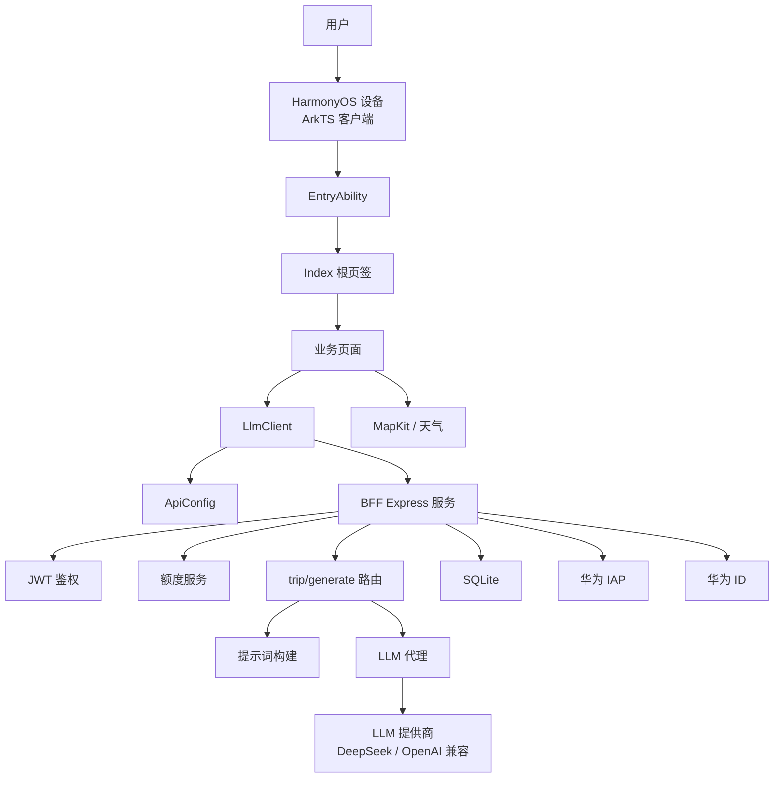
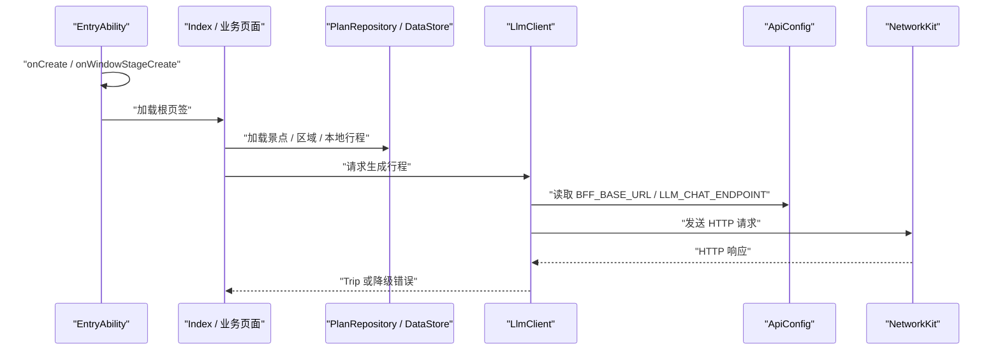
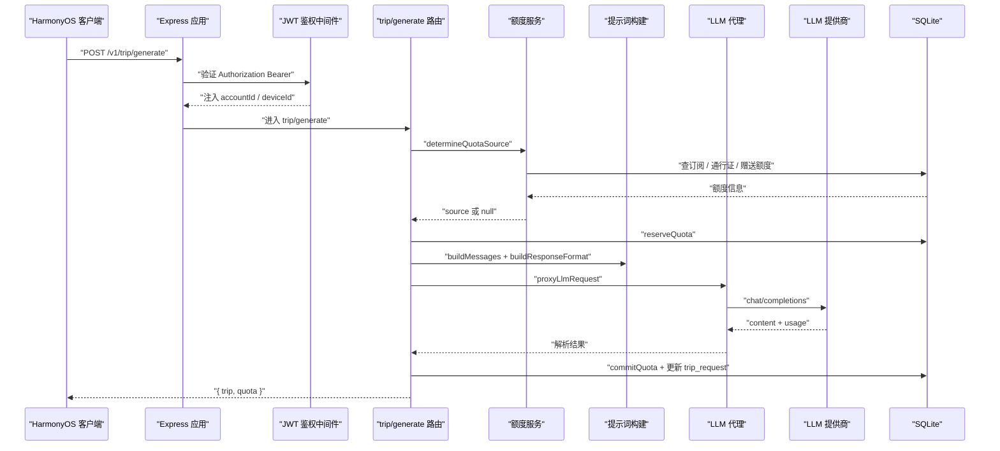
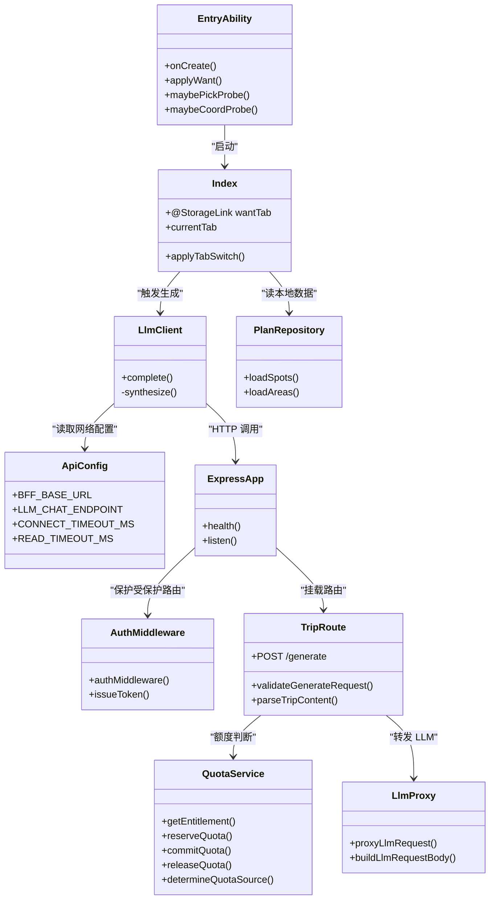
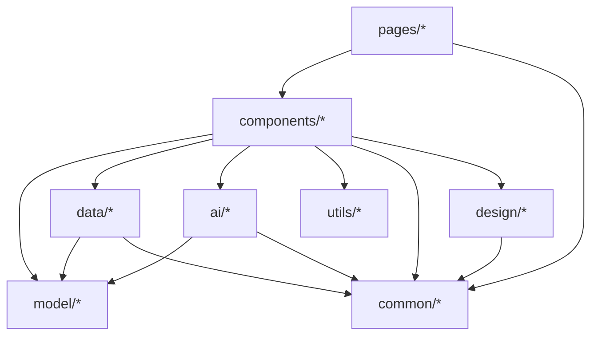
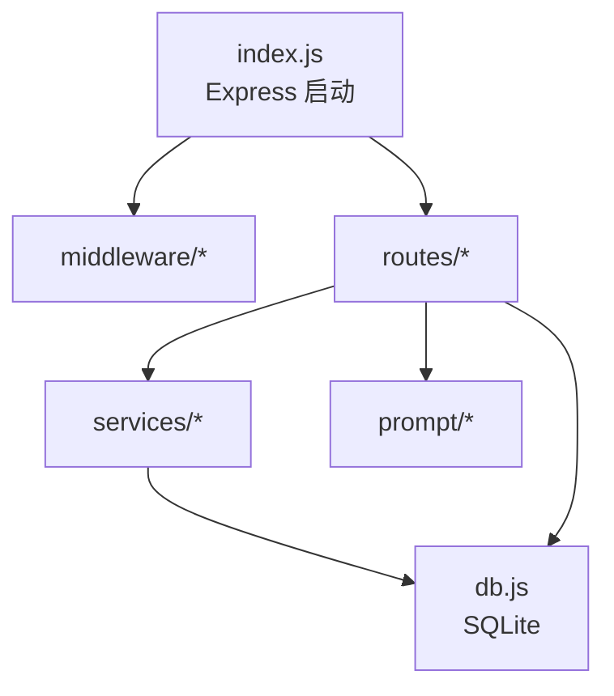
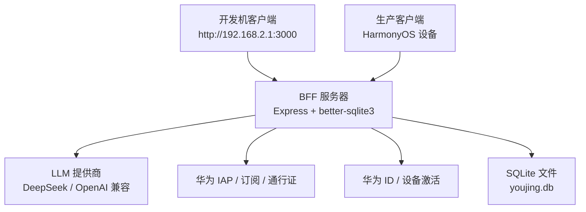
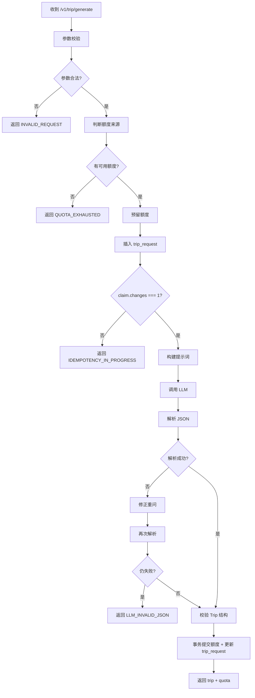

# 整体架构概览

<cite>
**本文引用的文件**   
- [Docs/ARCHITECTURE.md](file://Docs/ARCHITECTURE.md)
- [Docs/TECH_STACK.md](file://Docs/TECH_STACK.md)
- [Docs/LLM接入方案-2026-10-26.md](file://Docs/LLM接入方案-2026-10-26.md)
- [entry/src/main/module.json5](file://entry/src/main/module.json5)
- [entry/src/main/ets/entryability/EntryAbility.ets](file://entry/src/main/ets/entryability/EntryAbility.ets)
- [entry/src/main/ets/pages/Index.ets](file://entry/src/main/ets/pages/Index.ets)
- [entry/src/main/ets/common/config/ApiConfig.ets](file://entry/src/main/ets/common/config/ApiConfig.ets)
- [entry/src/main/ets/ai/LlmClient.ets](file://entry/src/main/ets/ai/LlmClient.ets)
- [entry/src/main/ets/data/PlanRepository.ets](file://entry/src/main/ets/data/PlanRepository.ets)
- [bff/package.json](file://bff/package.json)
- [bff/src/index.js](file://bff/src/index.js)
- [bff/src/db.js](file://bff/src/db.js)
- [bff/src/middleware/auth.js](file://bff/src/middleware/auth.js)
- [bff/src/routes/trip.js](file://bff/src/routes/trip.js)
- [bff/src/services/llm.js](file://bff/src/services/llm.js)
- [bff/src/services/quota.js](file://bff/src/services/quota.js)
</cite>

## 目录

1. [引言](#引言)
2. [项目结构](#项目结构)
3. [核心组件](#核心组件)
4. [架构总览](#架构总览)
5. [关键组件详解](#关键组件详解)
6. [依赖关系分析](#依赖关系分析)
7. [部署拓扑](#部署拓扑)
8. [性能与可靠性特征](#性能与可靠性特征)
9. [故障排查指南](#故障排查指南)
10. [结论](#结论)

## 引言

有径是一个面向 HarmonyOS 用户的旅行规划应用，采用前后端分离的 BFF（Backend for Frontend）架构：

- **HarmonyOS 客户端（ArkTS）**负责用户界面、本地数据持久化、权限与系统能力调用、用户交互流程编排。
- **Node.js Express BFF**负责设备鉴权、订阅与通行证权益管理、行程生成额度控制、提示词构建、第三方 LLM 转发、IAP 校验与通知处理。
- **SQLite**作为 BFF 的关系型数据库，承载账户、订阅、通行证、配额账本、行程请求流水和 IAP 订单。
- **华为生态 API**覆盖日历、位置、地图、小艺 Skill、实况窗等能力；LLM 侧通过 BFF 代理到 OpenAI 兼容接口（当前默认 DeepSeek）。

该文档聚焦“整体架构”这一单一事实源，说明系统边界、调用链路、技术选型理由以及关键设计决策。

**章节来源**
- [Docs/ARCHITECTURE.md:1-61](file://Docs/ARCHITECTURE.md#L1-L61)
- [Docs/TECH_STACK.md:1-41](file://Docs/TECH_STACK.md#L1-L41)
- [Docs/LLM接入方案-2026-10-26.md:1-154](file://Docs/LLM接入方案-2026-10-26.md#L1-L154)

## 项目结构

仓库按“移动端 + BFF + 工程文档 + 工具脚本”划分，不是传统单体前端。

| 路径 | 角色 | 主要职责 |
|---|---|---|
| `entry/` | HarmonyOS ArkTS 应用模块 | UIAbility、页面、组件、模型、RDB 数据层、AI 调用层、设计 Token |
| `bff/` | Node.js BFF 服务 | Express 路由、JWT 鉴权、额度控制、LLM 代理、SQLite 持久化、IAP 校验 |
| `cloud/` | 云函数示例 | 精选、重排等业务逻辑的云侧实现样例 |
| `Docs/` | 架构与技术契约 | 架构约定、技术栈锁定、LLM 接入方案、商业化方案等 |
| `tools/` | 工程辅助脚本 | 审计、探测、验证、部署检查等 Node/Python/Shell 工具 |



**图表来源**
- [entry/src/main/module.json5:1-133](file://entry/src/main/module.json5#L1-L133)
- [Docs/ARCHITECTURE.md:1-61](file://Docs/ARCHITECTURE.md#L1-L61)
- [bff/src/index.js:1-55](file://bff/src/index.js#L1-L55)

**章节来源**
- [Docs/ARCHITECTURE.md:1-61](file://Docs/ARCHITECTURE.md#L1-L61)
- [entry/src/main/module.json5:1-133](file://entry/src/main/module.json5#L1-L133)
- [bff/package.json:1-22](file://bff/package.json#L1-L22)

## 核心组件

### 客户端侧

| 组件 | 职责 | 关键约束 |
|---|---|---|
| `EntryAbility` | UIAbility 入口，负责生命周期、窗口、权限、探针、Skill 预填、导航模式初始化 | 禁止直接依赖 pages 以外的业务层写操作 |
| `Index` | 根 @Entry 组件，承载 HdsTabs 五页签、深链跳转、顶部条、底部液态胶囊导航 | 二级页全屏 push 到外层宿主栈，避免切 tab 与返回行为异常 |
| `ai/LlmClient` | LLM 调用抽象与生成编排；支持 Mock、BFF、直连三种传输 | 页面不得直接发起 LLM 请求 |
| `data/*` | RDB 建库、迁移、DAO、Store | 页面必须经 data 层访问本地数据 |
| `common/config` | 网络与环境配置单点 | URL、超时、开关集中定义，禁止散落硬编码 |
| `design/*` | 视觉 Token | 色值、字号、间距以 token 为唯一事实源 |

**章节来源**
- [entry/src/main/ets/entryability/EntryAbility.ets:1-200](file://entry/src/main/ets/entryability/EntryAbility.ets#L1-L200)
- [entry/src/main/ets/pages/Index.ets:1-200](file://entry/src/main/ets/pages/Index.ets#L1-L200)
- [entry/src/main/ets/ai/LlmClient.ets:1-200](file://entry/src/main/ets/ai/LlmClient.ets#L1-L200)
- [entry/src/main/ets/data/PlanRepository.ets:1-55](file://entry/src/main/ets/data/PlanRepository.ets#L1-L55)
- [entry/src/main/ets/common/config/ApiConfig.ets:1-66](file://entry/src/main/ets/common/config/ApiConfig.ets#L1-L66)

### BFF 侧

| 组件 | 职责 | 关键约束 |
|---|---|---|
| `src/index.js` | Express 启动、全局中间件、健康检查、路由挂载、统一错误处理 | `/v1/iap/notify` 保留原始字节用于 RSA 签名校验 |
| `middleware/auth.js` | JWT 验签，注入 accountId 与 deviceId | 未携带或无效 Bearer 返回 401 |
| `routes/trip.js` | 行程生成路由：参数校验、额度判断、幂等记录、LLM 转发、结果校验、事务结算 | 失败时释放额度，解析失败可修正重试一次 |
| `services/llm.js` | LLM 上游请求代理 | 默认 DeepSeek，带超时、限流透传、响应体抽取 |
| `services/quota.js` | 订阅/通行证/赠送额度判定与预留、提交、回滚 | 月度上限 20 次，gift 默认 3 次 |
| `db.js` | SQLite DDL、WAL、外键、列升级 | 支持 `DB_PATH` 环境变量迁移到挂载卷 |

**章节来源**
- [bff/src/index.js:1-55](file://bff/src/index.js#L1-L55)
- [bff/src/middleware/auth.js:1-25](file://bff/src/middleware/auth.js#L1-L25)
- [bff/src/routes/trip.js:1-200](file://bff/src/routes/trip.js#L1-L200)
- [bff/src/services/llm.js:1-98](file://bff/src/services/llm.js#L1-L98)
- [bff/src/services/quota.js:1-113](file://bff/src/services/quota.js#L1-L113)
- [bff/src/db.js:1-136](file://bff/src/db.js#L1-L136)

## 架构总览

有径的系统边界如下：

- **客户端边界**：UI 展示、用户输入、本地 RDB 持久化、华为系统权限、日历/位置/地图/Skill/卡片扩展。
- **BFF 边界**：身份鉴权、额度控制、LLM 转发、IAP 校验、订阅与通行证状态查询。
- **外部系统边界**：DeepSeek 或其他 OpenAI 兼容 LLM、华为 IAP、华为 ID Token、MapKit、天气服务。



**图表来源**
- [entry/src/main/ets/entryability/EntryAbility.ets:1-200](file://entry/src/main/ets/entryability/EntryAbility.ets#L1-L200)
- [entry/src/main/ets/pages/Index.ets:1-200](file://entry/src/main/ets/pages/Index.ets#L1-L200)
- [entry/src/main/ets/ai/LlmClient.ets:1-200](file://entry/src/main/ets/ai/LlmClient.ets#L1-L200)
- [entry/src/main/ets/common/config/ApiConfig.ets:1-66](file://entry/src/main/ets/common/config/ApiConfig.ets#L1-L66)
- [bff/src/index.js:1-55](file://bff/src/index.js#L1-L55)
- [bff/src/middleware/auth.js:1-25](file://bff/src/middleware/auth.js#L1-L25)
- [bff/src/routes/trip.js:1-200](file://bff/src/routes/trip.js#L1-L200)
- [bff/src/services/llm.js:1-98](file://bff/src/services/llm.js#L1-L98)
- [bff/src/services/quota.js:1-113](file://bff/src/services/quota.js#L1-L113)

## 关键组件详解

### 调用链路：从 EntryAbility 到 LLM Provider

完整调用链路分为客户端链路和 BFF 链路两部分。

#### 客户端链路



**图表来源**
- [entry/src/main/ets/entryability/EntryAbility.ets:1-200](file://entry/src/main/ets/entryability/EntryAbility.ets#L1-L200)
- [entry/src/main/ets/pages/Index.ets:1-200](file://entry/src/main/ets/pages/Index.ets#L1-L200)
- [entry/src/main/ets/data/PlanRepository.ets:1-55](file://entry/src/main/ets/data/PlanRepository.ets#L1-L55)
- [entry/src/main/ets/ai/LlmClient.ets:1-200](file://entry/src/main/ets/ai/LlmClient.ets#L1-L200)
- [entry/src/main/ets/common/config/ApiConfig.ets:1-66](file://entry/src/main/ets/common/config/ApiConfig.ets#L1-L66)

#### BFF 链路



**图表来源**
- [bff/src/index.js:1-55](file://bff/src/index.js#L1-L55)
- [bff/src/middleware/auth.js:1-25](file://bff/src/middleware/auth.js#L1-L25)
- [bff/src/routes/trip.js:1-200](file://bff/src/routes/trip.js#L1-L200)
- [bff/src/services/quota.js:1-113](file://bff/src/services/quota.js#L1-L113)
- [bff/src/services/llm.js:1-98](file://bff/src/services/llm.js#L1-L98)
- [bff/src/db.js:1-136](file://bff/src/db.js#L1-L136)

### 为什么选择 Stage 模型与 ArkTS V1 严格模式

- `module.json5` 将 entry 模块类型声明为 `entry`，并声明主元素 `EntryAbility`，这是 HarmonyOS Stage 模型的典型入口形式。
- 应用包名、目标 SDK、运行时 OS 由 `AppScope/app.json5` 与 `build-profile.json5` 共同决定，技术栈文档明确运行在 HarmonyOS 上。
- 工程文档对 ArkTS 源码组织、依赖方向、命名规范做了强制约定，体现严格模式下的工程纪律。

**章节来源**
- [entry/src/main/module.json5:1-133](file://entry/src/main/module.json5#L1-L133)
- [Docs/TECH_STACK.md:1-41](file://Docs/TECH_STACK.md#L1-L41)
- [Docs/ARCHITECTURE.md:1-61](file://Docs/ARCHITECTURE.md#L1-L61)

### 为什么使用 RDB 而非 NoSQL

客户端使用 RDB（通过 ArkTS 的 RDB 能力）保存 Trip、Spot、Area、Checkin、Expense 等业务实体，并由 `data/*` 提供 DAO 层封装。

原因包括：

- 行程、活动、餐食、住宿、费用、打卡等数据具有明确的表结构和关联关系，适合关系型建模。
- 需要事务一致性：例如行程写入、提醒注册、日历同步等场景要求多步操作要么全部成功，要么回滚。
- 查询模式稳定：按城市、日期、行程 ID、活动类别等字段筛选，关系型索引更自然。
- 客户端资源受限，SQLite/RDB 比内存中的 NoSQL 更适合长期持久化。

BFF 侧同样选择 SQLite，因为：

- 配额账本、订阅、通行证、订单、通知事件都是强一致业务。
- `better-sqlite3` 是同步 API，便于在 Express 路由中用事务保证“预留 → 调用 → 提交/释放”原子性。
- 部署简单，不需要额外数据库服务即可运行，适合轻量 BFF。

**章节来源**
- [Docs/ARCHITECTURE.md:1-61](file://Docs/ARCHITECTURE.md#L1-L61)
- [bff/src/db.js:1-136](file://bff/src/db.js#L1-L136)

### 为什么采用 BFF 而非客户端直连第三方 API

客户端的 `LlmClient` 定义了三种传输方式：Mock、BFF、直连。生产推荐走 BFF，主要原因如下：

1. **密钥不在客户端**  
   BFF 持有 LLM API Key，客户端只发送业务参数；发布包无需携带密钥。
2. **鉴权统一**  
   JWT 中间件在 BFF 层校验 `Authorization: Bearer`，避免每个第三方 API 都重复鉴权逻辑。
3. **额度控制**  
   订阅每月 20 次、赠送 3 次、通行证等规则集中在 BFF，客户端无法绕过。
4. **幂等与观测**  
   `trip_request` 记录 idempotency_key、request_hash、status、token 用量、模型名称，便于重试、审计和对账。
5. **错误语义收敛**  
   BFF 把上游 429、超时、非 2xx 转换为统一错误码，客户端只需处理有限状态。
6. **多供应商可替换**  
   通过 `bff/src/services/llm.js` 的 `baseUrl`、`apiKey`、`model` 环境变量切换上游，客户端无感知。

**章节来源**
- [entry/src/main/ets/ai/LlmClient.ets:1-200](file://entry/src/main/ets/ai/LlmClient.ets#L1-L200)
- [entry/src/main/ets/common/config/ApiConfig.ets:1-66](file://entry/src/main/ets/common/config/ApiConfig.ets#L1-L66)
- [bff/src/middleware/auth.js:1-25](file://bff/src/middleware/auth.js#L1-L25)
- [bff/src/routes/trip.js:1-200](file://bff/src/routes/trip.js#L1-L200)
- [bff/src/services/llm.js:1-98](file://bff/src/services/llm.js#L1-L98)
- [Docs/LLM接入方案-2026-10-26.md:1-154](file://Docs/LLM接入方案-2026-10-26.md#L1-L154)

### 组件依赖关系图



**图表来源**
- [entry/src/main/ets/entryability/EntryAbility.ets:1-200](file://entry/src/main/ets/entryability/EntryAbility.ets#L1-L200)
- [entry/src/main/ets/pages/Index.ets:1-200](file://entry/src/main/ets/pages/Index.ets#L1-L200)
- [entry/src/main/ets/ai/LlmClient.ets:1-200](file://entry/src/main/ets/ai/LlmClient.ets#L1-L200)
- [entry/src/main/ets/data/PlanRepository.ets:1-55](file://entry/src/main/ets/data/PlanRepository.ets#L1-L55)
- [entry/src/main/ets/common/config/ApiConfig.ets:1-66](file://entry/src/main/ets/common/config/ApiConfig.ets#L1-L66)
- [bff/src/index.js:1-55](file://bff/src/index.js#L1-L55)
- [bff/src/middleware/auth.js:1-25](file://bff/src/middleware/auth.js#L1-L25)
- [bff/src/routes/trip.js:1-200](file://bff/src/routes/trip.js#L1-L200)
- [bff/src/services/llm.js:1-98](file://bff/src/services/llm.js#L1-L98)
- [bff/src/services/quota.js:1-113](file://bff/src/services/quota.js#L1-L113)

## 依赖关系分析

### 客户端内部依赖方向

工程文档明确规定了单向依赖方向：

```text
pages → components → model / data / ai / utils → common
                ↘ design ↗
```

这条规则保证了：

- 页面不直接操作 RDB。
- 页面不直接发起 LLM 请求。
- 通用配置、错误码、日志、设计 Token 位于最底层。
- mock 仅被 data 层在开发开关开启后使用，UI 层不直连 mock。



**图表来源**
- [Docs/ARCHITECTURE.md:1-61](file://Docs/ARCHITECTURE.md#L1-L61)

**章节来源**
- [Docs/ARCHITECTURE.md:1-61](file://Docs/ARCHITECTURE.md#L1-L61)

### BFF 内部依赖方向

BFF 采用 Express 路由 + 中间件 + 服务层的分层结构：

- 路由负责 HTTP 契约、参数校验、状态码映射。
- 中间件负责鉴权、限流、幂等。
- 服务层封装额度、LLM、IAP、华为 ID Token 等业务逻辑。
- `db.js` 提供连接与 DDL，所有持久化操作最终落到 SQLite。



**图表来源**
- [bff/src/index.js:1-55](file://bff/src/index.js#L1-L55)
- [bff/src/db.js:1-136](file://bff/src/db.js#L1-L136)

**章节来源**
- [bff/src/index.js:1-55](file://bff/src/index.js#L1-L55)
- [bff/src/db.js:1-136](file://bff/src/db.js#L1-L136)

## 部署拓扑

BFF 的部署拓扑相对简单：HarmonyOS 客户端通过 HTTPS 或局域网 HTTP 调用 BFF，BFF 再访问 LLM 提供商和华为 IAP。



**图表来源**
- [entry/src/main/ets/common/config/ApiConfig.ets:1-66](file://entry/src/main/ets/common/config/ApiConfig.ets#L1-L66)
- [bff/src/index.js:1-55](file://bff/src/index.js#L1-L55)
- [bff/src/services/llm.js:1-98](file://bff/src/services/llm.js#L1-L98)

## 性能与可靠性特征

### 行程生成流程的性能特征

- 客户端读超时为 120 秒，适配整程生成可能较长的上游响应。
- BFF 上游 LLM 默认超时 45 秒，给“第一次失败 + 修正重问”留出余量。
- 免费档最大输出 token 为 8192，付费档为 16384。
- 解析失败会追加修正指令重试一次，避免模型尾部附带解释文本导致 JSON 解析失败。

### 可靠性机制

| 机制 | 位置 | 作用 |
|---|---|---|
| JWT 鉴权 | BFF 中间件 | 防止未授权访问额度接口 |
| 速率限制 | BFF 中间件 | 保护 LLM 与后端资源 |
| 幂等键 | BFF trip/generate | 同 key 并发只允许一个 pending 请求 |
| 额度预留/提交/释放 | BFF 额度服务 | 失败回滚，避免误扣费 |
| 事务结算 | BFF trip 路由 | 状态、token 用量、额度提交原子落库 |
| 健康检查 | BFF `/health` | 探活时实际查询 SQLite，避免假存活 |
| WAL 模式 | SQLite | 提升并发读写稳定性 |
| 外键约束 | SQLite | 保持订阅、订单、额度账本一致性 |



**图表来源**
- [bff/src/routes/trip.js:1-200](file://bff/src/routes/trip.js#L1-L200)
- [bff/src/services/quota.js:1-113](file://bff/src/services/quota.js#L1-L113)
- [bff/src/services/llm.js:1-98](file://bff/src/services/llm.js#L1-L98)

**章节来源**
- [entry/src/main/ets/common/config/ApiConfig.ets:1-66](file://entry/src/main/ets/common/config/ApiConfig.ets#L1-L66)
- [bff/src/routes/trip.js:1-200](file://bff/src/routes/trip.js#L1-L200)
- [bff/src/services/llm.js:1-98](file://bff/src/services/llm.js#L1-L98)
- [bff/src/services/quota.js:1-113](file://bff/src/services/quota.js#L1-L113)
- [bff/src/db.js:1-136](file://bff/src/db.js#L1-L136)

## 故障排查指南

### 客户端无法生成行程

常见原因：

- `ApiConfig.BFF_BASE_URL` 为空或未配置，客户端跳过票据与权益门禁，但不会自动启用真实模型。
- 设备未激活，缺少 Bearer token。
- BFF 返回 401，JWT 过期或无效。
- BFF 返回 402，额度已用尽。
- LLM 上游返回 429，BFF 透传限流错误。
- LLM 上游超时，BFF 返回 504。

排查顺序：

1. 确认 `ApiConfig` 是否指向正确 BFF 地址。
2. 确认设备是否已完成激活并获得有效 token。
3. 查看 BFF 日志中 `/v1/trip/generate` 的请求参数与账号。
4. 检查 SQLite 中 `trip_request` 是否处于 `pending`、`failed` 或 `succeeded`。
5. 检查 `quota_ledger` 是否预留成功、是否提交成功。
6. 检查 LLM 上游是否返回 429 或超时。

**章节来源**
- [entry/src/main/ets/common/config/ApiConfig.ets:1-66](file://entry/src/main/ets/common/config/ApiConfig.ets#L1-L66)
- [bff/src/middleware/auth.js:1-25](file://bff/src/middleware/auth.js#L1-L25)
- [bff/src/routes/trip.js:1-200](file://bff/src/routes/trip.js#L1-L200)
- [bff/src/services/llm.js:1-98](file://bff/src/services/llm.js#L1-L98)
- [bff/src/services/quota.js:1-113](file://bff/src/services/quota.js#L1-L113)

### BFF 健康检查不可用

`/health` 不仅返回静态 `ok`，还会执行 `SELECT 1` 查询 SQLite。若数据库损坏、路径不可写或只读，会返回 503。

建议：

- 部署前运行 `npm run preflight` 或手动初始化数据库。
- 确保 `DB_PATH` 指向可写路径。
- 监控 `/health` 返回值，不要只看进程存活。

**章节来源**
- [bff/src/index.js:1-55](file://bff/src/index.js#L1-L55)
- [bff/src/db.js:1-136](file://bff/src/db.js#L1-L136)

### 行程生成幂等异常

如果同一 `idempotency_key` 同时发出多个请求，BFF 会把后续请求标记为冲突；如果请求失败后重试，额度会释放，下次重新预留。

排查重点：

- 客户端是否重复提交相同幂等键。
- 网络超时是否导致客户端误判失败并重发。
- BFF 是否在预留成功后、调用 LLM 前崩溃，导致额度停留在 reserved 状态。

**章节来源**
- [bff/src/routes/trip.js:1-200](file://bff/src/routes/trip.js#L1-L200)
- [bff/src/services/quota.js:1-113](file://bff/src/services/quota.js#L1-L113)

## 结论

有径的整体架构可以概括为：

- **客户端**是 HarmonyOS ArkTS 应用，遵循严格的目录依赖方向和 UI 约定，负责体验、本地数据和系统能力。
- **BFF**是轻量 Express 服务，承担鉴权、额度、LLM 转发和 IAP 处理，是客户端与第三方系统之间的安全边界。
- **SQLite**贯穿额度账本、行程请求流水、订阅与订单，满足强一致需求。
- **LLM 调用**优先走 BFF，避免客户端持有密钥，同时集中处理限流、幂等、重试、观测和错误映射。
- **Stage 模型、RDB、BFF**三者共同服务于可维护性、安全性与可扩展性，而不是单纯的技术偏好。

未来演进应继续遵守现有契约：新增功能先更新架构和技术栈文档，变更依赖需评估用途、许可证、维护状态和替代方案，避免“有据”项目中曾经出现的散乱配置与无版本锁定问题。