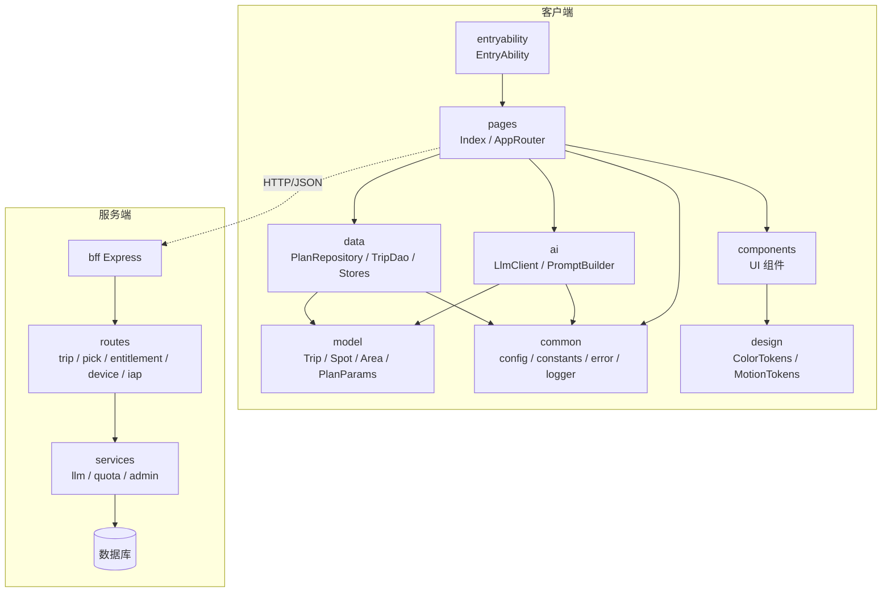
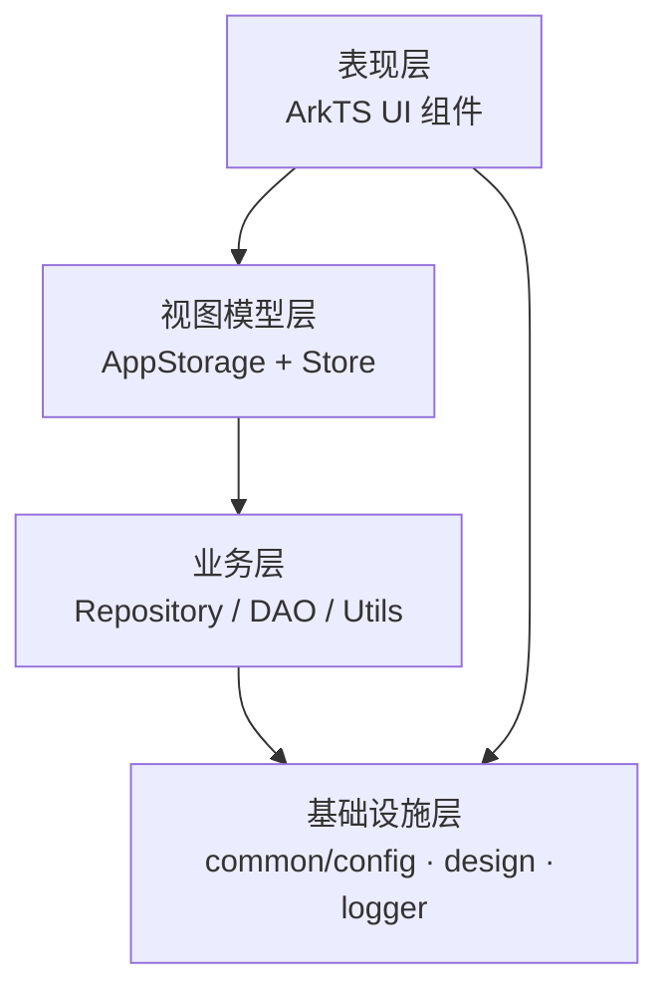
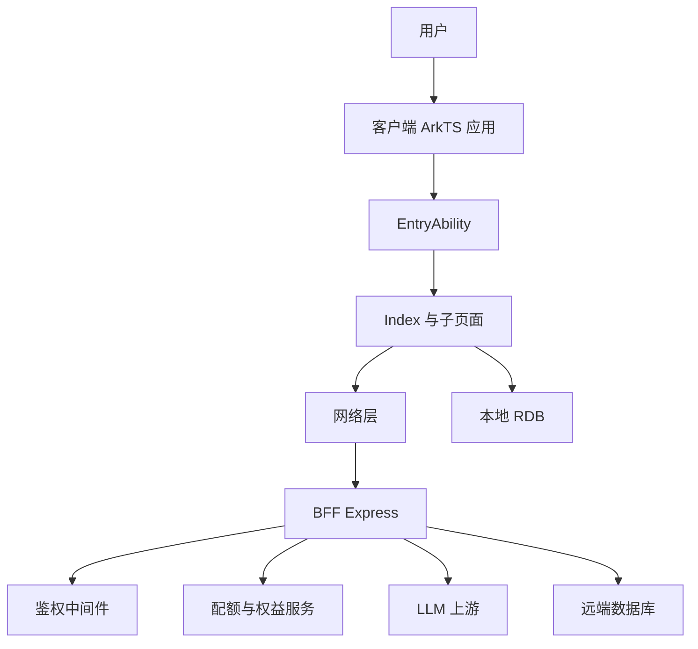
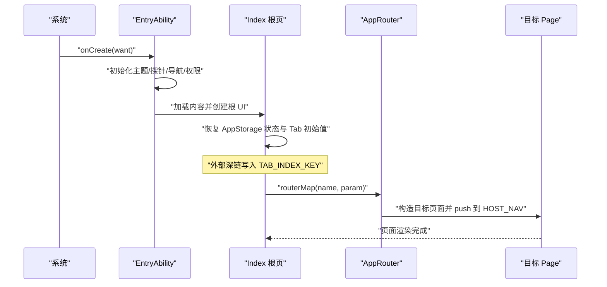
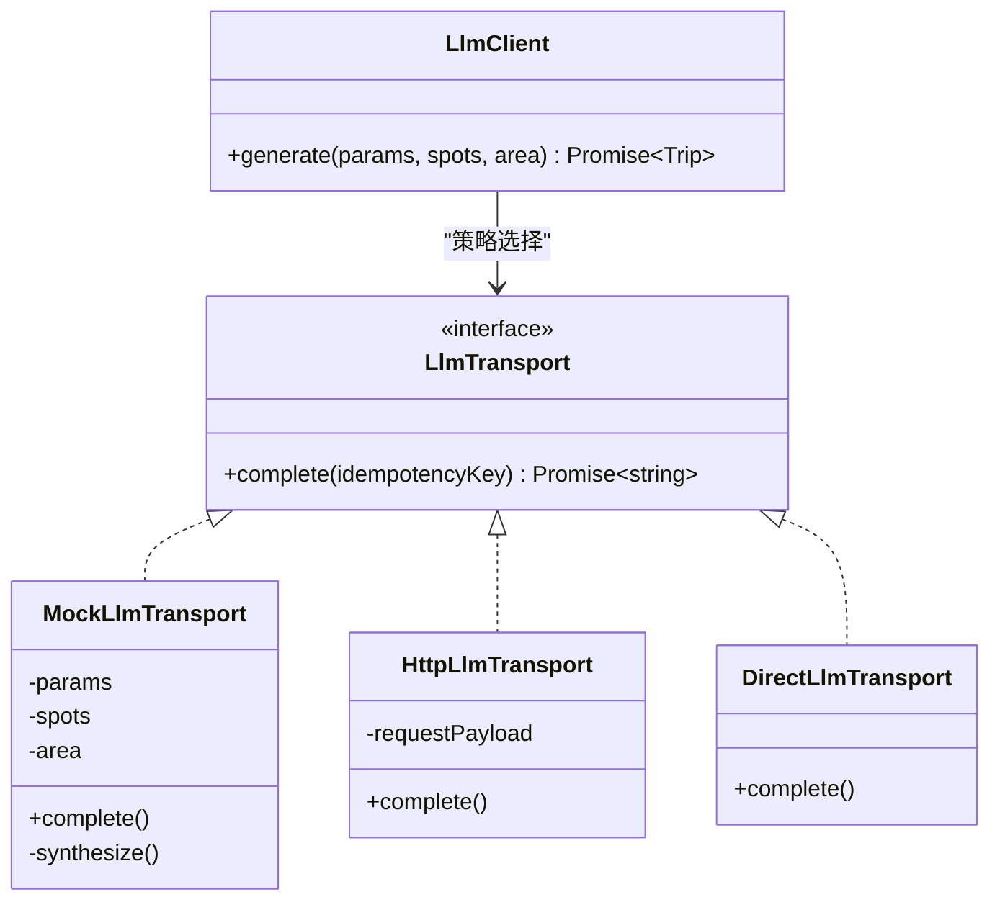
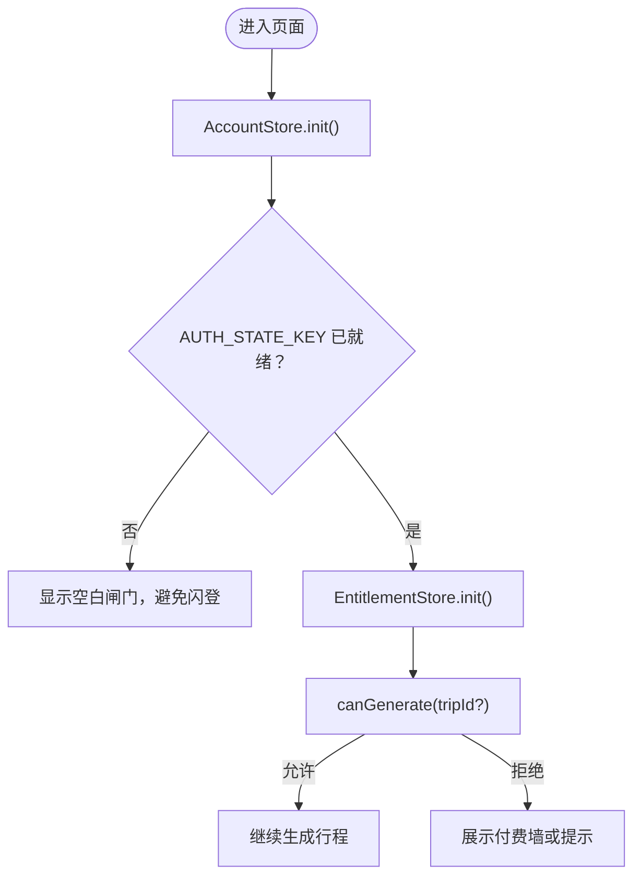
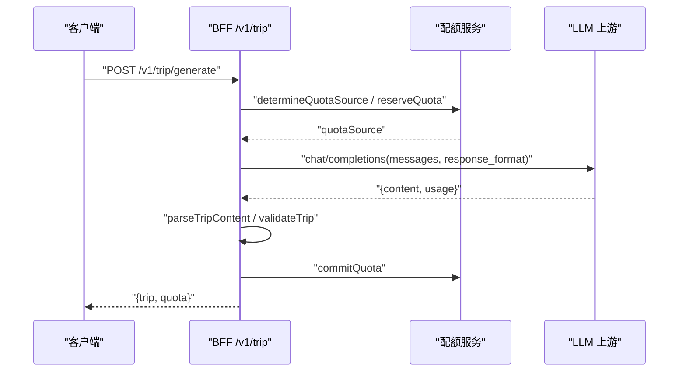
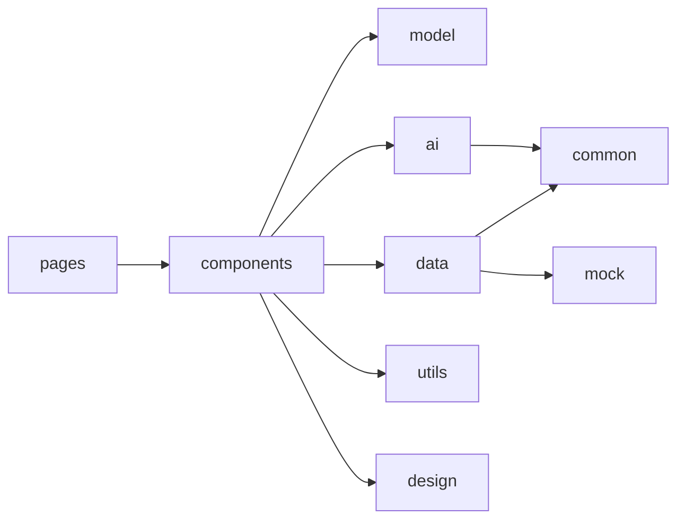

# 架构设计

<cite>
**本文引用的文件**   
- [entry/src/main/ets/entryability/EntryAbility.ets](file://entry/src/main/ets/entryability/EntryAbility.ets)
- [entry/src/main/ets/pages/Index.ets](file://entry/src/main/ets/pages/Index.ets)
- [entry/src/main/ets/pages/AppRouter.ets](file://entry/src/main/ets/pages/AppRouter.ets)
- [entry/src/main/ets/common/constants/AppNav.ets](file://entry/src/main/ets/common/constants/AppNav.ets)
- [entry/src/main/ets/common/config/DirectConfig.ets](file://entry/src/main/ets/common/config/DirectConfig.ets)
- [entry/src/main/ets/common/config/ApiConfig.ets](file://entry/src/main/ets/common/config/ApiConfig.ets)
- [entry/src/main/ets/common/config/AccountConfig.ets](file://entry/src/main/ets/common/config/AccountConfig.ets)
- [entry/src/main/ets/data/PlanRepository.ets](file://entry/src/main/ets/data/PlanRepository.ets)
- [entry/src/main/ets/data/TripDao.ets](file://entry/src/main/ets/data/TripDao.ets)
- [entry/src/main/ets/data/AccountStore.ets](file://entry/src/main/ets/data/AccountStore.ets)
- [entry/src/main/ets/data/EntitlementStore.ets](file://entry/src/main/ets/data/EntitlementStore.ets)
- [entry/src/main/ets/ai/LlmClient.ets](file://entry/src/main/ets/ai/LlmClient.ets)
- [bff/src/index.js](file://bff/src/index.js)
- [bff/src/routes/trip.js](file://bff/src/routes/trip.js)
- [bff/src/services/llm.js](file://bff/src/services/llm.js)
- [Docs/ARCHITECTURE.md](file://Docs/ARCHITECTURE.md)
</cite>

## 目录
1. [引言](#引言)
2. [项目结构](#项目结构)
3. [核心组件](#核心组件)
4. [架构总览](#架构总览)
5. [详细组件分析](#详细组件分析)
6. [依赖关系分析](#依赖关系分析)
7. [性能与可靠性](#性能与可靠性)
8. [故障排查指南](#故障排查指南)
9. [结论](#结论)
10. [附录：扩展点与迁移建议](#附录扩展点与迁移建议)

## 引言
本文面向有径应用的架构设计与实现契约，聚焦三层分层、MVVM 状态模型、关键设计模式、前后端通信协议以及系统上下文和组件交互。目标读者包括前端开发者、后端协作方和产品维护者，既需要理解 EntryAbility → Index → Page 的调用链路，也需要掌握 LLM 传输策略、DAO 数据访问、全局状态与权限门控等核心机制。

## 项目结构
工程以 ArkTS 客户端为主，配套 Node.js BFF 服务：
- 客户端 `entry/src/main/ets/`：按职责拆分为 entryability、pages、components、model、data、ai、mock、utils、design、common、widget 等目录。
- 服务端 `bff/src/`：Express 应用，提供设备激活、权益、行程生成、地点精选和内购回调接口。
- 文档 `Docs/ARCHITECTURE.md`：明确目录职责、依赖方向和 UI 约定，是本次架构解读的依据之一。



图表来源
- [Docs/ARCHITECTURE.md:1-61](file://Docs/ARCHITECTURE.md#L1-L61)
- [bff/src/index.js:1-55](file://bff/src/index.js#L1-L55)

章节来源
- [Docs/ARCHITECTURE.md:1-61](file://Docs/ARCHITECTURE.md#L1-L61)

## 核心组件
本节梳理分层与 MVVM 的关键实体：

- 表现层（View）
  - EntryAbility：应用生命周期、探针、窗口主题、导航初始化、Widget 与定位能力装配。
  - Index：根页签容器、Dock 胶囊交互、二级页全屏宿主栈、外部深链路由分发。
  - AppRouter：全局路由表，将字符串路由名映射到页面构造器。
  - 各 Page 组件：Tab 根页及向导页，消费 AppStorage 状态并触发业务操作。

- 视图模型层（ViewModel）
  - AccountStore：登录态单例，通过 AppStorage 广播 AUTH_STATE_KEY；供 DAO 分区、Gate 判断。
  - EntitlementStore：权益缓存单例，TTL 控制，canExport/canGenerate 作为付费墙入口。
  - DeviceTokenStore、PlanDraft、TripReminder 等：全局或页面级状态载体。

- 模型与数据层（Model / Data）
  - Model：Trip、Spot、Area、PlanParams、Weather 等业务类型定义。
  - PlanRepository：数据仓储，封装 Mock / 种子库 / Map Kit 的数据源切换。
  - TripDao：RDB 整存整取 DAO，聚合 Trip 主从表读写，返回 TripSummary 列表。
  - SpotDao / AreaDao / CheckinDao / ExpenseDao：领域 DAO。

- 基础设施层（Common / Config）
  - ApiConfig：BFF URL、LLM 端点、超时、天气接口、开发旁路开关。
  - DirectConfig：开发期直连 OpenAI 兼容接口的 Key/URL/MODEL。
  - AccountConfig：华为账号配置、偏好分片名、游客 UID。
  - BuildConfig、Cities、ErrorCode、Logger：构建常量、城市枚举、错误码、日志。

章节来源
- [entry/src/main/ets/entryability/EntryAbility.ets:1-923](file://entry/src/main/ets/entryability/EntryAbility.ets#L1-L923)
- [entry/src/main/ets/pages/Index.ets:1-1018](file://entry/src/main/ets/pages/Index.ets#L1-L1018)
- [entry/src/main/ets/pages/AppRouter.ets:1-100](file://entry/src/main/ets/pages/AppRouter.ets#L1-L100)
- [entry/src/main/ets/common/constants/AppNav.ets:1-221](file://entry/src/main/ets/common/constants/AppNav.ets#L1-L221)
- [entry/src/main/ets/common/config/ApiConfig.ets:1-66](file://entry/src/main/ets/common/config/ApiConfig.ets#L1-L66)
- [entry/src/main/ets/common/config/DirectConfig.ets:1-33](file://entry/src/main/ets/common/config/DirectConfig.ets#L1-L33)
- [entry/src/main/ets/common/config/AccountConfig.ets:1-29](file://entry/src/main/ets/common/config/AccountConfig.ets#L1-L29)
- [entry/src/main/ets/data/PlanRepository.ets:1-55](file://entry/src/main/ets/data/PlanRepository.ets#L1-L55)
- [entry/src/main/ets/data/TripDao.ets:1-384](file://entry/src/main/ets/data/TripDao.ets#L1-L384)
- [entry/src/main/ets/data/AccountStore.ets:1-213](file://entry/src/main/ets/data/AccountStore.ets#L1-L213)
- [entry/src/main/ets/data/EntitlementStore.ets:1-235](file://entry/src/main/ets/data/EntitlementStore.ets#L1-L235)
- [entry/src/main/ets/ai/LlmClient.ets:1-482](file://entry/src/main/ets/ai/LlmClient.ets#L1-L482)

## 架构总览
有径采用“表现层 — 业务层 — 基础设施层”的分层结构，并在客户端内使用 MVVM 组织状态与 UI。

### 分层架构
- 表现层
  - 由 ArkTS UI 组件构成，负责用户输入、页面布局、动画与导航。
  - 不直接操作 RDB 或直接发起 LLM 请求，必须经 data/ai 层。
- 业务层
  - 通过 Repository/DAO 抽象数据访问；通过 Store 管理全局状态；通过工具函数处理纯逻辑。
- 基础设施层
  - 配置集中管理；错误码、日志、设计 Token 收敛。



图表来源
- [Docs/ARCHITECTURE.md:1-61](file://Docs/ARCHITECTURE.md#L1-L61)

### MVVM 在 ArkTS 中的落地
- View：EntryAbility、Index、各 Page 使用 @State/@Prop/@StorageLink/@StorageProp 驱动渲染。
- ViewModel：AccountStore、EntitlementStore 通过 AppStorage 键值广播登录态、权益变更、当前 Tab、活跃行程等。
- Model：Trip、Spot、Area、PlanParams 等类型集中在 model/，被 data/ai/pages 共同引用但不反向依赖。

章节来源
- [entry/src/main/ets/pages/Index.ets:1-1018](file://entry/src/main/ets/pages/Index.ets#L1-L1018)
- [entry/src/main/ets/data/AccountStore.ets:1-213](file://entry/src/main/ets/data/AccountStore.ets#L1-L213)
- [entry/src/main/ets/data/EntitlementStore.ets:1-235](file://entry/src/main/ets/data/EntitlementStore.ets#L1-L235)
- [entry/src/main/ets/model/Trip.ets](file://entry/src/main/ets/model/Trip.ets)

### 系统上下文图


图表来源
- [bff/src/index.js:1-55](file://bff/src/index.js#L1-L55)
- [entry/src/main/ets/entryability/EntryAbility.ets:1-923](file://entry/src/main/ets/entryability/EntryAbility.ets#L1-L923)
- [entry/src/main/ets/pages/Index.ets:1-1018](file://entry/src/main/ets/pages/Index.ets#L1-L1018)

## 详细组件分析

### 应用启动与页面调用链路：EntryAbility → Index → Page
EntryAbility 负责冷启初始化、深色主题播种、探针参数解析、导航模式、位置权限、设备激活与 Widget 同步。Index 作为根页签容器，承担 Dock 胶囊、底部导航、二级页宿主栈与外部深链落点。AppRouter 把路由名映射到具体页面构造器。



图表来源
- [entry/src/main/ets/entryability/EntryAbility.ets:1-923](file://entry/src/main/ets/entryability/EntryAbility.ets#L1-L923)
- [entry/src/main/ets/pages/Index.ets:1-1018](file://entry/src/main/ets/pages/Index.ets#L1-L1018)
- [entry/src/main/ets/pages/AppRouter.ets:1-100](file://entry/src/main/ets/pages/AppRouter.ets#L1-L100)
- [entry/src/main/ets/common/constants/AppNav.ets:1-221](file://entry/src/main/ets/common/constants/AppNav.ets#L1-L221)

章节来源
- [entry/src/main/ets/entryability/EntryAbility.ets:1-923](file://entry/src/main/ets/entryability/EntryAbility.ets#L1-L923)
- [entry/src/main/ets/pages/Index.ets:1-1018](file://entry/src/main/ets/pages/Index.ets#L1-L1018)
- [entry/src/main/ets/pages/AppRouter.ets:1-100](file://entry/src/main/ets/pages/AppRouter.ets#L1-L100)
- [entry/src/main/ets/common/constants/AppNav.ets:1-221](file://entry/src/main/ets/common/constants/AppNav.ets#L1-L221)

### 数据访问抽象：DAO 与 Repository
PlanRepository 屏蔽数据来源差异：Mock 演示数据、内置种子库、Map Kit 回退；TripDao 封装 Trip 主从表的整存整取、摘要查询与模型拼装。

```mermaid
classDiagram
  class PlanRepository {
    +loadSpots(context, city) Promise~Spot[]~
    +loadAreas(context, city) Promise~Area[]~
  }
  class SpotDao {
    +loadByCity(context, city) Promise~Spot[]~
  }
  class AreaDao {
    +loadByCity(context, city) Promise~Area[]~
  }
  class MapKitCityStore {
    +load(context, city) Promise~MapCityData~
  }
  class TripDao {
    +saveTrip(context, trip) Promise~void~
    +listSummaries(context) Promise~TripSummary[]~
    +loadTrip(context, id) Promise~Trip~
  }

  PlanRepository --> SpotDao : "读取景点"
  PlanRepository --> AreaDao : "读取区域"
  PlanRepository --> MapKitCityStore : "Map 城市回退"
  TripDao --> "RDB" : "Trip / TripDay / Activity / Meal"
```

图表来源
- [entry/src/main/ets/data/PlanRepository.ets:1-55](file://entry/src/main/ets/data/PlanRepository.ets#L1-L55)
- [entry/src/main/ets/data/TripDao.ets:1-384](file://entry/src/main/ets/data/TripDao.ets#L1-L384)

章节来源
- [entry/src/main/ets/data/PlanRepository.ets:1-55](file://entry/src/main/ets/data/PlanRepository.ets#L1-L55)
- [entry/src/main/ets/data/TripDao.ets:1-384](file://entry/src/main/ets/data/TripDao.ets#L1-L384)

### LLM 传输策略：策略模式
LlmClient 暴露统一生成入口，内部根据环境选择三种传输实现：
- MockLlmTransport：离线合成合法 Trip JSON，用于开发闭环验证。
- HttpLlmTransport：通过 BFF 中转，携带幂等键、权益校验、额度扣减。
- DirectLlmTransport：开发期直连 OpenAI 兼容接口，需 DirectConfig 同时提供 URL 与 KEY。



图表来源
- [entry/src/main/ets/ai/LlmClient.ets:1-482](file://entry/src/main/ets/ai/LlmClient.ets#L1-L482)
- [entry/src/main/ets/common/config/DirectConfig.ets:1-33](file://entry/src/main/ets/common/config/DirectConfig.ets#L1-L33)
- [entry/src/main/ets/common/config/ApiConfig.ets:1-66](file://entry/src/main/ets/common/config/ApiConfig.ets#L1-L66)

章节来源
- [entry/src/main/ets/ai/LlmClient.ets:1-482](file://entry/src/main/ets/ai/LlmClient.ets#L1-L482)
- [entry/src/main/ets/common/config/DirectConfig.ets:1-33](file://entry/src/main/ets/common/config/DirectConfig.ets#L1-L33)
- [entry/src/main/ets/common/config/ApiConfig.ets:1-66](file://entry/src/main/ets/common/config/ApiConfig.ets#L1-L66)

### 全局状态与权限门控：单例模式
AccountStore 与 EntitlementStore 均为单例式 Store，对外提供同步 uid()/state()/hasSubscription()/canGenerate() 等方法，并通过 AppStorage 广播状态变化，供 UI 响应。



图表来源
- [entry/src/main/ets/data/AccountStore.ets:1-213](file://entry/src/main/ets/data/AccountStore.ets#L1-L213)
- [entry/src/main/ets/data/EntitlementStore.ets:1-235](file://entry/src/main/ets/data/EntitlementStore.ets#L1-L235)

章节来源
- [entry/src/main/ets/data/AccountStore.ets:1-213](file://entry/src/main/ets/data/AccountStore.ets#L1-L213)
- [entry/src/main/ets/data/EntitlementStore.ets:1-235](file://entry/src/main/ets/data/EntitlementStore.ets#L1-L235)

### 前后端通信协议
- RESTful API：BFF 基于 Express 提供 /v1/device、/v1/entitlement、/v1/trip、/v1/pick、/v1/iap 等路由，统一挂载 authMiddleware 与 rateLimitMiddleware。
- 鉴权机制：设备激活获取 token；行程与权益接口要求携带凭据，服务端校验后注入 accountId。
- LLM 调用：客户端可走 BFF /v1/trip/generate，BFF 内部组装 messages、选择 response_format、代理上游 chat/completions，并返回 trip 与 quota。
- 实时通信：仓库未体现 WebSocket 客户端或服务端实现，当前实时能力未纳入本架构说明。



图表来源
- [bff/src/index.js:1-55](file://bff/src/index.js#L1-L55)
- [bff/src/routes/trip.js:1-234](file://bff/src/routes/trip.js#L1-L234)
- [bff/src/services/llm.js:1-98](file://bff/src/services/llm.js#L1-L98)

章节来源
- [bff/src/index.js:1-55](file://bff/src/index.js#L1-L55)
- [bff/src/routes/trip.js:1-234](file://bff/src/routes/trip.js#L1-L234)
- [bff/src/services/llm.js:1-98](file://bff/src/services/llm.js#L1-L98)

## 依赖关系分析
依据 Docs/ARCHITECTURE.md，依赖方向单向且严格：
- pages → components → model / data / ai / utils → common
- design 与 common 同属底层，可被上层引用，但不得反向依赖业务目录。
- mock 仅被 data 层在条件开关下读取，UI 层禁止直接引用。



图表来源
- [Docs/ARCHITECTURE.md:1-61](file://Docs/ARCHITECTURE.md#L1-L61)

章节来源
- [Docs/ARCHITECTURE.md:1-61](file://Docs/ARCHITECTURE.md#L1-L61)

## 性能与可靠性
- 幂等与并发安全
  - BFF 使用 Idempotency-Key 防止重复扣费与双写；并发抢占失败返回 409。
- 容错与重试
  - LLM JSON 解析失败时，BFF 追加修正指令进行一次修复调用；仍失败返回明确错误码。
- 超时保护
  - LLM 上游默认 45 秒超时，避免幂等行长期 pending。
- 额度与配额
  - 免费档与付费档使用不同 maxTokens 与提示词策略；服务端 commit 后再读 entitlement 快照返回客户端。
- 客户端侧降级
  - Mock 传输保证无网络仍可体验完整管线；DEV_SKIP_BFF 便于开发联调，发布包禁用。

章节来源
- [bff/src/routes/trip.js:1-234](file://bff/src/routes/trip.js#L1-L234)
- [bff/src/services/llm.js:1-98](file://bff/src/services/llm.js#L1-L98)
- [entry/src/main/ets/ai/LlmClient.ets:1-482](file://entry/src/main/ets/ai/LlmClient.ets#L1-L482)
- [entry/src/main/ets/common/config/ApiConfig.ets:1-66](file://entry/src/main/ets/common/config/ApiConfig.ets#L1-L66)

## 故障排查指南
- 行程生成始终跳付费页
  - 检查 ApiConfig.BFF_BASE_URL 是否为空；若为空，DEV_SKIP_BFF 会放开门禁但不会自动启用真实 LLM。
  - 检查 EntitlementStore 是否成功恢复缓存；TTL 过期且无 token 时会误判为无额度。
- 生成输出非法 JSON
  - 查看 BFF 日志中 LLM_INVALID_JSON 与修复调用；确认上游 finish_reason 是否为 length。
- 登录态异常或闪登
  - 确认 AccountStore.init 在首次读写前执行；AUTH_STATE_KEY 在初始化期间为“未知”，Index 应显示闸门而非页面。
- 地图或费用页切回显示旧行程
  - 检查 ACTIVE_TRIP_KEY 是否正确设置；根页应按 Tab 序号订阅 TAB_SHOWN_KEY 刷新。

章节来源
- [entry/src/main/ets/data/EntitlementStore.ets:1-235](file://entry/src/main/ets/data/EntitlementStore.ets#L1-L235)
- [entry/src/main/ets/data/AccountStore.ets:1-213](file://entry/src/main/ets/data/AccountStore.ets#L1-L213)
- [bff/src/routes/trip.js:1-234](file://bff/src/routes/trip.js#L1-L234)
- [entry/src/main/ets/common/constants/AppNav.ets:1-221](file://entry/src/main/ets/common/constants/AppNav.ets#L1-L221)

## 结论
有径应用通过清晰的分层与严格的依赖方向约束，将 UI、状态、数据访问与 LLM 调用解耦；借助 ArkTS 的 AppStorage 实现 MVVM 风格的状态驱动；以 DAO 与 Repository 抽象数据源；用策略模式支持 Mock/BFF/直连三种 LLM 通路；通过 BFF 统一鉴权、配额、提示词与上游转发。该架构在保证可测试性与可维护性的同时，也为后续插件化与扩展提供了稳固基础。

## 附录：扩展点与迁移建议

### LLM 提供商插件化
- 当前已有 LlmTransport 接口与三种实现；新增提供商只需实现 complete(idempotencyKey) 并注册到 GenerationChannel 或 LlmClient 的选择逻辑中。
- 配置项集中在 ApiConfig 与 DirectConfig；发布前务必移除直连 Key。

章节来源
- [entry/src/main/ets/ai/LlmClient.ets:1-482](file://entry/src/main/ets/ai/LlmClient.ets#L1-L482)
- [entry/src/main/ets/common/config/DirectConfig.ets:1-33](file://entry/src/main/ets/common/config/DirectConfig.ets#L1-L33)
- [entry/src/main/ets/common/config/ApiConfig.ets:1-66](file://entry/src/main/ets/common/config/ApiConfig.ets#L1-L66)

### 地点数据源可替换
- PlanRepository 已封装 Mock、种子库与 Map Kit 回退；新增数据源可在 loadSpots/loadAreas 分支中添加。
- 注意非内置城市在未查过预约信息时不应断言“无需预约”，Mock 合成逻辑已补齐此语义。

章节来源
- [entry/src/main/ets/data/PlanRepository.ets:1-55](file://entry/src/main/ets/data/PlanRepository.ets#L1-L55)
- [entry/src/main/ets/ai/LlmClient.ets:1-482](file://entry/src/main/ets/ai/LlmClient.ets#L1-L482)

### 主题系统与 UI 定制
- ColorTokens、TypeTokens、SpaceTokens、LayoutTokens、MotionTokens 作为视觉单一事实源，新增样式应先入 token。
- EntryAbility 负责深浅色主题播种；Index 顶部栏底色随 TopStrip 变化，避免色差条。

章节来源
- [entry/src/main/ets/entryability/EntryAbility.ets:1-923](file://entry/src/main/ets/entryability/EntryAbility.ets#L1-L923)
- [entry/src/main/ets/pages/Index.ets:1-1018](file://entry/src/main/ets/pages/Index.ets#L1-L1018)
- [Docs/ARCHITECTURE.md:1-61](file://Docs/ARCHITECTURE.md#L1-L61)