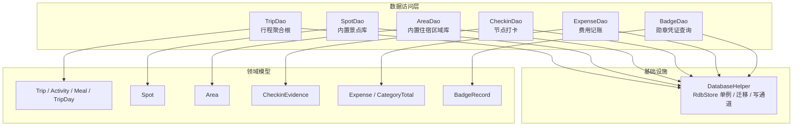
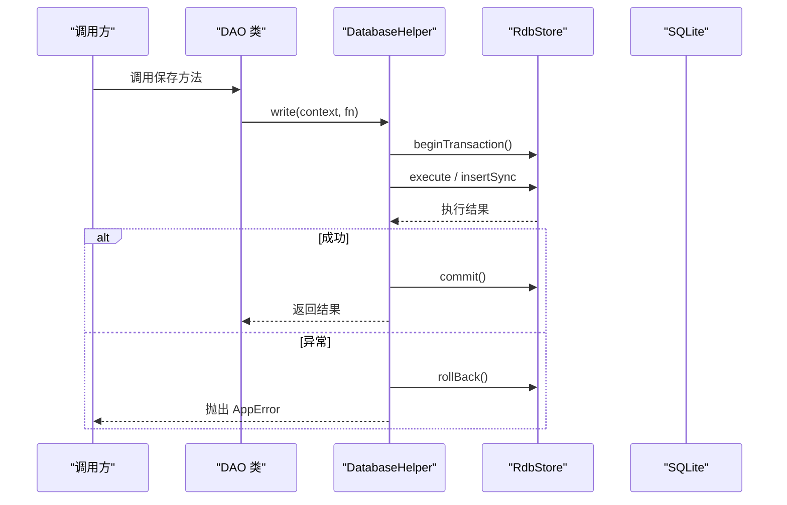
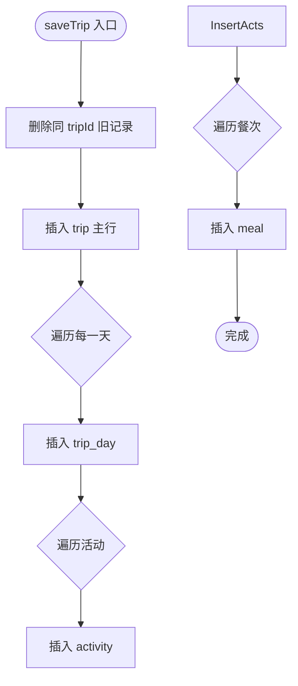
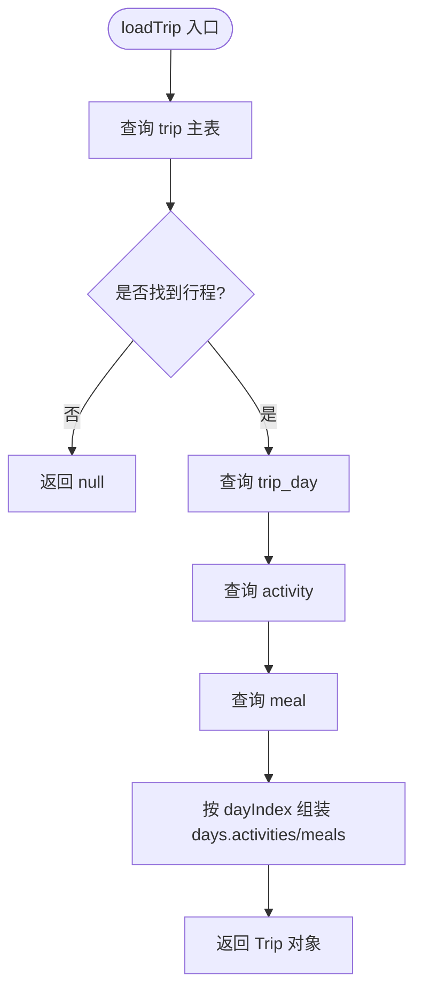
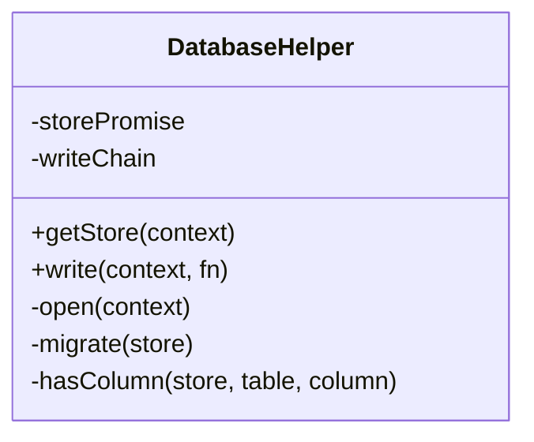
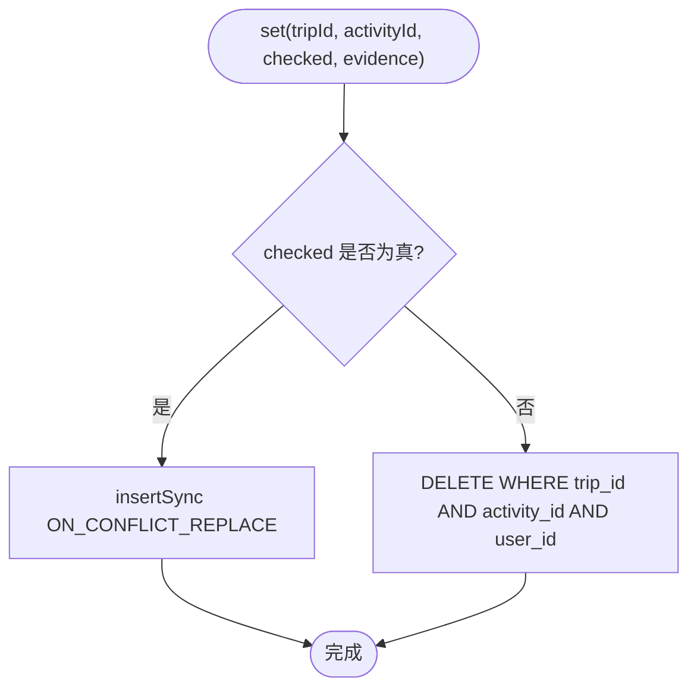
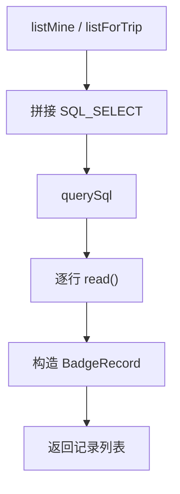
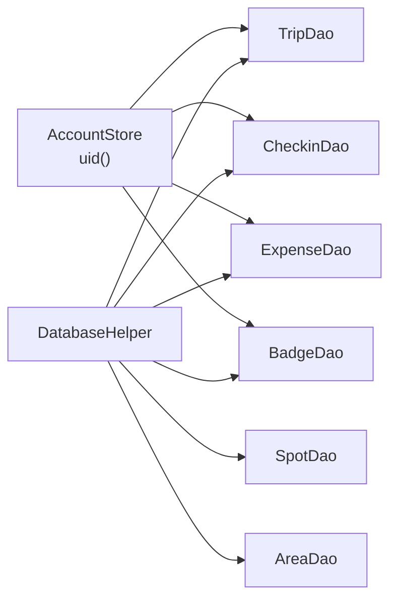

# DAO 模式：数据访问抽象

<cite>
**本文引用的文件**
- [TripDao.ets](file://entry/src/main/ets/data/TripDao.ets)
- [DatabaseHelper.ets](file://entry/src/main/ets/data/DatabaseHelper.ets)
- [AreaDao.ets](file://entry/src/main/ets/data/AreaDao.ets)
- [BadgeDao.ets](file://entry/src/main/ets/data/BadgeDao.ets)
- [SpotDao.ets](file://entry/src/main/ets/data/SpotDao.ets)
- [CheckinDao.ets](file://entry/src/main/ets/data/CheckinDao.ets)
- [ExpenseDao.ets](file://entry/src/main/ets/data/ExpenseDao.ets)
</cite>

## 目录
1. [引言](#引言)
2. [项目结构](#项目结构)
3. [核心组件](#核心组件)
4. [架构总览](#架构总览)
5. [详细组件分析](#详细组件分析)
6. [依赖关系分析](#依赖关系分析)
7. [性能考量](#性能考量)
8. [故障排查指南](#故障排查指南)
9. [结论](#结论)
10. [附录：CRUD 与复杂查询速查](#附录crud-与复杂查询速查)

## 引言
本文件围绕 DAO（Data Access Object）模式，系统化说明本项目中数据访问层的职责、边界与实现规范。重点包括：

- TripDao 作为“聚合根”的整存整取策略、事务封装和复杂查询优化。
- DatabaseHelper 提供的单写通道与读收口机制。
- DAO 层职责边界：只负责持久化，不包含业务编排。
- SpotDao、BadgeDao、AreaDao、CheckinDao、ExpenseDao 等不同实体的访问模式对比。
- 数据模型映射、SQL 构建、结果集解析的统一规范。
- 事务处理、错误恢复、性能优化的最佳实践。
- 如何通过 DAO 模式简化单元测试和数据迁移。
- 具体 CRUD 操作示例与复杂查询案例（以路径引用为主）。

## 项目结构
DAO 相关代码集中在 `entry/src/main/ets/data` 目录下，按实体或功能域拆分为多个 DAO 类；数据库生命周期与迁移由 `DatabaseHelper` 统一管理。

**图表来源**
- [DatabaseHelper.ets:1-295](file://entry/src/main/ets/data/DatabaseHelper.ets#L1-L295)
- [TripDao.ets:1-384](file://entry/src/main/ets/data/TripDao.ets#L1-L384)
- [SpotDao.ets:1-100](file://entry/src/main/ets/data/SpotDao.ets#L1-L100)
- [AreaDao.ets:1-75](file://entry/src/main/ets/data/AreaDao.ets#L1-L75)
- [CheckinDao.ets:1-70](file://entry/src/main/ets/data/CheckinDao.ets#L1-L70)
- [ExpenseDao.ets:1-111](file://entry/src/main/ets/data/ExpenseDao.ets#L1-L111)
- [BadgeDao.ets:1-70](file://entry/src/main/ets/data/BadgeDao.ets#L1-L70)

**章节来源**
- [DatabaseHelper.ets:1-295](file://entry/src/main/ets/data/DatabaseHelper.ets#L1-L295)

## 核心组件
DAO 层在本项目中承担以下职责：

| 组件 | 主要职责 | 读写方式 | 典型 SQL 特征 |
|---|---|---|---|
| TripDao | 行程聚合根的整存整取、列表摘要、详情装配 | 写走单写通道；读逐列映射 | 子查询统计 spot/booking/leg/checkin；多表多次读取再组装 |
| SpotDao | 内置景点库批量 upsert、按城市排序读取 | 写走单写通道；读直接 querySql | 按 city 过滤，按 popularity 排序 |
| AreaDao | 内置住宿区域库批量 upsert、按城市排序读取 | 写走单写通道；读直接 querySql | 按 city 过滤，按 grp、id 排序 |
| CheckinDao | 打卡/取消打卡、行程打卡索引 | 写走单写通道；读直接 querySql | 唯一键 (trip_id, activity_id)，ON_CONFLICT_REPLACE |
| ExpenseDao | 新增/删除记账、最近列表、分类汇总、按节点汇总 | 写走单写通道；读带私有 query 模板 | GROUP BY category/activity_id，LIMIT |
| BadgeDao | 从 checkin 联表产出勋章凭证 | 仅读，直接 querySql | JOIN activity/trip，按 checked_at 倒序 |

DAO 的职责边界非常明确：**不实现业务规则**，只负责把 SQL 结果映射为领域对象，并保证分区隔离、可测试性与可迁移性。

**章节来源**
- [TripDao.ets:1-384](file://entry/src/main/ets/data/TripDao.ets#L1-L384)
- [SpotDao.ets:1-100](file://entry/src/main/ets/data/SpotDao.ets#L1-L100)
- [AreaDao.ets:1-75](file://entry/src/main/ets/data/AreaDao.ets#L1-L75)
- [CheckinDao.ets:1-70](file://entry/src/main/ets/data/CheckinDao.ets#L1-L70)
- [ExpenseDao.ets:1-111](file://entry/src/main/ets/data/ExpenseDao.ets#L1-L111)
- [BadgeDao.ets:1-70](file://entry/src/main/ets/data/BadgeDao.ets#L1-L70)

## 架构总览
DAO 层通过 DatabaseHelper 统一接入 ArkData RDB，形成“写收敛、读解耦”的访问模式。

**图表来源**
- [DatabaseHelper.ets:158-196](file://entry/src/main/ets/data/DatabaseHelper.ets#L158-L196)
- [DatabaseHelper.ets:201-295](file://entry/src/main/ets/data/DatabaseHelper.ets#L201-L295)

该设计将“事务边界”“失败回滚”“版本迁移”集中到基础设施层，DAO 只需关注当前实体的写入语义和结果映射。

**章节来源**
- [DatabaseHelper.ets:158-196](file://entry/src/main/ets/data/DatabaseHelper.ets#L158-L196)
- [DatabaseHelper.ets:201-295](file://entry/src/main/ets/data/DatabaseHelper.ets#L201-L295)

## 详细组件分析

### TripDao：聚合根整存整取
TripDao 是本次文档的核心。它不只是单个表的增删改查，而是以 Trip 为聚合根，对 trip、trip_day、activity、meal 进行整体一致地写入与读取。

#### 整存整取写入策略
写入流程先清空同一 tripId 下的旧行，再顺序插入 trip、trip_day、activity、meal。这样保证“一次 saveTrip 要么全部成功，要么全部失败”，避免半更新状态。

**图表来源**
- [TripDao.ets:28-89](file://entry/src/main/ets/data/TripDao.ets#L28-L89)

#### 事务封装
所有写操作都通过 `DatabaseHelper.write` 进入串行写通道。写通道内部开启事务，任何异常都会回滚并包装为 `AppError`；链式队列保证并发写入不会导致 RDB busy。

#### 复杂查询优化
- 列表摘要使用一个 SQL 配合多个子查询统计 spot 数量、预约状态、通勤记录和打卡数，减少页面端循环统计。
- 详情加载采用“先主表、再子表、最后内存拼装”的方式，因为 SQLite 没有原生 JSON 数组嵌套反序列化，且 Trip 结构较深。

**图表来源**
- [TripDao.ets:91-179](file://entry/src/main/ets/data/TripDao.ets#L91-L179)

#### 数据模型映射规范
- 字符串字段使用 `getString`。
- 数值字段使用 `getLong`。
- JSON 文本列（如 highlights、tips、category_budget）通过辅助函数解析为空数组保护。
- 可选字段在空串或 null 时映射为 undefined，保持领域模型语义。

**章节来源**
- [TripDao.ets:1-384](file://entry/src/main/ets/data/TripDao.ets#L1-L384)
- [DatabaseHelper.ets:158-196](file://entry/src/main/ets/data/DatabaseHelper.ets#L158-L196)

### DatabaseHelper：写通道与读收口
DatabaseHelper 提供两个关键能力：

1. **单写通道**：`write` 方法维护 `writeChain` Promise 队列，串行执行写任务；每个任务包裹 `beginTransaction/commit/rollBack`。
2. **读收口**：通过 `getStore` 暴露 `RdbStore`，DAO 可直接执行 `querySql`，但读侧必须逐列解析，禁止把原始 ResultSet 泄漏给上层。

此外，它还管理数据库初始化、版本迁移和索引创建。

**图表来源**
- [DatabaseHelper.ets:1-295](file://entry/src/main/ets/data/DatabaseHelper.ets#L1-L295)

**章节来源**
- [DatabaseHelper.ets:1-295](file://entry/src/main/ets/data/DatabaseHelper.ets#L1-L295)

### SpotDao：内置景点库的批量 upsert
SpotDao 的典型模式是“批量写入 + 按城市读取”。写入时使用 `ON_CONFLICT_REPLACE` 实现幂等 upsert；读取时显式排序，避免依赖 SQLite 隐式行序。

关键点：
- JSON 字段 tags、nearby_ids 需要 try/catch 解析。
- 布尔型存储用 INTEGER 0/1，映射为领域布尔值。
- 可选字段空串映射为 undefined。

**章节来源**
- [SpotDao.ets:1-100](file://entry/src/main/ets/data/SpotDao.ets#L1-L100)

### AreaDao：内置住宿区域库
AreaDao 与 SpotDao 类似，但用于住宿区域数据。它强调：
- 批量 upsert。
- 按 city 过滤并按 grp、id 排序，确保候选切片可复现。
- JSON 字段 anchorStations、metroLines、commerceTags、suitableCrowds 统一解析。

**章节来源**
- [AreaDao.ets:1-75](file://entry/src/main/ets/data/AreaDao.ets#L1-L75)

### CheckinDao：打卡与取消打卡
CheckinDao 的写入语义更丰富：checked=true 时插入或覆盖一条打卡记录，checked=false 时删除对应记录。删除时必须带上 user_id，防止同机切换账号后误删他人数据。

**图表来源**
- [CheckinDao.ets:28-60](file://entry/src/main/ets/data/CheckinDao.ets#L28-L60)

**章节来源**
- [CheckinDao.ets:1-70](file://entry/src/main/ets/data/CheckinDao.ets#L1-L70)

### ExpenseDao：费用记账与聚合
ExpenseDao 展示了“简单 CRUD + 聚合查询”的模式：

- 新增：返回自增 id。
- 删除：按 id 与 user_id 删除。
- 列表：按 tripId 和 userId 过滤，按 created_at 倒序 LIMIT。
- 分类汇总：GROUP BY category。
- 按节点汇总：GROUP BY activity_id，并在 JS 层转换为 Map。

注意：`sumGroupedByActivity` 的 map 回调返回 string 数组，随后在 then 中转为 Record，这是为了适配 query 模板类型；实际实现中建议统一返回强类型对象。

**章节来源**
- [ExpenseDao.ets:1-111](file://entry/src/main/ets/data/ExpenseDao.ets#L1-L111)

### BadgeDao：只读关联查询
BadgeDao 不建新表，而是从 checkin 联表 activity 和 trip 提取“可作为勋章凭证的打卡证据”。其设计体现了 DAO 层只做数据访问的原则：合并逻辑交给 `utils/BadgeBoard`。

**图表来源**
- [BadgeDao.ets:17-69](file://entry/src/main/ets/data/BadgeDao.ets#L17-L69)

**章节来源**
- [BadgeDao.ets:1-70](file://entry/src/main/ets/data/BadgeDao.ets#L1-L70)

## 依赖关系分析
DAO 之间的耦合很弱，它们共同依赖 DatabaseHelper 和 AccountStore，并通过领域模型解耦。

**图表来源**
- [TripDao.ets:1-20](file://entry/src/main/ets/data/TripDao.ets#L1-L20)
- [CheckinDao.ets:1-20](file://entry/src/main/ets/data/CheckinDao.ets#L1-L20)
- [ExpenseDao.ets:1-20](file://entry/src/main/ets/data/ExpenseDao.ets#L1-L20)
- [BadgeDao.ets:1-20](file://entry/src/main/ets/data/BadgeDao.ets#L1-L20)
- [DatabaseHelper.ets:1-50](file://entry/src/main/ets/data/DatabaseHelper.ets#L1-L50)

潜在风险点：
- 所有写操作共享同一个 `writeChain`，如果某个写任务耗时过长，会阻塞后续写入。
- 大量 JSON 列适合小型聚合，但不适合做复杂条件检索；这类查询应放在应用层或导出后再处理。
- BadgeDao 使用字符串拼接主键进行 JOIN，属于轻量方案，不适合超大数据量场景。

**章节来源**
- [DatabaseHelper.ets:158-196](file://entry/src/main/ets/data/DatabaseHelper.ets#L158-L196)
- [BadgeDao.ets:17-35](file://entry/src/main/ets/data/BadgeDao.ets#L17-L35)

## 性能考量
DAO 层已体现多项性能优化实践：

1. **写串行化**：通过 `writeChain` 避免并发写导致 RDB busy。
2. **事务封装**：写通道内统一 begin/commit/rollBack，降低长事务概率。
3. **索引设计**：DatabaseHelper 在建库后统一创建常用过滤列索引，如 trip.user_id、spot.city、expense.trip_id、checkin.user_id。
4. **聚合下推**：ExpenseDao 的分类汇总、TripDao 的摘要统计尽量在 SQL 层完成，减少 UI 层循环。
5. **JSON 列限制**：单条记录 ≤2MB，避免大 JSON 拖慢事务。
6. **分页与 LIMIT**：列表查询使用 LIMIT，例如 ExpenseDao 最近列表。
7. **显式排序**：AreaDao、SpotDao 明确 ORDER BY，保证结果可复现。

建议进一步优化：
- 对高频复杂查询考虑物化视图或缓存层。
- 对超大行程可拆分 loadTrip 为“主信息 + 按需加载子表”。
- 对 BadgeDao 的大规模联表查询增加合适索引。
- 统一 ExpenseDao 的 query 模板返回值类型，避免 string[] 中转。

[本节为通用性能指导，不直接分析特定代码片段]

## 故障排查指南
DAO 层的错误主要通过 `AppError` 向上抛出，常见错误码包括：

| 错误场景 | 处理方式 | 排查建议 |
|---|---|---|
| RDB 初始化失败 | 抛出 `RDB_INIT_FAILED` | 检查上下文、权限、存储路径 |
| 写事务失败 | 自动 rollBack 并抛 `RDB_TRANSACTION_FAILED` | 查看日志中的 tripId、activityId、SQL 参数 |
| 迁移失败 | 整个迁移回滚并抛 `RDB_MIGRATION_FAILED` | 检查 oldVersion 到 newVersion 的迁移 SQL 幂等性 |
| 结果集为空 | 返回 null 或空集合 | 确认 user_id 分区是否正确 |
| JSON 解析异常 | 返回空数组或默认值 | 检查历史数据是否损坏 |

关键排查入口：

- 写事务异常：见 `DatabaseHelper.write` 的 catch 分支。
- 迁移异常：见 `DatabaseHelper.migrate` 的 catch 分支。
- 打卡日志：CheckinDao 输出打卡/取消打卡及凭证信息。
- 行程保存日志：TripDao 输出 tripId 与 days 数量。

**章节来源**
- [DatabaseHelper.ets:158-196](file://entry/src/main/ets/data/DatabaseHelper.ets#L158-L196)
- [DatabaseHelper.ets:201-295](file://entry/src/main/ets/data/DatabaseHelper.ets#L201-L295)
- [CheckinDao.ets:52-60](file://entry/src/main/ets/data/CheckinDao.ets#L52-L60)
- [TripDao.ets:78-89](file://entry/src/main/ets/data/TripDao.ets#L78-L89)

## 结论
本项目 DAO 层以 DatabaseHelper 为基础，形成清晰的职责边界：基础设施负责连接、事务和迁移；DAO 负责单一实体的持久化语义和结果映射。TripDao 作为聚合根，体现“整存整取”的一致性策略；其他 DAO 则根据实体复杂度选择批量 upsert、简单 CRUD 或只读关联查询。

这种设计带来三个主要收益：

1. **一致性**：写事务收敛，避免部分更新。
2. **可测试性**：DAO 只依赖 store 接口和 AccountStore，便于替换为内存或测试数据库。
3. **可迁移性**：版本号驱动迁移，支持跨级升级与幂等加列。

未来若引入离线同步或分布式数据源，可在 DAO 层之上增加适配器，而不破坏现有数据访问契约。

[本节为总结性内容，不直接分析特定代码片段]

## 附录：CRUD 与复杂查询速查

### TripDao 示例
- 整存整取保存：参考路径 `[TripDao.ets:28-89](file://entry/src/main/ets/data/TripDao.ets#L28-L89)`
- 列表摘要查询：参考路径 `[TripDao.ets:91-113](file://entry/src/main/ets/data/TripDao.ets#L91-L113)`
- 详情加载与组装：参考路径 `[TripDao.ets:115-179](file://entry/src/main/ets/data/TripDao.ets#L115-L179)`

### SpotDao 示例
- 批量 upsert：参考路径 `[SpotDao.ets:18-43](file://entry/src/main/ets/data/SpotDao.ets#L18-L43)`
- 按城市读取：参考路径 `[SpotDao.ets:45-98](file://entry/src/main/ets/data/SpotDao.ets#L45-L98)`

### AreaDao 示例
- 批量 upsert：参考路径 `[AreaDao.ets:18-35](file://entry/src/main/ets/data/AreaDao.ets#L18-L35)`
- 按城市读取：参考路径 `[AreaDao.ets:37-73](file://entry/src/main/ets/data/AreaDao.ets#L37-L73)`

### CheckinDao 示例
- 打卡/取消打卡：参考路径 `[CheckinDao.ets:28-60](file://entry/src/main/ets/data/CheckinDao.ets#L28-L60)`
- 行程打卡索引：参考路径 `[CheckinDao.ets:62-69](file://entry/src/main/ets/data/CheckinDao.ets#L62-L69)`

### ExpenseDao 示例
- 新增记账：参考路径 `[ExpenseDao.ets:18-31](file://entry/src/main/ets/data/ExpenseDao.ets#L18-L31)`
- 删除记账：参考路径 `[ExpenseDao.ets:33-40](file://entry/src/main/ets/data/ExpenseDao.ets#L33-L40)`
- 最近列表：参考路径 `[ExpenseDao.ets:42-63](file://entry/src/main/ets/data/ExpenseDao.ets#L42-L63)`
- 分类汇总：参考路径 `[ExpenseDao.ets:65-78](file://entry/src/main/ets/data/ExpenseDao.ets#L65-L78)`
- 按节点汇总：参考路径 `[ExpenseDao.ets:80-100](file://entry/src/main/ets/data/ExpenseDao.ets#L80-L100)`

### BadgeDao 示例
- 查询全部凭证：参考路径 `[BadgeDao.ets:24-30](file://entry/src/main/ets/data/BadgeDao.ets#L24-L30)`
- 查询单行程凭证：参考路径 `[BadgeDao.ets:32-36](file://entry/src/main/ets/data/BadgeDao.ets#L32-L36)`
- 结果解析：参考路径 `[BadgeDao.ets:52-69](file://entry/src/main/ets/data/BadgeDao.ets#L52-L69)`

### 数据迁移速查
- 建库语句与索引：参考路径 `[DatabaseHelper.ets:52-157](file://entry/src/main/ets/data/DatabaseHelper.ets#L52-L157)`
- 迁移逻辑：参考路径 `[DatabaseHelper.ets:222-295](file://entry/src/main/ets/data/DatabaseHelper.ets#L222-L295)`