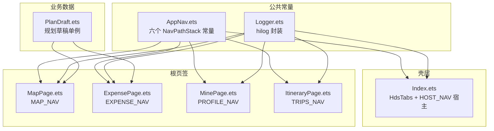
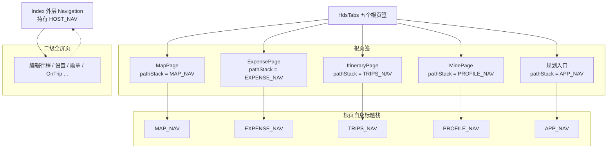
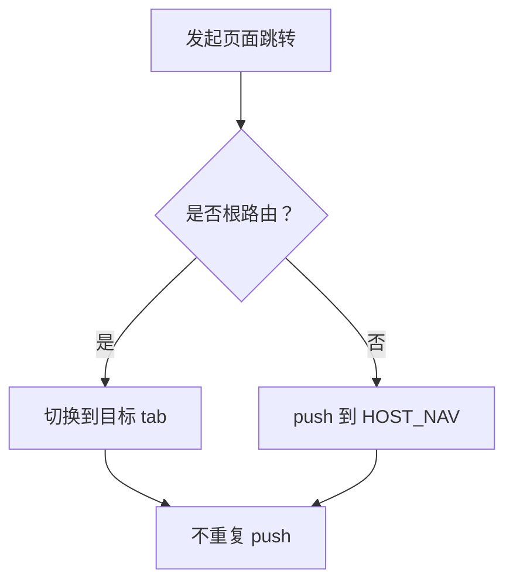
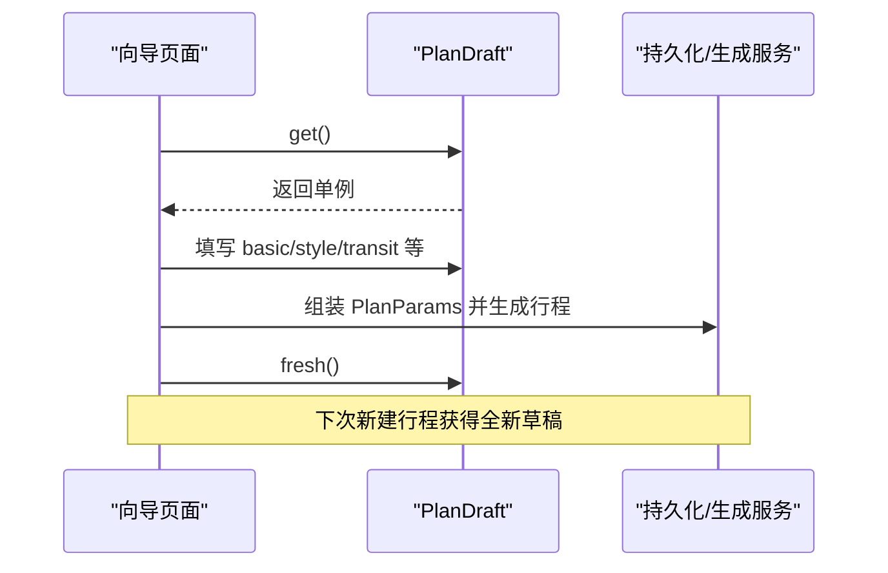
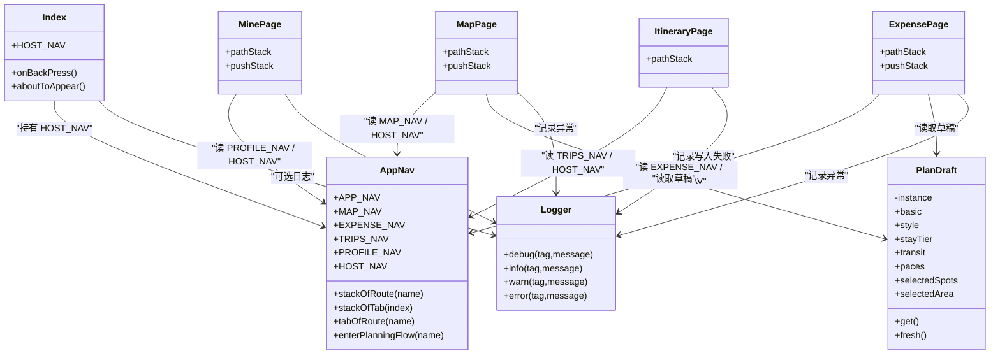

# 单例模式：全局状态管理

<cite>
**本文引用的文件**   
- [AppNav.ets](file://entry/src/main/ets/common/constants/AppNav.ets)
- [Logger.ets](file://entry/src/main/ets/common/logger/Logger.ets)
- [PlanDraft.ets](file://entry/src/main/ets/data/PlanDraft.ets)
- [Index.ets](file://entry/src/main/ets/pages/Index.ets)
- [MapPage.ets](file://entry/src/main/ets/pages/MapPage.ets)
- [ExpensePage.ets](file://entry/src/main/ets/pages/ExpensePage.ets)
- [MinePage.ets](file://entry/src/main/ets/pages/MinePage.ets)
- [ItineraryPage.ets](file://entry/src/main/ets/pages/ItineraryPage.ets)
</cite>

## 目录
1. [引言](#引言)
2. [项目结构](#项目结构)
3. [核心组件](#核心组件)
4. [架构总览](#架构总览)
5. [详细组件分析](#详细组件分析)
6. [依赖关系分析](#依赖关系分析)
7. [性能与并发特性](#性能与并发特性)
8. [生命周期、初始化与销毁](#生命周期初始化与销毁)
9. [最佳实践与常见陷阱](#最佳实践与常见陷阱)
10. [与依赖注入的权衡](#与依赖注入的权衡)
11. [故障排查指南](#故障排查指南)
12. [结论](#结论)

## 引言
本文面向 ArkTS / HarmonyOS 应用中的“单例模式”使用，围绕仓库中三类关键全局状态展开：

- **导航栈单例**：`APP_NAV`、`MAP_NAV`、`EXPENSE_NAV`、`TRIPS_NAV`、`PROFILE_NAV`、`HOST_NAV`。
- **日志器单例**：`Logger` 类提供的统一日志出口。
- **草稿数据单例**：`PlanDraft` 跨页共享的规划草稿实例。

这些单例共同承担“跨页面可见的全局 UI 路由状态”“可过滤的应用级日志”“多步向导的中间态”。本文不泛谈设计模式理论，而是基于仓库实际代码解释它们为什么这样实现、如何被消费、生命周期怎么管、以及测试和重构时需要注意什么。

## 项目结构
与单例相关的核心位置如下：

**图表来源**
- [AppNav.ets:1-110](file://entry/src/main/ets/common/constants/AppNav.ets#L1-L110)
- [Logger.ets:1-35](file://entry/src/main/ets/common/logger/Logger.ets#L1-L35)
- [PlanDraft.ets:1-77](file://entry/src/main/ets/data/PlanDraft.ets#L1-L77)
- [Index.ets:1-120](file://entry/src/main/ets/pages/Index.ets#L1-L120)
- [MapPage.ets:1-120](file://entry/src/main/ets/pages/MapPage.ets#L1-L120)
- [ExpensePage.ets:1-120](file://entry/src/main/ets/pages/ExpensePage.ets#L1-L120)
- [MinePage.ets:1-120](file://entry/src/main/ets/pages/MinePage.ets#L1-L120)
- [ItineraryPage.ets:1-120](file://entry/src/main/ets/pages/ItineraryPage.ets#L1-L120)

**章节来源**
- [AppNav.ets:1-110](file://entry/src/main/ets/common/constants/AppNav.ets#L1-L110)
- [Logger.ets:1-35](file://entry/src/main/ets/common/logger/Logger.ets#L1-L35)
- [PlanDraft.ets:1-77](file://entry/src/main/ets/data/PlanDraft.ets#L1-L77)

## 核心组件
### 导航栈单例族
`AppNav.ets` 暴露六个模块级常量，每个都是 `NavPathStack` 实例：

| 常量 | 用途 | 绑定方 |
|---|---|---|
| `APP_NAV` | “规划”格自身的导航栈 | 规划入口相关页面 |
| `MAP_NAV` | “地图”格的导航栈 | `MapPage` |
| `EXPENSE_NAV` | “费用”格的导航栈 | `ExpensePage` |
| `TRIPS_NAV` | “行程”历史/最近列表的导航栈 | `ItineraryPage` 等 |
| `PROFILE_NAV` | “我的”格的导航栈 | `MinePage` |
| `HOST_NAV` | 外层宿主栈，承载所有二级全屏页 | `Index` 最外层 `Navigation` |

关键规则：

- 一个 `NavPathStack` 只能被一个 `Navigation` 持有；把 `HOST_NAV` 同时绑到某个根页会抢走宿主的绑定，导致二级页渲染不出来。
- 五个根页各自内嵌自己的 `pathStack`（例如 `MAP_NAV`、`EXPENSE_NAV`、`PROFILE_NAV`），只用于根页标题栏；真正的子页面 push/pop 全部走 `HOST_NAV`。
- `stackOfRoute` 当前把所有非根路由统一返回 `HOST_NAV`；`isTabRoot` 判断 Map、Expense、Trips、Mine 是根路由，不再重复 push。
- `stackOfTab` 根据 dock 页签下标返回对应根栈；`tabOfRoute` 决定深链应切到哪个 tab。

**章节来源**
- [AppNav.ets:1-110](file://entry/src/main/ets/common/constants/AppNav.ets#L1-L110)
- [AppNav.ets:150-221](file://entry/src/main/ets/common/constants/AppNav.ets#L150-L221)

### 日志器单例
`Logger` 是一个静态方法类，封装 hilog：

- `debug` 受 `BuildConfig.IS_DEBUG` 门控。
- `info`、`warn`、`error` 始终输出。
- 所有日志通过固定域和 `YouJing.` 前缀组织，便于设备端按 tag 过滤。
- 没有内部可变状态，因此不存在传统意义上的“实例销毁”问题。

**章节来源**
- [Logger.ets:1-35](file://entry/src/main/ets/common/logger/Logger.ets#L1-L35)

### 草稿状态单例
`PlanDraft` 是跨向导屏共享的规划草稿：

- 私有静态字段 `instance` 控制单例创建。
- `get()` 懒加载并返回实例。
- 构造后对 `basic.startDate`、`endDate` 做反向区间修复。
- `fresh()` 将 `instance` 置空，从而在下次 `get()` 重建新草稿。
- 公开字段包含目的地、日期、人数、预算、风格、住宿档位、交通偏好、节奏、景点、区域等。

**章节来源**
- [PlanDraft.ets:1-77](file://entry/src/main/ets/data/PlanDraft.ets#L1-L77)

## 架构总览
导航栈与宿主栈的关系可以用下面的架构图表示：

**图表来源**
- [Index.ets:1-120](file://entry/src/main/ets/pages/Index.ets#L1-L120)
- [MapPage.ets:1-120](file://entry/src/main/ets/pages/MapPage.ets#L1-L120)
- [ExpensePage.ets:1-120](file://entry/src/main/ets/pages/ExpensePage.ets#L1-L120)
- [MinePage.ets:1-120](file://entry/src/main/ets/pages/MinePage.ets#L1-L120)
- [ItineraryPage.ets:1-120](file://entry/src/main/ets/pages/ItineraryPage.ets#L1-L120)
- [AppNav.ets:1-110](file://entry/src/main/ets/common/constants/AppNav.ets#L1-L110)

## 详细组件分析

### 导航栈单例：设计目的与使用规范

#### 为什么需要六个栈
- 每个 dock 根页签都有自己的导航历史。
- “规划”“地图”“行程”“费用”“我的”五个根页互不干扰。
- 二级页需要一条跨根页签共享的全屏栈，避免从不同 tab 进入同一个二级页时出现“push 到不可见栈”的问题。

#### 六个常量的语义
- `APP_NAV`：规划流程的根栈。
- `MAP_NAV`：地图根栈。
- `EXPENSE_NAV`：费用根栈。
- `TRIPS_NAV`：行程历史/最近列表根栈。
- `PROFILE_NAV`：新的“我的”根栈。
- `HOST_NAV`：唯一由 `Index` 外层 `Navigation` 持有的宿主栈。

#### 正确用法
- 根页初始化时声明 `private pathStack = <对应根栈>`，仅用于根页标题栏。
- 需要跳转二级页时使用 `this.pushStack = HOST_NAV; this.pushStack.pushPath(...)`。
- 通过 `AppNav.enterPlanningFlow` 启动规划流程：先切到“规划” tab，再把首屏 push 到 `HOST_NAV`。
- 深链或外部拉起时，`stackOfRoute` 返回 `HOST_NAV`，`tabOfRoute` 决定目标 tab。

#### 错误用法
- 把 `HOST_NAV` 绑定到某个根页的 `HdsNavigation`。
- 把二级页 push 到某个根栈而不是 `HOST_NAV`。
- 让多个 `Navigation` 持有同一个 `NavPathStack`。
- 对根路由重复 push，造成同层级叠页。

**图表来源**
- [AppNav.ets:150-221](file://entry/src/main/ets/common/constants/AppNav.ets#L150-L221)
- [Index.ets:201-260](file://entry/src/main/ets/pages/Index.ets#L201-L260)

**章节来源**
- [AppNav.ets:1-110](file://entry/src/main/ets/common/constants/AppNav.ets#L1-L110)
- [AppNav.ets:150-221](file://entry/src/main/ets/common/constants/AppNav.ets#L150-L221)
- [MapPage.ets:1-120](file://entry/src/main/ets/pages/MapPage.ets#L1-L120)
- [ExpensePage.ets:1-120](file://entry/src/main/ets/pages/ExpensePage.ets#L1-L120)
- [MinePage.ets:1-120](file://entry/src/main/ets/pages/MinePage.ets#L1-L120)
- [ItineraryPage.ets:1-120](file://entry/src/main/ets/pages/ItineraryPage.ets#L1-L120)

### 日志器 Logger：线程安全与性能

#### 实现特征
- 无实例字段，只有静态方法和静态常量。
- `debug` 在发布配置下直接返回，避免运行时字符串拼接和 hilog 调用。
- `info`、`warn`、`error` 直接委托 hilog。
- 所有日志带统一 domain 和 `YouJing.` tag 前缀。

#### 线程安全
- 没有共享可变状态，因此天然线程安全。
- 并发调用不会互相覆盖状态，也不会产生竞态条件。

#### 性能考虑
- `debug` 分支短路可减少发布版开销。
- 真正成本主要来自 hilog 调用和字符串格式化；应避免在热路径上频繁打大量 debug 日志。
- 推荐用模块名作为 tag，例如 `'Ui.MapPage'`、`'Data.TripDao'`，便于定位。

**章节来源**
- [Logger.ets:1-35](file://entry/src/main/ets/common/logger/Logger.ets#L1-L35)

### PlanDraft：草稿状态单例与一致性

#### 数据结构
`PlanDraft` 维护一个跨页共享的对象，包括：

- `basic`：目的地、出发日、结束日、人数、预算。
- `style`：旅行风格。
- `stayTier`：住宿档位。
- `transit`：交通偏好。
- `paces`：节奏选项。
- `selectedSpots`：已选景点。
- `selectedArea`：已选区域。

#### 一致性保证
- `get()` 懒加载，首次访问才创建实例。
- 每次取回实例都会执行 `repairInvertedRange`，防止用户只填出发日或只填返程日时留下无效日期区间。
- `days` 方法通过 `TripLength.days` 提供统一的行程天数口径，避免页面侧各自计算不一致。
- `fresh()` 清空静态 `instance`，使下一次 `get()` 拿到干净草稿。

#### 典型流程

**图表来源**
- [PlanDraft.ets:1-77](file://entry/src/main/ets/data/PlanDraft.ets#L1-L77)

**章节来源**
- [PlanDraft.ets:1-77](file://entry/src/main/ets/data/PlanDraft.ets#L1-L77)

## 依赖关系分析

**图表来源**
- [AppNav.ets:1-221](file://entry/src/main/ets/common/constants/AppNav.ets#L1-L221)
- [Index.ets:1-260](file://entry/src/main/ets/pages/Index.ets#L1-L260)
- [MapPage.ets:1-120](file://entry/src/main/ets/pages/MapPage.ets#L1-L120)
- [ExpensePage.ets:1-200](file://entry/src/main/ets/pages/ExpensePage.ets#L1-L200)
- [MinePage.ets:1-120](file://entry/src/main/ets/pages/MinePage.ets#L1-L120)
- [ItineraryPage.ets:1-120](file://entry/src/main/ets/pages/ItineraryPage.ets#L1-L120)
- [Logger.ets:1-35](file://entry/src/main/ets/common/logger/Logger.ets#L1-L35)
- [PlanDraft.ets:1-77](file://entry/src/main/ets/data/PlanDraft.ets#L1-L77)

## 性能与并发特性

### 导航栈
- `NavPathStack` 是框架级对象，本身不是纯函数式状态，不能当作普通变量比较相等性。
- 主要性能风险不在单例创建，而在频繁 push/pop 引起的 UI 重绘和转场。
- 二级页集中在 `HOST_NAV`，避免同一二级页在不同 tab 下重复入栈。

### Logger
- 发布模式下 `debug` 短路，减少不必要开销。
- 建议在高频回调中谨慎打日志，尤其避免字符串拼接热点。
- 推荐使用模块 tag，配合系统日志工具过滤。

### PlanDraft
- 单例创建一次即可，后续只是字段读写。
- `repairInvertedRange` 每次取回都运行，但只做简单日期比较和浅拷贝，开销很低。
- 真正的大对象是 `selectedSpots`、`selectedArea` 等集合，应在用户明确开始新行程时调用 `fresh()`，避免旧数据污染。

[本节为通用性能讨论，不直接分析具体行号]

## 生命周期、初始化与销毁

### 导航栈单例
- **创建时机**：模块加载时立即创建六个 `NavPathStack`。
- **持有者**：
  - `HOST_NAV` 由 `Index` 外层 `Navigation` 持有。
  - 其他栈由各根页的 `pathStack` 引用，并由各自的 `HdsNavigation` 绑定。
- **销毁策略**：ArkTS 应用进程结束时回收；正常切换 tab 不会销毁栈。
- **注意事项**：
  - 不要手动释放 `NavPathStack`。
  - 不要在根页销毁时再 pop 子页；交给系统导航和返回逻辑处理。
  - `Index.onBackPress` 负责优先处理宿主栈中的二级页，再处理根页弹层，最后退回地图 tab。

**章节来源**
- [AppNav.ets:1-110](file://entry/src/main/ets/common/constants/AppNav.ets#L1-L110)
- [Index.ets:201-260](file://entry/src/main/ets/pages/Index.ets#L201-L260)

### Logger
- **创建时机**：类定义时即存在。
- **销毁策略**：无需销毁。
- **线程模型**：无状态，任意线程调用不会产生状态竞争。

**章节来源**
- [Logger.ets:1-35](file://entry/src/main/ets/common/logger/Logger.ets#L1-L35)

### PlanDraft
- **创建时机**：第一次调用 `PlanDraft.get()`。
- **重置时机**：用户完成生成或回到首页新建行程时调用 `PlanDraft.fresh()`。
- **销毁策略**：不显式销毁；通过置空 `instance` 让下次重建。
- **一致性要点**：
  - 写草稿的一方应负责在合适时机调用 `fresh()`。
  - 读草稿的地方应通过 `get()` 获取，而不是自己 new。

**章节来源**
- [PlanDraft.ets:1-77](file://entry/src/main/ets/data/PlanDraft.ets#L1-L77)

## 最佳实践与常见陷阱

### 正确使用示例（概念描述）
- **导航栈**：
  - 根页声明 `pathStack = MAP_NAV`，二级页通过 `HOST_NAV.pushPath` 跳转。
  - 启动规划流程使用 `AppNav.enterPlanningFlow('YourStartPage')`。
- **日志**：
  - 使用 `Logger.info('Ui.MapPage', '地图页已加载')`。
  - 发布版禁用 debug 日志，但仍保留 info/warn/error。
- **草稿**：
  - 向导页统一 `const draft = PlanDraft.get()`。
  - 新建行程前调用 `PlanDraft.fresh()`。
  - 日期未选择时保持空串，由 `days` 方法按默认档计算显示。

### 错误使用示例（概念描述）
- **导航栈**：
  - 在根页里写 `new NavPathStack()` 然后 push 二级页，结果页面出现在不可见 tab。
  - 把 `HOST_NAV` 传给根页 `HdsNavigation`，导致宿主栈被抢走。
  - 对根路由重复 push，造成同级页叠压。
- **日志**：
  - 直接使用 `console.log`，绕过统一 tag 和发布门控。
  - 在极热路径打印大量 debug 信息。
- **草稿**：
  - 每次访问都 `new PlanDraft()`，导致向导页之间无法共享状态。
  - 忘记调用 `fresh()`，导致第二次规划携带上次选中景点。
  - 在页面 build 中频繁构造大对象，而不是复用单例字段。

### 内存泄漏防护
- 不要给单例持有 UI 组件引用、Context、Scroller、Animation 等强引用。
- 不要在单例中注册页面级回调而不注销。
- 如果单例要缓存数据，应限制大小或使用可清理接口。

### 多进程场景
- ArkTS 单例通常只在当前进程有效。
- 若存在独立进程，不应假设进程间共享同一个 `PlanDraft` 或 `NavPathStack`。
- 跨进程共享应通过 `AppStorage`、数据库、文件或 IPC 契约，而不是依赖模块级单例。

### 单元测试 Mock
- **Logger**：可直接替换静态方法或在测试中捕获 hilog 输出；因其无状态，Mock 成本低。
- **PlanDraft**：
  - 测试前调用 `PlanDraft.fresh()` 清理静态实例。
  - 使用独立的测试用例验证 `repairInvertedRange`、`days`、`fresh()`。
  - 避免多个测试共用同一份脏草稿。
- **导航栈**：
  - 不建议 Mock `NavPathStack` 内部行为，因为它是框架对象。
  - 更合适的是断言调用了 `enterPlanningFlow`、`stackOfRoute`、`stackOfTab`、`tabOfRoute`。
  - 对复杂跳转流程可用集成测试验证最终页面栈。

**章节来源**
- [PlanDraft.ets:1-77](file://entry/src/main/ets/data/PlanDraft.ets#L1-L77)
- [Logger.ets:1-35](file://entry/src/main/ets/common/logger/Logger.ets#L1-L35)
- [AppNav.ets:150-221](file://entry/src/main/ets/common/constants/AppNav.ets#L150-L221)

## 与依赖注入的权衡

### 当前方案的优势
- 实现简单：模块级常量或静态单例不需要容器。
- 性能直观：单例只创建一次，读取成本低。
- 适合 ArkUI 场景：很多状态本身就是框架级对象，不适合通过构造函数传递。

### 当前方案的劣势
- 全局隐式依赖：任何模块都能直接 import 并使用。
- 难以替换：测试时需要操作静态字段或模块状态。
- 生命周期边界模糊：单例的生命周期和应用进程绑定，不像 DI 容器可以分层作用域。

### 何时考虑依赖注入
- 需要明显隔离测试环境。
- 需要按功能域或会话作用域创建实例。
- 需要延迟初始化、降级实现或 A/B 开关。
- 团队希望显式表达依赖关系。

### 本仓库的现实取舍
- 导航栈本质是框架级路由状态，不适合拆成可注入的服务接口。
- Logger 是横切关注点，当前静态封装足够简单。
- PlanDraft 是短期向导草稿，更适合轻量单例，而不是完整 DI scope。
- 如果未来草稿需要跨会话、跨账号、跨进程同步，才值得引入更明确的存储抽象和注入机制。

[本节为概念性权衡分析，不直接分析具体行号]

## 故障排查指南

### 现象：二级页点击无反应或渲染空白
- 可能原因：二级页 push 到了错误的根栈，而不是 `HOST_NAV`。
- 检查点：
  - 是否使用了 `APP_NAV`、`MAP_NAV` 等根栈来 push 二级页。
  - 是否误把 `HOST_NAV` 绑到了根页 `HdsNavigation`。
  - 是否对根路由重复 push。

**章节来源**
- [AppNav.ets:1-110](file://entry/src/main/ets/common/constants/AppNav.ets#L1-L110)
- [MapPage.ets:1-120](file://entry/src/main/ets/pages/MapPage.ets#L1-L120)
- [ExpensePage.ets:1-120](file://entry/src/main/ets/pages/ExpensePage.ets#L1-L120)
- [MinePage.ets:1-120](file://entry/src/main/ets/pages/MinePage.ets#L1-L120)

### 现象：从某个 tab 打开的二级页 push 后看不到
- 可能原因：push 到了不可见的 tab 根栈。
- 解决方式：统一改为 push 到 `HOST_NAV`，并通过 `stackOfRoute`、`tabOfRoute` 处理深链落点。

**章节来源**
- [AppNav.ets:150-221](file://entry/src/main/ets/common/constants/AppNav.ets#L150-L221)

### 现象：第二次规划带着上次的景点
- 可能原因：忘记调用 `PlanDraft.fresh()`。
- 解决方式：在新建规划入口处调用 `PlanDraft.fresh()`，确保重新 `get()` 得到干净实例。

**章节来源**
- [PlanDraft.ets:60-77](file://entry/src/main/ets/data/PlanDraft.ets#L60-L77)

### 现象：日志找不到或过多
- 可能原因：
  - 使用了 `console.log`。
  - 在发布版期望看到 debug 日志。
  - tag 命名混乱。
- 解决方式：
  - 统一使用 `Logger`。
  - 发布版关闭 debug。
  - 按模块命名 tag，如 `Ui.Expense`、`Ui.MapPage`。

**章节来源**
- [Logger.ets:1-35](file://entry/src/main/ets/common/logger/Logger.ets#L1-L35)

## 结论
这个仓库的单例模式使用有三个清晰层次：

1. **导航栈单例**：以六个模块级常量表达 UI 路由职责，其中 `HOST_NAV` 是唯一宿主栈，其余五个栈对应五个 dock 根页签。
2. **日志器单例**：无状态静态类，统一 tag、域和发布门控，适合全工程共享。
3. **草稿数据单例**：`PlanDraft` 通过懒加载和 `fresh()` 管理跨向导页面的临时状态。

它们共同的特点是：简单、易理解、与 ArkUI 导航体系紧密耦合。代价是全局隐式依赖和测试可替换性有限。对于这类短生命周期、框架级状态，当前方案是合理的；但如果未来需要更强的作用域、可插拔实现或多进程语义，则应逐步引入更明确的存储抽象和依赖注入机制。