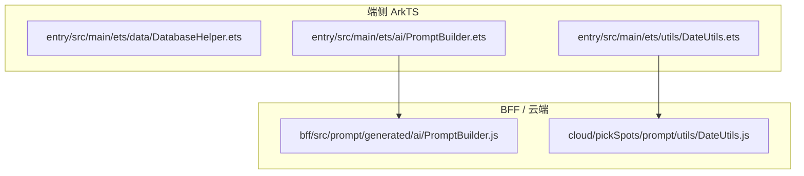
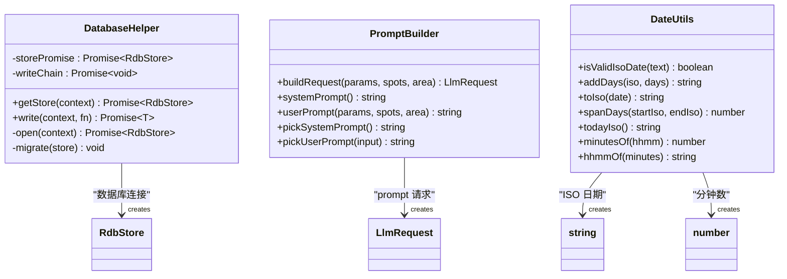
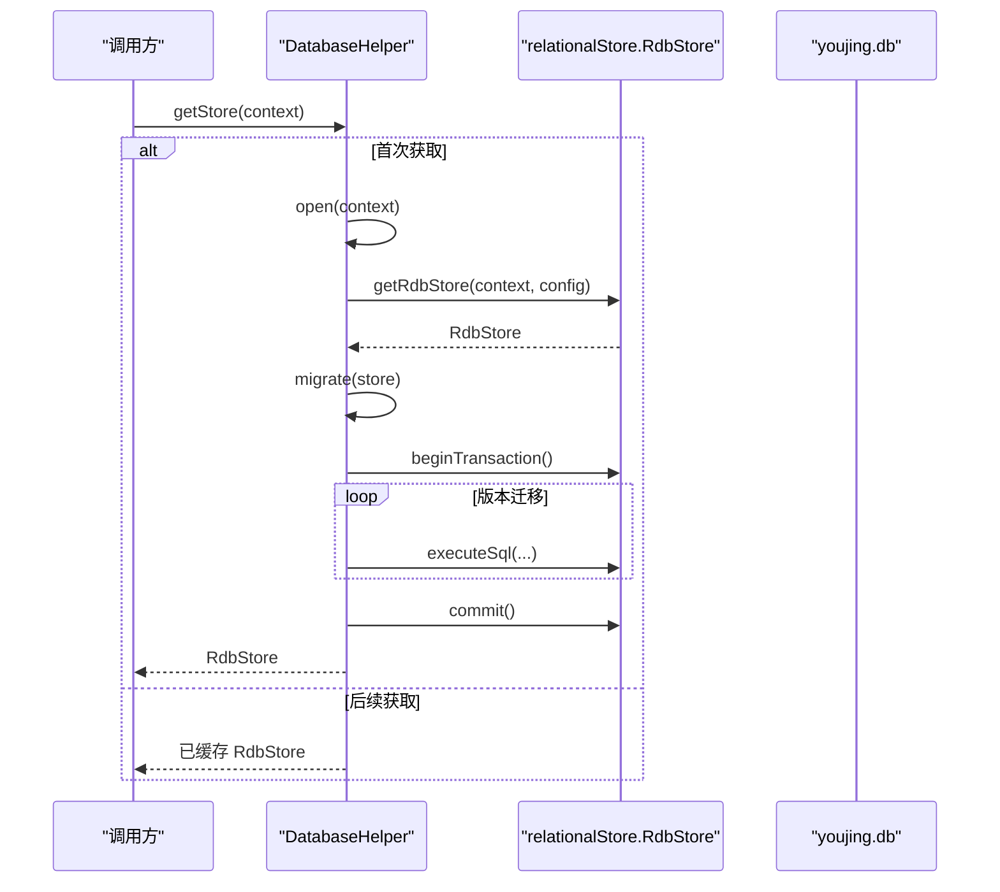
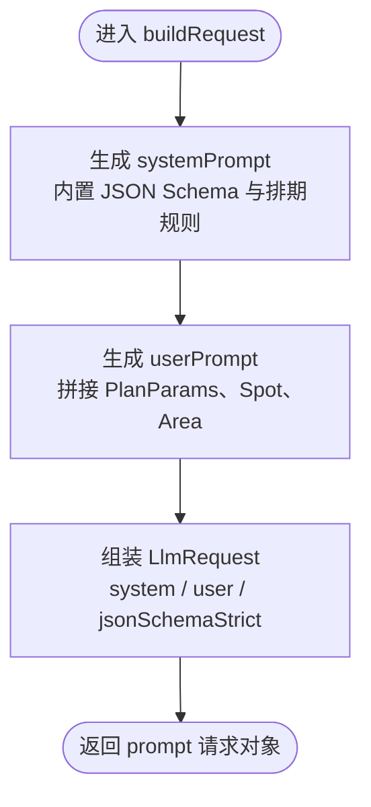
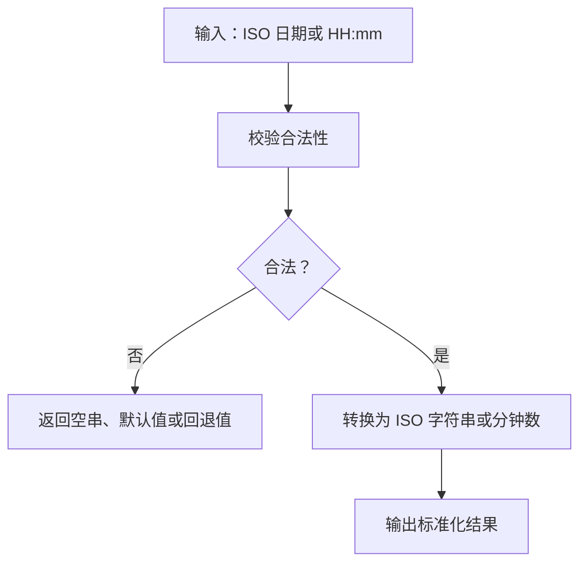
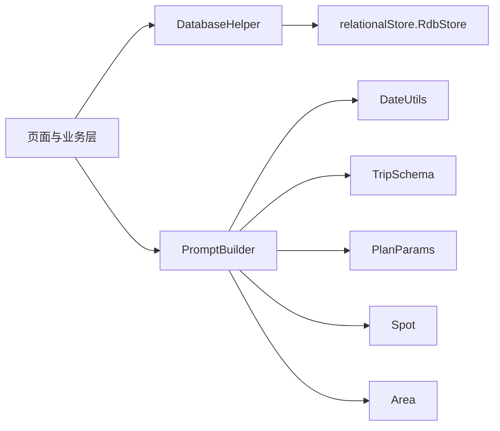

# 工厂模式：对象创建抽象

<cite>
**本文引用的文件**   
- [DatabaseHelper.ets](file://entry/src/main/ets/data/DatabaseHelper.ets)
- [PromptBuilder.ets](file://entry/src/main/ets/ai/PromptBuilder.ets)
- [DateUtils.ets](file://entry/src/main/ets/utils/DateUtils.ets)
- [PromptBuilder.js](file://bff/src/prompt/generated/ai/PromptBuilder.js)
- [DateUtils.js](file://cloud/pickSpots/prompt/utils/DateUtils.js)
</cite>

## 目录
1. [引言](#引言)
2. [项目结构中的工厂相关位置](#项目结构中的工厂相关位置)
3. [核心组件分析](#核心组件分析)
4. [架构总览](#架构总览)
5. [详细组件分析](#详细组件分析)
6. [依赖关系分析](#依赖关系分析)
7. [性能与内存管理](#性能与内存管理)
8. [故障排查指南](#故障排查指南)
9. [结论](#结论)
10. [附录：工厂方法扩展示例](#附录工厂方法扩展示例)

## 引言
本文面向“对象创建抽象”这一主题，围绕仓库中三类典型实现展开：
- `DatabaseHelper` 提供 `relationalStore.RdbStore` 的数据库连接工厂。
- `PromptBuilder` 提供 prompt 模板构建工厂。
- `DateUtils` 虽不是传统工厂，但体现“输入决定输出形态”的对象创建抽象思想。

文档重点说明：
- 这些类如何隐藏创建细节、支持多态、便于测试。
- 它们在实际代码中的职责边界和调用链。
- 如何在现有风格下安全扩展新的创建分支。
- 工厂方法的性能考虑与内存管理最佳实践。

## 项目结构中的工厂相关位置
仓库采用按功能域组织的方式：
- 端侧 ArkTS 应用入口位于 `entry/src/main/ets`，其中 `data` 子目录负责本地 RDB 数据访问，`ai` 子目录负责 LLM 提示词构造，`utils` 子目录存放纯函数工具。
- BFF（Node.js）侧通过同步脚本生成与端侧同源的 `PromptBuilder.js` 与 `DateUtils.js`，用于云端或后端服务复用同一套 prompt 契约。

**图表来源**
- [PromptBuilder.ets:1-187](file://entry/src/main/ets/ai/PromptBuilder.ets#L1-L187)
- [PromptBuilder.js:1-158](file://bff/src/prompt/generated/ai/PromptBuilder.js#L1-L158)
- [DateUtils.ets:1-80](file://entry/src/main/ets/utils/DateUtils.ets#L1-L80)
- [DateUtils.js:1-77](file://cloud/pickSpots/prompt/utils/DateUtils.js#L1-L77)

**章节来源**
- [DatabaseHelper.ets:1-295](file://entry/src/main/ets/data/DatabaseHelper.ets#L1-L295)
- [PromptBuilder.ets:1-187](file://entry/src/main/ets/ai/PromptBuilder.ets#L1-L187)
- [DateUtils.ets:1-80](file://entry/src/main/ets/utils/DateUtils.ets#L1-L80)

## 核心组件分析
本节从“谁负责创建什么对象、依据什么条件创建、为什么这样设计”的角度分析三个关键类。

| 组件 | 创建目标 | 创建依据 | 工厂特征 |
|---|---|---|---|
| `DatabaseHelper` | `relationalStore.RdbStore` | 应用上下文 `Context`、数据库名称、安全级别、版本号 | 单例连接 + 写事务串行化；对外只暴露获取接口，隐藏建库、迁移、错误包装等细节 |
| `PromptBuilder` | `LlmRequest` prompt 请求对象 | `PlanParams`、景点集合、区域信息、LLM 类型语义 | 根据参数拼装系统指令和用户消息，统一返回结构化 prompt 请求 |
| `DateUtils` | ISO 日期字符串、分钟数等轻量值对象 | ISO 日期文本、时间片段、当前时间 | 无状态纯函数式 API，体现“输入决定输出形态”的创建抽象 |

**章节来源**
- [DatabaseHelper.ets:1-295](file://entry/src/main/ets/data/DatabaseHelper.ets#L1-L295)
- [PromptBuilder.ets:1-187](file://entry/src/main/ets/ai/PromptBuilder.ets#L1-L187)
- [DateUtils.ets:1-80](file://entry/src/main/ets/utils/DateUtils.ets#L1-L80)

## 架构总览
从工厂模式视角看，这三个组件共同构成“对象创建层”的不同侧面：

**图表来源**
- [DatabaseHelper.ets:1-295](file://entry/src/main/ets/data/DatabaseHelper.ets#L1-L295)
- [PromptBuilder.ets:1-187](file://entry/src/main/ets/ai/PromptBuilder.ets#L1-L187)
- [DateUtils.ets:1-80](file://entry/src/main/ets/utils/DateUtils.ets#L1-L80)

## 详细组件分析

### 数据库连接工厂：`DatabaseHelper`
`DatabaseHelper` 是典型的“连接工厂 + 生命周期管理”组合。它不要求调用方直接操作 `relationalStore.getRdbStore`，而是通过静态方法统一获取和管理 `RdbStore` 实例。

关键行为包括：
- **单例连接**：通过私有静态字段缓存 `storePromise`，避免重复创建数据库连接。
- **延迟初始化**：首次调用 `getStore` 时才执行 `open`，减少冷启动开销。
- **版本化迁移**：在 `migrate` 中根据 `oldVersion < N` 逐级执行变更，保证跨版本升级幂等。
- **写事务串行化**：通过 `writeChain` 将写事务排队，规避底层 RDB busy 问题。
- **错误包装**：初始化失败、迁移失败、写事务失败统一包装为 `AppError`，并携带错误码。

**图表来源**
- [DatabaseHelper.ets:1-295](file://entry/src/main/ets/data/DatabaseHelper.ets#L1-L295)

#### 工厂方法优点
- **隐藏创建细节**：调用方不需要关心数据库文件名、安全级别、表结构、索引、迁移逻辑。
- **集中生命周期**：连接只创建一次，迁移只在必要时执行，避免分散状态导致不一致。
- **便于测试**：可通过替换 `getStore` 的行为或注入 mock store，隔离真实数据库。
- **稳定外部契约**：`getStore` 和 `write` 成为稳定的工厂入口，内部重构不影响上层。

#### 可扩展性
如果未来需要支持多数据库实例，可在工厂中添加“命名空间”或“配置键”，例如根据环境、账号分区或业务线选择不同 `STORE_NAME` 和 `DB_VERSION`。

**章节来源**
- [DatabaseHelper.ets:1-295](file://entry/src/main/ets/data/DatabaseHelper.ets#L1-L295)

### Prompt 构建工厂：`PromptBuilder`
`PromptBuilder` 的职责不是直接调用 LLM，而是根据业务输入生成符合契约的 prompt 请求对象。它的工厂属性体现在：
- 输入：行程计划参数、景点列表、区域信息。
- 输出：包含系统指令、用户消息和 JSON Schema 严格标志的请求对象。
- 策略：系统指令内嵌完整 JSON Schema 与排期规则，用户消息组装目的地、日期、人数、预算、节奏、住宿区域、候选景点等信息。

**图表来源**
- [PromptBuilder.ets:1-187](file://entry/src/main/ets/ai/PromptBuilder.ets#L1-L187)

#### 工厂方法优点
- **隐藏 prompt 组装细节**：调用方只需传入业务模型，无需记忆每条规则的位置。
- **支持多态场景**：虽然当前类使用静态方法，但可拆分为不同 LLM 类型的子类或策略对象，例如直连 DeepSeek、BFF 代理、云函数等不同通道。
- **便于测试**：可对 `systemPrompt` 和 `userPrompt` 分别断言，验证是否包含必要约束。
- **降低耦合**：prompt 规则集中在一个地方，修改时不会散落各页面。

#### 与 BFF 侧的关系
BFF 中的 `PromptBuilder.js` 是由端侧源码通过同步脚本生成的产物，确保前后端 prompt 契约一致。这体现了“单一事实源 + 代码生成”的工厂变体。

**章节来源**
- [PromptBuilder.ets:1-187](file://entry/src/main/ets/ai/PromptBuilder.ets#L1-L187)
- [PromptBuilder.js:1-158](file://bff/src/prompt/generated/ai/PromptBuilder.js#L1-L158)

### 日期格式化抽象：`DateUtils`
`DateUtils` 不是传统意义上的“工厂类”，但它体现了对象创建的抽象思想：
- 输入是原始时间表达，输出是标准化值对象或字符串。
- 所有日期统一为 ISO `YYYY-MM-DD`，避免各处格式不一致。
- 提供校验、加减天数、跨度计算、时间片转换等方法，形成一组“时间对象创建与转换”的入口。

**图表来源**
- [DateUtils.ets:1-80](file://entry/src/main/ets/utils/DateUtils.ets#L1-L80)

#### 抽象价值
- **统一契约**：全工程使用相同日期格式，减少解析歧义。
- **纯函数风格**：没有副作用，易于单元测试。
- **容错设计**：非法输入返回明确回退值，而不是抛出异常，让调用方决定处理策略。

**章节来源**
- [DateUtils.ets:1-80](file://entry/src/main/ets/utils/DateUtils.ets#L1-L80)
- [DateUtils.js:1-77](file://cloud/pickSpots/prompt/utils/DateUtils.js#L1-L77)

## 依赖关系分析
三个组件之间的依赖并不复杂，但能清晰反映工厂模式的职责分离：

**图表来源**
- [DatabaseHelper.ets:1-295](file://entry/src/main/ets/data/DatabaseHelper.ets#L1-L295)
- [PromptBuilder.ets:1-187](file://entry/src/main/ets/ai/PromptBuilder.ets#L1-L187)
- [DateUtils.ets:1-80](file://entry/src/main/ets/utils/DateUtils.ets#L1-L80)

**章节来源**
- [DatabaseHelper.ets:1-295](file://entry/src/main/ets/data/DatabaseHelper.ets#L1-L295)
- [PromptBuilder.ets:1-187](file://entry/src/main/ets/ai/PromptBuilder.ets#L1-L187)
- [DateUtils.ets:1-80](file://entry/src/main/ets/utils/DateUtils.ets#L1-L80)

## 性能与内存管理
### 数据库连接工厂
- **连接复用**：`storePromise` 保证整个应用进程内只有一个 `RdbStore` 实例，避免频繁打开数据库带来的 I/O 和内存压力。
- **延迟初始化**：只有在真正需要时才创建连接，适合移动端冷启动优化。
- **写事务串行化**：`writeChain` 把写操作排成队列，降低并发写入冲突和底层 busy 概率。
- **迁移幂等**：使用 `oldVersion < N` 累积判断，并在新版本中加入列存在性检查，避免重复 ALTER 导致的迁移失败。

### Prompt 构建工厂
- **字符串拼接成本**：`systemPrompt` 会拼接大量规则行，属于一次性构建成本；建议在长生命周期对象中复用结果，或在高频路径中做缓存。
- **JSON Schema 嵌入**：系统指令中包含完整 JSON Schema，会增加 prompt 长度和 token 消耗，这是为了提升 LLM 输出稳定性而做的权衡。
- **对象复用**：`LlmRequest` 每次都会新建，若在同一请求链中多次调用，可考虑在上层缓存。

### 日期工具
- **纯函数开销低**：`DateUtils` 的方法都是轻量计算，适合频繁调用。
- **避免隐式时区陷阱**：工具方法以 ISO 字符串为主，减少了因平台 `Date` 实现差异导致的时区问题。

**章节来源**
- [DatabaseHelper.ets:1-295](file://entry/src/main/ets/data/DatabaseHelper.ets#L1-L295)
- [PromptBuilder.ets:1-187](file://entry/src/main/ets/ai/PromptBuilder.ets#L1-L187)
- [DateUtils.ets:1-80](file://entry/src/main/ets/utils/DateUtils.ets#L1-L80)

## 故障排查指南
### 数据库初始化失败
- 现象：获取 `RdbStore` 时报错。
- 可能原因：权限不足、存储不可用、`getRdbStore` 调用失败。
- 定位要点：查看 `open` 方法捕获的错误，并确认 `STORE_NAME` 和 `SecurityLevel.S4` 配置是否符合预期。

### 数据库迁移失败
- 现象：旧库升级到新版本后无法读写。
- 可能原因：某个 `ALTER TABLE` 或 `CREATE INDEX` 失败，或迁移顺序不符合预期。
- 定位要点：检查 `migrate` 中的版本分支、事务提交和回滚逻辑，特别注意 v11 对 `advance_days` 列的幂等检查。

### 写事务失败
- 现象：增删改操作抛错。
- 可能原因：SQL 错误、唯一约束冲突、业务校验失败。
- 定位要点：通过 `write` 方法包装的 `AppError` 查看错误码和原始消息；注意 `writeChain` 不会阻断后续写入，失败会被吞掉继续排队。

### Prompt 输出不符合预期
- 现象：LLM 返回 JSON 不合法、行程天数不对、餐次缺失。
- 可能原因：prompt 规则不够强约束、用户输入缺少必要字段、地图服务字段不完整。
- 定位要点：检查 `systemPrompt` 中的规则编号，特别是关于一天行程上限、餐次要求、地址回填、预约信息的条目。

**章节来源**
- [DatabaseHelper.ets:1-295](file://entry/src/main/ets/data/DatabaseHelper.ets#L1-L295)
- [PromptBuilder.ets:1-187](file://entry/src/main/ets/ai/PromptBuilder.ets#L1-L187)

## 结论
本仓库中的工厂模式并非只有一种写法：
- `DatabaseHelper` 是“资源工厂 + 生命周期管理”，适合封装昂贵且易出错的外部资源。
- `PromptBuilder` 是“策略型工厂”，根据业务参数生成不同结构的 prompt 请求。
- `DateUtils` 是“值对象工厂”，通过统一入口把原始时间输入标准化为可靠输出。

三者共同体现了一个原则：**创建对象的逻辑应当被抽象出来，使调用方只关心“得到什么”，而不必关心“怎么创建”**。

## 附录：工厂方法扩展示例
以下示例仅描述扩展方式，不直接粘贴实现代码。

### 扩展数据库连接工厂
如果需要按环境切换数据库：
1. 新增配置项，例如 `STORE_CONFIGS`，包含不同环境的 `name`、`securityLevel`、`version`。
2. 在 `getStore` 中根据环境选择配置。
3. 保持对外 API 不变，仅在内部分支改变创建行为。

### 扩展 Prompt 构建工厂
如果需要支持多种 LLM：
1. 定义抽象接口 `LlmPromptFactory`，包含 `buildRequest`、`systemPrompt`、`userPrompt`。
2. 将当前静态方法下沉到具体实现，例如 `DeepSeekPromptBuilder`、`BffPromptBuilder`。
3. 由上层根据 LLM 类型选择实现，或使用简单枚举分发。

### 扩展 DateUtils 的创建抽象
如果需要支持更多时间格式：
1. 新增 `parseToMinutes`、`formatToLocaleString` 等方法。
2. 保持返回值类型稳定，避免破坏调用方。
3. 对非法输入继续使用明确的回退值，而不是随意抛错。

**章节来源**
- [DatabaseHelper.ets:1-295](file://entry/src/main/ets/data/DatabaseHelper.ets#L1-L295)
- [PromptBuilder.ets:1-187](file://entry/src/main/ets/ai/PromptBuilder.ets#L1-L187)
- [DateUtils.ets:1-80](file://entry/src/main/ets/utils/DateUtils.ets#L1-L80)