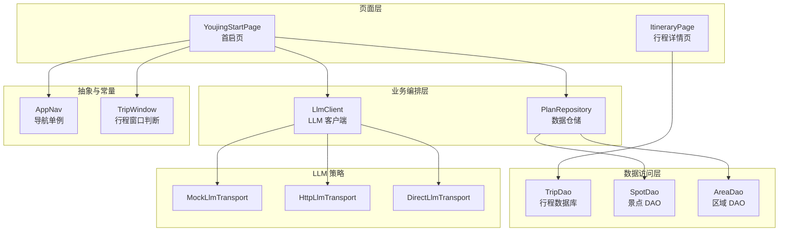
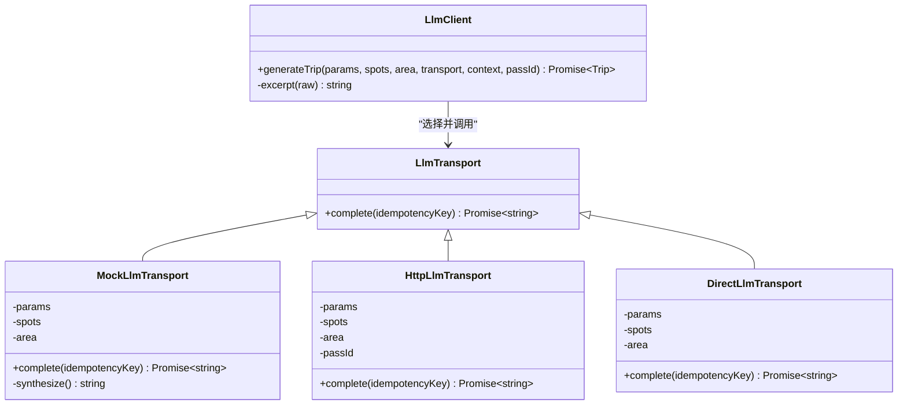
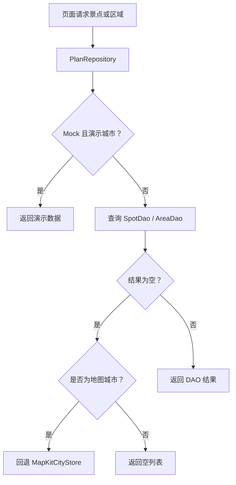
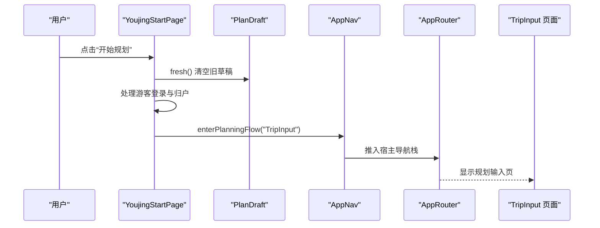
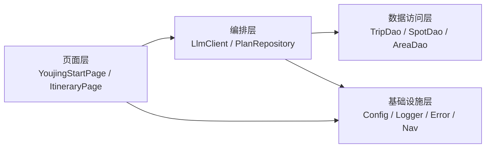
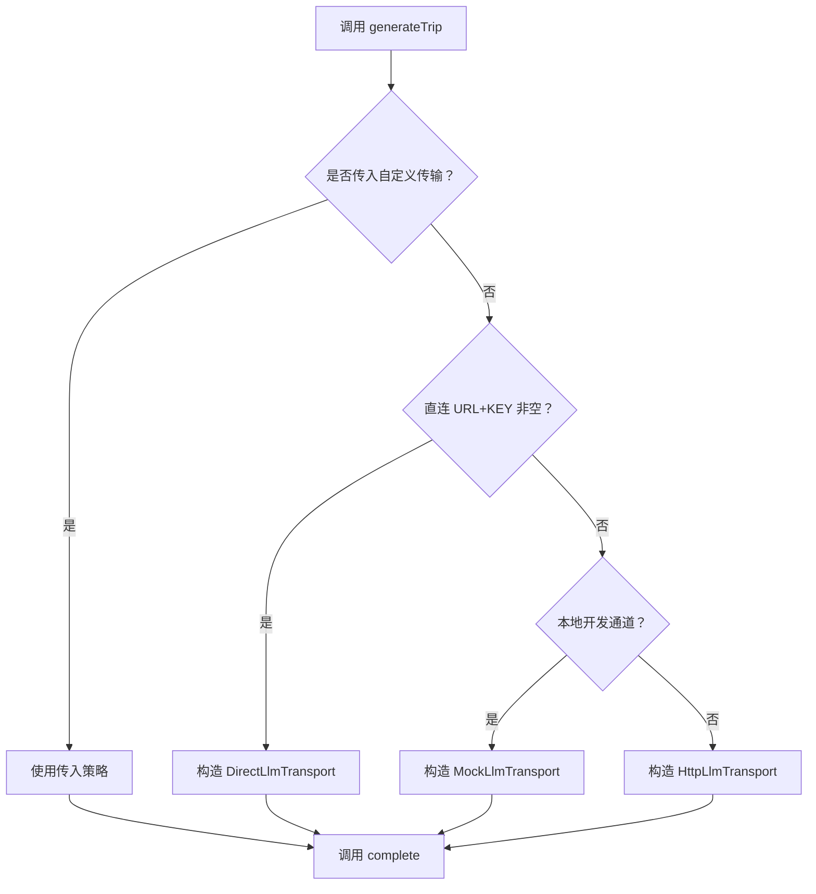
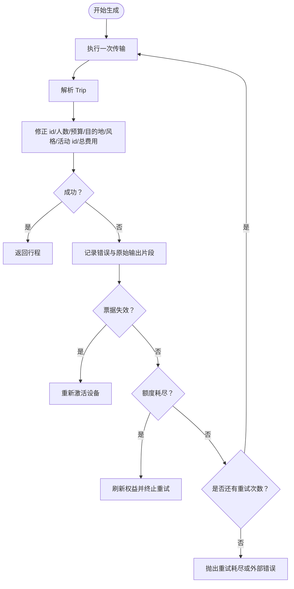
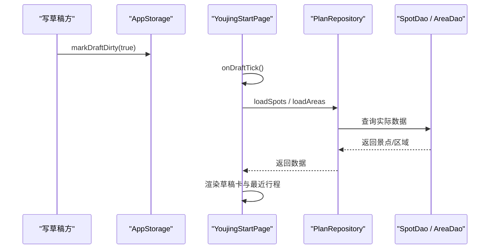
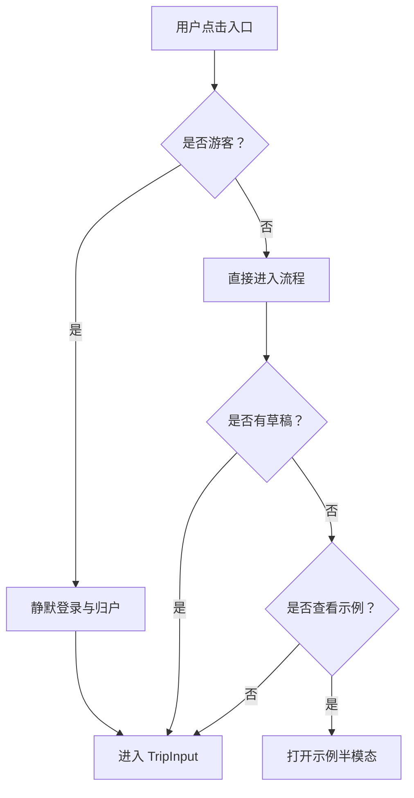
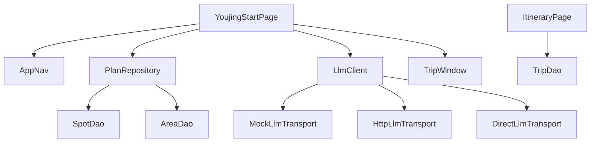

# 模式组合：复杂场景应用

<cite>
**本文引用的文件**   
- [LlmClient.ets](file://entry/src/main/ets/ai/LlmClient.ets)
- [PlanRepository.ets](file://entry/src/main/ets/data/PlanRepository.ets)
- [YoujingStartPage.ets](file://entry/src/main/ets/pages/YoujingStartPage.ets)
- [AppNav.ets](file://entry/src/main/ets/common/constants/AppNav.ets)
- [TripDao.ets](file://entry/src/main/ets/data/TripDao.ets)
- [TripWindow.ets](file://entry/src/main/ets/utils/TripWindow.ets)
- [LLM接入方案-2026-10-26.md](file://Docs/LLM接入方案-2026-10-26.md)
</cite>

## 目录
1. [引言](#引言)
2. [项目结构](#项目结构)
3. [核心组件](#核心组件)
4. [架构总览](#架构总览)
5. [详细组件分析](#详细组件分析)
6. [依赖关系分析](#依赖关系分析)
7. [性能与可靠性](#性能与可靠性)
8. [反模式与陷阱](#反模式与陷阱)
9. [重构建议与最佳实践](#重构建议与最佳实践)
10. [结论](#结论)

## 引言
本文围绕三个真实代码落点，拆解设计模式如何在复杂业务中协作：
- LLM 生成通道：策略模式 + 单例模式。全局唯一的 `LlmClient` 负责编排重试、鉴权、配额和解析；内部按运行环境选择 Mock、BFF 或直连传输策略。
- 规划数据仓储：DAO 模式 + 观察者模式。`PlanRepository` 统一路由 Mock/种子库/地图城市数据，页面通过仓库取数，避免直接耦合 DAO；同时利用 AppStorage 广播机制实现“数据变更后通知 UI”。
- 启动与流程入口：观察者模式 + 工厂模式。`YoujingStartPage` 根据用户输入与草稿状态动态创建不同规划流程，并通过全局导航栈进入向导链。

这些组合把“可变部分”（传输方式、数据来源、流程类型）从“稳定部分”（重试、校验、持久化、UI 渲染）中剥离出来，从而提升可维护性与可扩展性。

**章节来源**
- [LLM接入方案-2026-10-26.md:1-154](file://Docs/LLM接入方案-2026-10-26.md#L1-L154)

## 项目结构
本次分析聚焦以下目录与文件：
- AI 层：`entry/src/main/ets/ai/LlmClient.ets`
- 数据层：`entry/src/main/ets/data/PlanRepository.ets`、`entry/src/main/ets/data/TripDao.ets`
- 页面层：`entry/src/main/ets/pages/YoujingStartPage.ets`
- 公共常量与导航：`entry/src/main/ets/common/constants/AppNav.ets`
- 工具类：`entry/src/main/ets/utils/TripWindow.ets`
- 设计文档：`Docs/LLM接入方案-2026-10-26.md`

**图表来源**
- [YoujingStartPage.ets:1-200](file://entry/src/main/ets/pages/YoujingStartPage.ets#L1-L200)
- [PlanRepository.ets:1-55](file://entry/src/main/ets/data/PlanRepository.ets#L1-L55)
- [LlmClient.ets:349-482](file://entry/src/main/ets/ai/LlmClient.ets#L349-L482)
- [AppNav.ets:1-120](file://entry/src/main/ets/common/constants/AppNav.ets#L1-L120)
- [TripDao.ets:52-120](file://entry/src/main/ets/data/TripDao.ets#L52-L120)
- [TripWindow.ets:1-24](file://entry/src/main/ets/utils/TripWindow.ets#L1-L24)

**章节来源**
- [YoujingStartPage.ets:1-200](file://entry/src/main/ets/pages/YoujingStartPage.ets#L1-L200)
- [PlanRepository.ets:1-55](file://entry/src/main/ets/data/PlanRepository.ets#L1-L55)
- [LlmClient.ets:349-482](file://entry/src/main/ets/ai/LlmClient.ets#L349-L482)
- [AppNav.ets:1-120](file://entry/src/main/ets/common/constants/AppNav.ets#L1-L120)
- [TripDao.ets:52-120](file://entry/src/main/ets/data/TripDao.ets#L52-L120)
- [TripWindow.ets:1-24](file://entry/src/main/ets/utils/TripWindow.ets#L1-L24)

## 核心组件
本节分别说明三个关键组件的职责以及它们各自承载的模式组合。

### LlmClient：策略模式 + 单例模式
- 单例职责：`LlmClient` 提供静态方法 `generateTrip`，作为全链路入口。调用方不关心走 Mock、BFF 还是直连，只传入 `PlanParams`、景点、区域和可选的传输策略。
- 策略职责：`LlmTransport` 接口定义 `complete`；三种实现分别对应离线合成、BFF 中转、端侧直连。
- 编排职责：重试一次、票据失效时重新激活设备、额度耗尽时提前退出、解析后修正 id/人数/预算/目的地/风格/活动 id/总费用，并回填地址、开放时间、预约信息。

**图表来源**
- [LlmClient.ets:48-50](file://entry/src/main/ets/ai/LlmClient.ets#L48-L50)
- [LlmClient.ets:53-227](file://entry/src/main/ets/ai/LlmClient.ets#L53-L227)
- [LlmClient.ets:228-327](file://entry/src/main/ets/ai/LlmClient.ets#L228-L327)
- [LlmClient.ets:328-348](file://entry/src/main/ets/ai/LlmClient.ets#L328-L348)
- [LlmClient.ets:349-482](file://entry/src/main/ets/ai/LlmClient.ets#L349-L482)

**章节来源**
- [LlmClient.ets:48-50](file://entry/src/main/ets/ai/LlmClient.ets#L48-L50)
- [LlmClient.ets:228-327](file://entry/src/main/ets/ai/LlmClient.ets#L228-L327)
- [LlmClient.ets:328-348](file://entry/src/main/ets/ai/LlmClient.ets#L328-L348)
- [LlmClient.ets:349-482](file://entry/src/main/ets/ai/LlmClient.ets#L349-L482)
- [LLM接入方案-2026-10-26.md:1-154](file://Docs/LLM接入方案-2026-10-26.md#L1-L154)

### PlanRepository：DAO 模式 + 观察者模式
- DAO 模式：`PlanRepository` 是面向页面的数据仓储，真正访问数据库的是 `SpotDao`、`AreaDao` 等 DAO。页面不应直接依赖 DAO，而应通过仓储获取 `Spot[]` 与 `Area[]`。
- 数据路由：当使用 Mock 且城市为演示城市时返回演示数据；否则查种子库；若为空且属于地图城市，再回退到地图城市存储。
- 观察者模式：当前仓库本身没有内建事件总线，但整个应用通过 `AppStorage` 键值广播“草稿是否脏”“页签是否显示”“活动行程是否变化”。写草稿的一方写入键值，首页通过 `@StorageProp` 与 `@Watch` 订阅，从而在数据变更后自动刷新 UI。

**图表来源**
- [PlanRepository.ets:1-55](file://entry/src/main/ets/data/PlanRepository.ets#L1-L55)
- [AppNav.ets:120-200](file://entry/src/main/ets/common/constants/AppNav.ets#L120-L200)

**章节来源**
- [PlanRepository.ets:1-55](file://entry/src/main/ets/data/PlanRepository.ets#L1-L55)
- [AppNav.ets:120-200](file://entry/src/main/ets/common/constants/AppNav.ets#L120-L200)

### YoujingStartPage：观察者模式 + 工厂模式
- 观察者模式：
  - 草稿状态通过 `DRAFT_DIRTY_KEY` 由写草稿一方广播；`YoujingStartPage` 用 `@StorageProp` 读取并在 `onDraftTick` 更新本地标志，从而决定是否展示“未完成的规划”。
  - “最近一趟”通过 `TAB_SHOWN_KEY` 判断 dock 切回规划页签，触发加载最近行程。
- 工厂模式：
  - 页面并不直接 new 一个“流程对象”，而是根据用户意图决定下一步动作：游客登录归户后 push 到 `TripInput`；继续草稿也进入 `TripInput`；点击示例则打开示例半模态。这里的“流程入口选择”相当于以用户输入为键的轻量工厂。
  - 真正的路由分发由 `AppRouter` 与 `AppNav.enterPlanningFlow` 完成，遵循“单一入口”原则。

**图表来源**
- [YoujingStartPage.ets:197-226](file://entry/src/main/ets/pages/YoujingStartPage.ets#L197-L226)
- [AppNav.ets:160-180](file://entry/src/main/ets/common/constants/AppNav.ets#L160-L180)

**章节来源**
- [YoujingStartPage.ets:197-226](file://entry/src/main/ets/pages/YoujingStartPage.ets#L197-L226)
- [AppNav.ets:160-180](file://entry/src/main/ets/common/constants/AppNav.ets#L160-L180)

## 架构总览
整体架构分为四层：
- 页面层：接收用户输入，驱动业务流程。
- 编排层：`LlmClient` 编排 LLM 调用；`PlanRepository` 编排数据源。
- 数据访问层：DAO 封装数据库读写。
- 基础设施层：配置、日志、错误码、导航、窗口判断。

[本图为概念架构，不对应具体代码行]

## 详细组件分析

### LlmClient 的组合模式详解
#### 策略模式如何工作
- 新增传输方式只需实现 `LlmTransport` 接口，例如 Mock、BFF、直连。
- 选择逻辑集中在 `LlmClient.generateTrip`：优先使用外部注入的策略；否则按直连配置、本地开发通道、BFF 优先级选择默认策略。
- 调用方无需感知网络、鉴权、超时、配额、重试细节。

**图表来源**
- [LlmClient.ets:349-382](file://entry/src/main/ets/ai/LlmClient.ets#L349-L382)

#### 单例模式的体现
- `LlmClient` 是静态类，所有调用都通过静态方法进入。
- 它不持有可变实例状态，也不暴露构造函数供外部缓存；真正的“全局唯一”体现在调用入口的统一性。
- 这种实现更接近“静态门面单例”，而不是传统意义上的“全局对象持有连接池”。

#### 重试与失败路径
- 最多尝试两次。
- 票据失效时先重新激活设备。
- 额度耗尽时主动停止重试并刷新权益。
- 外部网络/配额/限额类错误原样上抛，内容类错误包装为“重试耗尽”。

**图表来源**
- [LlmClient.ets:349-482](file://entry/src/main/ets/ai/LlmClient.ets#L349-L482)

**章节来源**
- [LlmClient.ets:48-50](file://entry/src/main/ets/ai/LlmClient.ets#L48-L50)
- [LlmClient.ets:228-327](file://entry/src/main/ets/ai/LlmClient.ets#L228-L327)
- [LlmClient.ets:328-348](file://entry/src/main/ets/ai/LlmClient.ets#L328-L348)
- [LlmClient.ets:349-482](file://entry/src/main/ets/ai/LlmClient.ets#L349-L482)

### PlanRepository 的数据流与观察者协作
#### DAO 模式的责任边界
- `PlanRepository` 不直接写 SQL，也不直接 new DAO 以外的数据源；它只做“选哪条数据路径”。
- 真正持久化、分页、聚合、映射都由 DAO 承担。
- 这样页面可以替换 Mock 数据、切换种子库、接入新城市来源，而不必修改 UI。

#### 观察者模式如何落地
- `PlanRepository` 本身不发射事件，但仓库读出的数据最终用于页面状态。
- 更明确的“数据变更 → UI 更新”发生在 `AppNav` 与页面之间：
  - 草稿脏标记通过 `markDraftDirty` 写入 `AppStorage`。
  - `YoujingStartPage` 通过 `@StorageProp(DRAFT_DIRTY_KEY)` 与 `@Watch('onDraftTick')` 订阅。
  - Dock 切换通过 `announceTabShown` 与 `isTabShownTick` 通知根页刷新最近行程。

**图表来源**
- [PlanRepository.ets:1-55](file://entry/src/main/ets/data/PlanRepository.ets#L1-L55)
- [AppNav.ets:160-200](file://entry/src/main/ets/common/constants/AppNav.ets#L160-L200)
- [YoujingStartPage.ets:60-120](file://entry/src/main/ets/pages/YoujingStartPage.ets#L60-L120)

**章节来源**
- [PlanRepository.ets:1-55](file://entry/src/main/ets/data/PlanRepository.ets#L1-L55)
- [AppNav.ets:160-200](file://entry/src/main/ets/common/constants/AppNav.ets#L160-L200)
- [YoujingStartPage.ets:60-120](file://entry/src/main/ets/pages/YoujingStartPage.ets#L60-L120)

### YoujingStartPage 的流程工厂
#### 用户输入驱动的流程选择
- 如果用户在游客分区点击主入口，页面先做静默登录与归户，然后进入规划输入页。
- 如果有草稿，用户点击“继续未完成的规划”，同样进入规划输入页，但不清空草稿。
- 示例入口不进入完整流程，而是打开示例半模态预览动线。

#### 与导航单例的配合
- 流程入口统一调用 `enterPlanningFlow`，该函数负责切到“规划”页签并 push 到宿主栈。
- 这避免了每个页面自己管理 `HOST_NAV`，降低循环依赖风险。

**图表来源**
- [YoujingStartPage.ets:197-226](file://entry/src/main/ets/pages/YoujingStartPage.ets#L197-L226)
- [AppNav.ets:160-180](file://entry/src/main/ets/common/constants/AppNav.ets#L160-L180)

**章节来源**
- [YoujingStartPage.ets:197-226](file://entry/src/main/ets/pages/YoujingStartPage.ets#L197-L226)
- [AppNav.ets:160-180](file://entry/src/main/ets/common/constants/AppNav.ets#L160-L180)

## 依赖关系分析

**图表来源**
- [YoujingStartPage.ets:1-200](file://entry/src/main/ets/pages/YoujingStartPage.ets#L1-L200)
- [PlanRepository.ets:1-55](file://entry/src/main/ets/data/PlanRepository.ets#L1-L55)
- [LlmClient.ets:349-482](file://entry/src/main/ets/ai/LlmClient.ets#L349-L482)
- [TripDao.ets:52-120](file://entry/src/main/ets/data/TripDao.ets#L52-L120)
- [TripWindow.ets:1-24](file://entry/src/main/ets/utils/TripWindow.ets#L1-L24)

**章节来源**
- [YoujingStartPage.ets:1-200](file://entry/src/main/ets/pages/YoujingStartPage.ets#L1-L200)
- [PlanRepository.ets:1-55](file://entry/src/main/ets/data/PlanRepository.ets#L1-L55)
- [LlmClient.ets:349-482](file://entry/src/main/ets/ai/LlmClient.ets#L349-L482)
- [TripDao.ets:52-120](file://entry/src/main/ets/data/TripDao.ets#L52-L120)
- [TripWindow.ets:1-24](file://entry/src/main/ets/utils/TripWindow.ets#L1-L24)

## 性能与可靠性
- LLM 重试：最多两次，避免无限重试拖垮 UI。
- 超时控制：HTTP 层设置连接与读取超时，平台超时码区分“真超时”和一般网络失败。
- 票据处理：票据失效时重新激活，避免拿过期 token 反复失败。
- 额度保护：额度耗尽时立即停止重试，并刷新服务端权益快照，防止误引导付费。
- 数据一致性：行程 id、活动 id、人数、预算、目的地、风格、总费用都在保存前强制对齐用户输入，避免模型幻觉导致费用页、分享、日历异常。
- 数据降级：Mock 数据保证离线闭环；BFF 或直连失败时保留确定性规则，界面不卡死。

**章节来源**
- [LlmClient.ets:228-327](file://entry/src/main/ets/ai/LlmClient.ets#L228-L327)
- [LlmClient.ets:349-482](file://entry/src/main/ets/ai/LlmClient.ets#L349-L482)
- [LLM接入方案-2026-10-26.md:1-154](file://Docs/LLM接入方案-2026-10-26.md#L1-L154)

## 反模式与陷阱
- 过度设计：如果只有 Mock 和 BFF 两种传输，就不必过早引入第三个直连策略；但当前已有三类实现，说明策略接口确实有扩展价值。
- 模式滥用：把每个小分支都写成独立模式不是好事。例如“是否游客”“是否有草稿”是简单条件判断，不需要为每个分支新建类。
- 循环依赖：页面不应直接持有 DAO 以外的全局单例状态，而应通过仓储和导航单例解耦。当前 `AppNav` 集中管理栈，降低了页面间直接耦合。
- 隐式全局状态：AppStorage 是全局键值，适合跨组件通信，但不适合表达强一致性事务；对于强一致数据，仍应通过 DAO 和仓储显式读写。
- 错误吞没：`LlmClient` 对外部错误尽量原样上抛，只对“模型内容不合格”做统一包装，这是正确做法；应避免把所有异常都包装成“未知错误”。

**章节来源**
- [LlmClient.ets:349-482](file://entry/src/main/ets/ai/LlmClient.ets#L349-L482)
- [AppNav.ets:1-120](file://entry/src/main/ets/common/constants/AppNav.ets#L1-L120)

## 重构建议与最佳实践
- 保持单一职责：
  - `LlmClient` 只负责 LLM 调用编排，不负责 UI。
  - `PlanRepository` 只负责数据源选择，不负责行程生成。
  - `YoujingStartPage` 只负责首启交互与流程入口选择。
- 遵守开闭原则：
  - 新增 LLM 传输方式时，只新增实现类，不改 `LlmClient` 调用逻辑。
  - 新增数据源时，优先扩展仓储路由，而不是改页面。
- 遵守依赖倒置：
  - 上层依赖 `LlmTransport` 接口，而非具体 HTTP/Mock/直连实现。
  - 页面依赖 `PlanRepository`，而非 `SpotDao`、`AreaDao`。
- 明确观察者边界：
  - 将“草稿脏”“页签切换”“活动行程变化”等事件放在公共常量或服务中统一管理，避免散落各处。
- 测试策略：
  - 对 `LlmTransport` 各实现单独单元测试。
  - 对 `LlmClient.generateTrip` 用 Mock 传输验证重试、票据、额度、解析修复逻辑。
  - 对 `PlanRepository` 验证 Mock/DAO/地图城市三条路径。
- 代码可读性：
  - 在策略选择处增加注释说明优先级，避免运行时行为成为“隐藏业务规则”。
  - 在仓储路由处标注数据来源 SOT，便于后续迁移。

**章节来源**
- [LlmClient.ets:349-482](file://entry/src/main/ets/ai/LlmClient.ets#L349-L482)
- [PlanRepository.ets:1-55](file://entry/src/main/ets/data/PlanRepository.ets#L1-L55)
- [YoujingStartPage.ets:197-226](file://entry/src/main/ets/pages/YoujingStartPage.ets#L197-L226)

## 结论
- LLM 通道通过“策略 + 单例”把不稳定传输与稳定编排解耦，使 Mock、BFF、直连可以并存并按环境选择。
- 数据仓储通过“DAO + 观察者”把持久化细节与 UI 刷新解耦，让页面只关心“需要什么数据”，不关心“数据从哪来”。
- 启动页通过“观察者 + 工厂”把用户意图转化为具体流程，既支持新建、继续草稿，又支持示例预览。
- 这些组合共同解决复杂业务中的多路径、多状态、多后端问题，显著提升可维护性与可扩展性。