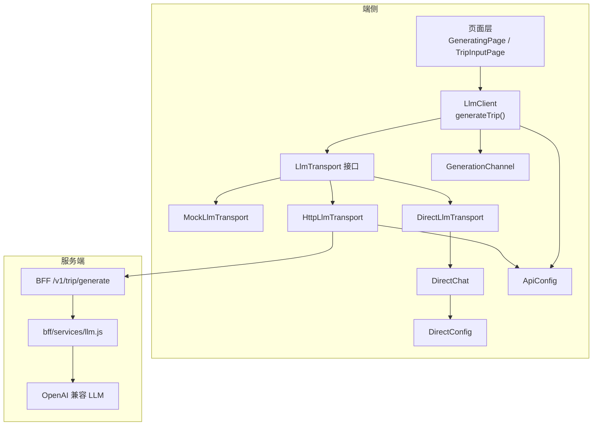
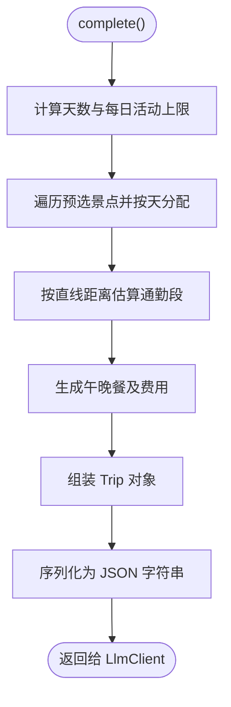
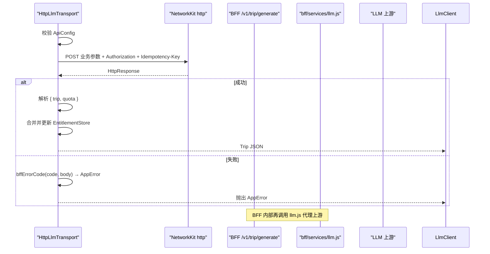
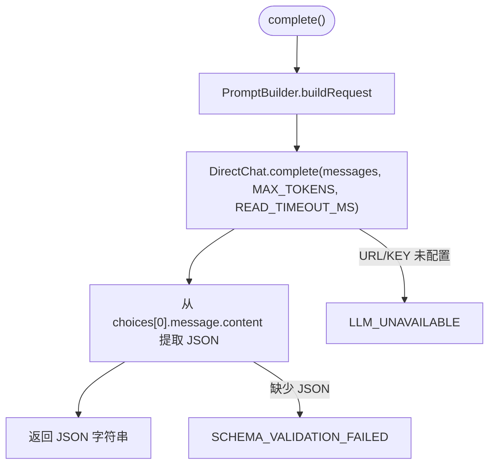
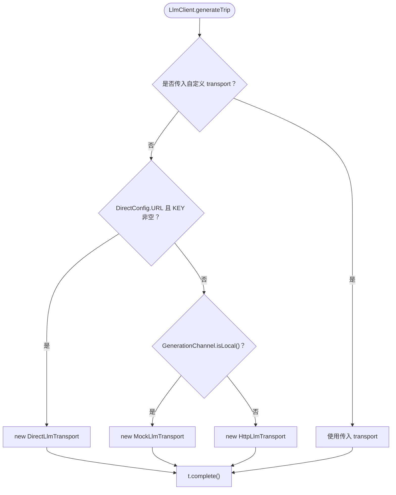
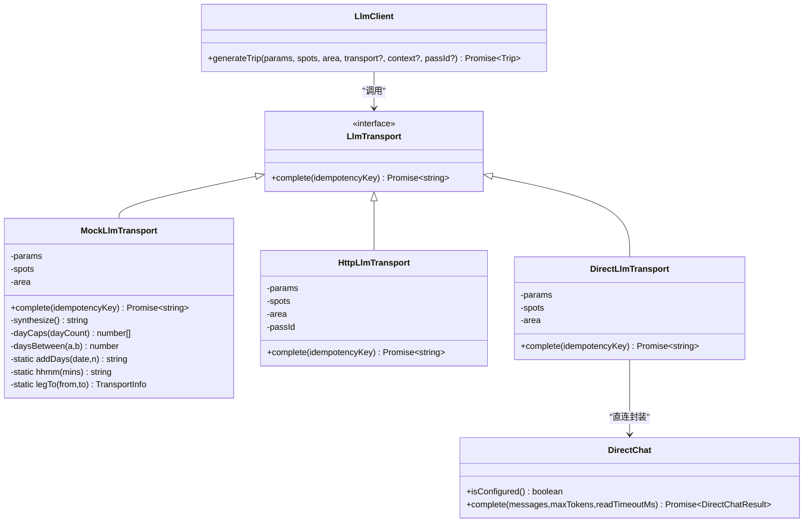
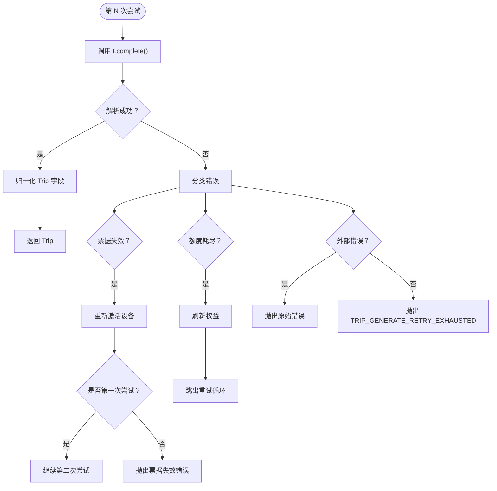

# 策略模式：LLM 传输抽象

<cite>
**本文引用的文件**   
- [LlmClient.ets](file://entry/src/main/ets/ai/LlmClient.ets)
- [DirectChat.ets](file://entry/src/main/ets/ai/DirectChat.ets)
- [DirectConfig.ets](file://entry/src/main/ets/common/config/DirectConfig.ets)
- [ApiConfig.ets](file://entry/src/main/ets/common/config/ApiConfig.ets)
- [GenerationChannel.ets](file://entry/src/main/ets/utils/GenerationChannel.ets)
- [llm.js](file://bff/src/services/llm.js)
</cite>

## 目录
1. [引言](#引言)
2. [项目结构定位](#项目结构定位)
3. [核心组件](#核心组件)
4. [架构总览](#架构总览)
5. [详细组件分析](#详细组件分析)
6. [依赖关系分析](#依赖关系分析)
7. [性能与超时特征](#性能与超时特征)
8. [错误处理与重试差异](#错误处理与重试差异)
9. [如何新增第四种传输策略](#如何新增第四种传输策略)
10. [为什么用策略模式而不是 if-else](#为什么用策略模式而不是-if-else)
11. [故障排查清单](#故障排查清单)
12. [结论](#结论)

## 引言
本仓库在行程生成链路中引入 `LlmTransport` 接口，把“调用 LLM”的具体方式从业务编排逻辑中抽离出来。当前提供三种实现：

| 实现 | 行为 | 适用阶段 | 关键配置 |
|---|---|---|---|
| `MockLlmTransport` | 离线确定性合成合法 Trip JSON，不发起网络请求 | 无 BFF、纯端侧联调、离线回归 | 无需网络配置；受 `GenerationChannel.isLocal()` 控制 |
| `HttpLlmTransport` | 通过 BFF `/v1/trip/generate` 中转，BFF 负责构建提示词、注入 Key、扣减配额并转发 LLM | 商业化上线、需要额度控制和鉴权 | `ApiConfig.BFF_BASE_URL`、`ApiConfig.LLM_CHAT_ENDPOINT` |
| `DirectLlmTransport` | 端侧直连 OpenAI 兼容 `chat/completions`，端侧构造提示词 | 开发期兜底，AGC/BFF 未就绪时临时使用 | `DirectConfig.URL`、`DirectConfig.KEY` |

运行时选择逻辑由 `LlmClient.generateTrip` 集中决策：优先使用传入的自定义 transport；否则按是否启用直连、是否本地模式、是否走 BFF 动态切换。该设计让上层页面只关心“生成 Trip”，而不关心最终消息发给谁。

**章节来源**
- [LlmClient.ets:1-20](file://entry/src/main/ets/ai/LlmClient.ets#L1-L20)
- [LlmClient.ets:349-482](file://entry/src/main/ets/ai/LlmClient.ets#L349-L482)

## 项目结构定位
LLM 传输抽象位于应用模块的 `ai` 层，属于端侧生成管线入口：



**图表来源**
- [LlmClient.ets:48-50](file://entry/src/main/ets/ai/LlmClient.ets#L48-L50)
- [LlmClient.ets:201-482](file://entry/src/main/ets/ai/LlmClient.ets#L201-L482)
- [DirectChat.ets:1-136](file://entry/src/main/ets/ai/DirectChat.ets#L1-L136)
- [DirectConfig.ets:1-33](file://entry/src/main/ets/common/config/DirectConfig.ets#L1-L33)
- [ApiConfig.ets:1-66](file://entry/src/main/ets/common/config/ApiConfig.ets#L1-L66)
- [GenerationChannel.ets:1-44](file://entry/src/main/ets/utils/GenerationChannel.ets#L1-L44)
- [llm.js:1-98](file://bff/src/services/llm.js#L1-L98)

**章节来源**
- [LlmClient.ets:1-20](file://entry/src/main/ets/ai/LlmClient.ets#L1-L20)
- [DirectChat.ets:1-18](file://entry/src/main/ets/ai/DirectChat.ets#L1-L18)
- [GenerationChannel.ets:1-15](file://entry/src/main/ets/utils/GenerationChannel.ets#L1-L15)

## 核心组件
### `LlmTransport` 接口
`LlmTransport` 是本次策略模式的唯一契约：

| 成员 | 类型 | 语义 |
|---|---|---|
| `complete(idempotencyKey?: string)` | `Promise<string>` | 返回一段可被 `TripParser.parseTrip` 解析的字符串，通常是 Trip JSON |

这个接口非常窄：它不暴露 HTTP、不暴露模型名、不暴露配额更新细节。这样，`MockLlmTransport` 可以完全离线，`HttpLlmTransport` 可以走 BFF，`DirectLlmTransport` 可以直连上游——调用方不需要感知差异。

**章节来源**
- [LlmClient.ets:48-50](file://entry/src/main/ets/ai/LlmClient.ets#L48-L50)

### 三种实现的职责对比

| 实现 | 输入 | 输出 | 网络 | 鉴权 | 配额 | 典型失败原因 |
|---|---|---|---|---|---|---|
| `MockLlmTransport` | `PlanParams`、`Spot[]`、`Area` | 本地合成的 Trip JSON 字符串 | 无 | 无 | 无 | 参数非法、景点缺失 |
| `HttpLlmTransport` | 业务参数 + 可选 `passId` | Trip JSON 字符串 | 有（BFF） | 设备 token | BFF 更新 EntitlementStore | BFF 状态码、网络超时、字段缺失 |
| `DirectLlmTransport` | `PlanParams`、`Spot[]`、`Area` | Trip JSON 字符串 | 有（直连） | `DirectConfig.KEY` | 不管理配额 | URL/KEY 未配置、上游 4xx/5xx、JSON 提取失败 |

**章节来源**
- [LlmClient.ets:52-200](file://entry/src/main/ets/ai/LlmClient.ets#L52-L200)
- [LlmClient.ets:214-348](file://entry/src/main/ets/ai/LlmClient.ets#L214-L348)
- [LlmClient.ets:350-398](file://entry/src/main/ets/ai/LlmClient.ets#L350-L398)

## 架构总览
下图展示一次完整行程生成的运行时流程，包括策略选择、重试和下游解析：

```mermaid
sequenceDiagram
  participant Page as "页面层"
  participant Client as "LlmClient"
  participant Selector as "策略选择逻辑"
  participant Transport as "LlmTransport 实现"
  participant Parser as "TripParser"
  participant Enrich as "TripEnrich"
  participant Store as "EntitlementStore"

  Page->>Client: generateTrip(params, spots, area, transport?, context?)
  Client->>Client: 计算 isLocal / direct
  Client->>Selector: 选择 transport
  alt 传入自定义 transport
    Selector-->>Client: 使用传入实现
  else 未传入
    alt DirectConfig.URL 且 KEY 非空
      Selector-->>Client: new DirectLlmTransport
    else GenerationChannel.isLocal()
      Selector-->>Client: new MockLlmTransport
    else
      Selector-->>Client: new HttpLlmTransport
    end
  end

  loop 最多两次尝试
    Client->>Transport: complete(idempotencyKey)
    Transport-->>Client: Trip JSON 字符串
    Client->>Parser: parseTrip(raw, expect)
    Parser-->>Client: Trip 对象
    Client->>Client: 归一化 id/人数/预算/目的地/风格
    Client->>Enrich: backfillActivityPlaces / backfillOpeningHours / backfillBooking
    Enrich-->>Client: 回填计数
    Client->>Store: 更新权益快照（仅 HttpLlmTransport 可能触发）
    Client-->>Page: Trip
  catch 异常
    Client->>Client: 票据失效则重新激活设备
    Client->>Client: 判断是否为外部错误直接上抛
    Client-->>Page: 抛出 AppError
  end
```

**图表来源**
- [LlmClient.ets:349-482](file://entry/src/main/ets/ai/LlmClient.ets#L349-L482)
- [GenerationChannel.ets:16-44](file://entry/src/main/ets/utils/GenerationChannel.ets#L16-L44)
- [DirectChat.ets:54-136](file://entry/src/main/ets/ai/DirectChat.ets#L54-L136)
- [llm.js:33-98](file://bff/src/services/llm.js#L33-L98)

**章节来源**
- [LlmClient.ets:349-482](file://entry/src/main/ets/ai/LlmClient.ets#L349-L482)

## 详细组件分析

### `MockLlmTransport`：离线确定性合成
`MockLlmTransport` 的核心价值不是“模拟一个随机响应”，而是用一套确定性规则复现真实行程生成结果：

- 根据 `PlanParams.basic.startDate` 到 `endDate` 计算天数。
- 根据用户选择的节奏档位（轻松、标准、紧凑）为每天分配活动名额。
- 按预选景点顺序排布，避免点击顺序影响结果。
- 对地图来源城市或预约信息缺失场景补充合规提示。
- 为每餐和住宿生成占位数据，使 Trip 通过守卫校验。
- 通勤段使用 `Transit` 估算距离，不再写死步行/地铁/打车时间。
- 最终序列化 Trip 为 JSON 字符串，交给 `TripParser` 走与真实模型相同的解析路径。

这意味着单元测试可以断言“相同输入得到相同 Trip”，同时覆盖真实解析器、守卫和入库逻辑，而不用真正联网。



**图表来源**
- [LlmClient.ets:52-200](file://entry/src/main/ets/ai/LlmClient.ets#L52-L200)

#### 适用场景
- 干净检出时无 BFF 也能运行。
- 离线回归测试。
- 快速验证 Trip 结构、解析器和页面渲染，而不关心真实模型质量。

#### 优点
- 零网络开销。
- 完全确定性。
- 复用真实解析链，保证离线输出也能过守卫。

#### 缺点
- 不具备真实 LLM 的规划能力。
- 不能覆盖 BFF 鉴权、配额、限流等后端逻辑。
- 不适合验收“真实模型输出”。

#### 配置要求
- 不需要 `DirectConfig`。
- 通常由 `GenerationChannel.isLocal()` 决定进入该分支。

**章节来源**
- [LlmClient.ets:52-200](file://entry/src/main/ets/ai/LlmClient.ets#L52-L200)
- [GenerationChannel.ets:16-44](file://entry/src/main/ets/utils/GenerationChannel.ets#L16-L44)

### `HttpLlmTransport`：BFF 中转
`HttpLlmTransport` 是商业化主路径的实现。端侧只负责发送业务参数，并把 BFF 返回的 Trip JSON 交给 `TripParser`：

- 先校验 `ApiConfig.BFF_BASE_URL` 和 `ApiConfig.LLM_CHAT_ENDPOINT` 是否配置。
- 使用 `buildTripGeneratePayload` 构造请求体，字段与 PromptBuilder 的 `userPrompt` 对齐。
- 携带设备 token 作为 `Authorization`，以及幂等键 `Idempotency-Key`。
- 成功时从响应中提取 `trip` 和 `quota`，并把 quota 合并回 `EntitlementStore`。
- 失败时根据 HTTP 状态码映射为 `AppError`，便于 UI 显示不同文案。
- 平台超时（libcurl 2300025）单独映射为 `NETWORK_TIMEOUT`。



**图表来源**
- [LlmClient.ets:214-348](file://entry/src/main/ets/ai/LlmClient.ets#L214-L348)
- [llm.js:33-98](file://bff/src/services/llm.js#L33-L98)

#### 适用场景
- 已部署 BFF 和商业化合规需求。
- 需要统一配额、鉴权、限流、日志和模型路由。
- 发布包不应包含任何 LLM Key。

#### 优点
- 端侧安全：Key 在 BFF。
- 端侧简单：不构造 OpenAI 信封。
- 配额可观测：quota 快照回到端侧缓存。

#### 缺点
- 依赖 BFF 可用性。
- 如果 BFF 未配置且非本地模式，会直接报 `LLM_UNAVAILABLE`。
- 需要维护端侧 payload 与 BFF prompt 的一致性。

#### 配置要求
- `ApiConfig.BFF_BASE_URL` 非空。
- `ApiConfig.LLM_CHAT_ENDPOINT` 非空。
- 通常需要有效的设备 token。

**章节来源**
- [LlmClient.ets:214-348](file://entry/src/main/ets/ai/LlmClient.ets#L214-L348)
- [ApiConfig.ets:1-66](file://entry/src/main/ets/common/config/ApiConfig.ets#L1-L66)

### `DirectLlmTransport`：直连 OpenAI
`DirectLlmTransport` 是开发期兜底方案，端侧直接调用 OpenAI 兼容接口：

- 使用 `PromptBuilder.buildRequest` 构造 system/user 消息，与 BFF 共享提示词 SOT。
- 通过 `DirectChat.complete` 发起 HTTP 请求。
- 从 `choices[0].message.content` 中截取 JSON 对象。
- 记录 model、prompt_tokens、completion_tokens。
- 如果 `DirectConfig.URL` 或 `DirectConfig.KEY` 为空，直接报 `LLM_UNAVAILABLE`。



**图表来源**
- [LlmClient.ets:350-398](file://entry/src/main/ets/ai/LlmClient.ets#L350-L398)
- [DirectChat.ets:54-136](file://entry/src/main/ets/ai/DirectChat.ets#L54-L136)
- [DirectConfig.ets:1-33](file://entry/src/main/ets/common/config/DirectConfig.ets#L1-L33)

#### 适用场景
- BFF 或 AGC 云函数尚未就绪。
- 开发者需要在端侧调试提示词、模型行为和 JSON 抽取。
- 短期联调，不作为上架路径。

#### 优点
- 绕过 BFF，快速验证提示词。
- 与 BFF 共用 `PromptBuilder`，减少两套 prompt 不一致的风险。
- 能拿到模型名和用量统计。

#### 缺点
- Key 留在端侧，存在泄露风险。
- 不上架：发布包不能带 Key。
- 不管理配额和限额，容易超支。
- 直连失败统一映射较粗，部分上游错误可能被包装成不可操作错误。

#### 配置要求
- `DirectConfig.URL` 非空。
- `DirectConfig.KEY` 非空。
- `DirectConfig.MODEL`、`DirectConfig.MAX_TOKENS` 决定模型和输出长度。

**章节来源**
- [LlmClient.ets:350-398](file://entry/src/main/ets/ai/LlmClient.ets#L350-L398)
- [DirectChat.ets:1-136](file://entry/src/main/ets/ai/DirectChat.ets#L1-L136)
- [DirectConfig.ets:1-33](file://entry/src/main/ets/common/config/DirectConfig.ets#L1-L33)

### 运行时策略选择逻辑
`LlmClient.generateTrip` 的策略选择优先级如下：

1. 如果调用方显式传入 `transport`，直接使用，不做环境判断。
2. 否则检查直连条件：`DirectConfig.URL` 和 `DirectConfig.KEY` 都非空。
3. 若启用直连，创建 `DirectLlmTransport`。
4. 否则检查 `GenerationChannel.isLocal()`：
   - 如果本地模式为真，创建 `MockLlmTransport`。
   - 否则创建 `HttpLlmTransport`。

`GenerationChannel.isLocal()` 的判断依据是：
- `MockConfig.USE_MOCK_DATA` 为真，或
- `ApiConfig.BFF_BASE_URL` 为空，或
- 用户在受阻屏触发了“改用本机规则引擎”的一次性开关。



**图表来源**
- [LlmClient.ets:349-398](file://entry/src/main/ets/ai/LlmClient.ets#L349-L398)
- [GenerationChannel.ets:16-44](file://entry/src/main/ets/utils/GenerationChannel.ets#L16-L44)
- [DirectConfig.ets:1-33](file://entry/src/main/ets/common/config/DirectConfig.ets#L1-L33)

**章节来源**
- [LlmClient.ets:349-398](file://entry/src/main/ets/ai/LlmClient.ets#L349-L398)
- [GenerationChannel.ets:16-44](file://entry/src/main/ets/utils/GenerationChannel.ets#L16-L44)

## 依赖关系分析


**图表来源**
- [LlmClient.ets:48-398](file://entry/src/main/ets/ai/LlmClient.ets#L48-L398)
- [DirectChat.ets:1-136](file://entry/src/main/ets/ai/DirectChat.ets#L1-L136)

**章节来源**
- [LlmClient.ets:48-398](file://entry/src/main/ets/ai/LlmClient.ets#L48-L398)
- [DirectChat.ets:1-136](file://entry/src/main/ets/ai/DirectChat.ets#L1-L136)

## 性能与超时特征
| 策略 | 主要耗时来源 | 超时配置 | 备注 |
|---|---|---|---|
| `MockLlmTransport` | 本地数组遍历、日期计算、JSON 序列化 | 无网络超时 | 几乎瞬时完成，适合高频单测 |
| `HttpLlmTransport` | 端侧 HTTP → BFF → 上游 LLM | `ApiConfig.CONNECT_TIMEOUT_MS`、`READ_TIMEOUT_MS` | 端侧读超时较长，BFF 内部默认约 45 秒 |
| `DirectLlmTransport` | 端侧直连 LLM | `CONNECT_TIMEOUT_MS`、`READ_TIMEOUT_MS` | 直连没有 BFF 缓冲，失败更快暴露 |

BFF 侧 `llm.js` 默认使用 45 秒超时，目的是给“修正重问”留余量，同时避免连接长期挂起。端侧读超时默认更长，以便等待模型生成。

**章节来源**
- [LlmClient.ets:214-348](file://entry/src/main/ets/ai/LlmClient.ets#L214-L348)
- [ApiConfig.ets:1-66](file://entry/src/main/ets/common/config/ApiConfig.ets#L1-L66)
- [llm.js:1-20](file://bff/src/services/llm.js#L1-L20)

## 错误处理与重试差异
`LlmClient.generateTrip` 对所有 transport 统一进行最多两次尝试，但具体错误表现因策略而异：

| 错误类型 | MockLlmTransport | HttpLlmTransport | DirectLlmTransport |
|---|---|---|---|
| 配置缺失 | 不适用 | 报 `LLM_UNAVAILABLE` | 报 `LLM_UNAVAILABLE` |
| 网络超时 | 不会发生 | 平台代码 2300025 → `NETWORK_TIMEOUT` | 平台代码 2300025 → `NETWORK_TIMEOUT` |
| 普通网络失败 | 不会发生 | `NETWORK_REQUEST_FAILED` | `NETWORK_REQUEST_FAILED` |
| BFF 业务错误 | 不适用 | 通过 `bffErrorCode` 映射为具体业务错误码 | 不适用 |
| 上游限流 | 不适用 | BFF 透传 429 → `CLOUD_RATE_LIMITED` | 直连失败通常被包装为 `LLM_UNAVAILABLE` |
| 额度耗尽 | 不适用 | 402 → `CLOUD_QUOTA_EXHAUSTED`，不再重试 | 不管理配额 |
| 票据失效 | 不适用 | 401 → 重新激活设备后重试 | 不主动处理 401 |
| 模型输出非法 | 不会发生（本地合成） | 解析失败进入重试 | JSON 提取失败 → `SCHEMA_VALIDATION_FAILED` |

重试后的最终行为也分两类：
- 外部错误（网络、超时、限流、额度、票据、服务不可用）：原样抛出，让 UI 显示可操作文案。
- 内容错误（模型生成的 Trip 不合格）：包装为 `TRIP_GENERATE_RETRY_EXHAUSTED`，引导用户再次尝试。



**图表来源**
- [LlmClient.ets:349-482](file://entry/src/main/ets/ai/LlmClient.ets#L349-L482)

**章节来源**
- [LlmClient.ets:349-482](file://entry/src/main/ets/ai/LlmClient.ets#L349-L482)

## 如何新增第四种传输策略
新增策略的目标是保持“调用方只关心 Trip JSON”这一契约不变。推荐步骤：

1. 新建一个类实现 `LlmTransport` 接口，并提供 `complete(idempotencyKey?: string): Promise<string>`。
2. 在该方法内实现新的传输逻辑，例如私有云、第三方代理、缓存命中、降级模板等。
3. 如需鉴权或网络，尽量复用现有工具类，如 `DirectChat` 的封装思路，或 `ApiConfig` 的统一配置。
4. 在 `LlmClient.generateTrip` 的策略选择分支中加入新条件的判断。
5. 为每个分支添加日志，便于区分实际运行的策略。
6. 编写单测：至少验证成功路径返回合法 Trip JSON，以及失败路径抛出明确 `AppError`。

示例伪结构（以路径引用代替代码内容）：

| 步骤 | 对应参考位置 |
|---|---|
| 定义接口契约 | [LlmClient.ets:48-50](file://entry/src/main/ets/ai/LlmClient.ets#L48-L50) |
| 参考 Mock 实现 | [LlmClient.ets:52-200](file://entry/src/main/ets/ai/LlmClient.ets#L52-L200) |
| 参考 HTTP 实现 | [LlmClient.ets:214-348](file://entry/src/main/ets/ai/LlmClient.ets#L214-L348) |
| 参考直连实现 | [LlmClient.ets:350-398](file://entry/src/main/ets/ai/LlmClient.ets#L350-L398) |
| 修改策略选择 | [LlmClient.ets:349-398](file://entry/src/main/ets/ai/LlmClient.ets#L349-L398) |
| 复用直连 HTTP 封装 | [DirectChat.ets:54-136](file://entry/src/main/ets/ai/DirectChat.ets#L54-L136) |
| 复用配置常量 | [ApiConfig.ets:1-66](file://entry/src/main/ets/common/config/ApiConfig.ets#L1-L66) |
| 复用本地模式判断 | [GenerationChannel.ets:16-44](file://entry/src/main/ets/utils/GenerationChannel.ets#L16-L44) |

注意：
- 不要在新策略里直接修改 `Trip` 业务字段，应把归一化逻辑保留在 `LlmClient.generateTrip`，这样所有策略共享同一份后置处理。
- 新策略应尽量抛出 `AppError` 并使用已有 `ErrorCode`，以便 UI 层统一处理。
- 如果新策略涉及 Key 或敏感配置，不要放入仓库默认值；参考 `DirectConfig` 的 skip-worktree 思路。

**章节来源**
- [LlmClient.ets:48-398](file://entry/src/main/ets/ai/LlmClient.ets#L48-L398)
- [DirectChat.ets:54-136](file://entry/src/main/ets/ai/DirectChat.ets#L54-L136)
- [ApiConfig.ets:1-66](file://entry/src/main/ets/common/config/ApiConfig.ets#L1-L66)
- [GenerationChannel.ets:16-44](file://entry/src/main/ets/utils/GenerationChannel.ets#L16-L44)

## 为什么用策略模式而不是 if-else
如果把三种传输方式写成 `if (direct) ... else if (local) ... else ...` 散落在调用处，会带来以下问题：

| 维度 | if-else 分散写法 | 策略模式 |
|---|---|---|
| 测试 | 每个调用点都要模拟环境、配置、分支 | 可以直接注入 mock transport，隔离环境 |
| 扩展性 | 新增策略要改多个调用点 | 新增实现类 + 一处选择逻辑 |
| 可维护性 | 条件越来越多，分支耦合业务 | 每种策略独立文件，职责清晰 |
| 一致性 | 不同页面可能采用不同判据 | 统一由 `LlmClient` 和 `GenerationChannel` 决策 |
| 可观测性 | 难以知道实际走了哪条路径 | 日志明确打印当前策略 |
| 错误处理 | 容易遗漏某条分支的错误分类 | 可在各实现内部集中处理，再由上层统一重试 |

当前代码已经体现这一收益：`LlmClient.generateTrip` 只关心“调用 transport 并解析 Trip”，而三种传输各自承担自己的网络、鉴权和错误映射责任。

**章节来源**
- [LlmClient.ets:349-398](file://entry/src/main/ets/ai/LlmClient.ets#L349-L398)
- [GenerationChannel.ets:1-15](file://entry/src/main/ets/utils/GenerationChannel.ets#L1-L15)

## 故障排查清单
| 现象 | 可能原因 | 排查方向 |
|---|---|---|
| 生成行程直接报错 `LLM_UNAVAILABLE` | BFF 未配置且非本地模式 | 检查 `ApiConfig.BFF_BASE_URL`、`ApiConfig.LLM_CHAT_ENDPOINT` |
| 直连报错 `端侧直连未配置` | `DirectConfig.URL` 或 `DirectConfig.KEY` 为空 | 检查直连配置文件 |
| 一直走 Mock 而不是 BFF | `GenerationChannel.isLocal()` 为真 | 检查 `MockConfig.USE_MOCK_DATA`、BFF 地址、一次性本地开关 |
| 直连总是走 Mock | `DirectConfig.URL/KEY` 任一为空 | 直连双条件必须同时满足 |
| 网络请求超时 | 平台返回 libcurl 2300025 | 检查 `READ_TIMEOUT_MS` 和网络连通性 |
| BFF 返回 429 | 上游限流 | 查看 BFF 日志，等待后再试；端侧应显示限流文案 |
| 401 反复失败 | 票据失效但未正确重新激活 | 确认 `context` 是否传入，是否触发 `DeviceActivator.reactivate` |
| 402 一直重试 | 额度耗尽不应重试 | 确认是否刷新权益并跳出循环 |
| 模型输出不是合法 JSON | 提示词或模型不稳定 | 检查 `PromptBuilder`、`response_format`、`DirectChat` JSON 截取逻辑 |
| 行程 ID 重复 | 模型返回固定或碰撞 ID | 确认 `LlmClient` 是否在落库前重写 ID |

**章节来源**
- [LlmClient.ets:214-482](file://entry/src/main/ets/ai/LlmClient.ets#L214-L482)
- [DirectChat.ets:54-136](file://entry/src/main/ets/ai/DirectChat.ets#L54-L136)
- [ApiConfig.ets:1-66](file://entry/src/main/ets/common/config/ApiConfig.ets#L1-L66)
- [DirectConfig.ets:1-33](file://entry/src/main/ets/common/config/DirectConfig.ets#L1-L33)
- [GenerationChannel.ets:16-44](file://entry/src/main/ets/utils/GenerationChannel.ets#L16-L44)

## 结论
`LlmTransport` 接口把 LLM 调用从业务编排中解耦，形成清晰的策略分层：

- `MockLlmTransport` 保证无网络环境下仍可端到端验证 Trip 结构和页面。
- `HttpLlmTransport` 承担商业化主路径，集中处理鉴权、配额和 BFF 协议。
- `DirectLlmTransport` 提供开发期直连能力，共享提示词但不替代上线路径。
- `LlmClient.generateTrip` 负责策略选择、重试、票据处理、Trip 归一化和后置回填。
- `GenerationChannel` 统一“本地 vs BFF”的门禁与传输判据，避免页面层各自判断。

这种设计让测试更可控、扩展更简单、错误更可解释。新增传输策略时只需实现接口并在选择逻辑中添加分支，而不必改动整个生成管线。