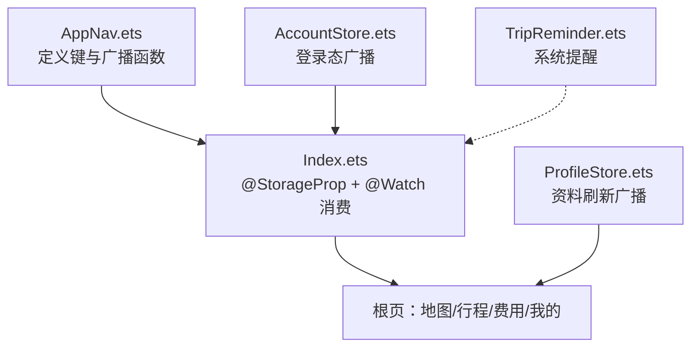
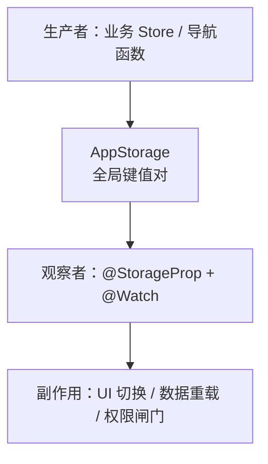
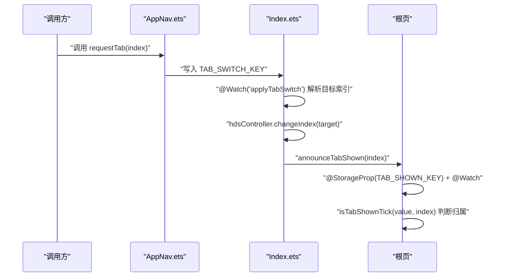
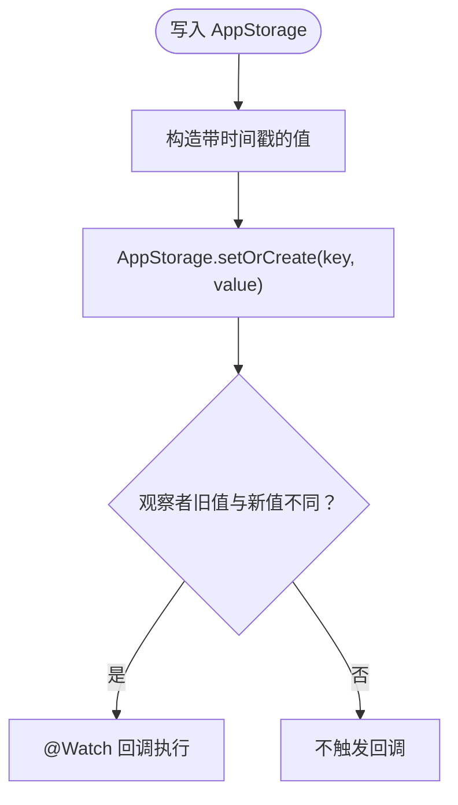
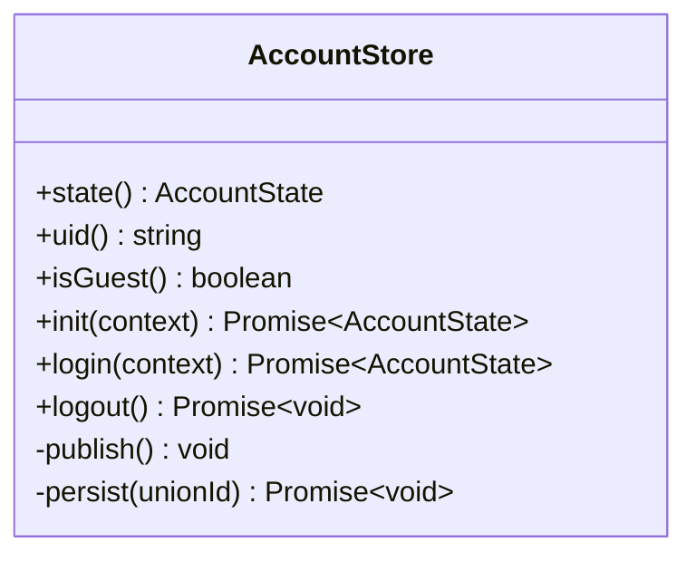
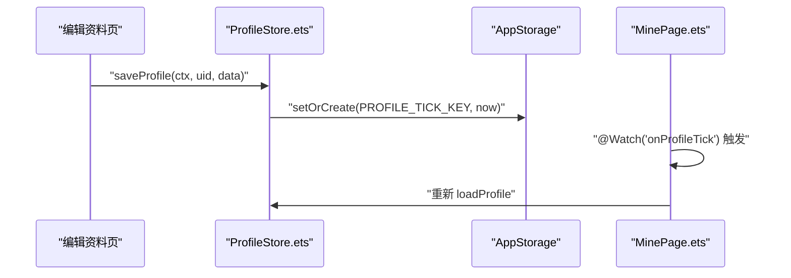
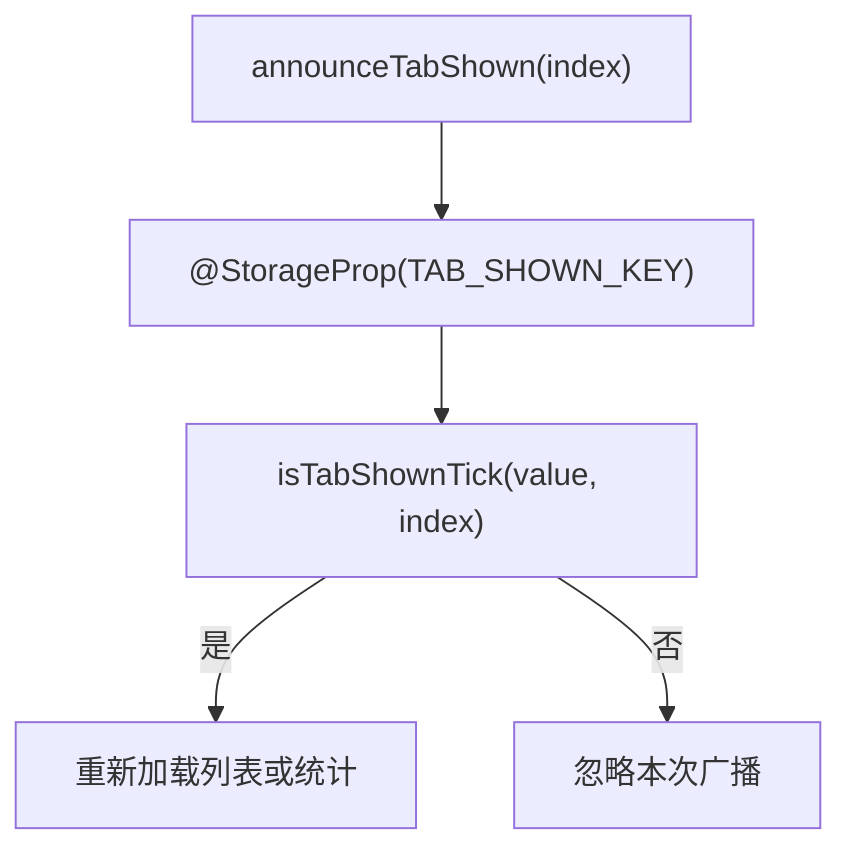
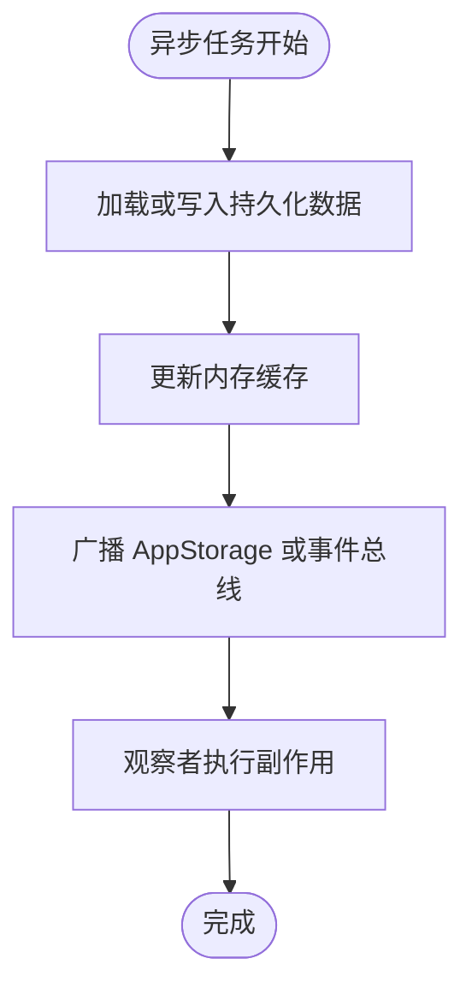
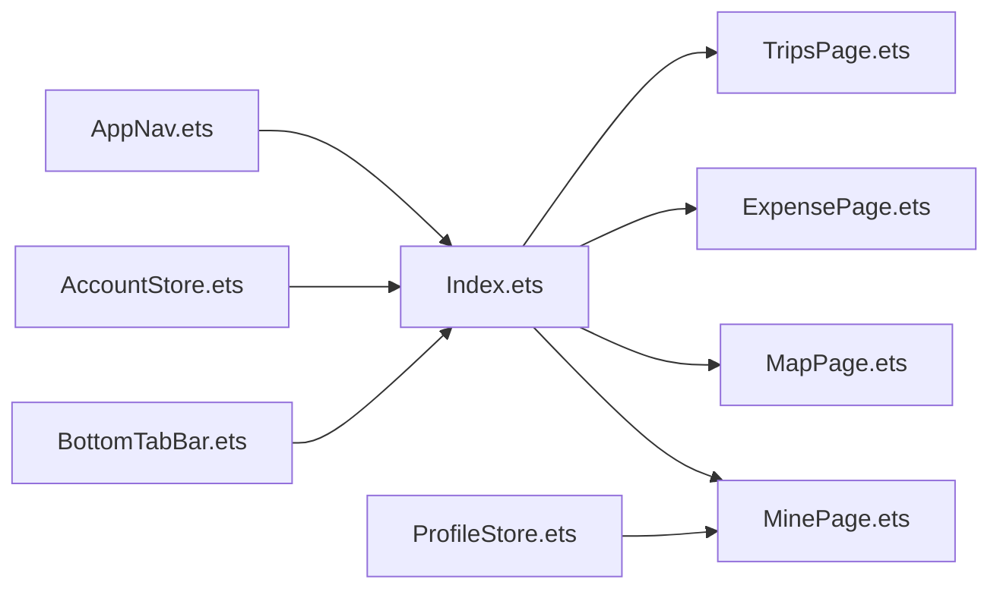

# 观察者模式：状态广播机制

<cite>
**本文引用的文件**   
- [AppNav.ets](file://entry/src/main/ets/common/constants/AppNav.ets)
- [Index.ets](file://entry/src/main/ets/pages/Index.ets)
- [AccountStore.ets](file://entry/src/main/ets/data/AccountStore.ets)
- [ProfileStore.ets](file://entry/src/main/ets/data/ProfileStore.ets)
- [TripReminder.ets](file://entry/src/main/ets/data/TripReminder.ets)
- [TripsPage.ets](file://entry/src/main/ets/pages/TripsPage.ets)
- [ExpensePage.ets](file://entry/src/main/ets/pages/ExpensePage.ets)
- [MapPage.ets](file://entry/src/main/ets/pages/MapPage.ets)
- [MinePage.ets](file://entry/src/main/ets/pages/MinePage.ets)
- [YoujingStartPage.ets](file://entry/src/main/ets/pages/YoujingStartPage.ets)
- [BottomTabBar.ets](file://entry/src/main/ets/components/BottomTabBar.ets)
</cite>

## 目录
1. [引言](#引言)
2. [项目结构中的观察者位置](#项目结构中的观察者位置)
3. [核心组件](#核心组件)
4. [架构总览](#架构总览)
5. [关键流程详解](#关键流程详解)
6. [依赖关系分析](#依赖关系分析)
7. [性能与内存注意事项](#性能与内存注意事项)
8. [故障排查指南](#故障排查指南)
9. [结论](#结论)

## 引言
本文聚焦仓库中基于 ArkTS 的观察者模式实践，围绕 `AppStorage` 广播、`@Watch` 订阅和通知回调展开。重点包括：
- `AppStorage` 作为全局状态总线的使用方式。
- AppNav 中 Tab 切换监听：`requestTab`、`announceTabShown`、`isTabShownTick` 如何协作。
- AccountStore 的用户登录态变更通知。
- ProfileStore 的用户资料偏好同步。
- 事件驱动架构在解耦、可扩展性和实时响应上的优势。
- `@Watch` 装饰器的使用示例与注意事项。
- 自定义事件总线设计思路、异步状态更新处理和循环依赖规避。
- 大量观察者场景下的性能优化、内存管理和调试技巧。

## 项目结构中的观察者位置
本仓采用“集中定义键 + 单点写入 + 多页面订阅”的事件驱动结构：
- 导航与 Tab 状态集中在 `AppNav.ets` 中定义键与广播函数。
- 根容器 `Index.ets` 通过 `@StorageProp` + `@Watch` 消费这些键并驱动 UI 切换。
- 业务 Store（如 AccountStore、ProfileStore）把领域状态写回 `AppStorage`，供任意页面观察。
- 各根页（地图、行程、费用、我的）通过相同的 `TAB_SHOWN_KEY` 广播重新加载数据。

**图示来源**
- [AppNav.ets:80-120](file://entry/src/main/ets/common/constants/AppNav.ets#L80-L120)
- [Index.ets:100-160](file://entry/src/main/ets/pages/Index.ets#L100-L160)
- [AccountStore.ets:80-100](file://entry/src/main/ets/data/AccountStore.ets#L80-L100)
- [ProfileStore.ets:110-130](file://entry/src/main/ets/data/ProfileStore.ets#L110-L130)

**章节来源**
- [AppNav.ets:80-120](file://entry/src/main/ets/common/constants/AppNav.ets#L80-L120)
- [Index.ets:100-160](file://entry/src/main/ets/pages/Index.ets#L100-L160)

## 核心组件
- AppNav：统一维护 Tab 相关键、深链目标、活动行程键、草稿脏标记、以及广播函数。
- Index：应用根容器，负责将外部深链或运行时请求转换为 HdsTabs 的索引切换，并广播“当前 Tab 已显示”。
- AccountStore：管理登录态，初始化完成后发布到 `AUTH_STATE_KEY`，供 UI 做闸门控制。
- ProfileStore：读写用户资料，保存后发布 `PROFILE_TICK_KEY`，触发资料区刷新。
- 根页（TripsPage、ExpensePage、MapPage、MinePage）：订阅 `TAB_SHOWN_KEY`，按自身 Tab 序号决定是否重取数据。
- BottomTabBar：低 SDK 降级分支底栏，演示了内部状态变化时的 `@State` 与事件处理，与全局广播形成对照。

**章节来源**
- [AppNav.ets:80-120](file://entry/src/main/ets/common/constants/AppNav.ets#L80-L120)
- [Index.ets:100-160](file://entry/src/main/ets/pages/Index.ets#L100-L160)
- [AccountStore.ets:80-100](file://entry/src/main/ets/data/AccountStore.ets#L80-L100)
- [ProfileStore.ets:110-130](file://entry/src/main/ets/data/ProfileStore.ets#L110-L130)
- [TripsPage.ets:80-90](file://entry/src/main/ets/pages/TripsPage.ets#L80-L90)
- [ExpensePage.ets:110-130](file://entry/src/main/ets/pages/ExpensePage.ets#L110-L130)
- [MapPage.ets:80-90](file://entry/src/main/ets/pages/MapPage.ets#L80-L90)
- [MinePage.ets:60-90](file://entry/src/main/ets/pages/MinePage.ets#L60-L90)
- [BottomTabBar.ets:120-200](file://entry/src/main/ets/components/BottomTabBar.ets#L120-L200)

## 架构总览
从数据流向看，本项目把 `AppStorage` 当作一个轻量级事件总线：
- 生产者只关心“状态变了”，不直接调用消费者。
- 消费者通过 `@StorageProp` 绑定键，并在 `@Watch` 中执行副作用。
- 键值通常带时间戳或序号，避免“同值不触发”的问题。

该结构天然解耦：新增消费者只需订阅已有键；新增生产者无需知道谁在看。

[无图示来源，因为这是概念性架构图]

## 关键流程详解

### AppNav 的 Tab 切换监听流程
Tab 切换由两条路径组成：
1. 运行期跨页签跳转：其他模块调用 `requestTab(index)`，Index 的 `@Watch('applyTabSwitch')` 解析出目标索引并调用 `changeIndex`。
2. 实际完成切换后：Index 调用 `announceTabShown(index)`，广播 `TAB_SHOWN_KEY`，根页再根据 `isTabShownTick(value, index)` 判断是否属于自己。

**图示来源**
- [AppNav.ets:89-100](file://entry/src/main/ets/common/constants/AppNav.ets#L89-L100)
- [Index.ets:120-140](file://entry/src/main/ets/pages/Index.ets#L120-L140)
- [Index.ets:420-430](file://entry/src/main/ets/pages/Index.ets#L420-L430)

**章节来源**
- [AppNav.ets:89-100](file://entry/src/main/ets/common/constants/AppNav.ets#L89-L100)
- [Index.ets:120-140](file://entry/src/main/ets/pages/Index.ets#L120-L140)
- [Index.ets:420-430](file://entry/src/main/ets/pages/Index.ets#L420-L430)

### 为什么键值要带时间戳
很多键值会重复写入相同语义的值，例如再次切到同一个 Tab、再次设置某个开关。ArkUI 的 `@Watch` 通常不会为“新值等于旧值”触发。因此仓库常用 `${index}:${Date.now()}` 这类格式，保证每次广播都是新值。

**图示来源**
- [AppNav.ets:89-100](file://entry/src/main/ets/common/constants/AppNav.ets#L89-L100)
- [AppNav.ets:100-120](file://entry/src/main/ets/common/constants/AppNav.ets#L100-L120)

**章节来源**
- [AppNav.ets:89-100](file://entry/src/main/ets/common/constants/AppNav.ets#L89-L100)
- [AppNav.ets:100-120](file://entry/src/main/ets/common/constants/AppNav.ets#L100-L120)

### AccountStore 的用户状态变更通知
AccountStore 的职责是登录态与设备身份准备。其关键行为如下：
- 初始化时读取本地偏好，恢复上次登录态。
- 无论成功还是失败，都会调用 `publish()` 把当前状态写入 `AUTH_STATE_KEY`。
- 未初始化前，键值为空字符串，用于阻止 UI 提前渲染登录门。
- 登录成功后清空权益缓存；登出后回到游客态并清理偏好。

**图示来源**
- [AccountStore.ets:80-100](file://entry/src/main/ets/data/AccountStore.ets#L80-L100)
- [AccountStore.ets:180-213](file://entry/src/main/ets/data/AccountStore.ets#L180-L213)

**章节来源**
- [AccountStore.ets:80-100](file://entry/src/main/ets/data/AccountStore.ets#L80-L100)
- [AccountStore.ets:180-213](file://entry/src/main/ets/data/AccountStore.ets#L180-L213)

### ProfileStore 的偏好设置同步
ProfileStore 负责用户资料的本地持久化与显示层出口：
- `loadProfile` 从 preferences 读取 JSON，缺字段兜底为空值。
- `saveProfile` 写完 preferences 后，向 `PROFILE_TICK_KEY` 广播一次时间戳。
- MinePage 等展示层通过 `@StorageProp(PROFILE_TICK_KEY) @Watch('onProfileTick')` 重新加载资料。

**图示来源**
- [ProfileStore.ets:110-130](file://entry/src/main/ets/data/ProfileStore.ets#L110-L130)
- [MinePage.ets:60-90](file://entry/src/main/ets/pages/MinePage.ets#L60-L90)

**章节来源**
- [ProfileStore.ets:110-130](file://entry/src/main/ets/data/ProfileStore.ets#L110-L130)
- [MinePage.ets:60-90](file://entry/src/main/ets/pages/MinePage.ets#L60-L90)

### 根页对“Tab 已显示”广播的处理
多个根页都订阅 `TAB_SHOWN_KEY`，但只在值以自身 Tab 序号开头时才重新拉取数据。这样可避免非当前 Tab 的广播造成多余刷新。

**图示来源**
- [AppNav.ets:94-100](file://entry/src/main/ets/common/constants/AppNav.ets#L94-L100)
- [TripsPage.ets:80-90](file://entry/src/main/ets/pages/TripsPage.ets#L80-L90)
- [ExpensePage.ets:110-130](file://entry/src/main/ets/pages/ExpensePage.ets#L110-L130)
- [MapPage.ets:80-90](file://entry/src/main/ets/pages/MapPage.ets#L80-L90)
- [MinePage.ets:60-90](file://entry/src/main/ets/pages/MinePage.ets#L60-L90)

**章节来源**
- [AppNav.ets:94-100](file://entry/src/main/ets/common/constants/AppNav.ets#L94-L100)
- [TripsPage.ets:80-90](file://entry/src/main/ets/pages/TripsPage.ets#L80-L90)
- [ExpensePage.ets:110-130](file://entry/src/main/ets/pages/ExpensePage.ets#L110-L130)
- [MapPage.ets:80-90](file://entry/src/main/ets/pages/MapPage.ets#L80-L90)
- [MinePage.ets:60-90](file://entry/src/main/ets/pages/MinePage.ets#L60-L90)

### 事件驱动架构的优势
- 解耦：生产者不依赖具体消费者，消费者也不依赖生产者实现细节。
- 可扩展：新增页面只需要订阅已有键，不需要修改现有广播逻辑。
- 实时响应：通过 `@Watch` 自动触发副作用，避免轮询。
- 可测试：键值和广播函数可以独立验证；UI 侧可模拟 `@Watch` 行为。

[无章节来源，因为这是通用分析]

### @Watch 装饰器使用示例与注意事项
在本仓中，`@Watch` 常见用法有三种：
1. 配合 `@StorageProp` 监听全局键：例如根页监听 Tab 切换广播、资料刷新广播。
2. 配合 `@Prop` 监听组件属性变化：例如子组件收到新数据后重建视图。
3. 配合 `@State` 监听本地状态变化：例如行程详情页按天索引切换。

注意事项：
- 如果新值等于旧值，`@Watch` 可能不触发，需要像 AppNav 那样追加时间戳。
- `@Watch` 回调应只做必要副作用，避免昂贵计算放在回调主线程。
- 不要在 `@Watch` 中直接写死 UI 布局参数，优先通过 `@StorageLink` 或 props 传递。
- 对于异步数据加载，应在 `@Watch` 中发起请求，而不是在回调里直接赋值复杂对象导致频繁重建。

**章节来源**
- [Index.ets:120-140](file://entry/src/main/ets/pages/Index.ets#L120-L140)
- [TripsPage.ets:80-90](file://entry/src/main/ets/pages/TripsPage.ets#L80-L90)
- [ExpensePage.ets:110-130](file://entry/src/main/ets/pages/ExpensePage.ets#L110-L130)
- [YoujingStartPage.ets:70-110](file://entry/src/main/ets/pages/YoujingStartPage.ets#L70-L110)

### 自定义事件总线设计建议
虽然本仓主要用 `AppStorage`，但如果未来需要更灵活的事件总线，可以参考以下设计：
- 定义事件类型枚举，避免字符串魔法值。
- 提供 `subscribe`、`unsubscribe`、`emit` 三个方法。
- 支持一次性订阅和条件订阅。
- 对高频事件做节流或去抖。
- 对异步事件提供错误回调和超时处理。
- 避免在事件回调中产生新的全局副作用，尽量返回纯结果。

[无章节来源，因为这是概念性设计建议]

### 如何处理异步状态更新
本仓的异步状态更新遵循“先落盘或先写缓存，再广播”的原则：
- AccountStore 先更新内部状态，再调用 `publish()` 写 `AUTH_STATE_KEY`。
- ProfileStore 先 flush preferences，再广播 `PROFILE_TICK_KEY`。
- TripReminder 先撤销旧提醒、再发布新提醒，并记录发布结果。

建议模式：

**图示来源**
- [AccountStore.ets:80-100](file://entry/src/main/ets/data/AccountStore.ets#L80-L100)
- [ProfileStore.ets:110-130](file://entry/src/main/ets/data/ProfileStore.ets#L110-L130)
- [TripReminder.ets:60-120](file://entry/src/main/ets/data/TripReminder.ets#L60-L120)

**章节来源**
- [AccountStore.ets:80-100](file://entry/src/main/ets/data/AccountStore.ets#L80-L100)
- [ProfileStore.ets:110-130](file://entry/src/main/ets/data/ProfileStore.ets#L110-L130)
- [TripReminder.ets:60-120](file://entry/src/main/ets/data/TripReminder.ets#L60-L120)

### 如何避免循环依赖
本仓通过以下方式降低循环依赖风险：
- 把路由和 Tab 常量放在 `AppNav.ets`，页面和 Ability 都从它读取，而不是互相引用。
- Store 之间职责清晰：AccountStore 不依赖 ProfileStore，ProfileStore 依赖 AccountStore 获取账号信息。
- UI 层只读 Store 提供的接口，不直接操作持久化细节。
- 广播键集中在常量文件中，避免多处硬编码字符串。

建议规则：
- 禁止 UI 组件直接相互调用业务方法。
- 禁止 Store 反向依赖 UI。
- 如果两个模块必须通信，引入事件键或事件总线。
- 对深层依赖抽取公共契约文件。

**章节来源**
- [AppNav.ets:1-40](file://entry/src/main/ets/common/constants/AppNav.ets#L1-L40)
- [ProfileStore.ets:1-40](file://entry/src/main/ets/data/ProfileStore.ets#L1-L40)
- [AccountStore.ets:1-40](file://entry/src/main/ets/data/AccountStore.ets#L1-L40)

## 依赖关系分析
从代码可见，观察者体系的核心依赖如下：

**图示来源**
- [AppNav.ets:80-120](file://entry/src/main/ets/common/constants/AppNav.ets#L80-L120)
- [Index.ets:100-160](file://entry/src/main/ets/pages/Index.ets#L100-L160)
- [AccountStore.ets:80-100](file://entry/src/main/ets/data/AccountStore.ets#L80-L100)
- [ProfileStore.ets:110-130](file://entry/src/main/ets/data/ProfileStore.ets#L110-L130)
- [BottomTabBar.ets:120-200](file://entry/src/main/ets/components/BottomTabBar.ets#L120-L200)

**章节来源**
- [AppNav.ets:80-120](file://entry/src/main/ets/common/constants/AppNav.ets#L80-L120)
- [Index.ets:100-160](file://entry/src/main/ets/pages/Index.ets#L100-L160)
- [AccountStore.ets:80-100](file://entry/src/main/ets/data/AccountStore.ets#L80-L100)
- [ProfileStore.ets:110-130](file://entry/src/main/ets/data/ProfileStore.ets#L110-L130)
- [BottomTabBar.ets:120-200](file://entry/src/main/ets/components/BottomTabBar.ets#L120-L200)

## 性能与内存注意事项
### 大量观察者的优化策略
- 减少广播频率：对高频 UI 状态使用节流，避免每帧广播。
- 合并广播：多个状态变化合并为一次 `AppStorage.setOrCreate`。
- 精准订阅：页面只订阅自身需要的键，避免全仓监听所有键。
- 懒加载：在 `@Watch` 中才发起数据请求，而不是在应用启动时全部拉取。

### 内存管理
- 在组件销毁时取消定时器、监听器和网络请求，防止已销毁组件继续写状态。
- 对长生命周期 Store，避免持有大对象引用；必要时释放不再使用的缓存。
- 对 `@Watch` 中的异步回调，注意闭包捕获的大对象。

### 调试技巧
- 给每个 `AppStorage` 键加日志，记录写入者和时间戳。
- 对 `@Watch` 回调打点，确认是否被触发、触发次数和耗时。
- 对 Tab 广播，打印 `value` 和 `index`，确认 `isTabShownTick` 判断是否正确。
- 对异步 Store，区分“初始化未完成”和“初始化失败”两种状态。

[无章节来源，因为这是通用指导]

## 故障排查指南
常见问题及定位方向：
- Tab 切过去不刷新：检查是否调用了 `announceTabShown(index)`，以及根页是否按 `isTabShownTick` 过滤。
- 重复切同一 Tab 不触发：检查键值是否带时间戳，避免旧值覆盖。
- 登录后仍显示游客界面：检查 `AUTH_STATE_KEY` 是否在 `AccountStore.publish()` 中写入，以及初始化顺序。
- 资料不更新：检查 `saveProfile` 是否写入 preferences 并广播 `PROFILE_TICK_KEY`。
- 根页首次进入数据陈旧：确认根页在 `aboutToAppear` 或 Tab 广播时重新加载。

**章节来源**
- [AppNav.ets:89-100](file://entry/src/main/ets/common/constants/AppNav.ets#L89-L100)
- [Index.ets:420-430](file://entry/src/main/ets/pages/Index.ets#L420-L430)
- [AccountStore.ets:80-100](file://entry/src/main/ets/data/AccountStore.ets#L80-L100)
- [ProfileStore.ets:110-130](file://entry/src/main/ets/data/ProfileStore.ets#L110-L130)
- [TripsPage.ets:80-90](file://entry/src/main/ets/pages/TripsPage.ets#L80-L90)
- [ExpensePage.ets:110-130](file://entry/src/main/ets/pages/ExpensePage.ets#L110-L130)

## 结论
本仓库通过 `AppStorage` 实现了简洁而有效的观察者模式：
- AppNav 统一管理导航广播键和函数。
- Index 作为根容器协调 Tab 切换与广播。
- AccountStore 和 ProfileStore 分别负责登录态和用户资料的状态广播。
- 根页通过 `@StorageProp` + `@Watch` 订阅广播，实现按需刷新。

这种架构的优势在于解耦、可扩展和实时响应；代价是需要在键命名、时序控制和广播频率上保持纪律。未来若事件规模扩大，可考虑引入结构化事件总线，同时保留 `AppStorage` 作为简单状态通道。

[无章节来源，因为这是总结性内容]