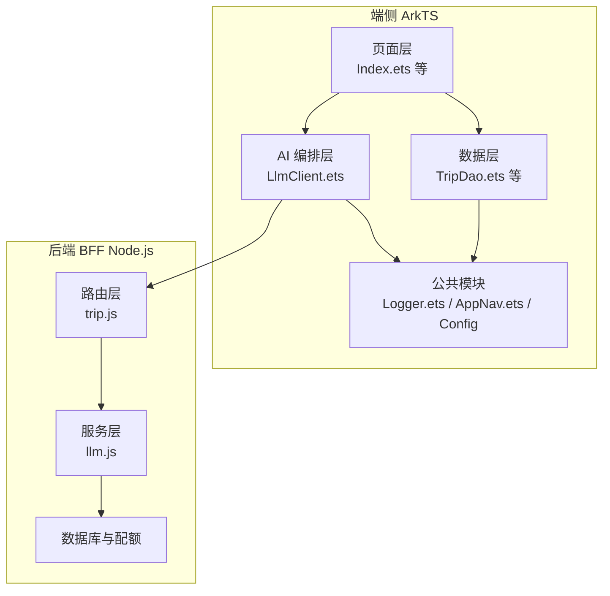
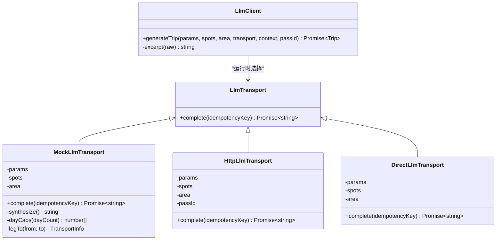
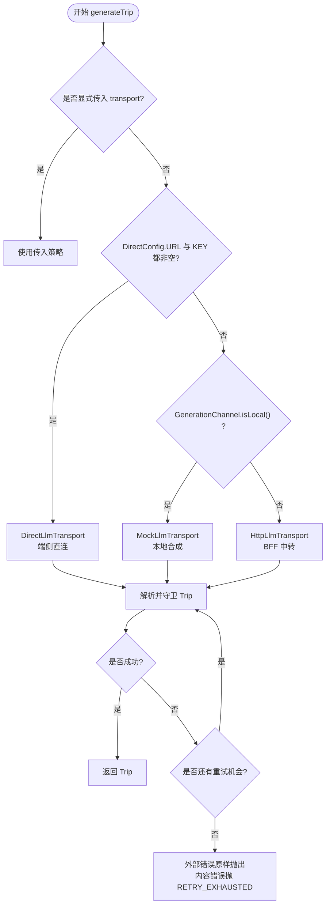
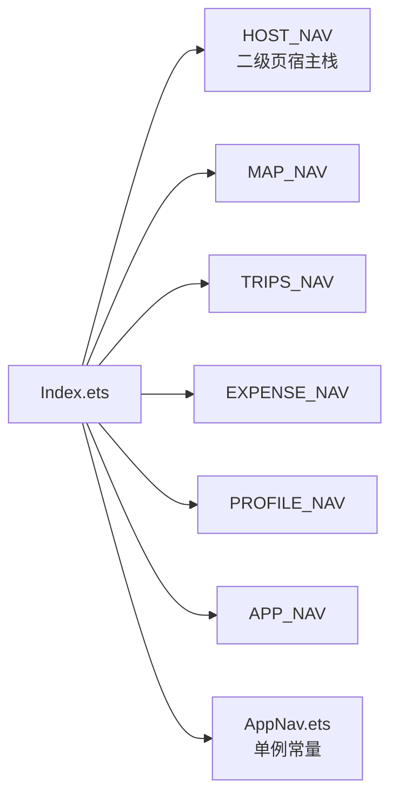
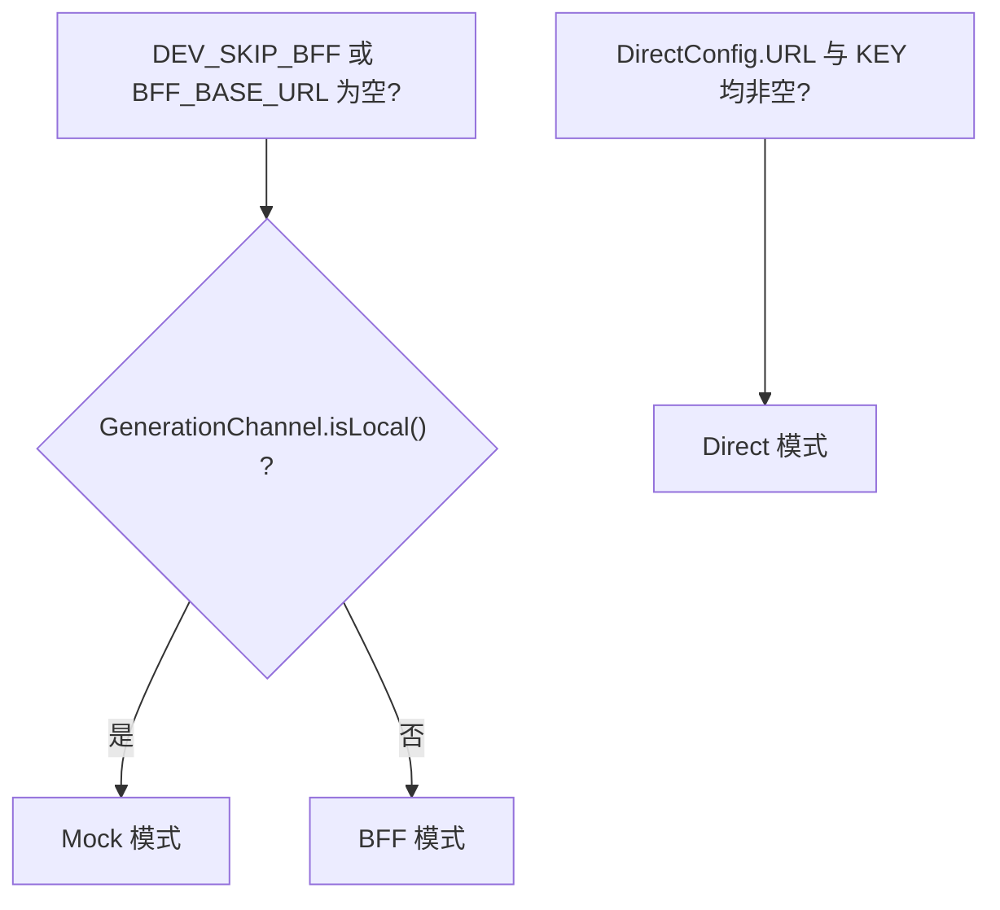
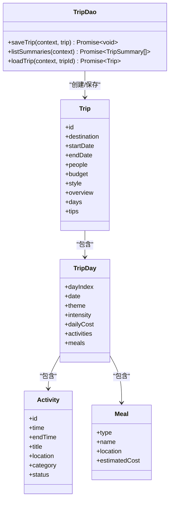
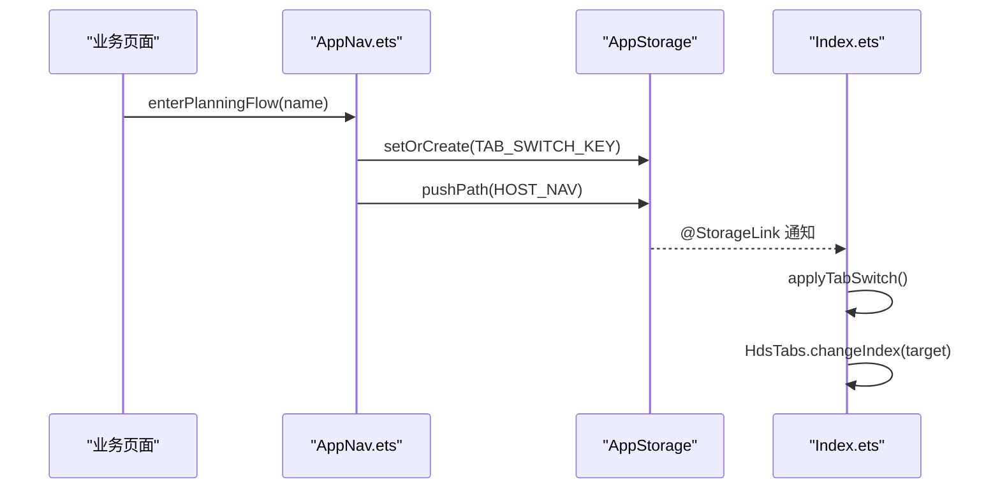
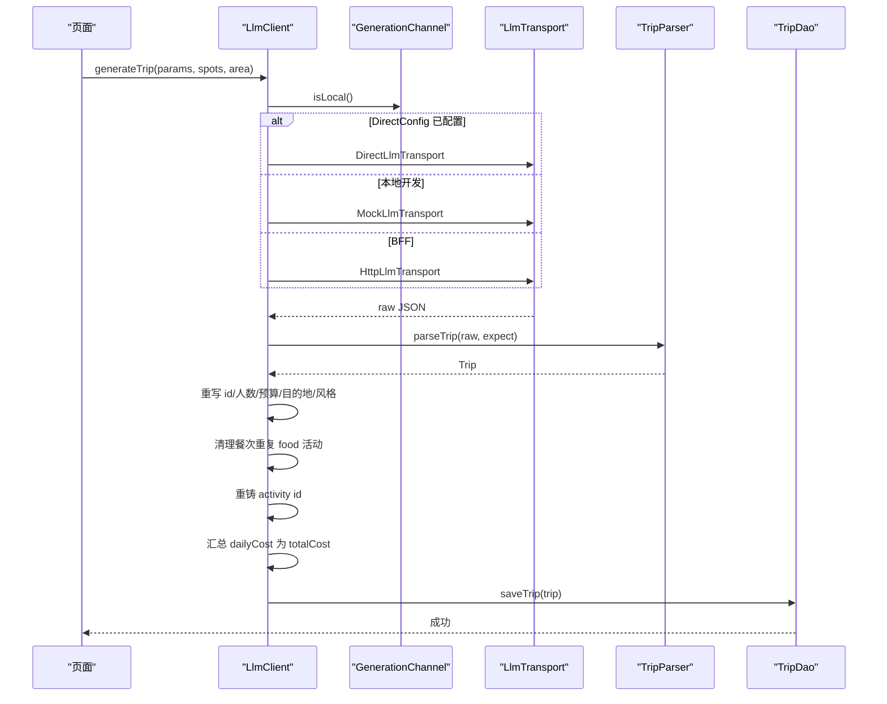

# 设计模式应用

<cite>
**本文引用的文件**   
- [LlmClient.ets](file://entry/src/main/ets/ai/LlmClient.ets)
- [DirectConfig.ets](file://entry/src/main/ets/common/config/DirectConfig.ets)
- [ApiConfig.ets](file://entry/src/main/ets/common/config/ApiConfig.ets)
- [MockConfig.ets](file://entry/src/main/ets/common/config/MockConfig.ets)
- [AppNav.ets](file://entry/src/main/ets/common/constants/AppNav.ets)
- [Logger.ets](file://entry/src/main/ets/common/logger/Logger.ets)
- [GenerationChannel.ets](file://entry/src/main/ets/utils/GenerationChannel.ets)
- [Index.ets](file://entry/src/main/ets/pages/Index.ets)
- [TripDao.ets](file://entry/src/main/ets/data/TripDao.ets)
- [llm.js](file://bff/src/services/llm.js)
- [trip.js](file://bff/src/routes/trip.js)
</cite>

## 目录

1. [引言](#引言)
2. [项目结构与设计模式定位](#项目结构与设计模式定位)
3. [核心模式总览](#核心模式总览)
4. [策略模式：LlmClient 的三种 LLM 传输策略](#策略模式llmclient-的三种-llm-传输策略)
5. [单例模式：导航、日志与配置的全局唯一实例](#单例模式导航日志与配置的全局唯一实例)
6. [工厂模式：数据对象与 DAO 的创建入口](#工厂模式数据对象与-dao-的创建入口)
7. [观察者模式：AppStorage 状态广播与事件驱动](#观察者模式appstorage-状态广播与事件驱动)
8. [模式组合与复杂场景](#模式组合与复杂场景)
9. [模式选择的权衡](#模式选择的权衡)
10. [性能与可靠性特征](#性能与可靠性特征)
11. [故障排查指南](#故障排查指南)
12. [结论](#结论)

## 引言

本仓库是一个面向旅行规划的场景化应用，包含 ArkTS 端侧代码和 Node.js BFF 服务。它把“生成行程”这一核心能力拆成清晰的层次：端侧负责用户输入、界面与编排，BFF 负责鉴权、配额、提示词构建与模型转发，数据库层负责持久化。

从设计模式视角看，这个工程没有堆砌理论模式，而是用几种常见模式解决实际问题：

| 模式 | 主要职责 | 典型位置 |
|---|---|---|
| 策略模式 | 在 Mock、BFF、Direct 三种 LLM 传输实现之间运行时切换 | `LlmClient` 及其 `LlmTransport` 接口 |
| 单例模式 | 提供全局唯一的导航栈、日志器、配置表 | `AppNav`、`Logger`、`ApiConfig`、`DirectConfig`、`MockConfig` |
| 工厂模式 | 集中构造 Trip、Day、Activity 等数据对象及 DAO | `TripDao`、各 Store/DAO 类 |
| 观察者模式 | 通过 AppStorage 实现跨组件状态广播 | `AppNav` 中的键值、`Index` 中的 `@StorageLink/@Watch` |

这些模式共同支撑了可测试性（Mock）、可配置性（BFF/Direct）、可维护性（统一日志）和响应式 UI（AppStorage）。

## 项目结构与设计模式定位

**图表来源**
- [Index.ets:1-60](file://entry/src/main/ets/pages/Index.ets#L1-L60)
- [LlmClient.ets:1-60](file://entry/src/main/ets/ai/LlmClient.ets#L1-L60)
- [TripDao.ets:1-30](file://entry/src/main/ets/data/TripDao.ets#L1-L30)
- [trip.js:1-30](file://bff/src/routes/trip.js#L1-L30)
- [llm.js:1-30](file://bff/src/services/llm.js#L1-L30)

项目按功能域组织：`ai/` 放 LLM 相关编排，`common/` 放日志、配置、错误等横切能力，`data/` 放数据库访问，`pages/` 放页面，`bff/` 是独立的后端服务。设计模式主要分布在 AI 编排层与公共模块中。

**章节来源**
- [Index.ets:1-60](file://entry/src/main/ets/pages/Index.ets#L1-L60)
- [LlmClient.ets:1-60](file://entry/src/main/ets/ai/LlmClient.ets#L1-L60)
- [TripDao.ets:1-30](file://entry/src/main/ets/data/TripDao.ets#L1-L30)
- [trip.js:1-30](file://bff/src/routes/trip.js#L1-L30)
- [llm.js:1-30](file://bff/src/services/llm.js#L1-L30)

## 核心模式总览

| 模式 | 是否显式声明 | 关键抽象 | 运行时行为 | 测试价值 |
|---|---:|---|---|---|
| 策略模式 | 有接口 `LlmTransport` | Mock、Http、Direct 三种传输 | 根据 DirectConfig、ApiConfig、GenerationChannel 动态选择 | 单元测试可直接注入 Mock |
| 单例模式 | 使用模块级常量或静态类 | NavPathStack、Logger、ApiConfig、DirectConfig、MockConfig | 全局共享同一实例 | 避免多栈/多配置导致的状态不一致 |
| 工厂模式 | 以类方法形式出现 | TripDao.saveTrip、TripDao.loadTrip 等 | 把原始行映射为业务对象 | 查询逻辑集中在 DAO |
| 观察者模式 | 基于 ArkUI AppStorage | 页签切换、活跃行程、草稿脏标记等 | 任意订阅方自动收到变化 | 解耦页面间状态同步 |

## 策略模式：LlmClient 的三种 LLM 传输策略

### 抽象与实现关系

LlmClient 不关心 LLM 到底走哪条通道，只依赖一个 `LlmTransport` 接口。当前有三个实现：

| 实现类 | 含义 | 适用场景 | 输出来源 |
|---|---|---|---|
| `MockLlmTransport` | 离线合成合法 Trip JSON | 无 BFF、开发期快速闭环 | 本地根据 PlanParams 和景点库生成 |
| `HttpLlmTransport` | 通过 BFF `/v1/trip/generate` 中转 | 生产环境或已部署 BFF | BFF 调用上游 LLM 后返回 trip 与 quota |
| `DirectLlmTransport` | 端侧直连 OpenAI 兼容 chat/completions | 开发兜底，上架前必须迁云 | DirectChat 直调模型 |

**图表来源**
- [LlmClient.ets:40-70](file://entry/src/main/ets/ai/LlmClient.ets#L40-L70)
- [LlmClient.ets:53-226](file://entry/src/main/ets/ai/LlmClient.ets#L53-L226)
- [LlmClient.ets:228-326](file://entry/src/main/ets/ai/LlmClient.ets#L228-L326)
- [LlmClient.ets:328-482](file://entry/src/main/ets/ai/LlmClient.ets#L328-L482)

### 运行时选择流程

**图表来源**
- [LlmClient.ets:350-482](file://entry/src/main/ets/ai/LlmClient.ets#L350-L482)
- [GenerationChannel.ets:11-42](file://entry/src/main/ets/utils/GenerationChannel.ets#L11-L42)
- [DirectConfig.ets:1-33](file://entry/src/main/ets/common/config/DirectConfig.ets#L1-L33)
- [ApiConfig.ets:1-66](file://entry/src/main/ets/common/config/ApiConfig.ets#L1-L66)

### 三种策略的使用场景

#### Mock 策略

Mock 不是简单返回固定字符串，而是根据用户输入的目的地、日期、人数、预算、风格以及选点列表，确定性合成一个完整的 Trip 对象。它会：

- 按节奏选项切分天段；
- 按剩余站点数量均匀分配每天活动；
- 估算通勤信息；
- 生成午餐、晚餐、住宿、费用摘要；
- 对地图来源城市补上“预约信息未获取”说明；
- 最终序列化为 JSON，进入完整解析和守卫链路。

这使 Mock 能等价验证真实管线，而不仅仅是断言“接口返回 200”。

**章节来源**
- [LlmClient.ets:53-226](file://entry/src/main/ets/ai/LlmClient.ets#L53-L226)

#### BFF 策略

HttpLlmTransport 把业务参数发送到 BFF，不再自己拼接 OpenAI 消息体。BFF 负责：

- 校验请求字段；
- 判断额度来源；
- 预留额度；
- 构建提示词；
- 调用上游 LLM；
- 尝试修正坏 JSON；
- 校验 Trip 结构；
- 提交额度并返回 trip 与 quota 快照。

端侧则负责：

- 设置 Authorization 与 Idempotency-Key；
- 处理 4xx/5xx 到 AppError 的错误码映射；
- 合并权益快照；
- 超时和网络失败分类；
- 票据失效时重新激活设备。

**章节来源**
- [LlmClient.ets:228-326](file://entry/src/main/ets/ai/LlmClient.ets#L228-L326)
- [trip.js:1-200](file://bff/src/routes/trip.js#L1-L200)
- [llm.js:1-98](file://bff/src/services/llm.js#L1-L98)

#### Direct 策略

DirectLlmTransport 只在 DirectConfig 同时配置 URL 和 KEY 时启用。它复用 PromptBuilder，直接调用 DirectChat，适合开发期绕过 BFF 调试模型行为。注释明确要求：上架前必须迁移到云函数或 BFF，发布包不能携带 Key。

**章节来源**
- [LlmClient.ets:328-348](file://entry/src/main/ets/ai/LlmClient.ets#L328-L348)
- [DirectConfig.ets:1-33](file://entry/src/main/ets/common/config/DirectConfig.ets#L1-L33)

### 为什么用策略模式而不是条件分支

如果所有传输逻辑都写在 LlmClient 内部，会出现以下问题：

1. **违反单一职责**：LlmClient 既要编排解析、重试、回填，又要决定 HTTP、Direct、Mock 三条网络路径。
2. **难以测试**：Mock 需要模拟网络层，但 Mock 本身就是网络层，测试会互相污染。
3. **难以扩展**：新增第四种传输方式需要修改已有分支，容易遗漏。
4. **难以隔离风险**：BFF 不可用时不应影响 Mock 和 Direct 的单元测试。
5. **决策与执行耦合**：选择策略的逻辑和执行策略的逻辑混在一起，不利于替换 GenerationChannel 的选择规则。

策略模式把“怎么生成”和“由谁生成”分开，让 LlmClient 专注编排、重试、容错和数据归一化。

**章节来源**
- [LlmClient.ets:1-60](file://entry/src/main/ets/ai/LlmClient.ets#L1-L60)
- [LlmClient.ets:350-482](file://entry/src/main/ets/ai/LlmClient.ets#L350-L482)

## 单例模式：导航、日志与配置的全局唯一实例

### 导航栈单例：AppNav

`AppNav.ets` 暴露多个模块级常量，每个都是全局唯一的 `NavPathStack`：

| 常量 | 用途 |
|---|---|
| `APP_NAV` | 默认根导航栈 |
| `MAP_NAV` | 地图页签栈 |
| `EXPENSE_NAV` | 费用页签栈 |
| `TRIPS_NAV` | 行程历史/最近列表栈 |
| `PROFILE_NAV` | 新“我的”页栈 |
| `HOST_NAV` | 二级页全屏宿主栈 |

此外还提供：

- 页签序号常量；
- DOCK_TABS 单一真值源；
- 深链路由到正确栈的方法；
- 切页签、广播 TabShown、活跃行程等工具函数。

**图表来源**
- [AppNav.ets:1-60](file://entry/src/main/ets/common/constants/AppNav.ets#L1-L60)
- [Index.ets:1-60](file://entry/src/main/ets/pages/Index.ets#L1-L60)

**章节来源**
- [AppNav.ets:1-200](file://entry/src/main/ets/common/constants/AppNav.ets#L1-L200)
- [Index.ets:1-60](file://entry/src/main/ets/pages/Index.ets#L1-L60)

### 日志器单例：Logger

`Logger.ets` 是一个静态封装类，对外暴露 debug、info、warn、error 四个方法。它把 hilog 的输出统一加上 YouJing. 前缀，并在 debug 级别受 BuildConfig.IS_DEBUG 控制。

这种实现是典型的单例风格：类本身不要求 new，所有调用通过静态方法进入同一个 DOMAIN 和 TAG_PREFIX。其好处是：

- 所有日志可被系统层过滤；
- 禁止直接 console.log；
- 模块 tag 命名统一；
- 调试开关集中管理。

**章节来源**
- [Logger.ets:1-35](file://entry/src/main/ets/common/logger/Logger.ets#L1-L35)

### 配置单例：ApiConfig、DirectConfig、MockConfig

这三个配置文件都是模块级导出对象，天然具有全局唯一语义：

| 配置 | 作用 | 重要约束 |
|---|---|---|
| ApiConfig | 网络端点、超时、BFF 地址、开发旁路开关 | 修改需全量重编；DEV_SKIP_BFF 仅开发态有效 |
| DirectConfig | 端侧直连 LLM 的 URL、KEY、MODEL、MAX_TOKENS | 不得入库；上架前清空 KEY |
| MockConfig | 数据层 Mock 开关 | 发布前必须置 false |

**图表来源**
- [ApiConfig.ets:1-66](file://entry/src/main/ets/common/config/ApiConfig.ets#L1-L66)
- [DirectConfig.ets:1-33](file://entry/src/main/ets/common/config/DirectConfig.ets#L1-L33)
- [MockConfig.ets:1-15](file://entry/src/main/ets/common/config/MockConfig.ets#L1-L15)
- [GenerationChannel.ets:11-42](file://entry/src/main/ets/utils/GenerationChannel.ets#L11-L42)

**章节来源**
- [ApiConfig.ets:1-66](file://entry/src/main/ets/common/config/ApiConfig.ets#L1-L66)
- [DirectConfig.ets:1-33](file://entry/src/main/ets/common/config/DirectConfig.ets#L1-L33)
- [MockConfig.ets:1-15](file://entry/src/main/ets/common/config/MockConfig.ets#L1-L15)

### 为什么用单例而非依赖注入

这个项目没有引入 DI 容器，主要原因包括：

1. **ArkTS/ArkUI 生态特性**：AppStorage、@Provide/@Consumer、@Entry/@Component 已经承担了部分依赖传播职责。
2. **全局状态确实需要全局入口**：导航栈、日志、配置本来就是全局资源，DI 反而增加样板代码。
3. **测试仍可通过注入策略完成**：LlmClient.generateTrip 接受可选 transport 参数，Mock 可在测试中注入，不需要整个框架支持 DI。
4. **复杂度可控**：项目规模中等，单例足够表达“全局唯一”语义。

需要注意的风险是：单例会隐藏隐式依赖，容易形成紧耦合。因此本项目把单例范围控制在导航、日志、配置三个明确领域，业务逻辑尽量通过参数传递。

**章节来源**
- [AppNav.ets:1-60](file://entry/src/main/ets/common/constants/AppNav.ets#L1-L60)
- [Logger.ets:1-35](file://entry/src/main/ets/common/logger/Logger.ets#L1-L35)
- [LlmClient.ets:350-370](file://entry/src/main/ets/ai/LlmClient.ets#L350-L370)

## 工厂模式：数据对象与 DAO 的创建入口

### TripDao 作为工厂

`TripDao.ets` 不只是数据库访问对象，也承担数据对象创建职责：

- `saveTrip`：把 Trip、TripDay、Activity、Meal 等对象写入 RDB。
- `listSummaries`：聚合查询并构造 TripSummary 列表。
- `loadTrip`：从 trip、trip_day、activity、meal 多张表拼装出完整 Trip 对象。

**图表来源**
- [TripDao.ets:1-30](file://entry/src/main/ets/data/TripDao.ets#L1-L30)
- [TripDao.ets:31-200](file://entry/src/main/ets/data/TripDao.ets#L31-L200)

### 工厂模式的体现

严格来说，这里更接近“数据组装工厂”而非 GoF 的 Factory Method。它的特点是：

- 外部调用者不需要知道 trip、trip_day、activity、meal 之间的关联主键；
- SQL 与业务对象映射集中在 DAO；
- 读取端只需调用 loadTrip 得到完整 Trip；
- 写入端只需传入 Trip，DAO 负责拆分插入。

这也带来一个重要约束：TripDao 要维护对象模型和数据库 schema 的一致性。一旦 Trip 新增字段，saveTrip 和 loadTrip 都必须同步更新。

**章节来源**
- [TripDao.ets:1-200](file://entry/src/main/ets/data/TripDao.ets#L1-L200)

## 观察者模式：AppStorage 状态广播与事件驱动

### AppStorage 作为状态总线

`AppNav.ets` 定义了一系列 AppStorage 键，例如：

| 键 | 含义 |
|---|---|
| TAB_INDEX_KEY | 外部深链初始页签 |
| TAB_SWITCH_KEY | 运行期切页签请求 |
| TAB_SHOWN_KEY | 当前 tab 显示广播 |
| ACTIVE_TRIP_KEY | 最后打开的行程 |
| DRAFT_DIRTY_KEY | 规划草稿是否被改动 |

`Index.ets` 通过 `@StorageLink` 和 `@StorageProp` 订阅这些键，从而实现：

- 冷启深链直接落在目标 tab；
- 运行期其他页面发起切 tab；
- 切回页签时刷新行程列表；
- 首页根据草稿脏标记决定是否显示续写按钮。

**图表来源**
- [AppNav.ets:80-140](file://entry/src/main/ets/common/constants/AppNav.ets#L80-L140)
- [Index.ets:1-60](file://entry/src/main/ets/pages/Index.ets#L1-L60)

### 观察者模式的优点

1. **跨组件解耦**：导航逻辑不直接引用具体页面。
2. **时间顺序清晰**：切 tab 请求和广播都带时间戳，防止同页签重复触发。
3. **与 ArkUI 生命周期结合**：@StorageLink 在 build 中消费，避免无效订阅。
4. **支持冷启和运行期两条路径**：冷启用初始 index，运行期用 changeIndex。

### 注意事项

- 如果只挂 link 但不进入 build，ArkUI 不会建立更新绑定，表现为“写了但没刷新”。
- 键名变更需要同步更新定义处和所有消费者。
- AppStorage 是进程内全局状态，不适合承载大规模高频数据。
- 多个订阅方可能重复计算，应确保监听回调轻量。

**章节来源**
- [AppNav.ets:80-160](file://entry/src/main/ets/common/constants/AppNav.ets#L80-L160)
- [Index.ets:60-140](file://entry/src/main/ets/pages/Index.ets#L60-L140)

## 模式组合与复杂场景

### LLM 生成一次完整调用链

**图表来源**
- [LlmClient.ets:350-482](file://entry/src/main/ets/ai/LlmClient.ets#L350-L482)
- [TripDao.ets:31-120](file://entry/src/main/ets/data/TripDao.ets#L31-L120)

### 模式组合要点

| 场景 | 使用模式 | 说明 |
|---|---|---|
| 选择 LLM 传输 | 策略模式 + 单例配置 | 策略决定行为，配置决定启用条件 |
| 跨页面跳转 | 单例导航栈 + 观察者 | AppNav 提供栈，AppStorage 广播意图 |
| 数据读写 | 工厂 + 观察者 | DAO 创建对象，Store/Page 订阅状态变化 |
| 重试与降级 | 策略 + 错误处理 | 外层重试，不同错误保留原始原因 |
| 开发与生产差异 | 单例配置 + 策略 | ApiConfig、DirectConfig、MockConfig 控制分支 |

### 复杂场景注意事项

1. **策略选择条件分散**：GenerationChannel、DirectConfig、ApiConfig 三者共同决定最终策略，阅读时需要一起看。
2. **单例副作用**：AppStorage 的写操作会影响所有订阅者，应避免频繁写大对象。
3. **DAO 与模型强耦合**：TripDao 既读库又组装对象，重构时需小心保持契约稳定。
4. **重试边界**：LlmClient 的重试针对“生成失败”，不应无限重试网络错误。
5. **幂等键生成**：每次调用都生成新的 idempotencyKey，BFF 层再根据 key 去重。

**章节来源**
- [LlmClient.ets:350-482](file://entry/src/main/ets/ai/LlmClient.ets#L350-L482)
- [GenerationChannel.ets:11-42](file://entry/src/main/ets/utils/GenerationChannel.ets#L11-L42)
- [AppNav.ets:80-160](file://entry/src/main/ets/common/constants/AppNav.ets#L80-L160)
- [TripDao.ets:31-200](file://entry/src/main/ets/data/TripDao.ets#L31-L200)

## 模式选择的权衡

### 策略模式 vs 条件分支

| 维度 | 策略模式 | 条件分支 |
|---|---|---|
| 可扩展性 | 新增策略只需加实现类 | 新增分支要改已有函数 |
| 可测试性 | 可注入具体实现 | 需要 mock 整段分支 |
| 可读性 | 关注点分离 | 长 if/else 易膨胀 |
| 启动成本 | 多一个接口和类 | 零额外类型 |
| 适用阶段 | 多种实现可能长期共存 | 临时或一次性分支 |

本项目最终选择策略模式，因为 Mock、BFF、Direct 不是临时分支，而是长期并存的生产、开发和兜底路径。

### 单例 vs 依赖注入

| 维度 | 单例 | 依赖注入 |
|---|---|---|
| 使用成本 | 直接 import | 需要容器或手动传参 |
| 全局可见性 | 天然全局 | 需要显式传递 |
| 测试难度 | 可通过局部覆盖或注入策略缓解 | 通常更容易替换 |
| 耦合度 | 容易隐藏依赖 | 依赖关系更透明 |
| 适用场景 | 全局资源、状态中心 | 复杂装配、高可测性需求 |

本项目采用折中方案：基础设施用单例，核心算法通过参数注入策略，避免为小项目引入重型 DI。

### 观察者 vs 主动轮询

| 维度 | AppStorage 观察者 | 主动轮询 |
|---|---|---|
| 实时性 | 状态变化即通知 | 需要定时检查 |
| 性能 | 仅在订阅方重建时更新 | 轮询开销固定 |
| 一致性 | 由 ArkUI 保证渲染绑定 | 容易竞态 |
| 复杂度 | 键名、类型需约定 | 逻辑简单但易漏检 |

对于导航、行程、草稿这类低频全局状态，观察者明显优于轮询。

**章节来源**
- [LlmClient.ets:350-370](file://entry/src/main/ets/ai/LlmClient.ets#L350-L370)
- [AppNav.ets:80-160](file://entry/src/main/ets/common/constants/AppNav.ets#L80-L160)

## 性能与可靠性特征

### 策略模式性能

- Mock 纯内存合成，延迟极低，适合端到端联调。
- HttpLlmTransport 使用 http.createHttp 并 finally 销毁连接，避免连接泄漏。
- DirectLlmTransport 复用 PromptBuilder，避免重复提示词构建。
- 策略选择发生在调用入口，不在热路径中反复判断。

### 单例模式性能

- Logger 静态调用无对象分配。
- AppNav 的 NavPathStack 由系统持有，应用只持引用。
- 配置对象在模块加载时初始化，避免重复构造。

### 观察者模式性能

- AppStorage 适合低频状态，不适合高频事件流。
- Index 对 dockPill 等高频交互使用 State 而非 AppStorage，避免 AppStorage 成为瓶颈。
- 切 tab 广播带时间戳，避免重复触发。

### 可靠性特征

| 问题 | 处理方式 |
|---|---|
| LLM 返回非法 JSON | BFF 先尝试修复，仍失败则报 LLM_INVALID_JSON |
| 网络超时 | 区分平台 code 2300025 为 NETWORK_TIMEOUT |
| 票据失效 | 重新激活设备后重试一次 |
| 额度耗尽 | 不调第二次，刷新权益缓存 |
| 模型输出重复餐次活动 | 过滤标题匹配餐次的 FOOD 活动 |
| 活动 id 冲突 | 按天序重铸 d{n}-a{m} |
| totalCost 不一致 | 改为 days.dailyCost 求和 |

**章节来源**
- [LlmClient.ets:228-482](file://entry/src/main/ets/ai/LlmClient.ets#L228-L482)
- [trip.js:120-200](file://bff/src/routes/trip.js#L120-L200)
- [llm.js:40-98](file://bff/src/services/llm.js#L40-L98)

## 故障排查指南

### 生成行程一直失败

排查顺序：

1. 确认 GenerationChannel 实际走哪条通道；
2. 如果是 Direct，检查 DirectConfig.URL 和 KEY 是否同时非空；
3. 如果是 BFF，检查 ApiConfig.BFF_BASE_URL 和 LLM_CHAT_ENDPOINT；
4. 查看 Logger 输出的传输选择和重试次数；
5. 检查 BFF 日志中的 prompt_mode、quota_source、finish_reason；
6. 若返回 429，注意这是限流，不是普通 5xx；
7. 若返回 402，不要重试，应刷新权益。

**章节来源**
- [LlmClient.ets:350-482](file://entry/src/main/ets/ai/LlmClient.ets#L350-L482)
- [trip.js:120-200](file://bff/src/routes/trip.js#L120-L200)
- [llm.js:40-98](file://bff/src/services/llm.js#L40-L98)

### 切页签不生效

排查顺序：

1. 确认是否通过 AppNav.requestTab 或 enterPlanningFlow 发起；
2. 检查目标 index 是否在 DOCK_TABS 范围内；
3. 确认 Index 中 @StorageLink 是否正确订阅 TAB_SWITCH_KEY；
4. 检查 isTabRoot 判定，根路由不应重复 push；
5. 检查二级页是否 push 到了 HOST_NAV 而不是某个 tab 私有栈。

**章节来源**
- [AppNav.ets:80-200](file://entry/src/main/ets/common/constants/AppNav.ets#L80-L200)
- [Index.ets:120-200](file://entry/src/main/ets/pages/Index.ets#L120-L200)

### 日志找不到

排查顺序：

1. 确认是否通过 Logger 调用，而不是 console.log；
2. 确认 tag 是否符合模块命名；
3. 确认调试日志是否开启 BuildConfig.IS_DEBUG；
4. 在设备上用 hilog 过滤 YouJing. 前缀。

**章节来源**
- [Logger.ets:1-35](file://entry/src/main/ets/common/logger/Logger.ets#L1-L35)

### 行程保存后数据异常

排查顺序：

1. 检查 TripDao.saveTrip 是否按 trip.id 先删后插；
2. 检查 activity.id 是否已由 LlmClient 重铸；
3. 检查 Trip.summary.highlights、tips、categoryBudgets 的 JSON 序列化；
4. 检查 user_id 是否与 AccountStore.uid 一致；
5. 检查 days 和 activities 是否按 day_index 排序组装。

**章节来源**
- [TripDao.ets:31-200](file://entry/src/main/ets/data/TripDao.ets#L31-L200)
- [LlmClient.ets:390-470](file://entry/src/main/ets/ai/LlmClient.ets#L390-L470)

## 结论

这个项目的模式使用以实用为导向：

- **策略模式**解决了 LLM 传输的多环境问题，使 Mock、BFF、Direct 可以并行演进；
- **单例模式**提供了稳定的全局入口，用于导航、日志和配置；
- **工厂模式**把数据对象创建集中在 DAO，降低页面层的数据库知识；
- **观察者模式**借助 AppStorage 实现了低耦合的跨组件状态同步。

最值得关注的工程纪律是：模式服务于问题，而不是反过来。策略模式用在真正有多实现的地方，单例只用于全局资源，观察者只用于低频状态，DAO 同时承担工厂职责是因为数据组装本就属于数据层。未来若 LLM 传输进一步增多，可考虑把“选择策略”的规则也抽成可配置策略；若业务对象变多，可逐步引入更明确的工厂抽象；若跨组件通信变复杂，可考虑在 AppStorage 之外补充专用事件通道。