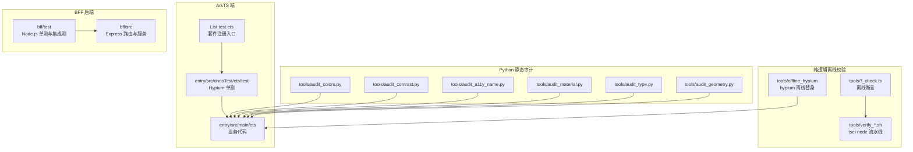
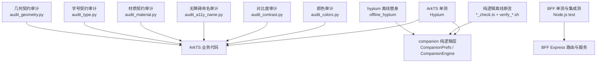
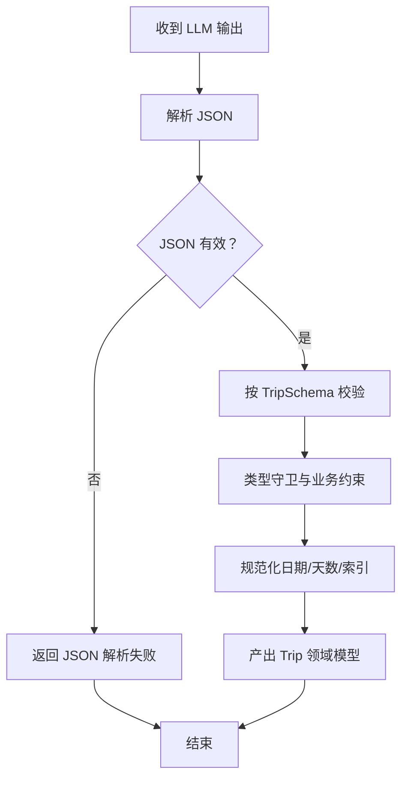
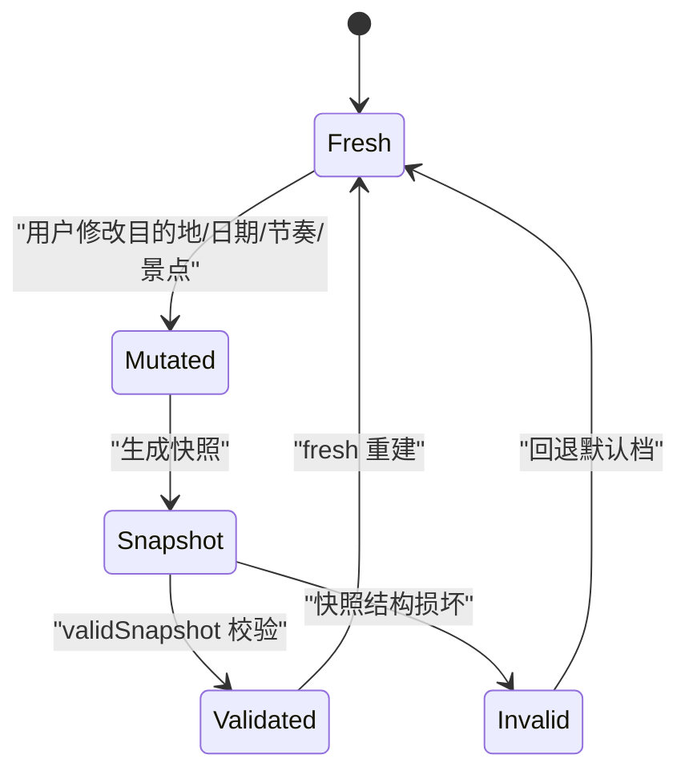
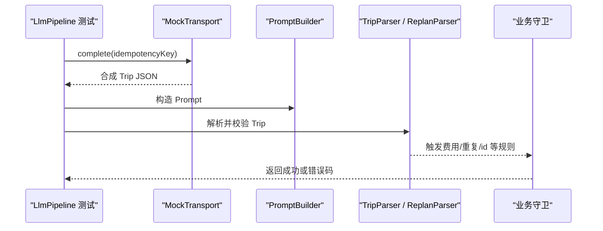
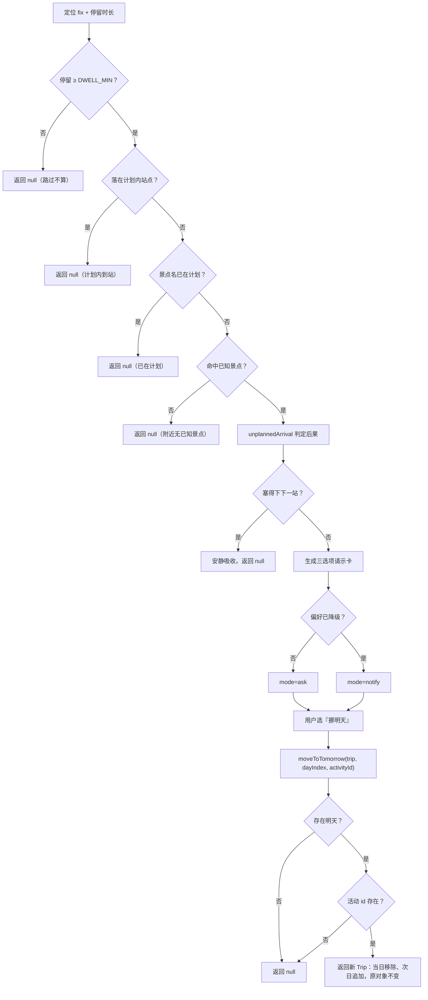
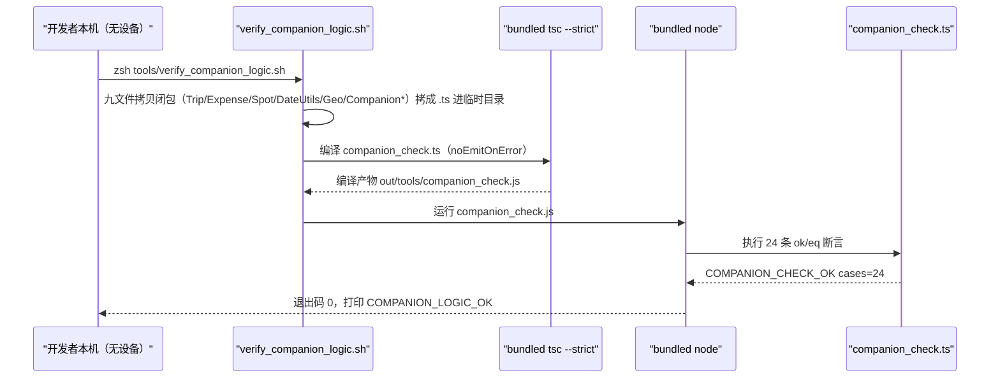
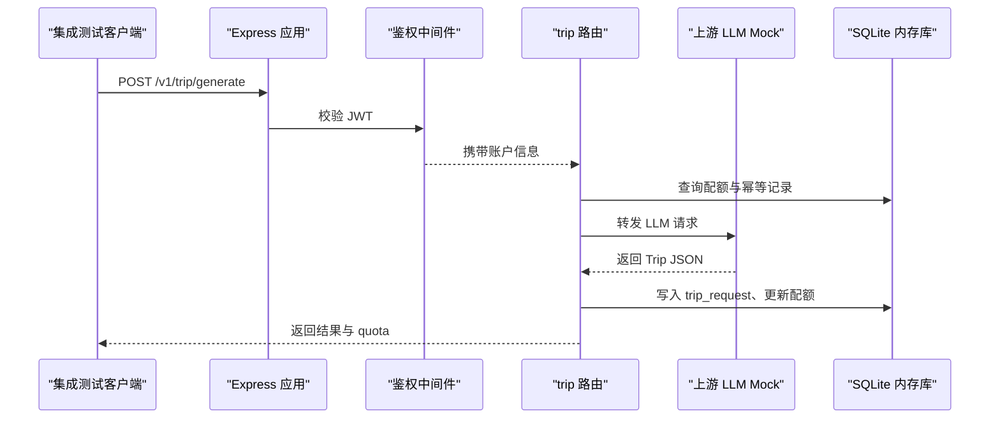
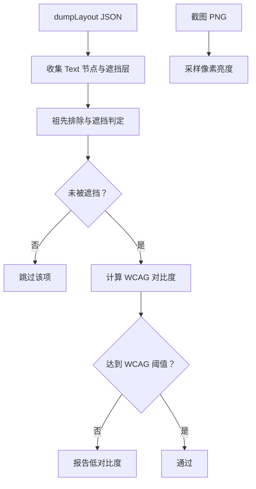
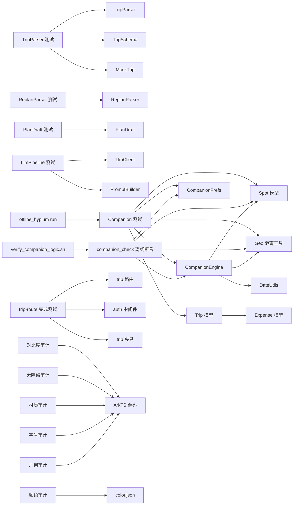

# 测试指南

<cite>
**本文引用的文件**
- [entry/src/ohosTest/module.json5](file://entry/src/ohosTest/module.json5)
- [bff/package.json](file://bff/package.json)
- [bff/test/trip-route.integration.test.js](file://bff/test/trip-route.integration.test.js)
- [bff/test/fixtures/trip.js](file://bff/test/fixtures/trip.js)
- [entry/src/ohosTest/ets/test/TripParser.test.ets](file://entry/src/ohosTest/ets/test/TripParser.test.ets)
- [entry/src/ohosTest/ets/test/LlmPipeline.test.ets](file://entry/src/ohosTest/ets/test/LlmPipeline.test.ets)
- [entry/src/ohosTest/ets/test/PlanDraft.test.ets](file://entry/src/ohosTest/ets/test/PlanDraft.test.ets)
- [entry/src/ohosTest/ets/test/ReplanParser.test.ets](file://entry/src/ohosTest/ets/test/ReplanParser.test.ets)
- [entry/src/ohosTest/ets/test/Companion.test.ets](file://entry/src/ohosTest/ets/test/Companion.test.ets)
- [entry/src/ohosTest/ets/test/List.test.ets](file://entry/src/ohosTest/ets/test/List.test.ets)
- [entry/src/main/ets/companion/CompanionPrefs.ets](file://entry/src/main/ets/companion/CompanionPrefs.ets)
- [entry/src/main/ets/companion/CompanionEngine.ets](file://entry/src/main/ets/companion/CompanionEngine.ets)
- [entry/src/main/ets/utils/Geo.ets](file://entry/src/main/ets/utils/Geo.ets)
- [tools/companion_check.ts](file://tools/companion_check.ts)
- [tools/verify_companion_logic.sh](file://tools/verify_companion_logic.sh)
- [tools/offline_hypium/shim.mjs](file://tools/offline_hypium/shim.mjs)
- [tools/offline_hypium/run.mjs](file://tools/offline_hypium/run.mjs)
- [tools/audit_colors.py](file://tools/audit_colors.py)
- [tools/audit_contrast.py](file://tools/audit_contrast.py)
- [tools/audit_a11y_name.py](file://tools/audit_a11y_name.py)
- [tools/audit_material.py](file://tools/audit_material.py)
- [tools/audit_type.py](file://tools/audit_type.py)
- [tools/audit_geometry.py](file://tools/audit_geometry.py)
</cite>

## 目录
1. [引言](#引言)
2. [项目结构](#项目结构)
3. [核心组件](#核心组件)
4. [架构总览](#架构总览)
5. [详细组件分析](#详细组件分析)
6. [依赖分析](#依赖分析)
7. [性能考量](#性能考量)
8. [故障排查指南](#故障排查指南)
9. [结论](#结论)

## 更新摘要
**本次变更内容**
- 「伴随助手逻辑测试」小节同步扩容：`Companion.test.ets` 由三组 `describe` 增至四组，新增 `CompanionEngine.moveToTomorrow` 套件（挪移到次日、无明天返回 null、活动缺失返回 null），`detectUnplanned` 五分支用例齐备。
- 「纯逻辑离线校验工作流」小节同步更新：`companion_check.ts` 断言规模扩充，成功标志输出为 `COMPANION_CHECK_OK cases=24`；`verify_companion_logic.sh` 拷贝闭包扩展至 `model/Spot.ets`、`model/Expense.ets`、`utils/Geo.ets` 等文件。
- 「依赖分析」补充 `Companion.test.ets` 与 `companion_check.ts` 对 `model/Spot`、`utils/Geo` 的新增依赖，以及 `Trip → Expense` 的传递依赖说明。
- 「故障排查指南 · 伴随助手逻辑异常」更新期望输出数值，并补充 `moveToTomorrow` 相关排查要点。
- 架构图、流程图与序列图同步纳入 `moveToTomorrow` 执行链路与新依赖节点。

## 引言
本指南面向有径项目的测试策略与工程实践，覆盖 ArkTS 单元测试、JavaScript 单元测试、Python 静态审计脚本、集成测试以及持续集成中的自动化方式。文档以仓库中已有的测试文件与工具为唯一依据，不引入外部假设。

核心目标：
- 明确 ArkTS 侧使用 hypium 框架的单元测试写法与断言风格。
- 明确 JavaScript 侧基于 Node.js test 的单元测试与集成测试组织方式。
- 说明 Python 审计脚本在颜色、对比度、无障碍命名、材质契约、字号、几何等方面的职责。
- 给出端到端测试流程、Mock 数据构造和测试环境搭建建议。
- 总结命名规范、断言方法、异步处理等最佳实践。
- 提供启动时间、内存占用、渲染性能的测量思路。
- 说明如何在持续集成中串联这些测试，以及无设备条件下如何用离线断言守护纯逻辑层。

## 项目结构
有径项目在测试方面分为三个主要区域：
- ArkTS 端单测：位于 `entry/src/ohosTest/ets/test`，通过 Hypium 框架运行，测试纯函数解析器、状态机、业务工具等；其入口在 `List.test.ets` 统一注册各测试套件。
- BFF 服务端单测与集成测：位于 `bff/test`，基于 Node.js 内置测试运行器，包含路由、幂等、配额、校验等用例，并支持集成测试。
- Python 静态审计：位于 `tools`，用于核对设计契约与实现一致性，包括颜色、对比度、无障碍名称、材质、字号、几何等。

除上述三类外，`tools` 目录还承载一组「纯逻辑离线校验」资产：`verify_*.sh` 脚本配合 `*_check.ts` 断言文件，以及 `offline_hypium` 离线替身，使不依赖 `@kit` 的核心逻辑在没有真机的情况下也能被编译并跑通断言。伴随助手（companion）即新增了这样一组离线校验样例。

**图示来源**
- [entry/src/ohosTest/ets/test/List.test.ets:38-87](file://entry/src/ohosTest/ets/test/List.test.ets#L38-L87)
- [entry/src/ohosTest/ets/test/Companion.test.ets:1-20](file://entry/src/ohosTest/ets/test/Companion.test.ets#L1-L20)
- [tools/companion_check.ts:1-10](file://tools/companion_check.ts#L1-L10)
- [tools/verify_companion_logic.sh:1-10](file://tools/verify_companion_logic.sh#L1-L10)
- [tools/offline_hypium/run.mjs:1-20](file://tools/offline_hypium/run.mjs#L1-L20)
- [bff/test/trip-route.integration.test.js:1-30](file://bff/test/trip-route.integration.test.js#L1-L30)
- [tools/audit_colors.py:1-20](file://tools/audit_colors.py#L1-L20)

**章节来源**
- [entry/src/ohosTest/module.json5:1-11](file://entry/src/ohosTest/module.json5#L1-L11)
- [bff/package.json:1-22](file://bff/package.json#L1-L22)
- [entry/src/ohosTest/ets/test/List.test.ets:38-87](file://entry/src/ohosTest/ets/test/List.test.ets#L38-L87)

## 核心组件
本节从“测试类型”维度梳理项目中已有的测试能力。

### ArkTS 单元测试（Hypium）
- 入口模块是一个独立 feature 模块 `entry_test`，类型为 feature，可随应用安装，用于承载真机或设备上的 Hypium 测试。
- 所有测试套件在 `List.test.ets` 中以 `import xxxTest from './Xxx.test'` 引入，并在 `testsuite()` 内顺序调用注册；新增套件必须在此登记才会被执行。
- 典型用例集中在解析器、草稿状态机、LLM 管线、伴随助手引擎、工具函数等领域。
- 常见模式：
  - 使用 `describe`、`it`、`expect` 组织用例。
  - 使用 `TestType.FUNCTION`、`Size.SMALLTEST`、`Level.LEVEL0/LEVEL1` 标记用例类型、规模与等级。
  - 对抛出异常的逻辑使用 try/catch 包装后断言错误码。
  - 使用 Mock 数据构造合法与非法输入，验证解析器的正常路径与防御路径。
  - 对被测对象为纯函数/纯类（无 `@kit`、无 UI）的场景，优先用工厂函数构造最小合法输入，再断言返回值字段。

示例参考路径：
- [TripParser 解析器回归用例](file://entry/src/ohosTest/ets/test/TripParser.test.ets#L1-L184)
- [PlanDraft 草稿状态机回归用例](file://entry/src/ohosTest/ets/test/PlanDraft.test.ets#L1-L126)
- [ReplanParser 重规划解析器用例](file://entry/src/ohosTest/ets/test/ReplanParser.test.ets#L1-L136)
- [LlmPipeline LLM 管线回归用例](file://entry/src/ohosTest/ets/test/LlmPipeline.test.ets#L1-L200)
- [Companion 伴随助手回归用例](file://entry/src/ohosTest/ets/test/Companion.test.ets#L1-L229)

**章节来源**
- [entry/src/ohosTest/module.json5:1-11](file://entry/src/ohosTest/module.json5#L1-L11)
- [entry/src/ohosTest/ets/test/List.test.ets:38-87](file://entry/src/ohosTest/ets/test/List.test.ets#L38-L87)
- [entry/src/ohosTest/ets/test/TripParser.test.ets:1-184](file://entry/src/ohosTest/ets/test/TripParser.test.ets#L1-L184)
- [entry/src/ohosTest/ets/test/PlanDraft.test.ets:1-126](file://entry/src/ohosTest/ets/test/PlanDraft.test.ets#L1-L126)
- [entry/src/ohosTest/ets/test/ReplanParser.test.ets:1-136](file://entry/src/ohosTest/ets/test/ReplanParser.test.ets#L1-L136)
- [entry/src/ohosTest/ets/test/LlmPipeline.test.ets:1-200](file://entry/src/ohosTest/ets/test/LlmPipeline.test.ets#L1-L200)
- [entry/src/ohosTest/ets/test/Companion.test.ets:1-229](file://entry/src/ohosTest/ets/test/Companion.test.ets#L1-L229)

### JavaScript 单元测试（Jest 与 Node.js test）
- 根级 `package.json` 未定义 Jest 相关脚本；BFF 子模块 `bff/package.json` 使用 Node.js 内置 `node:test` 运行测试，而非 Jest。
- BFF 测试覆盖路由、幂等键、配额扣减、上游错误映射、请求体契约等。
- 测试夹具位于 `bff/test/fixtures`，提供合法 Trip、稀疏请求、富请求等数据。

示例参考路径：
- [BFF 测试脚本入口](file://bff/package.json#L8-L14)
- [trip-route 集成测试](file://bff/test/trip-route.integration.test.js#L1-L200)
- [trip 测试夹具](file://bff/test/fixtures/trip.js#L1-L108)

**章节来源**
- [bff/package.json:1-22](file://bff/package.json#L1-L22)
- [bff/test/trip-route.integration.test.js:1-200](file://bff/test/trip-route.integration.test.js#L1-L200)
- [bff/test/fixtures/trip.js:1-108](file://bff/test/fixtures/trip.js#L1-L108)

### Python 静态审计脚本
项目有一套 Python 审计工具链，用于把设计契约与 ArkTS 实现进行机器化核对。这些脚本不是运行时测试，而是质量门禁。

| 脚本 | 主要职责 | 输入 | 输出 |
|---|---|---|---|
| `audit_colors.py` | 核对浅色/深色色值与设计契约是否一致 | 浅色/深色 `color.json`、设计契约 Markdown | 偏差清单，退出码 0 表示无偏差 |
| `audit_contrast.py` | 基于 dumpLayout 节点树与截图像素计算 WCAG 对比度 | dump JSON、截图 PNG、可选屏名 | 低于阈值的文本项、遮挡统计 |
| `audit_a11y_name.py` | 检查语义控件是否设置可及名 | ArkTS 源码 | 漏写可及名的控件位置 |
| `audit_material.py` | 检查栏面 blur、材质载体、自绘归零、门控三元式 | ArkTS 源码、可选 HdsChrome 内容、设计契约 | 违规点位与门控问题 |
| `audit_type.py` | 检查 Text 字号与图标字号是否走 Token | ArkTS 页面、组件、Widget 源码 | 绕过 token 的字号与行高问题 |
| `audit_geometry.py` | 检查圆角、间距、尺寸是否走 Token，并核对契约与 Token 表 | ArkTS 源码、Token 表、设计契约 | 必须修复项与参考项 |

**章节来源**
- [tools/audit_colors.py:1-113](file://tools/audit_colors.py#L1-L113)
- [tools/audit_contrast.py:1-200](file://tools/audit_contrast.py#L1-L200)
- [tools/audit_a11y_name.py:1-169](file://tools/audit_a11y_name.py#L1-L169)
- [tools/audit_material.py:1-200](file://tools/audit_material.py#L1-L200)
- [tools/audit_type.py:1-87](file://tools/audit_type.py#L1-L87)
- [tools/audit_geometry.py:1-200](file://tools/audit_geometry.py#L1-L200)

## 架构总览
下面的架构图展示测试在系统中的角色：ArkTS 单测守护核心解析、状态机与伴随助手决策引擎；BFF 测试守护 API 行为与外部依赖；离线校验工作流在无设备时对纯逻辑层做编译加断言；Python 审计守护设计契约一致性。伴随助手引擎在请示卡之外还承担「执行」侧的纯函数（如 `moveToTomorrow`），同样处于设备单测与离线断言的双轨覆盖之下。

**图示来源**
- [entry/src/ohosTest/ets/test/Companion.test.ets:1-20](file://entry/src/ohosTest/ets/test/Companion.test.ets#L1-L20)
- [entry/src/main/ets/companion/CompanionEngine.ets:1-224](file://entry/src/main/ets/companion/CompanionEngine.ets#L1-L224)
- [tools/companion_check.ts:1-10](file://tools/companion_check.ts#L1-L10)
- [tools/verify_companion_logic.sh:1-33](file://tools/verify_companion_logic.sh#L1-L33)
- [tools/offline_hypium/shim.mjs:1-20](file://tools/offline_hypium/shim.mjs#L1-L20)
- [entry/src/ohosTest/ets/test/TripParser.test.ets:1-20](file://entry/src/ohosTest/ets/test/TripParser.test.ets#L1-L20)
- [bff/test/trip-route.integration.test.js:1-30](file://bff/test/trip-route.integration.test.js#L1-L30)
- [tools/audit_colors.py:1-20](file://tools/audit_colors.py#L1-L20)

## 详细组件分析

### ArkTS 解析器与模型测试
TripParser 与 ReplanParser 是典型的纯函数层测试场景：输入可能是 LLM 输出的原始字符串或 JSON，输出需要被严格校验到领域模型。测试重点包括：
- 合法 JSON 往返。
- 包裹在 Markdown 代码块中的 JSON。
- 缺失字段、枚举错误、类型错误、日期顺序、时间范围等非法输入。
- 多日行程去重、补天、截断等边界形态。
- 错误码与 `ErrorCode` 对齐。

**图示来源**
- [entry/src/ohosTest/ets/test/TripParser.test.ets:1-184](file://entry/src/ohosTest/ets/test/TripParser.test.ets#L1-L184)
- [entry/src/ohosTest/ets/test/ReplanParser.test.ets:1-136](file://entry/src/ohosTest/ets/test/ReplanParser.test.ets#L1-L136)

**章节来源**
- [entry/src/ohosTest/ets/test/TripParser.test.ets:1-184](file://entry/src/ohosTest/ets/test/TripParser.test.ets#L1-L184)
- [entry/src/ohosTest/ets/test/ReplanParser.test.ets:1-136](file://entry/src/ohosTest/ets/test/ReplanParser.test.ets#L1-L136)

### ArkTS 草稿状态机测试
PlanDraft 测试关注的是跨页共享实例、默认值、反向日期修复、快照落盘与反序列化校验。关键断言包括：
- 单例引用相等性。
- 默认目的地、人数、预算、节奏、选中景点、选中区域。
- 空日期区间对应 3 天的业务口径。
- 反向日期修正为同日。
- fresh 清理历史 mutation。
- toSnapshot 与 validSnapshot 的七字段往返。

**图示来源**
- [entry/src/ohosTest/ets/test/PlanDraft.test.ets:1-126](file://entry/src/ohosTest/ets/test/PlanDraft.test.ets#L1-L126)

**章节来源**
- [entry/src/ohosTest/ets/test/PlanDraft.test.ets:1-126](file://entry/src/ohosTest/ets/test/PlanDraft.test.ets#L1-L126)

### ArkTS LLM 管线测试
LlmPipeline 测试覆盖了 Prompt 构造、离线闭环、重试耗尽错误码、费用不一致、活动 id 重复、餐食重复等真实缺陷形态。测试中使用自定义 Transport 模拟 LLM 响应，从而避免调用真实网络。

**图示来源**
- [entry/src/ohosTest/ets/test/LlmPipeline.test.ets:1-200](file://entry/src/ohosTest/ets/test/LlmPipeline.test.ets#L1-L200)

**章节来源**
- [entry/src/ohosTest/ets/test/LlmPipeline.test.ets:1-200](file://entry/src/ohosTest/ets/test/LlmPipeline.test.ets#L1-L200)

### 伴随助手逻辑测试
**Updated** 本小节同步测试覆盖扩容：`Companion.test.ets` 由三组 `describe` 增至四组，新增 `CompanionEngine.moveToTomorrow` 套件，`detectUnplanned` 五分支用例齐备。

伴随助手（companion）由两个纯逻辑单元构成：`CompanionPrefs` 负责偏好降级（同一类低风险决定连续选推荐项达到阈值后从「请示」降为「通知」，用户纠正一次立刻回升），`CompanionEngine` 负责规划外到访的识别、请示卡生成，以及「挪明天」的执行侧纯函数 `moveToTomorrow`。两者均不依赖 `@kit` 与 UI，因此采用「设备用例 + 离线断言」双轨覆盖。

`Companion.test.ets` 用四个 `describe` 套件组织 Hypium 设备用例，并在 `List.test.ets` 中通过 `companionTest()` 注册：
- `CompanionPrefs`：验证三次一致推荐后降级为 `notify`、纠正后立即回到 `ask`、选择非推荐项会重置连续计数。
- `CompanionEngine`：验证未识别地点出轻问卡（`unknown_place`、低风险、至少两选项）、无后果时安静吸收返回 null、有后果时给出三选项且推荐首项为 `move_tomorrow`、查找下一站时剔除交通腿与酒店、偏好降级后卡片切到 `notify` 模式。
- `CompanionEngine.detectUnplanned`：五分支全部覆盖——停够时长才识别为规划外（`recognizes_unplanned_spot_after_dwell`）、路过不停留返回 null（`passing_by_without_dwell_is_null`）、落在计划内站点返回 null（`planned_arrival_is_null`）、景点名已在计划返回 null（`spot_already_in_plan_is_null`）、fix 附近无已知景点返回 null（`fix_near_no_known_spot_is_null`）。
- `CompanionEngine.moveToTomorrow`（新增套件）：验证活动从当日挪移追加到次日末尾且原 Trip 不被改动（不可变语义，`moves_activity_to_next_day`）、当日已是最后一天无明天时返回 null（`no_tomorrow_returns_null`）、指定活动 id 不存在时返回 null（`missing_activity_returns_null`）。

**图示来源**
- [entry/src/ohosTest/ets/test/Companion.test.ets:139-228](file://entry/src/ohosTest/ets/test/Companion.test.ets#L139-L228)
- [entry/src/main/ets/companion/CompanionEngine.ets:31-152](file://entry/src/main/ets/companion/CompanionEngine.ets#L31-L152)
- [entry/src/main/ets/companion/CompanionPrefs.ets:15-45](file://entry/src/main/ets/companion/CompanionPrefs.ets#L15-L45)

**章节来源**
- [entry/src/ohosTest/ets/test/Companion.test.ets:1-229](file://entry/src/ohosTest/ets/test/Companion.test.ets#L1-L229)
- [entry/src/ohosTest/ets/test/List.test.ets:42-86](file://entry/src/ohosTest/ets/test/List.test.ets#L42-L86)
- [entry/src/main/ets/companion/CompanionEngine.ets:31-224](file://entry/src/main/ets/companion/CompanionEngine.ets#L31-L224)
- [entry/src/main/ets/companion/CompanionPrefs.ets:1-46](file://entry/src/main/ets/companion/CompanionPrefs.ets#L1-L46)

### 纯逻辑离线校验工作流
对于无 `@kit`、无 UI 的纯逻辑层，项目提供两条互补的离线校验路径，使其在没有真机的环境下也能被编译并跑通断言。伴随助手是该工作流的代表性样例。

其一为「拷贝编译 + 断言」路径：`tools/verify_companion_logic.sh` 把不依赖 `@kit` 的 `.ets` 拷成临时目录下的 `.ts`，再用 DevEco 自带的 `tsc --strict --noEmitOnError` 编译、用自带 `node` 运行 `tools/companion_check.ts`。随着引擎引入 `detectUnplanned` 与 `moveToTomorrow`，拷贝闭包已从早期的 Trip/DateUtils/Companion 三件套扩展为九个文件：`model/Trip.ets`、`model/Expense.ets`、`model/Spot.ets`、`utils/DateUtils.ets`、`utils/Geo.ets`、`companion/CompanionTypes.ets`、`companion/CompanionPrefs.ets`、`companion/CompanionEngine.ets` 以及断言文件本身。其中 `model/Expense.ets` 是被 `Trip.ets` 传递引入（`Trip` 引用 `CategoryBudget`），`Spot` 与 `Geo` 则是识别规划外到访所需的数据模型与距离工具。该断言文件用 `ok()` 与 `eq()` 两类辅助函数累计计数，覆盖偏好降级、规划外到访请示、`detectUnplanned` 识别三类逻辑共 24 条断言，全部通过后打印 `COMPANION_CHECK_OK cases=24`，外层脚本再打印 `COMPANION_LOGIC_OK` 作为成功标志。同样的范式也用于 `verify_replan_logic.sh`、`verify_weather_logic.sh` 等。

其二为「hypium 离线替身」路径：`tools/offline_hypium/run.mjs` 把 `ohosTest` 的用例文件原样搬到临时目录，仅改写 import 指向（`.ets`→`.ts`、`@ohos/hypium`→本地替身 `shim.mjs`），断言一条都不复制，跑的就是设备上要跑的代码。`shim.mjs` 只支持本仓实际用到的少数断言方法，其余一律抛错——静默放过比不跑更糟。当被测闭包出现 `@kit.*` / `@ohos.*`（hypium 除外）时，整个套件判为「离线跑不了」，只能在真机 `aa test` 中执行；设备可用时仍以 `aa test` 为准，离线替身不能替代它。

**图示来源**
- [tools/verify_companion_logic.sh:1-33](file://tools/verify_companion_logic.sh#L1-L33)
- [tools/companion_check.ts:13-139](file://tools/companion_check.ts#L13-L139)
- [tools/offline_hypium/run.mjs:1-20](file://tools/offline_hypium/run.mjs#L1-L20)
- [tools/offline_hypium/shim.mjs:1-20](file://tools/offline_hypium/shim.mjs#L1-L20)

**章节来源**
- [tools/verify_companion_logic.sh:1-33](file://tools/verify_companion_logic.sh#L1-L33)
- [tools/companion_check.ts:1-139](file://tools/companion_check.ts#L1-L139)
- [tools/offline_hypium/shim.mjs:1-40](file://tools/offline_hypium/shim.mjs#L1-L40)
- [tools/offline_hypium/run.mjs:1-40](file://tools/offline_hypium/run.mjs#L1-L40)

### BFF 集成测试
BFF 集成测试构建一个内嵌 Express 应用和一个上游 Mock 服务，注入内存数据库，发送带 JWT 的请求，验证：
- 首次生成 200 与配额返回。
- 幂等重放不调上游。
- 同键不同体返回 422。
- 并发同键只有一个真正调上游。
- 上游 4xx 映射为 502 且不落 succeeded、不扣 gift。
- BFF 校验失败时错误码与配额账本状态。

**图示来源**
- [bff/test/trip-route.integration.test.js:1-200](file://bff/test/trip-route.integration.test.js#L1-L200)
- [bff/test/fixtures/trip.js:1-108](file://bff/test/fixtures/trip.js#L1-L108)

**章节来源**
- [bff/test/trip-route.integration.test.js:1-200](file://bff/test/trip-route.integration.test.js#L1-L200)
- [bff/test/fixtures/trip.js:1-108](file://bff/test/fixtures/trip.js#L1-L108)

### Python 静态审计工作流
以下流程图说明对比度审计的典型输入、判定与输出：dumpLayout 节点树用于判断文本框、遮挡层、绘制序；截图用于提取像素亮度；WCAG 阈值决定普通文字与大字号门槛；祖先排除与悬浮条遮挡防止假阳性。

**图示来源**
- [tools/audit_contrast.py:1-200](file://tools/audit_contrast.py#L1-L200)

**章节来源**
- [tools/audit_contrast.py:1-200](file://tools/audit_contrast.py#L1-L200)
- [tools/audit_colors.py:1-113](file://tools/audit_colors.py#L1-L113)
- [tools/audit_a11y_name.py:1-169](file://tools/audit_a11y_name.py#L1-L169)
- [tools/audit_material.py:1-200](file://tools/audit_material.py#L1-L200)
- [tools/audit_type.py:1-87](file://tools/audit_type.py#L1-L87)
- [tools/audit_geometry.py:1-200](file://tools/audit_geometry.py#L1-L200)

## 依赖分析
**Updated** 本节同步伴随助手测试闭包的扩容。

测试之间的依赖关系如下：
- ArkTS 单测依赖业务模块中的解析器、模型、错误码、伴随助手引擎与偏好类、Mock 数据；其中 `Companion.test.ets` 依赖 `companion/CompanionPrefs`、`companion/CompanionEngine`、`companion/CompanionTypes` 以及 `model/Trip`、`model/Spot`、`utils/Geo`——后两者是为 `detectUnplanned` 的坐标匹配用例（`spot()`/`pt()` 工厂函数）而新增。
- 伴随助手离线断言 `companion_check.ts` 依赖同一组纯逻辑模块，并由 `verify_companion_logic.sh` 负责拷贝与编译。脚本的拷贝闭包为九文件：`model/Trip`、`model/Expense`、`model/Spot`、`utils/DateUtils`、`utils/Geo`、`companion/CompanionTypes`、`companion/CompanionPrefs`、`companion/CompanionEngine` 与断言文件本身；其中 `model/Expense` 经 `Trip.ets` 传递引入，`utils/Geo` 经 `CompanionEngine.ets` 直接引入。`offline_hypium` 则复用 `ohosTest` 用例源，仅替换 import 指向。
- BFF 集成测试依赖 Express、SQLite、JWT、环境变量与上游 LLM Mock。
- Python 审计脚本依赖 ArkTS 源码和设计契约文件，部分脚本还依赖 Pillow。

**图示来源**
- [entry/src/ohosTest/ets/test/Companion.test.ets:6-12](file://entry/src/ohosTest/ets/test/Companion.test.ets#L6-L12)
- [tools/companion_check.ts:7-12](file://tools/companion_check.ts#L7-L12)
- [tools/verify_companion_logic.sh:18-26](file://tools/verify_companion_logic.sh#L18-L26)
- [entry/src/main/ets/companion/CompanionEngine.ets:11-17](file://entry/src/main/ets/companion/CompanionEngine.ets#L11-L17)
- [entry/src/main/ets/model/Trip.ets:11](file://entry/src/main/ets/model/Trip.ets#L11)
- [tools/offline_hypium/run.mjs:33-36](file://tools/offline_hypium/run.mjs#L33-L36)
- [entry/src/ohosTest/ets/test/TripParser.test.ets:1-20](file://entry/src/ohosTest/ets/test/TripParser.test.ets#L1-L20)
- [bff/test/trip-route.integration.test.js:1-30](file://bff/test/trip-route.integration.test.js#L1-L30)
- [bff/test/fixtures/trip.js:1-30](file://bff/test/fixtures/trip.js#L1-L30)
- [tools/audit_contrast.py:1-20](file://tools/audit_contrast.py#L1-L20)
- [tools/audit_colors.py:1-20](file://tools/audit_colors.py#L1-L20)

**章节来源**
- [entry/src/ohosTest/ets/test/Companion.test.ets:1-229](file://entry/src/ohosTest/ets/test/Companion.test.ets#L1-L229)
- [tools/companion_check.ts:1-139](file://tools/companion_check.ts#L1-L139)
- [tools/verify_companion_logic.sh:1-33](file://tools/verify_companion_logic.sh#L1-L33)
- [entry/src/main/ets/companion/CompanionEngine.ets:1-224](file://entry/src/main/ets/companion/CompanionEngine.ets#L1-L224)
- [entry/src/main/ets/model/Trip.ets:11](file://entry/src/main/ets/model/Trip.ets#L11)
- [tools/offline_hypium/run.mjs:1-40](file://tools/offline_hypium/run.mjs#L1-L40)
- [entry/src/ohosTest/ets/test/TripParser.test.ets:1-184](file://entry/src/ohosTest/ets/test/TripParser.test.ets#L1-L184)
- [bff/test/trip-route.integration.test.js:1-200](file://bff/test/trip-route.integration.test.js#L1-L200)
- [bff/test/fixtures/trip.js:1-108](file://bff/test/fixtures/trip.js#L1-L108)
- [tools/audit_contrast.py:1-200](file://tools/audit_contrast.py#L1-L200)
- [tools/audit_colors.py:1-113](file://tools/audit_colors.py#L1-L113)

## 性能考量
当前仓库中没有统一的性能测试框架或基准脚本。结合已有测试形态，建议从以下角度补充测量：

- 启动时间
  - 在 ArkTS 端：可在应用入口记录冷启动开始与首帧绘制完成时间，作为回归基线。
  - 在 BFF 端：可在集成测试中记录单次请求延迟，区分鉴权、DB、上游 LLM 耗时。
- 内存占用
  - 在 ArkTS 端：针对大行程、多日、大量景点的解析与渲染路径构造极端用例，观察内存增长。伴随助手 `detectUnplanned` 在已知景点列表很大时会逐个算距离，可作为热点候选；`moveToTomorrow` 返回新 Trip 时会对 days 数组做整体浅拷贝，频繁挪移场景需关注分配开销。
  - 在 BFF 端：针对长列表 Trip 与重复幂等请求，观察 SQLite 内存库与进程内存变化。
- 渲染性能
  - 结合 `audit_contrast.py` 的 dumpLayout 与截图流程，可延伸出 UI 布局稳定性指标：节点数量、遮挡比例、对比度通过率。
  - 对地图、Timeline、List 等复杂 UI 页面，增加“大列表滚动”“频繁重排”类用例。
- 离线校验成本
  - `verify_*.sh` 每次新建临时目录并全量 `tsc --strict` 编译，适合 CI 中对纯逻辑层的快速回归门禁；伴随助手的拷贝闭包扩至九文件后编译量略有上升，但仍在秒级。`offline_hypium` 仅在无设备时跑纯逻辑用例，设备可用时应以真机 `aa test` 的性能与行为为准。

上述建议属于通用指导，不直接对应仓库中的具体测试实现。

## 故障排查指南

### ArkTS 解析器异常
常见问题与定位方式：
- 非 JSON 字符串：应返回 JSON 解析失败错误码。
- 缺少必填字段或枚举值非法：应返回 schema 校验失败错误码。
- 类型错误或时间顺序错误：应返回类型守卫失败或 schema 校验失败错误码。
- 多日行程 dayIndex 重复或缺天：应走规范化或拒绝重试。

排查步骤：
1. 查看对应测试用例中对 mutateJson 的破坏方式。
2. 确认期望错误码与 `ErrorCode` 常量一致。
3. 若新增 LLM 输出形态，先在测试中加入破坏样本，再改解析器。

**章节来源**
- [entry/src/ohosTest/ets/test/TripParser.test.ets:1-184](file://entry/src/ohosTest/ets/test/TripParser.test.ets#L1-L184)
- [entry/src/ohosTest/ets/test/ReplanParser.test.ets:1-136](file://entry/src/ohosTest/ets/test/ReplanParser.test.ets#L1-L136)

### ArkTS 草稿状态机异常
常见问题与定位方式：
- fresh 没有清空历史 mutation。
- 空日期区间被当成 1 天而不是 3 天。
- 反向日期没有修正为同日。
- 快照字段丢失导致 validSnapshot 失败。

排查步骤：
1. 先复现快照往返失败或默认值异常的用例。
2. 检查 PlanDraft 的单例共享与 reset/fresh 逻辑。
3. 确保快照校验采用 fail-closed 策略，不让坏草稿进入生成链路。

**章节来源**
- [entry/src/ohosTest/ets/test/PlanDraft.test.ets:1-126](file://entry/src/ohosTest/ets/test/PlanDraft.test.ets#L1-L126)

### 伴随助手逻辑异常
**Updated** 期望输出与排查要点已同步扩容后的断言集。

常见问题与定位方式：
- 偏好降级未按预期触发：连续选推荐项需达到 `DEGRADE_STREAK`（3 次）才降为 `notify`；中途选了非推荐项会清零计数并撤销降级。
- 纠正后未回升：`correct(key)` 应立即把模式拉回 `ask` 并清零连续计数。
- 不该打扰却出卡：`unplannedArrival` 在「塞得下下一站」时必须返回 null；注意下一站查找会剔除交通腿与酒店，避免误判挤占。
- 规划外识别失败：`detectUnplanned` 要求停留 ≥ `DWELL_MIN`（3 分钟），且 fix 落在计划内站点、景点名已在计划、fix 附近无已知景点时都应返回 null；坐标缺失或 (0,0) 会被 `Geo.usable` 过滤掉，构造用例时需给合法经纬度。
- 挪明天异常（新增）：`moveToTomorrow` 在传入的 dayIndex 已是最后一天（无明天）或活动 id 在当日找不到时必须返回 null；成功时必须返回新 Trip 且原对象不被改动——若发现原 Trip 被就地修改，即为不可变语义被破坏。

排查步骤：
1. 先跑 `zsh tools/verify_companion_logic.sh`，确认 `COMPANION_CHECK_OK cases=24` 与 `COMPANION_LOGIC_OK` 是否成立；任一断言失败会直接抛 `FAIL:` 并中断。若报「找不到模块 Spot/Geo/Expense」类编译错误，优先核对 `verify_companion_logic.sh` 的九文件拷贝闭包是否完整。
2. 无设备时用 `node tools/offline_hypium/run.mjs` 跑 Hypium 离线替身；若提示某断言方法未实现，需把它补进 `shim.mjs`。
3. 设备可用时以真机 `aa test` 为准，并确认 `Companion.test.ets` 已在 `List.test.ets` 的 `testsuite()` 中调用注册；四组 `describe`（CompanionPrefs / CompanionEngine / detectUnplanned / moveToTomorrow）应全部出现在执行结果里。

**章节来源**
- [entry/src/main/ets/companion/CompanionPrefs.ets:13-45](file://entry/src/main/ets/companion/CompanionPrefs.ets#L13-L45)
- [entry/src/main/ets/companion/CompanionEngine.ets:22-152](file://entry/src/main/ets/companion/CompanionEngine.ets#L22-L152)
- [entry/src/main/ets/utils/Geo.ets:24-67](file://entry/src/main/ets/utils/Geo.ets#L24-L67)
- [entry/src/ohosTest/ets/test/Companion.test.ets:58-228](file://entry/src/ohosTest/ets/test/Companion.test.ets#L58-L228)
- [tools/companion_check.ts:51-137](file://tools/companion_check.ts#L51-L137)
- [tools/verify_companion_logic.sh:1-33](file://tools/verify_companion_logic.sh#L1-L33)
- [tools/offline_hypium/run.mjs:1-20](file://tools/offline_hypium/run.mjs#L1-L20)

### BFF 集成测试异常
常见问题与定位方式：
- 幂等键复用但请求体不同：应返回 422。
- 并发同键请求：应只允许一个获胜者，另一个返回冲突。
- 上游 4xx：应映射为 502，不落 succeeded，不扣 gift。
- BFF 自身校验失败：应返回明确的错误码。

排查步骤：
1. 检查上游 Mock 服务返回体是否符合 `validTrip()` 口径。
2. 检查幂等键、请求体、JWT 签发逻辑。
3. 检查 SQLite 中 trip_request 与 quota_ledger 的状态。

**章节来源**
- [bff/test/trip-route.integration.test.js:1-200](file://bff/test/trip-route.integration.test.js#L1-L200)
- [bff/test/fixtures/trip.js:1-108](file://bff/test/fixtures/trip.js#L1-L108)

### Python 静态审计失败
常见问题与定位方式：
- 颜色偏差：浅色/深色 color.json 与设计契约不一致。
- 对比度不足：深色模式下文字对比度低于 WCAG 阈值或被遮挡。
- 无障碍名称缺失：语义控件没有 accessibilityText/placeholder。
- 材质契约违规：栏面 blur、材质载体、自绘归零、门控三元式不符合契约。
- 字号绕过 Token：Text/SymbolGlyph 使用硬编码字号。
- 几何绕过 Token：圆角、间距、尺寸未走 RadiusTokens/SpaceTokens/LayoutTokens。

排查步骤：
1. 优先运行 `audit_colors.py`、`audit_type.py`、`audit_geometry.py` 这类轻量脚本。
2. 再运行 `audit_a11y_name.py` 检查可及名。
3. 最后运行 `audit_contrast.py`，配合 dumpLayout 与截图定位真实 UI 问题。
4. 对于材质问题，使用 `audit_material.py --selftest` 或传入契约参数做反证。

**章节来源**
- [tools/audit_colors.py:1-113](file://tools/audit_colors.py#L1-L113)
- [tools/audit_contrast.py:1-200](file://tools/audit_contrast.py#L1-L200)
- [tools/audit_a11y_name.py:1-169](file://tools/audit_a11y_name.py#L1-L169)
- [tools/audit_material.py:1-200](file://tools/audit_material.py#L1-L200)
- [tools/audit_type.py:1-87](file://tools/audit_type.py#L1-L87)
- [tools/audit_geometry.py:1-200](file://tools/audit_geometry.py#L1-L200)

## 结论
有径项目的测试体系由三部分构成：ArkTS 端 Hypium 单测守护核心解析、状态机与伴随助手决策引擎，BFF 端 Node.js test 守护 API 行为与外部依赖，Python 静态审计守护设计契约一致性。在此基础上，`verify_*.sh` + `*_check.ts` 与 `offline_hypium` 组成的纯逻辑离线校验工作流，让不依赖 `@kit` 的逻辑在没有真机时也能被编译并跑通断言——伴随助手的 `Companion.test.ets`（设备用例，四组 describe 覆盖偏好降级、请示引擎、`detectUnplanned` 五分支与 `moveToTomorrow` 三态，在 `List.test.ets` 注册）与 `companion_check.ts`/`verify_companion_logic.sh`（24 条离线断言、九文件拷贝闭包）正是这一双轨模式的代表样例。

后续建议：
- 将 ArkTS 单测、BFF 测试、纯逻辑离线校验、Python 审计脚本统一纳入 CI 流水线，把 `COMPANION_LOGIC_OK` 等成功标志与脚本退出码作为门禁。
- 为 BFF 补充覆盖率统计，为 ArkTS 补充 UI 与性能回归用例。
- 保持“先写破坏用例，再修实现”的习惯，让测试成为契约的一部分；新增纯逻辑模块时同步补一份 `*_check.ts` 与对应 `verify_*.sh`，并注意引擎闭包扩张（如 Spot/Geo/Expense）时同步维护拷贝清单。
- 将 Python 审计脚本的退出码作为质量门禁，禁止视觉与可访问性退化。