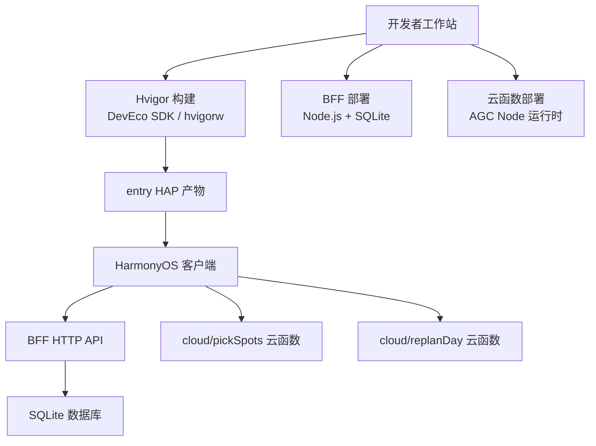
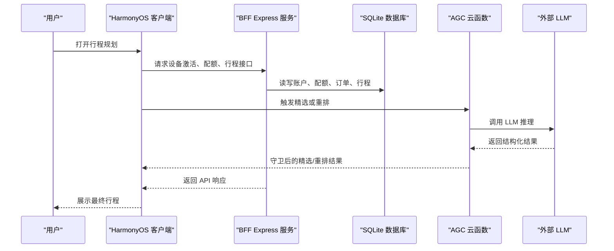
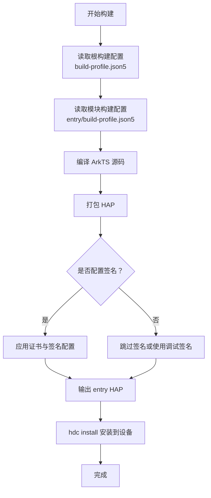
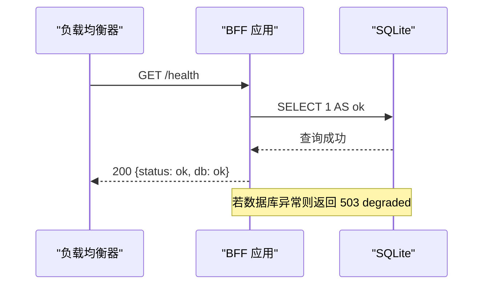
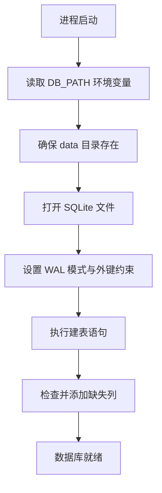
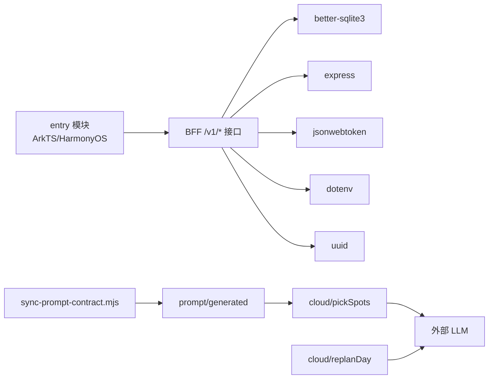

# 部署运维

<cite>
**本文引用的文件**   
- [根构建配置 build-profile.json5](file://build-profile.json5)
- [根构建脚本 hvigorfile.ts](file://hvigorfile.ts)
- [模块构建配置 entry/build-profile.json5](file://entry/build-profile.json5)
- [模块构建脚本 entry/hvigorfile.ts](file://entry/hvigorfile.ts)
- [应用清单 AppScope/app.json5](file://AppScope/app.json5)
- [模块清单 entry/src/main/module.json5](file://entry/src/main/module.json5)
- [代码混淆规则 entry/obfuscation-rules.txt](file://entry/obfuscation-rules.txt)
- [技术栈文档 Docs/TECH_STACK.md](file://Docs/TECH_STACK.md)
- [工程架构文档 Docs/ARCHITECTURE.md](file://Docs/ARCHITECTURE.md)
- [安装脚本 tools/build_install.sh](file://tools/build_install.sh)
- [后端入口 bff/src/index.js](file://bff/src/index.js)
- [后端数据库 bff/src/db.js](file://bff/src/db.js)
- [后端包配置 bff/package.json](file://bff/package.json)
- [前置自检 bff/scripts/preflight.mjs](file://bff/scripts/preflight.mjs)
- [额度重置工具 bff/scripts/reset-dev-quota.mjs](file://bff/scripts/reset-dev-quota.mjs)
- [提示词同步脚本 bff/scripts/sync-prompt-contract.mjs](file://bff/scripts/sync-prompt-contract.mjs)
- [精选云函数 cloud/pickSpots/index.js](file://cloud/pickSpots/index.js)
- [重排云函数 cloud/replanDay/index.js](file://cloud/replanDay/index.js)
</cite>

## 目录
1. [简介](#简介)
2. [项目结构](#项目结构)
3. [核心组件](#核心组件)
4. [架构总览](#架构总览)
5. [详细组件分析](#详细组件分析)
6. [依赖关系分析](#依赖关系分析)
7. [性能与容量规划](#性能与容量规划)
8. [故障排除指南](#故障排除指南)
9. [安全加固](#安全加固)
10. [发布流程与回滚策略](#发布流程与回滚策略)
11. [结论](#结论)

## 简介
本部署运维文档面向“有径”HarmonyOS 端、Node.js 后端 BFF 以及云端 Node 函数的构建、发布和运维。文档覆盖以下内容：
- HarmonyOS 构建流程、签名配置与代码混淆。
- Node.js 后端部署、SQLite 数据库配置与环境变量管理。
- 日志、健康检查与监控告警建议。
- 版本管理、灰度发布与回滚策略。
- 构建安装、数据备份与健康检查等运维脚本。
- 常见问题诊断、性能瓶颈分析与资源优化建议。
- 代码混淆、敏感信息保护与安全扫描。

## 项目结构
仓库是一个多模块工程，主要包含：
- `entry`：HarmonyOS 应用模块，使用 ArkTS、Hvigor 构建。
- `bff`：Node.js 后端，Express + better-sqlite3，提供设备激活、权益、配额、行程、内购校验等接口。
- `cloud`：AGC Node 运行时云函数，分别实现“精选地点”和“当日行程重排”。
- `tools`：构建安装脚本及各类审计、验证脚本。
- `Docs`：技术栈、架构、验收方案等工程契约文档。

**图表来源**
- [根构建配置 build-profile.json5:1-56](file://build-profile.json5#L1-L56)
- [后端入口 bff/src/index.js:1-55](file://bff/src/index.js#L1-L55)
- [后端数据库 bff/src/db.js:1-136](file://bff/src/db.js#L1-L136)

**章节来源**
- [根构建配置 build-profile.json5:1-56](file://build-profile.json5#L1-L56)
- [模块构建配置 entry/build-profile.json5:1-33](file://entry/build-profile.json5#L1-L33)
- [后端包配置 bff/package.json:1-22](file://bff/package.json#L1-L22)
- [技术栈文档 Docs/TECH_STACK.md:1-41](file://Docs/TECH_STACK.md#L1-L41)
- [工程架构文档 Docs/ARCHITECTURE.md:1-61](file://Docs/ARCHITECTURE.md#L1-L61)

## 核心组件
本节从运维视角梳理关键组件及其职责：
- HarmonyOS 应用层：`entry` 模块通过 Hvigor 打包为 HAP，由 DevEco Studio 或命令行构建，最终由 hdc 安装到真机或模拟器。
- 后端 BFF：Express 应用加载 `.env`，初始化 SQLite，挂载鉴权、限流路由，并暴露 `/health` 健康检查。
- 云函数：`cloud/pickSpots` 与 `cloud/replanDay` 是零依赖 Node 函数，负责调用 LLM 并对结果做守卫校验。
- 运维脚本：`tools/build_install.sh` 封装构建成功判定、产物时间戳校验与 hdc 安装；`bff/scripts/preflight.mjs` 是上线前安全检查。

**章节来源**
- [模块清单 entry/src/main/module.json5:1-133](file://entry/src/main/module.json5#L1-L133)
- [后端入口 bff/src/index.js:1-55](file://bff/src/index.js#L1-L55)
- [精选云函数 cloud/pickSpots/index.js:1-200](file://cloud/pickSpots/index.js#L1-L200)
- [重排云函数 cloud/replanDay/index.js:1-200](file://cloud/replanDay/index.js#L1-L200)
- [安装脚本 tools/build_install.sh:1-69](file://tools/build_install.sh#L1-L69)

## 架构总览
有径系统可理解为三层：
1. **客户端层**：HarmonyOS 端，承担用户界面、本地数据、地图、天气、LLM 交互入口。
2. **后端服务层**：BFF 提供统一 HTTP API，承载鉴权、配额、订阅、订单、行程等核心逻辑，持久化到 SQLite。
3. **云端计算层**：AGC 云函数承担轻量 AI 决策任务，复用 BFF 侧生成的 Prompt 与 Schema 生成物，避免手写两份业务规则。

**图表来源**
- [后端入口 bff/src/index.js:1-55](file://bff/src/index.js#L1-L55)
- [后端数据库 bff/src/db.js:1-136](file://bff/src/db.js#L1-L136)
- [精选云函数 cloud/pickSpots/index.js:1-200](file://cloud/pickSpots/index.js#L1-L200)
- [重排云函数 cloud/replanDay/index.js:1-200](file://cloud/replanDay/index.js#L1-L200)

## 详细组件分析

### HarmonyOS 构建与签名
HarmonyOS 构建由根级 `build-profile.json5` 和模块级 `entry/build-profile.json5` 共同控制。

- 应用标识与版本：
  - bundleName：`com.youjing.app`。
  - versionCode：`1000000`。
  - versionName：`1.0.0`。
- 目标平台：
  - runtimeOS：`HarmonyOS`。
  - targetSdkVersion 与 compatibleSdkVersion：均为 `26.0.0`。
- 构建模式：
  - debug 与 release。
- 模块：
  - 仅 `entry` 模块，target 默认 `default`，测试 target 含 `ohosTest`。

**图表来源**
- [根构建配置 build-profile.json5:1-56](file://build-profile.json5#L1-L56)
- [模块构建配置 entry/build-profile.json5:1-33](file://entry/build-profile.json5#L1-L33)
- [应用清单 AppScope/app.json5:1-11](file://AppScope/app.json5#L1-L11)

#### 签名配置现状
当前根构建配置中存在一个名为 `default` 的 HarmonyOS 签名配置，包含证书路径、别名、密码、p7b profile、p12 storeFile 及签名算法。该配置直接写入了开发机路径，不适合直接提交到仓库。生产环境应：
- 将证书与密钥放入受控密钥管理系统或 CI 加密变量。
- 使用独立于调试签名的发布签名。
- 在发布流水线中注入 `storePassword`、`keyPassword` 等敏感值。

**章节来源**
- [根构建配置 build-profile.json5:1-56](file://build-profile.json5#L1-L56)
- [应用清单 AppScope/app.json5:1-11](file://AppScope/app.json5#L1-L11)
- [模块清单 entry/src/main/module.json5:1-133](file://entry/src/main/module.json5#L1-L133)
- [技术栈文档 Docs/TECH_STACK.md:1-41](file://Docs/TECH_STACK.md#L1-L41)

#### 多渠道打包说明
当前工程未定义多个 product，只有一个 `default` 产品。若需要多渠道或多渠道变体（例如 debug/release、不同 bundleName、不同签名），可在 `products` 数组中新增条目，并为每个产品指定 `signingConfig`、`bundleName`、`versionCode` 等字段。由于现有代码未实现渠道差异化逻辑，扩展时还需评估：
- 不同渠道是否使用不同 API 地址、品牌色、文案。
- 是否需要不同的权限声明或 Ability 配置。
- 是否需要独立的华为应用市场签名。

**章节来源**
- [根构建配置 build-profile.json5:1-56](file://build-profile.json5#L1-L56)
- [模块清单 entry/src/main/module.json5:1-133](file://entry/src/main/module.json5#L1-L133)

#### 代码混淆
模块级 release 构建启用了 ArkTS 混淆配置，但 `enable` 当前为 `false`，实际生效的是 `entry/obfuscation-rules.txt` 中定义的混淆选项，包括属性混淆、顶层名称混淆、文件名混淆与导出混淆。

建议：
- 发布前启用混淆开关。
- 保留必要的类名、方法名，避免反射或动态解析失败。
- 使用 namecache 文件保持混淆映射稳定，便于崩溃堆栈还原。

**章节来源**
- [模块构建配置 entry/build-profile.json5:1-33](file://entry/build-profile.json5#L1-L33)
- [代码混淆规则 entry/obfuscation-rules.txt:1-23](file://entry/obfuscation-rules.txt#L1-L23)

### 后端部署：Node.js 应用
后端 BFF 是一个基于 Express 的 Node.js 应用，入口文件加载环境变量、初始化 SQLite、注册中间件与路由，并监听端口。

#### 启动命令
- 生产启动：`npm start`。
- 开发热重载：`npm run dev`。
- 数据库迁移：`npm run migrate`。
- 前置检查：`npm run preflight`。

#### 健康检查
应用暴露 `/health` 接口，不仅返回静态 `ok`，还会执行一次 SQLite 查询，确保数据库可用。若数据库不可用，返回 `503 degraded`。

**图表来源**
- [后端入口 bff/src/index.js:1-55](file://bff/src/index.js#L1-L55)

#### 中间件与路由
- 全局 JSON 请求体解析，限制 2MB，并保存原始字节用于 IAP 通知验签。
- 将数据库实例挂载到请求对象，供路由使用。
- `/v1/device`：设备相关接口。
- `/v1/entitlement`：权益接口，需鉴权。
- `/v1/trip`：行程接口，需鉴权和限流。
- `/v1/pick`：精选接口，需鉴权和限流。
- `/v1/iap`：内购相关接口。
- 全局错误处理返回统一 JSON 错误格式。

**章节来源**
- [后端入口 bff/src/index.js:1-55](file://bff/src/index.js#L1-L55)

### 后端部署：SQLite 数据库
后端使用 better-sqlite3 作为同步数据库驱动，数据库路径可通过 `DB_PATH` 环境变量覆盖，默认位于 `bff/data/youjing.db`。

#### 建表与迁移
数据库启动时会执行 DDL，创建账户、订阅、通行证、配额账本、行程请求、订单、IAP 通知事件等表，并创建必要索引。同时包含列级别迁移逻辑，用于向后兼容旧库结构。

**图表来源**
- [后端数据库 bff/src/db.js:1-136](file://bff/src/db.js#L1-L136)

#### 部署注意事项
- 容器或云函数环境中根文件系统可能只读，必须通过 `DB_PATH` 指向可写卷。
- WAL 模式提升并发读写能力，但仍需注意 SQLite 写入锁争用。
- 备份策略应复制整个数据库文件，或在低写入期进行快照。

**章节来源**
- [后端数据库 bff/src/db.js:1-136](file://bff/src/db.js#L1-L136)
- [前置自检 bff/scripts/preflight.mjs:120-140](file://bff/scripts/preflight.mjs#L120-L140)

### 环境变量管理
后端通过 dotenv 加载 `.env`，并在多处读取环境变量。

| 环境变量 | 用途 | 默认行为或风险 |
|---|---|---|
| `PORT` | 服务监听端口 | 默认 `3000` |
| `DB_PATH` | SQLite 数据库路径 | 默认 `bff/data/youjing.db` |
| `JWT_SECRET` | 设备票据签名密钥 | 开发中间件存在示例值，预检脚本会检测 |
| `DEEPSEEK_API_KEY` | LLM 调用密钥 | 缺失会导致 LLM 代理失败 |
| `LLM_BASE_URL` | LLM 基础地址 | 由 LLM 服务模块读取 |
| `LLM_MODEL` | LLM 模型名称 | 由 LLM 服务模块读取 |
| `LLM_TIMEOUT_MS` | LLM 超时毫秒数 | 由 LLM 服务模块读取 |
| `LLM_RESPONSE_FORMAT` | LLM 响应格式 | 影响 prompt contract 响应格式 |
| `IAP_APP_ID` | 华为内购应用 ID | 用于收据 applicationId 比对 |
| `IAP_ROOT_CERT_PATH` | 华为 IAP 根证书路径 | 预检脚本检查是否存在 |
| `IAP_ALLOW_SANDBOX` | 沙盒收据放行开关 | 生产环境不应开启 |
| `HUAWEI_CLIENT_ID` | 华为账号客户端 ID | 用于 idToken audience 校验 |
| `HUAWEI_JWKS_URL` | 华为 JWKS 地址 | 用于公钥获取 |
| `HUAWEI_ISSUER` | 华为签发者 | 用于 idToken issuer 校验 |
| `ADMIN_ACCOUNT_IDS` | 管理员账户白名单 | 用于配额管理等管理接口 |
| `RATE_LIMIT_PER_MINUTE` | 限流每分钟次数 | 由限流中间件读取 |
| `RATE_LIMIT_WINDOW_MS` | 限流窗口毫秒数 | 由限流中间件读取 |

预检脚本会对关键环境变量进行阻断式检查，防止把示例密钥、缺失证书或未配置的华为客户端 ID 带到生产环境。

**章节来源**
- [后端入口 bff/src/index.js:1-55](file://bff/src/index.js#L1-L55)
- [前置自检 bff/scripts/preflight.mjs:1-158](file://bff/scripts/preflight.mjs#L1-L158)
- [后端数据库 bff/src/db.js:1-136](file://bff/src/db.js#L1-L136)

### 监控与告警
当前仓库没有内置集中式监控系统，但已具备可用于接入监控的基础设施。

- 健康检查：`/health` 返回服务状态和数据库状态，适合负载均衡探针、容器存活探针、UptimeRobot 等外部监控。
- 错误日志：全局错误处理器打印错误消息，可作为日志收集系统的输入源。
- 限流中间件：可结合网关或 Nginx 指标观察 QPS、延迟与 429 比例。
- 配额与行程请求表：可用于离线分析 LLM 成本、成功率、耗时分布。

建议接入方式：
- 使用 systemd、PM2、容器编排或云服务托管时的内置日志采集。
- 将 `/health` 接入负载均衡健康检查与外部可用性监控。
- 对 5xx、429、LLM 上游超时等指标设置告警。
- 对 SQLite 文件大小、WAL 文件增长、磁盘使用率设置阈值告警。

[本节为通用运维建议，不直接分析具体代码行]

### 发布流程
#### 客户端发布
1. 更新 `AppScope/app.json5` 中的 `versionCode` 与 `versionName`。
2. 确认 `build-profile.json5` 中 `targetSdkVersion`、`runtimeOS` 符合预期。
3. 如需发布，替换签名配置为生产证书，并确保 CI 能安全注入密钥。
4. 运行构建并安装脚本验证产物。
5. 上传到华为应用市场或内部分发渠道。

#### 后端发布
1. 执行 `npm run preflight`，确保密钥、证书、IAP 校验结构、Prompt 生成物等通过。
2. 执行 `npm run sync:prompt`，确保提示词与 Schema 生成物与前端 SOT 同步。
3. 部署到服务器或容器，设置 `.env`。
4. 启动服务后探测 `/health`。
5. 逐步放量，观察错误率、延迟、配额扣减、IAP 回调。

#### 云函数发布
- `cloud/pickSpots` 与 `cloud/replanDay` 是 AGC Node 运行时函数。
- 提示词生成物由 `sync-prompt-contract.mjs` 复制到 `cloud/pickSpots/prompt`，保证云端不手写第二份规则。
- 发布前确保 LLM 环境变量正确，并限制请求大小与超时。

**章节来源**
- [应用清单 AppScope/app.json5:1-11](file://AppScope/app.json5#L1-L11)
- [根构建配置 build-profile.json5:1-56](file://build-profile.json5#L1-L56)
- [前置自检 bff/scripts/preflight.mjs:1-158](file://bff/scripts/preflight.mjs#L1-L158)
- [提示词同步脚本 bff/scripts/sync-prompt-contract.mjs:1-175](file://bff/scripts/sync-prompt-contract.mjs#L1-L175)
- [精选云函数 cloud/pickSpots/index.js:1-200](file://cloud/pickSpots/index.js#L1-L200)
- [重排云函数 cloud/replanDay/index.js:1-200](file://cloud/replanDay/index.js#L1-L200)

## 依赖关系分析

**图表来源**
- [后端包配置 bff/package.json:1-22](file://bff/package.json#L1-L22)
- [后端入口 bff/src/index.js:1-55](file://bff/src/index.js#L1-L55)
- [后端数据库 bff/src/db.js:1-136](file://bff/src/db.js#L1-L136)
- [提示词同步脚本 bff/scripts/sync-prompt-contract.mjs:1-175](file://bff/scripts/sync-prompt-contract.mjs#L1-L175)
- [精选云函数 cloud/pickSpots/index.js:1-200](file://cloud/pickSpots/index.js#L1-L200)
- [重排云函数 cloud/replanDay/index.js:1-200](file://cloud/replanDay/index.js#L1-L200)

**章节来源**
- [后端包配置 bff/package.json:1-22](file://bff/package.json#L1-L22)
- [工程架构文档 Docs/ARCHITECTURE.md:1-61](file://Docs/ARCHITECTURE.md#L1-L61)

## 性能与容量规划

### 客户端构建性能
- 当前 Hvigor 插件为空扩展，主要使用内置 appTasks/hapTasks。
- 构建缓存依赖 Hvigor 与 ArkTS 编译器，建议使用 CI 缓存 `node_modules`、`.hvigor` 与编译产物目录。
- 混淆关闭时可缩短构建时间；发布前再启用混淆。

### 后端性能
- SQLite 使用 WAL 模式，适合读多写少场景；高并发写入时应关注锁竞争。
- 建议：
  - 单实例下合理调优连接使用模式，避免频繁新建连接。
  - 对热点表建立索引，目前已有 account_id、idempotency_key 等索引。
  - 限制请求体大小，避免大体积 LLM 响应或恶意请求拖慢服务。
  - 结合限流中间件与网关层限流，保护下游 LLM 与数据库。

### 云函数性能
- 云函数对请求体、候选数量、reason/note 长度做了边界校验。
- LLM 调用带超时控制，避免长时间挂起。
- 建议：
  - 监控 LLM 上游超时率与返回内容结构错误率。
  - 对云函数冷启动时间与 P95 延迟设置告警。
  - 对重复候选、超长文本、非法枚举值等快速失败路径增加统计。

**章节来源**
- [后端入口 bff/src/index.js:1-55](file://bff/src/index.js#L1-L55)
- [后端数据库 bff/src/db.js:1-136](file://bff/src/db.js#L1-L136)
- [精选云函数 cloud/pickSpots/index.js:1-200](file://cloud/pickSpots/index.js#L1-L200)
- [重排云函数 cloud/replanDay/index.js:1-200](file://cloud/replanDay/index.js#L1-L200)

## 故障排除指南

### 常见客户端问题
- 构建成功但装机读到旧代码：
  - 安装脚本已强制要求构建成功且产物修改时间在合理范围内，避免 UP-TO-DATE 复用旧产物。
  - 若仍复现，检查 HDC 目标设备、多设备环境下的 `-t` 参数。
- 找不到签名产物：
  - 确认构建模块参数与输出路径匹配。
  - 确认签名配置有效且未被 CI 覆盖。

**章节来源**
- [安装脚本 tools/build_install.sh:1-69](file://tools/build_install.sh#L1-L69)

### 常见后端问题
- `/health` 返回 `degraded`：
  - 检查 SQLite 文件路径、权限、磁盘空间。
  - 检查 WAL 文件是否被误删或只读挂载。
- JWT 相关接口失败：
  - 检查 `JWT_SECRET` 是否与客户端或服务端一致。
  - 预检脚本会拒绝示例密钥。
- IAP 回调失败：
  - 检查 `IAP_ROOT_CERT_PATH` 是否存在。
  - 检查 `IAP_APP_ID` 是否正确。
  - 检查 `IAP_ALLOW_SANDBOX` 是否在生产环境被误开。
- LLM 调用失败：
  - 检查 `DEEPSEEK_API_KEY`、`LLM_BASE_URL`、`LLM_MODEL`。
  - 检查 `LLM_TIMEOUT_MS` 是否过短。

**章节来源**
- [后端入口 bff/src/index.js:1-55](file://bff/src/index.js#L1-L55)
- [前置自检 bff/scripts/preflight.mjs:1-158](file://bff/scripts/preflight.mjs#L1-L158)

### 数据问题
- 配额耗尽导致行程接口 402：
  - 可使用额度重置工具恢复开发环境的赠送额度，注意该工具明确标注“勿用于生产”。
- 需要定位某账户配额历史：
  - 可查询 `quota_ledger` 表，结合 `account_id`、`source`、`state`、`settled_at` 分析。

**章节来源**
- [额度重置工具 bff/scripts/reset-dev-quota.mjs:1-41](file://bff/scripts/reset-dev-quota.mjs#L1-L41)
- [后端数据库 bff/src/db.js:1-136](file://bff/src/db.js#L1-L136)

### 资源优化建议
- 客户端：
  - 发布前启用代码混淆，减少包体积和反编译可读性。
  - 避免在 UI 层直接访问数据库或发起 LLM 请求，遵循架构依赖方向。
- 后端：
  - 限制请求体大小，避免大体积响应。
  - 合理使用限流，保护 SQLite 与 LLM 上游。
  - 定期归档或清理 `trip_request`、`iap_notify_event` 等非核心历史数据。
- 云函数：
  - 复用提示词生成物，避免重复维护业务规则。
  - 对 LLM 超时、JSON 解析失败、守卫校验失败等路径增加错误码与统计。

**章节来源**
- [代码混淆规则 entry/obfuscation-rules.txt:1-23](file://entry/obfuscation-rules.txt#L1-L23)
- [工程架构文档 Docs/ARCHITECTURE.md:1-61](file://Docs/ARCHITECTURE.md#L1-L61)

## 安全加固

### 代码混淆
- 模块级 release 构建已引入混淆规则文件，但开关当前关闭。
- 建议在正式发布前启用混淆，并结合 namecache 提高堆栈可读性。

**章节来源**
- [模块构建配置 entry/build-profile.json5:1-33](file://entry/build-profile.json5#L1-L33)
- [代码混淆规则 entry/obfuscation-rules.txt:1-23](file://entry/obfuscation-rules.txt#L1-L23)

### 敏感信息保护
- `.env` 已被加入后端 `.gitignore`，不应提交到仓库。
- 生产环境必须通过 CI 或密钥管理服务注入以下敏感项：
  - `JWT_SECRET`
  - `DEEPSEEK_API_KEY`
  - `IAP_ROOT_CERT_PATH`
  - `HUAWEI_CLIENT_ID`
  - HarmonyOS 签名证书与密钥。
- 预检脚本会拒绝示例密钥和缺失配置。

**章节来源**
- [前置自检 bff/scripts/preflight.mjs:1-158](file://bff/scripts/preflight.mjs#L1-L158)

### 安全扫描建议
- 客户端：
  - 使用 DevEco Studio 或第三方静态分析检查 ArkTS 安全问题。
  - 对第三方依赖进行许可证与漏洞扫描。
- 后端：
  - 对 Node.js 依赖执行 `npm audit`。
  - 对敏感环境变量进行泄露扫描。
  - 对 IAP 验签、JWT 验签、限流逻辑编写自动化测试。
- 云函数：
  - 对 LLM 调用 URL、API Key、超时参数进行配置校验。
  - 对请求体大小、候选数量、字符串长度进行边界测试。

[本节为通用安全建议，不直接分析具体代码行]

## 发布流程与回滚策略

### 版本管理
- 客户端版本由 `AppScope/app.json5` 管理，`versionCode` 用于应用市场升级判断，`versionName` 用于人类可读版本。
- 后端与云函数以 Git 标签、CI 构建编号、镜像版本号等方式管理版本。
- 提示词与 Schema 通过 `sync-prompt-contract.mjs` 同步，manifest 中包含生成时间与源文件哈希，可用于一致性校验。

**章节来源**
- [应用清单 AppScope/app.json5:1-11](file://AppScope/app.json5#L1-L11)
- [提示词同步脚本 bff/scripts/sync-prompt-contract.mjs:1-175](file://bff/scripts/sync-prompt-contract.mjs#L1-L175)

### 灰度发布
推荐分阶段灰度：
1. 内部测试：使用调试签名与测试证书。
2. 小流量后端灰度：先部署一台 BFF 实例，观察 `/health`、错误率、配额扣减。
3. 后端全量：确认无回归后扩容。
4. 客户端灰度：通过应用市场或内部渠道向小比例用户推送新版本。
5. 全量发布：观察 LLM 调用成功率、云函数延迟、SQLite 负载。

### 回滚策略
- 客户端：
  - 保留上一版本安装包或应用市场历史版本。
  - 若新版本的 LLM 或 BFF 接口不兼容，优先回滚后端，再回滚客户端。
- 后端：
  - 使用容器镜像或部署包版本标记，支持一键切回上一版本。
  - 数据库变更采用向前兼容的 DDL 与列迁移，避免回滚破坏旧版本。
- 云函数：
  - 保留上一版本函数部署包。
  - 对 LLM 上游故障，优先降级或关闭相关功能，而不是回滚全部服务。

**章节来源**
- [后端数据库 bff/src/db.js:1-136](file://bff/src/db.js#L1-L136)
- [后端入口 bff/src/index.js:1-55](file://bff/src/index.js#L1-L55)

## 结论
有径工程的部署运维基线已经具备：
- HarmonyOS 客户端构建与安装脚本。
- Node.js 后端健康检查、SQLite 初始化、环境变量预检。
- 云端 AI 函数与提示词生成物同步机制。
- 清晰的架构依赖方向与数据表结构。

下一步建议重点完善：
- 将签名证书与密钥纳入 CI 密钥管理。
- 启用发布混淆并建立崩溃符号映射。
- 接入集中式日志、指标与告警系统。
- 完善数据库备份、恢复演练与容量扩容预案。
- 建立完整的灰度发布与回滚演练流程。