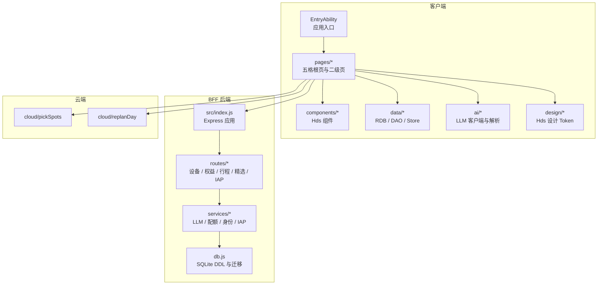
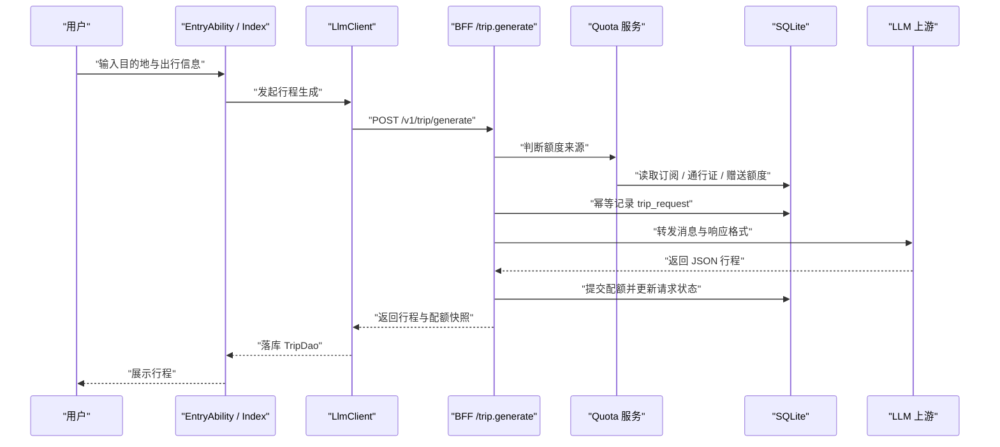
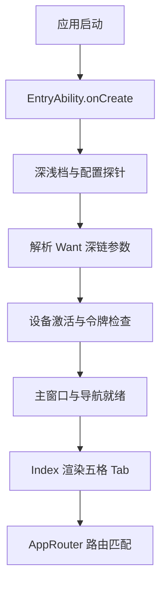
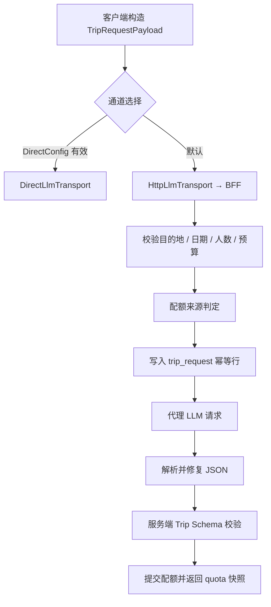
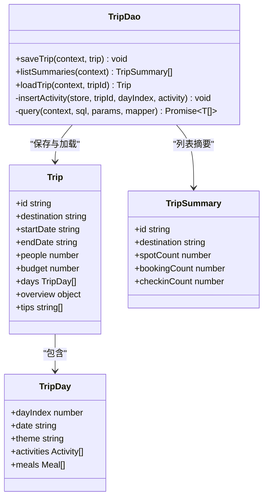
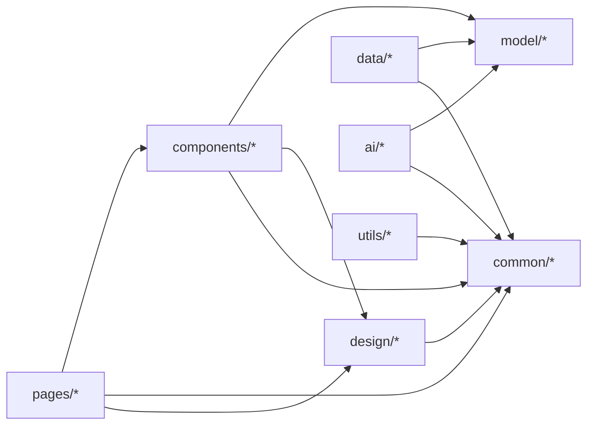

# 项目概览

<cite>
**本文引用的文件**   
- [package.json](file://package.json)
- [entry/oh-package.json5](file://entry/oh-package.json5)
- [bff/package.json](file://bff/package.json)
- [Docs/TECH_STACK.md](file://Docs/TECH_STACK.md)
- [Docs/ARCHITECTURE.md](file://Docs/ARCHITECTURE.md)
- [entry/src/main/module.json5](file://entry/src/main/module.json5)
- [entry/src/main/ets/entryability/EntryAbility.ets](file://entry/src/main/ets/entryability/EntryAbility.ets)
- [entry/src/main/ets/pages/Index.ets](file://entry/src/main/ets/pages/Index.ets)
- [entry/src/main/ets/pages/AppRouter.ets](file://entry/src/main/ets/pages/AppRouter.ets)
- [entry/src/main/ets/common/constants/AppNav.ets](file://entry/src/main/ets/common/constants/AppNav.ets)
- [entry/src/main/ets/common/config/DirectConfig.ets](file://entry/src/main/ets/common/config/DirectConfig.ets)
- [entry/src/main/ets/ai/LlmClient.ets](file://entry/src/main/ets/ai/LlmClient.ets)
- [entry/src/main/ets/data/TripDao.ets](file://entry/src/main/ets/data/TripDao.ets)
- [bff/src/index.js](file://bff/src/index.js)
- [bff/src/db.js](file://bff/src/db.js)
- [bff/src/routes/trip.js](file://bff/src/routes/trip.js)
- [bff/src/services/llm.js](file://bff/src/services/llm.js)
- [bff/src/services/quota.js](file://bff/src/services/quota.js)
</cite>

## 目录
1. [引言](#引言)
2. [项目结构](#项目结构)
3. [核心组件](#核心组件)
4. [架构总览](#架构总览)
5. [关键流程详解](#关键流程详解)
6. [依赖关系分析](#依赖关系分析)
7. [性能与可靠性特征](#性能与可靠性特征)
8. [快速开始](#快速开始)
9. [产品特性矩阵](#产品特性矩阵)
10. [目标用户画像与竞品差异](#目标用户画像与竞品差异)
11. [常见问题排查](#常见问题排查)
12. [结语](#结语)

## 引言
有径·YouJing（HarmonyProject2）是一款面向 HarmonyOS Stage 模型的智能旅行规划应用。它的核心价值主张是“一句话生成行程，行中导航提醒，行后回顾分享”的全链路体验：用户在行前用自然语言描述旅行意图，系统结合 LLM、地图与本地数据生成结构化行程；行中通过导航、打卡与提醒辅助执行；行后支持回顾与分享，沉淀旅行记忆。

前端采用 ArkTS + ArkUI 构建基于 Stage 模型的应用，后端使用 Node.js BFF 提供设备激活、权益校验、配额管理、LLM 代理与内购校验，云端函数承担部分离线能力。工程强调类型安全、设计一致性与可测试性：ArkTS V1 严格模式配合 Hds 组件体系统一视觉语言，Express + SQLite 提供轻量可靠的 BFF 服务，RDB 与 DAO 负责端侧持久化。

**章节来源**
- [Docs/ARCHITECTURE.md:1-61](file://Docs/ARCHITECTURE.md#L1-L61)
- [Docs/TECH_STACK.md:1-41](file://Docs/TECH_STACK.md#L1-L41)

## 项目结构
仓库按职责划分为三个主要区域：

| 区域 | 含义 | 关键内容 |
|---|---|---|
| `entry` | HarmonyOS 客户端模块 | ArkTS 页面、组件、模型、RDB DAO、LLM 客户端、Hds 设计层、入口 Ability |
| `bff` | Node.js 业务后端 | Express 路由、SQLite 数据库、权限与配额、LLM 代理、IAP 处理 |
| `cloud` | 云端函数 | 景点精选与重规划等无服务器逻辑 |
| `Docs` | 工程契约与技术文档 | 架构契约、技术栈基线、方案说明 |
| `tools` | 审计与验证脚本 | 可访问性、颜色、布局、类型与行为校验工具 |

**图表来源**
- [entry/src/main/ets/entryability/EntryAbility.ets:1-923](file://entry/src/main/ets/entryability/EntryAbility.ets#L1-L923)
- [entry/src/main/ets/pages/Index.ets:1-1018](file://entry/src/main/ets/pages/Index.ets#L1-L1018)
- [entry/src/main/ets/pages/AppRouter.ets:1-100](file://entry/src/main/ets/pages/AppRouter.ets#L1-L100)
- [bff/src/index.js:1-55](file://bff/src/index.js#L1-L55)
- [bff/src/db.js:1-136](file://bff/src/db.js#L1-L136)

**章节来源**
- [Docs/ARCHITECTURE.md:1-61](file://Docs/ARCHITECTURE.md#L1-L61)
- [entry/src/main/module.json5:1-133](file://entry/src/main/module.json5#L1-L133)

## 核心组件
本项目的核心由五类组件构成：

| 组件类别 | 职责 | 关键实现位置 |
|---|---|---|
| 应用入口 | 初始化日志、深浅档、窗口、深链、小艺 Skill、定位与地理围栏探针 | [EntryAbility.ets](file://entry/src/main/ets/entryability/EntryAbility.ets#L1-L923) |
| 导航与界面 | 底部五格 Tab、全屏二级页、路由表、动态 Dock 胶囊 | [Index.ets](file://entry/src/main/ets/pages/Index.ets#L1-L1018)、[AppRouter.ets](file://entry/src/main/ets/pages/AppRouter.ets#L1-L100)、[AppNav.ets](file://entry/src/main/ets/common/constants/AppNav.ets#L1-L221) |
| LLM 客户端 | Mock/BFF/直连三种传输通道、请求构造、重试与错误映射 | [LlmClient.ets](file://entry/src/main/ets/ai/LlmClient.ets#L1-L482)、[DirectConfig.ets](file://entry/src/main/ets/common/config/DirectConfig.ets#L1-L33) |
| 本地数据层 | RDB 建库、DAO 整存整取 Trip、摘要查询、用户隔离 | [TripDao.ets](file://entry/src/main/ets/data/TripDao.ets#L1-L384) |
| BFF 后端 | Express 路由、认证限流、SQLite 存储、LLM 代理、配额引擎 | [bff/src/index.js](file://bff/src/index.js#L1-L55)、[bff/src/db.js](file://bff/src/db.js#L1-L136)、[bff/src/routes/trip.js](file://bff/src/routes/trip.js#L1-L234)、[bff/src/services/llm.js](file://bff/src/services/llm.js#L1-L98)、[bff/src/services/quota.js](file://bff/src/services/quota.js#L1-L113) |

**章节来源**
- [entry/src/main/ets/entryability/EntryAbility.ets:1-923](file://entry/src/main/ets/entryability/EntryAbility.ets#L1-L923)
- [entry/src/main/ets/pages/Index.ets:1-1018](file://entry/src/main/ets/pages/Index.ets#L1-L1018)
- [entry/src/main/ets/ai/LlmClient.ets:1-482](file://entry/src/main/ets/ai/LlmClient.ets#L1-L482)
- [entry/src/main/ets/data/TripDao.ets:1-384](file://entry/src/main/ets/data/TripDao.ets#L1-L384)
- [bff/src/index.js:1-55](file://bff/src/index.js#L1-L55)

## 架构总览
整体架构遵循“前端 ArkTS 客户端 + Node.js BFF + 云端函数”的分层模型：

- 客户端负责用户交互、状态编排、本地 RDB 持久化以及调用 BFF 或云端函数。
- BFF 负责身份与会话、订阅与通行证校验、配额扣减、提示词组装、LLM 代理和 IAP 回调。
- 云端函数承载独立部署的轻量计算任务，例如景点精选与行程重规划。

**图表来源**
- [entry/src/main/ets/ai/LlmClient.ets:1-482](file://entry/src/main/ets/ai/LlmClient.ets#L1-L482)
- [bff/src/routes/trip.js:1-234](file://bff/src/routes/trip.js#L1-L234)
- [bff/src/services/quota.js:1-113](file://bff/src/services/quota.js#L1-L113)
- [bff/src/services/llm.js:1-98](file://bff/src/services/llm.js#L1-L98)
- [entry/src/main/ets/data/TripDao.ets:1-384](file://entry/src/main/ets/data/TripDao.ets#L1-L384)

## 关键流程详解

### 应用启动与导航
`EntryAbility` 是应用生命周期入口，负责深浅档初始化、深链参数处理、Skill 预填、地理围栏探针、设备激活与 Widget 同步。`Index` 则承载底部五格 Tab 与全屏二级页导航，并通过 `AppNav` 统一管理各 Tab 的 `NavPathStack`、当前活动行程与草稿状态。

**图表来源**
- [entry/src/main/ets/entryability/EntryAbility.ets:1-923](file://entry/src/main/ets/entryability/EntryAbility.ets#L1-L923)
- [entry/src/main/ets/pages/Index.ets:1-1018](file://entry/src/main/ets/pages/Index.ets#L1-L1018)
- [entry/src/main/ets/pages/AppRouter.ets:1-100](file://entry/src/main/ets/pages/AppRouter.ets#L1-L100)
- [entry/src/main/ets/common/constants/AppNav.ets:1-L221](file://entry/src/main/ets/common/constants/AppNav.ets#L1-L221)

**章节来源**
- [entry/src/main/ets/entryability/EntryAbility.ets:1-923](file://entry/src/main/ets/entryability/EntryAbility.ets#L1-L923)
- [entry/src/main/ets/pages/Index.ets:1-1018](file://entry/src/main/ets/pages/Index.ets#L1-L1018)
- [entry/src/main/ets/common/constants/AppNav.ets:1-L221](file://entry/src/main/ets/common/constants/AppNav.ets#L1-L221)

### 行程生成与 LLM 通道选择
`LlmClient` 抽象出三种传输通道：

| 通道 | 适用场景 | 特点 |
|---|---|---|
| `MockLlmTransport` | 开发期离线闭环 | 确定性合成合法 Trip JSON，走完整解析与守卫链路 |
| `HttpLlmTransport` | 生产环境 | 通过 BFF 中转，不暴露 Key，自动处理配额与幂等 |
| `DirectLlmTransport` | 开发期兜底 | 直连 OpenAI 兼容接口，需 `DirectConfig.URL` 与 `KEY` |

BFF 的 `/v1/trip/generate` 会校验日期、人数、预算与天数范围，先决定额度来源，再写入幂等请求记录，最后调用 LLM 并尝试修复非标准 JSON 输出。

**图表来源**
- [entry/src/main/ets/ai/LlmClient.ets:1-L482](file://entry/src/main/ets/ai/LlmClient.ets#L1-L482)
- [entry/src/main/ets/common/config/DirectConfig.ets:1-L33](file://entry/src/main/ets/common/config/DirectConfig.ets#L1-L33)
- [bff/src/routes/trip.js:1-L234](file://bff/src/routes/trip.js#L1-L234)
- [bff/src/services/llm.js:1-L98](file://bff/src/services/llm.js#L1-L98)
- [bff/src/services/quota.js:1-L113](file://bff/src/services/quota.js#L1-L113)

**章节来源**
- [entry/src/main/ets/ai/LlmClient.ets:1-L482](file://entry/src/main/ets/ai/LlmClient.ets#L1-L482)
- [bff/src/routes/trip.js:1-L234](file://bff/src/routes/trip.js#L1-L234)

### 本地行程持久化
`TripDao` 封装对 RDB 的写操作，以 Trip 为聚合根进行整存整取，并按 `trip.user_id` 隔离数据。列表摘要通过 SQL 聚合计算景点数、预约项数、通勤段数与打卡数，详情页则逐表重建 `TripDay`、`Activity` 与 `Meal`。

**图表来源**
- [entry/src/main/ets/data/TripDao.ets:1-L384](file://entry/src/main/ets/data/TripDao.ets#L1-L384)

**章节来源**
- [entry/src/main/ets/data/TripDao.ets:1-L384](file://entry/src/main/ets/data/TripDao.ets#L1-L384)

## 依赖关系分析
代码依赖方向在架构契约中被明确约束：页面与组件可引用 model、data、ai、utils 与 design，但禁止反向依赖；common 与 design 作为底层模块不得引用业务目录。

**图表来源**
- [Docs/ARCHITECTURE.md:1-L61](file://Docs/ARCHITECTURE.md#L1-L61)

**章节来源**
- [Docs/ARCHITECTURE.md:1-L61](file://Docs/ARCHITECTURE.md#L1-L61)

## 性能与可靠性特征
- **客户端类型安全**：ArkTS V1 严格模式减少运行时类型错误，配合 Hds 组件体系降低 UI 不一致成本。
- **BFF 幂等与限额**：`trip_request` 使用 `idempotency_key` 防止重复计费；`quota_ledger` 区分 reserved / committed / released 状态，失败时回滚额度。
- **LLM 容错**：JSON 解析失败时自动追加修正指令并重问；超时与 429 限流分别映射到 504 与 429，避免把限流伪装成通用 5xx。
- **本地读写分离**：RDB 写走事务通道，读按列映射模型，避免大对象一次性反序列化。
- **健康检查**：BFF `/health` 不仅返回静态 ok，还会实际执行 SQLite 查询，便于负载均衡识别损坏库。

**章节来源**
- [bff/src/routes/trip.js:1-L234](file://bff/src/routes/trip.js#L1-L234)
- [bff/src/services/llm.js:1-L98](file://bff/src/services/llm.js#L1-L98)
- [bff/src/services/quota.js:1-L113](file://bff/src/services/quota.js#L1-L113)
- [bff/src/index.js:1-L55](file://bff/src/index.js#L1-L55)
- [entry/src/main/ets/data/TripDao.ets:1-L384](file://entry/src/main/ets/data/TripDao.ets#L1-L384)

## 快速开始

### 环境要求
- DevEco Studio：建议使用工程锁定的版本，当前技术栈文档以 API 26 与对应 SDK 为准。
- HarmonyOS SDK：API 26，targetSdkVersion 与 compatibleSdkVersion 均锁定为 26.0.0。
- Node.js：用于运行 BFF，工程脚本使用 ES Module 形式。
- ohpm：HarmonyOS 包管理器，工程依赖与 lockfile 与之对齐。

参考技术栈基线：

| 条目 | 值 |
|---|---|
| targetSdkVersion | 26.0.0 |
| runtimeOS | HarmonyOS |
| DevEco Studio | 26.0.0.851 |
| HarmonyOS SDK | API 26 |
| ohpm | 26.0.0.630 |
| bundleName | com.youjing.app |

**章节来源**
- [Docs/TECH_STACK.md:1-L41](file://Docs/TECH_STACK.md#L1-L41)

### 安装依赖
1. 打开仓库根目录。
2. 安装 BFF 依赖：进入 `bff` 目录并执行依赖安装命令。
3. 客户端依赖由 ohpm 管理，通常通过 DevEco Studio 构建时自动拉取。

BFF 依赖包括 Express、better-sqlite3、jsonwebtoken、uuid 与 dotenv。

**章节来源**
- [bff/package.json:1-L22](file://bff/package.json#L1-L22)
- [entry/oh-package.json5:1-L10](file://entry/oh-package.json5#L1-L10)

### 首次运行
1. 使用 DevEco Studio 打开工程，确认 HarmonyOS SDK 与 API 26 已就绪。
2. 编译并运行 entry 模块，启动 `EntryAbility`。
3. 如需联调 LLM，可在 BFF 中设置环境变量或直接使用开发期直连配置。
4. 首次运行 BFF 时，建议执行数据库初始化脚本以创建 SQLite 表结构。

BFF 启动后会监听端口，并挂载设备、权益、行程、精选与 IAP 路由。

**章节来源**
- [entry/src/main/ets/entryability/EntryAbility.ets:1-L923](file://entry/src/main/ets/entryability/EntryAbility.ets#L1-L923)
- [bff/src/index.js:1-L55](file://bff/src/index.js#L1-L55)
- [bff/src/db.js:1-L136](file://bff/src/db.js#L1-L136)

## 产品特性矩阵

| 阶段 | 特性 | 用户价值 | 主要实现 |
|---|---|---|---|
| 行前 | 一句话生成行程 | 降低规划门槛 | LLM 提示词、TripSchema、TripParser |
| 行前 | 偏好问答与景点精选 | 让行程更贴合个人偏好 | PreferenceQA、PickClient、云函数 |
| 行中 | 导航与地点展示 | 帮助落地计划 | MapPage、TripMapView、Geo |
| 行中 | 到达提醒与地理围栏 | 减少错过行程 | ArrivalWatcher、ArrivalNotice |
| 行中 | 日历同步与提醒 | 把行程纳入日常日程 | CalendarSync、Agent Reminder |
| 行后 | 打卡与回顾 | 增强成就感与记忆 | CheckinDao、TripReview |
| 行后 | 分享 | 社交传播与口碑 | ShareExporter、SharePage |
| 商业化 | 订阅 / 通行证 / 赠送额度 | 控制 LLM 调用成本 | EntitlementStore、Quota、IAP |

**章节来源**
- [entry/src/main/ets/ai/LlmClient.ets:1-L482](file://entry/src/main/ets/ai/LlmClient.ets#L1-L482)
- [entry/src/main/ets/pages/AppRouter.ets:1-L100](file://entry/src/main/ets/pages/AppRouter.ets#L1-L100)
- [bff/src/services/quota.js:1-L113](file://bff/src/services/quota.js#L1-L113)

## 目标用户画像与竞品差异

### 目标用户
- 普通旅行者：希望用最少步骤获得可执行的行程，不需要手动排天排点。
- 自由行爱好者：重视景点动线、交通衔接与预约信息。
- 家庭与亲子出行者：关注节奏、强度、餐饮与住宿安排。
- 鸿蒙生态用户：期望与小艺、实况窗、卡片、日历等系统能力协同。

### 竞品差异点
- **全链路而非单次生成**：多数工具只做“生成文本”，有径把生成、导航、提醒、回顾串起来。
- **本地优先的数据层**：行程持久化在 RDB，即使网络异常仍可查看与管理行程。
- **配额与商业化透明**：BFF 端集中处理订阅、通行证与赠送额度，避免客户端自报额度。
- **ArkTS 类型安全与 Hds 设计一致性**：减少样式漂移，提高跨页面体验一致性。
- **多通道 LLM 适配**：Mock / BFF / 直连三种通道便于开发、测试与迁移。

## 常见问题排查

| 现象 | 可能原因 | 排查建议 |
|---|---|---|
| 行程生成一直失败 | LLM 返回非标准 JSON | 检查 BFF 是否触发修正重问，查看 `trip.js` 中的解析与修复逻辑 |
| 频繁出现额度不足 | 订阅过期或月度次数用尽 | 检查 `subscription` 与 `trip_request` 计数，确认 `quota.js` 的月度上限 |
| 客户端报票据失效 | 设备令牌过期 | 检查 `DeviceActivator` 与 `DeviceTokenStore`，重新激活设备 |
| 开发期无法直连 LLM | `DirectConfig.URL` 或 `KEY` 为空 | 补充直连配置并确保不随发布包提交 |
| 本地行程未显示 | RDB 查询条件或用户隔离问题 | 检查 `TripDao.listSummaries` 与 `AccountStore.uid()` |
| BFF 健康检查通过但服务异常 | 静态健康检查未真正查库 | 使用真实 `/health` 路径并观察 SQLite WAL 状态 |

**章节来源**
- [bff/src/routes/trip.js:1-L234](file://bff/src/routes/trip.js#L1-L234)
- [bff/src/services/quota.js:1-L113](file://bff/src/services/quota.js#L1-L113)
- [entry/src/main/ets/common/config/DirectConfig.ets:1-L33](file://entry/src/main/ets/common/config/DirectConfig.ets#L1-L33)
- [entry/src/main/ets/data/TripDao.ets:1-L384](file://entry/src/main/ets/data/TripDao.ets#L1-L384)
- [bff/src/index.js:1-L55](file://bff/src/index.js#L1-L55)

## 结语
有径·YouJing 的技术选择围绕“可靠、可控、可演进”展开：ArkTS 保证前端类型安全，Hds 统一设计语言，BFF 集中处理商业与安全相关逻辑，RDB 保障本地数据可用，LLM 通道可替换且可降级。随着后续接入 AGC 云函数与更多城市数据管线，项目仍保持清晰的分层与明确的依赖边界，适合继续扩展商业化、国际化与多端形态。