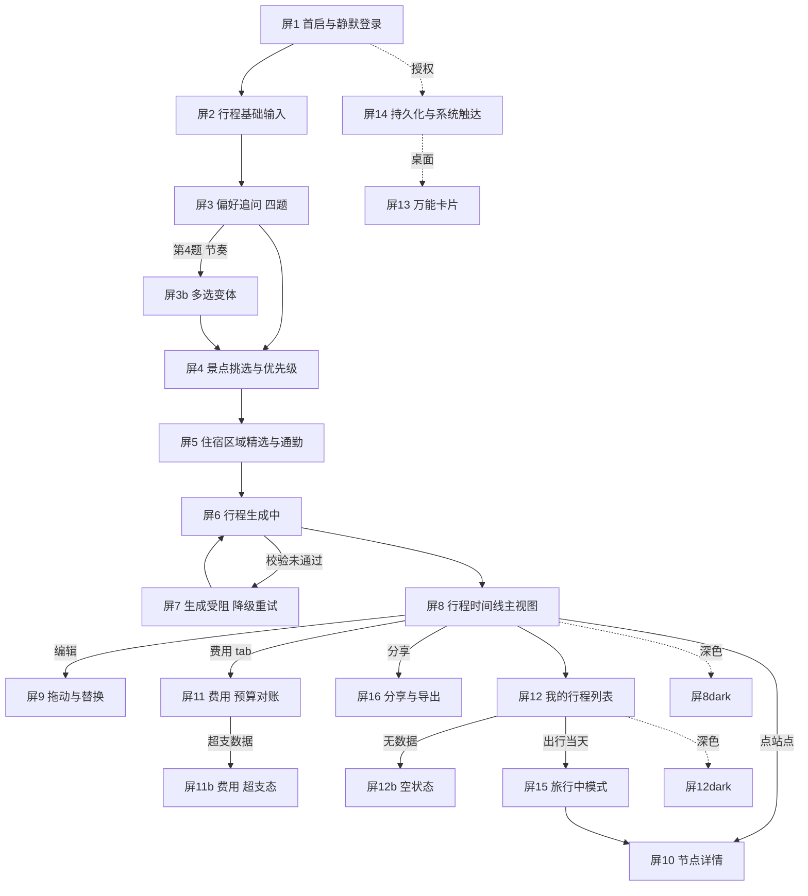

# 有径（Youjing）设计定稿 · 前端开工交付文档

> 生成时间 2026-10-21。家族契约：`~/Documents/StitchDesign/DESIGN.md`（md5 见文末）。
> 稿件真相源：`~/Downloads/stitch_v7_ledger/<帧目录>/code.html` + `screen.png`。
> 本文档的 token 表与逐帧偏差表**由脚本从 DESIGN.md 与台账 code.html 直接生成**，不是手抄。

## 0. 一句话状态

**浅色 19 帧已冻结**：全部成帧、导出、建档，跑过声明级审计与**渲染几何实测**。
四闸门（tailwind 注入 / 8 位 hex / Material 3 token 名 / 安全区补丁）**19/19 全绿**；
阴影六条闭集违规 **0**；字号离梯 **0**；离表圆角 **3 处**；内联 `style=` **130 处**；离表间距 **194 处**。

后三类**不返修稿件**，作为「实现期对照表」在第 7 节逐帧列出——ArkTS 里改一个数比在 Stitch 里 fork 一块帧便宜两个数量级。

**深色 19 帧已冻结**（2026-10-22 全量复算）：19 屏全部成帧、导出、按 md5 建档，`audit_dark.sh` 逐块跑过——
`html/body` 显式 `#121212` **19/19**；§4「亮字压亮底」**0 违规**（旧批次是 4/20）；深色 `box-shadow` 声明除下述 1 条外全为 0；
三个带路线地图的屏（屏 5 / 屏 8 / 屏 16）**整块换成 `route-night-*`**、纸质板 0 命中（旧批次这块是浅地图配近黑等高线）。

唯一一条深色稿件缺陷：**屏 15 深色 `4d55fd31` 的 dock 带 1 条 `box-shadow: 0px 6px 16px 0px rgba(0,0,0,0.55)`**。
它的值恰好等于契约 token `dark-glass-bar-shadow` —— 是**契约自相矛盾**（一边「深色零阴影」，一边留了这条 token），
已按决议第 8 条了断：**该 token 只描述 ArkTS 侧 HDS 材质自带的系统投影，不得翻成 CSS 声明。实现期删掉这一行即可，材质会给到。**

旧批次 20 块深色帧（在自相矛盾的前置块下生成的那批）**一律不作为对色参照**，清单与原因见流程文档第十七章。

**云端已清场（2026-10-22）**：Stitch 项目 `686208087596162876` 里的废帧全部删净，画布上**只剩这 38 块定稿**（旧深色 20 + 屏3b fork + 屏4/屏13 重复 + 3 块死帧）。复核不靠 md5（跨轮会变），靠「剥掉 `<style>` 后的标记长度：云端 = 导出 + 恒定 1505」做精确对齐，38/38 命中、0 未匹配。

**屏 12b 有一对同名帧，别搞混**：本文档第 7 节与组件映射表引用的 `7991fe5b` 是**干净版**，它**已经不在云端**；云端活着的是同名修复分叉 `06190639`，尾部多挂了三处 `!important` 内联补丁（`.status-icons{gap:4px!important}` 等）。两块都已在台账，**实现按 `7991fe5b` 抄，不要照抄 `06190639` 的 `!important`**——那是「短纠偏只挂内联补丁」的产物。

## 1. 画布与栅格

| 项 | 值 | ArkTS |
|---|---|---|
| 画板 | 360 × 780 vp，`overflow: hidden`，**硬边界** | 设计基准宽 360vp |
| 基线网格 | 4px | 所有尺寸取 4 的倍数 |
| 最小命中区 | 44 × 44 vp | `44vp` |
| 页面左右内缩 | 16px（宽屏 20px） | — |

**底栏铁律**：任何 `bottom: 0` 的底栏，其包含块必须是画板本身；稿件中屏 4 因内容溢出导致 `document.scrollHeight = 820`，底栏被推到 800、主 CTA 距底 −4px。**实现时按 780 收回，不得照抄。**

## 2. 色彩 token（全量，含 ArkTS 换算）

| token | 值 | ArkTS `$r()` |
|---|---|---|
| `canvas` | `#FFFFFF` | $r('FFFFFFFF') |
| `surface-elevated` | `#F7F7F8` | $r('FFF7F7F8') |
| `surface-subtle` | `#F2F2F4` | $r('FFF2F2F4') |
| `surface-panel` | `#EFEFF2` | $r('FFEFEFF2') |
| `surface-sunken` | `#E9E9EC` | $r('FFE9E9EC') |
| `skeleton-base` | `#E8E8EC` | $r('FFE8E8EC') |
| `skeleton-highlight` | `#F8F8FA` | $r('FFF8F8FA') |
| `ink` | `#17171A` | $r('FF17171A') |
| `body` | `#5A5A60` | $r('FF5A5A60') |
| `muted` | `#69696E` | $r('FF69696E') |
| `faint` | `#9E9EA3` | $r('FF9E9EA3') |
| `icon` | `#3C3C43` | $r('FF3C3C43') |
| `on-dark` | `#FFFFFF` | $r('FFFFFFFF') |
| `primary` | `#0066CC` | $r('FF0066CC') |
| `primary-press` | `#0055BB` | $r('FF0055BB') |
| `primary-tint` | `rgba(0, 102, 204, 0.1)` | — |
| `on-primary` | `#FFFFFF` | $r('FFFFFFFF') |
| `accent-mention` | `#5856D6` | $r('FF5856D6') |
| `success` | `#1C7440` | $r('FF1C7440') |
| `warning` | `#A06400` | $r('FFA06400') |
| `danger` | `#C0392B` | $r('FFC0392B') |
| `like` | `#C0392B` | $r('FFC0392B') |
| `bookmark` | `#9A6206` | $r('FF9A6206') |
| `hairline` | `#E5E5EA` | $r('FFE5E5EA') |
| `separator` | `rgba(60, 60, 67, 0.2)` | — |
| `hairline-strong` | `#E0E0E5` | $r('FFE0E0E5') |
| `glass-bar-surface` | `rgba(255, 255, 255, 0.44)` | — |
| `glass-bar-border` | `rgba(196, 196, 202, 0.4)` | — |
| `glass-bar-shadow` | `rgba(26, 26, 30, 0.18)` | — |
| `glass-bar-gradient-mask` | `rgba(242, 242, 245, 0.4)` | — |
| `glass-selection-surface` | `rgba(239, 239, 242, 0.6)` | — |
| `glass-selection-border` | `rgba(196, 196, 202, 0.4)` | — |
| `glass-selection-shadow` | `rgba(0, 102, 204, 0.18)` | — |
| `glass-segment-bg` | `rgba(60, 60, 67, 0.1)` | — |
| `glass-segment-border` | `rgba(60, 60, 67, 0.18)` | — |
| `glass-overlay` | `rgba(23, 23, 26, 0.1)` | — |
| `modal-scrim` | `rgba(23, 23, 26, 0.32)` | — |
| `glass-overlay-border` | `rgba(23, 23, 26, 0.16)` | — |
| `dark-canvas` | `#121212` | $r('FF121212') |
| `dark-surface-elevated` | `#1E1E1E` | $r('FF1E1E1E') |
| `dark-surface-subtle` | `#232326` | $r('FF232326') |
| `dark-surface-panel` | `#28282C` | $r('FF28282C') |
| `dark-surface-sunken` | `#0D0D0F` | $r('FF0D0D0F') |
| `dark-ink` | `#F2F2F4` | $r('FFF2F2F4') |
| `dark-body` | `#A8A8AE` | $r('FFA8A8AE') |
| `dark-muted` | `#97979E` | $r('FF97979E') |
| `dark-faint` | `#8A8A91` | $r('FF8A8A91') |
| `dark-icon` | `#FFFFFF` | $r('FFFFFFFF') |
| `dark-primary` | `#0A84FF` | $r('FF0A84FF') |
| `dark-primary-press` | `#3D9BFF` | $r('FF3D9BFF') |
| `dark-primary-tint` | `rgba(10, 132, 255, 0.2)` | — |
| `dark-accent-mention` | `#7D7AFF` | $r('FF7D7AFF') |
| `dark-success` | `#30D158` | $r('FF30D158') |
| `dark-warning` | `#FF9F0A` | $r('FFFF9F0A') |
| `dark-danger` | `#FF453A` | $r('FFFF453A') |
| `dark-like` | `#FF453A` | $r('FFFF453A') |
| `dark-bookmark` | `#FFD60A` | $r('FFFFD60A') |
| `dark-on-primary` | `#121212` | $r('FF121212')。**注意它不是 `on-primary` 的深浅对应值**：深色下压在 `#0A84FF` / `#FF9F0A` / `#30D158` / `#FFD60A` / `#FF453A` 亮底上的字一律用它，白字压这些底只有 3.65:1，16px 不算 WCAG large text，是真 AA 失败 |
| `dark-separator` | `rgba(84, 84, 88, 0.3)` | — |
| `dark-hairline` | `#3A3A3F` | $r('FF3A3A3F') |
| `dark-skeleton-base` | `#2A2A2F` | $r('FF2A2A2F') |
| `dark-skeleton-highlight` | `#35353B` | $r('FF35353B') |
| `dark-glass-bar-surface` | `rgba(18, 18, 18, 0.35)` | — |
| `dark-glass-bar-border` | `rgba(69, 69, 75, 0.32)` | — |
| `dark-glass-bar-shadow` | `rgba(0, 0, 0, 0.55)` | — |
| `dark-glass-bar-gradient-mask` | `rgba(42, 47, 54, 0.4)` | — |
| `dark-glass-selection-surface` | `rgba(46, 46, 50, 0.2)` | — |
| `dark-glass-segment-bg` | `rgba(255, 255, 255, 0.13)` | — |
| `dark-glass-segment-border` | `rgba(255, 255, 255, 0.14)` | — |
| `dark-glass-overlay` | `rgba(255, 255, 255, 0.13)` | — |
| `dark-glass-overlay-border` | `rgba(255, 255, 255, 0.19)` | — |
| `route-paper-path` | `#0066CC` | $r('FF0066CC') |
| `route-paper-path-soft` | `rgba(0, 102, 204, 0.35)` | — |
| `route-paper-node-fill` | `#FFFFFF` | $r('FFFFFFFF') |
| `route-paper-node-stroke` | `#17171A` | $r('FF17171A') |
| `route-paper-contour` | `rgba(26, 26, 26, 0.15)` | — |
| `route-paper-water` | `#EAF2FA` | $r('FFEAF2FA') |
| `route-paper-land` | `#F7F7F8` | $r('FFF7F7F8') |
| `route-paper-gold` | `#A06400` | $r('FFA06400') |
| `route-paper-bg-top` | `#FFFFFF` | $r('FFFFFFFF') |
| `route-paper-bg-bottom` | `#F1F2F5` | $r('FFF1F2F5') |
| `route-night-path` | `#7DB8FF` | $r('FF7DB8FF') |
| `route-night-path-soft` | `rgba(125, 184, 255, 0.3)` | — |
| `route-night-node-fill` | `#16203A` | $r('FF16203A') |
| `route-night-node-stroke` | `#ECE8DF` | $r('FFECE8DF') |
| `route-night-contour` | `rgba(255, 255, 255, 0.12)` | — |
| `route-night-water` | `#0B1424` | $r('FF0B1424') |
| `route-night-land` | `#16203A` | $r('FF16203A') |
| `route-night-gold` | `#D9A441` | $r('FFD9A441') |
| `route-night-bg-top` | `#070B16` | $r('FF070B16') |
| `route-night-bg-bottom` | `#0E1830` | $r('FF0E1830') |
| `star-paper-ink` | `#1A1A1A` | $r('FF1A1A1A') |
| `star-paper-ring` | `rgba(26, 26, 26, 0.3)` | — |
| `star-paper-icon` | `#0066CC` | $r('FF0066CC') |
| `star-paper-gold` | `#A06400` | $r('FFA06400') |
| `star-paper-bg-top` | `#FFFFFF` | $r('FFFFFFFF') |
| `star-paper-bg-bottom` | `#F1F2F5` | $r('FFF1F2F5') |
| `star-night-ink` | `#ECE8DF` | $r('FFECE8DF') |
| `star-night-ring` | `rgba(255, 255, 255, 0.15)` | — |
| `star-night-icon` | `#7DB8FF` | $r('FF7DB8FF') |
| `star-night-gold` | `#D9A441` | $r('FFD9A441') |
| `star-night-badge` | `#4D9FFF` | $r('FF4D9FFF') |
| `star-night-bg-top` | `#070B16` | $r('FF070B16') |
| `star-night-bg-bottom` | `#0E1830` | $r('FF0E1830') |

> ArkTS 串为 `ARGB` 十六进制（alpha 在前）。稿件 CSS 里**禁止**出现 8 位 hex，只允许 6 位 hex 或 `rgba()`；两者换算是本次审计的一个固定坑位，已写进契约。

## 3. 字阶（封闭，不许插值）

| 角色 | 字体 | 字号/字重/行高 | 用途 |
|---|---|---|---|
| Display | Noto Serif SC | 32 / 700 / 44 | 页面大标题。**数字例外**：金额 hero 用同档但走 sans |
| Title | Noto Serif SC | 21 / 700 / 32 | 日标题、卡片目的地名 |
| Headline | HarmonyOS Sans | 18 / 600 / 24 | **所有站点名**（sans，绝不 serif） |
| Body | HarmonyOS Sans | 16 / 400 / 24 | 正文 |
| Small | HarmonyOS Sans | 14 / 400 / 20 | 次级 |
| Caption | HarmonyOS Sans | 12 / 450 / 16 | 辅助信息 |
| Overline | HarmonyOS Sans | 11 / 600 | 标签 |
| Time | HarmonyOS Sans | 12 / 600 | 行程时间，tabular |

允许字号只有 `10 11 12 14 16 18 21 32`。`13/15/17/19/20` 不存在。字距全局 0。所有数字 tabular。**serif 永不上控件、永不上站点名、永不上数字。**

## 4. 圆角 / 间距 / 阴影（三个封闭集）

**圆角只有八个值**：`0 / 6 / 10 / 14 / 20 / 28 / 30 / 999`。语义：`6` 媒体与卡内嵌套、`10` 胶囊与输入、`14` 理由件、`20` 卡片与弹层、`28` hero 面板、`30` dock 与分段控件、`999` 所有按钮/徽标/头像。

**间距阶梯（本次由脚本从 DESIGN.md 解析）**：`4 / 8 / 12 / 16 / 18 / 20 / 24 / 28 / 32 / 48 / 94`。另有 `layout` 具名值：

| layout token | 值 |
|---|---|
| `grid-baseline` | `4px` |
| `page-padding` | `16px` |
| `page-padding-wide` | `20px` |
| `item-gap` | `12px` |
| `block-gap` | `16px` |
| `section-gap` | `24px` |
| `content-max-width` | `720px` |
| `min-touch-target` | `44px` |
| `title-bar-height` | `60px` |
| `segmented-control-height` | `36px` |
| `tab-bar-height` | `64px` |
| `floating-dock-width` | `300px` |
| `floating-dock-bottom-margin` | `28px` |
| `floating-dock-side-margin` | `16px` |
| `bottom-scroll-reserve` | `94px` |
| `hairline-width` | `0.5px` |
| `glass-border-width` | `1px` |
| `sheet-panel-width` | `344px` |
| `sheet-panel-padding` | `20px` |
| `itinerary-spine-width` | `2px` |
| `itinerary-row-min-height` | `76px` |
| `itinerary-block-gap` | `12px` |
| `transit-leg-height` | `44px` |
| `route-line-width` | `2px` |
| `map-overlay-inset` | `16px` |
| `map-height-compact` | `200px` |
| `day-divider-height` | `44px` |
| `question-option-gap` | `8px` |
| `widget-2x2-padding` | `12px` |
| `widget-2x4-padding` | `16px` |
| `post_card_padding` | `16px` |
| `compose_genre_card_height` | `112px` |
| `compose_body_height` | `124px` |
| `compose_field_height` | `72px` |
| `profile_stat_width` | `72px` |
| `tab_item_width` | `58px` |
| `tab_item_height` | `50px` |
| `tab_side_margin` | `18px` |
| `tab_bottom_gap` | `18px` |

**阴影六条闭集，一条都不许多**：

| elevation | 声明 | 用在哪 |
|---|---|---|
| `contact` | `0px 0px 1px 0px rgba(0,0,0,0.03)` | 卡片下沿的实边 |
| `card` | `0px 3px 10px 0px rgba(0,0,0,0.07)` | 行程卡 / 摘要卡 |
| `floating` | `0px 6px 16px 0px rgba(0,0,0,0.09)` | dock / 弹层 / 拖动中的行 |
| `segmented` | `0px 0px 8px 0px rgba(0,0,0,0.06)` | 分段控件轨道 |
| `popover` | `0px 0px 8px 0px rgba(0,0,0,0.07)` | 浮层菜单 |

**深色模式一律零阴影**：`elevation` 在深色下不启用，层次靠亮度阶梯 `#121212 → #1E1E1E → #232326 → #28282C`。

## 5. 玻璃面：只有四处，全部 `blur(50px)`

| 面 | 底色 | 描边 | 备注 |
|---|---|---|---|
| 顶栏 | `rgba(255,255,255,0.44)` / 深色 `rgba(18,18,18,0.35)` | `1px rgba(196,196,202,0.40)` / 深色 `rgba(69,69,75,0.32)` | 60vp |
| 分段控件 | `rgba(60,60,67,0.10)` / 深色 `rgba(255,255,255,0.13)` | `1px rgba(60,60,67,0.18)` / 深色 `rgba(255,255,255,0.14)` | 36vp，圆角 30 |
| 浮动 dock | 同顶栏 | 同顶栏 | 300×64，圆角 30，距底 `calc(28px + env(safe-area-inset-bottom,12px))` |
| 吸顶日标题 | 同顶栏 | 下沿 `0.5px rgba(60,60,67,0.20)` | 44vp |

**弹层（sheet）不是玻璃**：实色 `#F7F7F8`（深色 `#1E1E1E`）+ `elevation.floating` + `modal-scrim rgba(23,23,26,0.32)` 遮罩，`backdrop-filter` 为 `none`。

**状态栏不是玻璃**：设备 chrome，`backdrop-filter` 必须 `none`。稿件屏 4 违规带了 `blur(24px)`。

## 6. 组件规格（照此实现）

| 组件 | 规格 |
|---|---|
| 主按钮 | 实心 `#0066CC`（深色 `#0A84FF`），高 44vp，圆角 999，标签 `#FFFFFF`；**深色下实心语义色上的标签改 `#121212` 墨字**。按下 `#0055BB` + `scale(0.97)` / 140ms。**一屏只许一个** |
| 次按钮 | 透明底 + `1px rgba(196,196,202,0.40)` 描边，标签 `14/400 #17171A`，命中 44×44 |
| 行程卡 | `#FFFFFF`（深色 `#1E1E1E`）圆角 20，`elevation.card`，内缩 16，卡间 12。**靠留白分隔，不画分隔线** |
| 理由件 | `#EFEFF2`（深色 `#28282C`）圆角 14，**必须带 `border-left: 2px solid #0066CC`**（深色 `#0A84FF`），内含 `11/600` overline + `14/400` 推理文字 |
| 徽章/胶囊 | 三选一：① 实心语义色 + 白字（深色墨字）② 中性 `#F2F2F4`/`#EFEFF2` + `#5A5A60`/`#17171A` 字 ③ `rgba(0,102,204,0.10)` + `#17171A` 字 + `1px #0066CC` 描边。**没有奶油/薄荷第四种** |
| 活动类型色点 | 景点 `#0066CC` · 餐饮 `#9A6206` · 住宿 `#5856D6` · 交通 `#3C3C43` · 休整 `#9E9EA3`（深色 `#0A84FF / #FFD60A / #7D7AFF / #FFFFFF / #8A8A91`）。**第六种类型用图标或文字，不许新色相** |
| 动线 | `2px #0066CC` 实线；当前站点实心圆 + 10px 内圈；已过站点 `1px #E5E5EA` 空心环。动线与当前站点是全屏唯一允许纯蓝的非按钮处 |
| 交通腿 | 44vp 高、虚线、**无背景填充**（画成实心胶囊是错的） |
| 空状态 | 48×48 展示档图标，`viewBox 24`、`stroke-width 2`、`stroke #69696E`（深色 `#97979E`），**描边不随 48 放大**；下方 21/700 serif 标题 + 16/400 说明 + 一个主按钮 |
| 桌面 widget | **实色填充，永不模糊、永不半透**（DESIGN.md L593）。2×2 内缩 12、2×4 内缩 16，最小可读字号 11 |
| 弹层 sheet | 344 宽、圆角 20、内缩 20、底部 `calc(20px + env(safe-area-inset-bottom,12px))`，`elevation.floating`，遮罩 `modal-scrim`。**不是玻璃** |

## 7. 38 帧清单与逐帧「实现期必改」表（19 浅色 + 19 深色）

（其中 `_superseded/屏8dark_有径-行程时间线主视图（深色）_e1245be8` / `_superseded/屏12dark_有径-我的行程（深色）_ccee0f60` 两帧已降级为**不作为对色参照**（它们属于云端已删除的旧深色批次，台账留作 §17.8 的量化证据），原因见第 10 节末两行；19 浅色帧不受影响。）

**认帧口径（2026-10-22 更正，旧口径「只认 `code.html` 的 md5」是错的）**：Stitch **每轮导出的 md5 也会变** —— 同一块帧只差序列化格式（`crossorigin` → `crossorigin=""`、`&` → `&amp;`、`<path/>` → `<path></path>`、空白折叠），实测 44 个台账 md5 对新导出只对上 2 个。**台账目录名才是稳定身份**，下表逐帧给出；跨轮对账要用「剥掉 `<style>` 后的标记比对」，不是 md5。

| md5 | 极性 | 台账目录（`~/Downloads/stitch_v7_ledger/` 下） |
|---|---|---|
| `77ed8d08` | 浅 | `屏1_首启与静默登录_77ed8d08` |
| `7d2eafa8` | 浅 | `屏2_有径 - 行程基础输入_7d2eafa8` |
| `b6b3126b` | 浅 | `屏3_偏好追问状态机_b6b3126b` |
| `480d5d03` | 浅 | `屏3b_有径-偏好追问（多选变体）_480d5d03` |
| `7d6e58d6` | 浅 | `屏4_有径 - 景点选择_7d6e58d6` |
| `1cd06e03` | 浅 | `屏5_有径-住宿区域选择_1cd06e03` |
| `35c7d3b4` | 浅 | `屏6_有径-行程生成中_35c7d3b4` |
| `a21e614c` | 浅 | `屏7_有径-生成受阻_a21e614c` |
| `9c0acbcd` | 浅 | `屏8_有径-行程时间线主视图_9c0acbcd` |
| `ebe57eac` | 浅 | `屏9_有径-行程时间线编辑态_ebe57eac` |
| `471fcea9` | 浅 | `屏10_有径-单个活动节点详情_471fcea9` |
| `1ab099b1` | 浅 | `屏11_有径-费用视图_1ab099b1` |
| `70642048` | 浅 | `屏11b_有径-费用视图超支态_70642048` |
| `f037b5c4` | 浅 | `屏12_有径-我的行程_f037b5c4` |
| `7991fe5b` | 浅 | `屏12b_有径-我的行程空状态_7991fe5b` |
| `06190639` | 浅 | `屏12b_有径-我的行程空状态_06190639` |
| `7fc1cb85` | 浅 | `屏13_有径-万能卡片_7fc1cb85` |
| `d04983a4` | 浅 | `屏14_有径-持久化与系统触达_d04983a4` |
| `fc4e40cd` | 浅 | `屏15_有径-旅行中模式_fc4e40cd` |
| `074108e2` | 浅 | `屏16_有径-分享与导出_074108e2` |
| `ec3c98d2` | 深 | `屏1dark_首启与静默登录_ec3c98d2` |
| `7a7d7437` | 深 | `屏2dark_行程基础输入_7a7d7437` |
| `15f63e13` | 深 | `屏3dark_偏好追问状态机_15f63e13` |
| `154f5acc` | 深 | `屏3bdark_偏好追问多选变体_154f5acc` |
| `91d1bb1b` | 深 | `屏4dark_景点选择_91d1bb1b` |
| `8e97ad08` | 深 | `屏5dark_住宿区域选择_8e97ad08` |
| `0c3e8176` | 深 | `屏6dark_行程生成中_0c3e8176` |
| `bad98dd4` | 深 | `屏7dark_生成受阻_bad98dd4` |
| `9906b869` | 深 | `屏8dark_行程时间线主视图_9906b869` |
| `1203d116` | 深 | `屏9dark_行程时间线编辑态_1203d116` |
| `b8d0f194` | 深 | `屏10dark_单个活动节点详情_b8d0f194` |
| `a1401ec5` | 深 | `屏11dark_费用视图_a1401ec5` |
| `d0d8a008` | 深 | `屏11bdark_费用视图超支态_d0d8a008` |
| `827ef889` | 深 | `屏12dark_我的行程_827ef889` |
| `85a3f561` | 深 | `屏12bdark_我的行程空状态_85a3f561` |
| `f5fad068` | 深 | `屏13dark_万能卡片_f5fad068` |
| `5a24fe34` | 深 | `屏14dark_持久化与系统触达_5a24fe34` |
| `4d55fd31` | 深 | `屏15dark_旅行中模式_4d55fd31` |
| `72ae2db0` | 深 | `屏16dark_分享与导出_72ae2db0` |

屏 12b 有**两块同名帧**，逐行 diff 过：除序列化噪声（自闭合标签展开、`class=""`、doctype 并成一行）外，**唯一实质差别是 `06190639` 在 `</head>` 前多挂了一个 `<style>`，里面三条 `!important`** —— `.status-icons{gap:4px}`、`.floating-dock{padding:0 8px}`、`.dock-item svg{margin-bottom:4px}`。前两条正好是本表下面「屏12b 实现期必改」里的 `gap 6→4` 与 `padding 10→8`，第三条与表里那条 `margin 2→0` **并不一致**（它写的是 `margin-bottom:4px`）。

**实现按干净版 `7991fe5b` 抄，然后自己按第 7 节的必改表落这三条间距；不要照抄 `!important`** —— 那是「短纠偏只挂内联补丁」的产物，优先级压过样式表，抄过去会变成后续调不动的死值。两块都已在台账。


| # | 屏名 | md5(8) | 离表间距 | 离表圆角 | 内联 | 该帧必改（实现期对齐） |
|---|---|---|---|---|---|---|
| 1 | 首启与静默登录 | `77ed8d08` | 9 | 0 | 1 | .bottom-section gap 10→8；.preview-badge padding 2→0；.preview-foot padding 10→8；.preview-foot-label margin 2→0；.status-icons gap 6→4… |
| 2 | 行程基础输入 | `7d2eafa8` | 4 | 0 | 8 | .budget-container gap 10→8；.budget-track-wrapper gap 6→4；.field-col gap 2→0；.status-icons gap 6→4 |
| 3 | 偏好追问状态机（四题） | `b6b3126b` | 2 | 1 | 0 | .option-text-group gap 2→0；.status-icons gap 6→4；home-bar 圆角2→10/14 |
| 4 | 偏好追问 · 节奏多选变体 | `480d5d03` | 3 | 0 | 0 | .content-area padding 84→94；.progress-track margin 1→0；.warning-line margin 2→0 |
| 5 | 景点挑选与优先级 | `7d6e58d6` | 3 | 0 | 1 | .badge-booking padding 2→0；.status-icons gap 6→4；.summary-strip gap 6→4；底栏溢出按780收回(CTA距底≥16)；.status-bar去blur；底栏材质收回CSS规则 |
| 6 | 住宿区域精选与通勤 | `1cd06e03` | 4 | 0 | 6 | .badge-ai padding 3→4；.badge-sub padding 3→4；.commute-col gap 2→0；.status-bar-icons gap 6→4 |
| 7 | 行程生成中 | `35c7d3b4` | 3 | 0 | 0 | .scroll-content padding 104→94；.skeleton-time-gutter margin 6→4；.status-icons gap 6→4 |
| 8 | 生成受阻 · 降级重试 | `a21e614c` | 4 | 0 | 0 | .scroll-container padding 104→94；.scroll-container padding 180→94；.solution-info gap 2→0；.status-icons gap 6→4 |
| 9 | 行程时间线主视图 | `9c0acbcd` | 7 | 0 | 3 | .booking-badge padding 3→4；.dock-icon margin 3→4；.floating-dock padding 10→8；.reason-block margin 10→8；.scroll-content padding 138→94… |
| 10 | 行程编辑 · 拖动与替换 | `ebe57eac` | 9 | 1 | 5 | .booking-badge padding 3→4；.insertion-badge padding 3→4；.spine-node margin 10→8；.status-icons gap 6→4；.stop-meta margin 2→0… |
| 11 | 节点详情 · 预约冲突耗时 | `471fcea9` | 7 | 0 | 4 | .badge-pill-bookmark padding 10→8；.badge-pill-warning padding 10→8；.header-meta padding 2→0；.hours-row gap 2→0；.media-column gap 6→4… |
| 12 | 费用 · 预算对账 | `1ab099b1` | 5 | 0 | 8 | .dock-item svg margin 2→0；.floating-dock padding 10→8；.hero-figure margin 6→4；.record-btn gap 6→4；.segmented-control padding 2→0… |
| 13 | 费用 · 超支态 | `70642048` | 5 | 0 | 10 | .dock-item svg margin 2→0；.floating-dock padding 10→8；.hero-figure margin 6→4；.record-btn gap 6→4；.segmented-control padding 2→0… |
| 14 | 我的行程列表 | `f037b5c4` | 9 | 0 | 4 | .booking-badge padding 2→0；.booking-badge padding 6→4；.card-footer gap 6→4；.dock-container padding 10→8；.dock-item gap 3→4… |
| 15 | 我的行程 · 空状态 | `7991fe5b` | 3 | 0 | 0 | .dock-item svg margin 2→0；.floating-dock padding 10→8；.status-icons gap 6→4 |
| 16 | 万能卡片（桌面 widget） | `7fc1cb85` | 6 | 1 | 35 | .launcher-search-pill gap 10→8；.widget-a gap 6→4；.widget-c gap 6→4；.widget-footer margin 2→0；.widget-route-strip margin 2→0… |
| 17 | 持久化与系统触达 | `d04983a4` | 4 | 0 | 1 | .payload-panel gap 6→4；.payload-panel padding 14→12；.row-text gap 2→0；.under-page padding 38→32 |
| 18 | 旅行中模式 | `fc4e40cd` | 6 | 0 | 3 | .badge-booking padding 3→4；.check-right gap 6→4；.dock-label margin 2→0；.scroll-content padding 72→94；.stop-row padding 10→8… |
| 19 | 分享与导出 | `074108e2` | 7 | 0 | 1 | .bar-title margin 2→0；.icon-btn-44 margin 10→8；.option-desc margin 2→0；.option-icon-box margin 6→4；.scroll-content padding 76→94… |
| 20 | 行程时间线主视图（深色） | `e1245be8` | 7 | 0 | 0 | .badge-pill padding 10→8；.node-wrapper padding 14→12；.reason-item margin 84→94；.reason-panel padding 14→12；.segmented-control padding 2→0… |
| 21 | 我的行程（深色） | `ccee0f60` | 5 | 0 | 1 | .badge-booking-success padding 10→8；.badge-booking-warning padding 10→8；.metric-cell gap 2→0；.saved-route-info gap 2→0；.segmented-control padding 2→0… |

<details><summary>完整离表清单（112 条，脚本生成，实现期逐条对）</summary>

**首启与静默登录（`77ed8d08`）**
```
.bottom-section                      gap:             10px -> 8px
.preview-badge                       padding:          2px -> 0px
.preview-foot                        padding:         10px -> 8px
.preview-foot-label                  margin:           2px -> 0px
.status-icons                        gap:              6px -> 4px
.stop-body                           padding:         10px -> 8px
.stop-title-row                      margin:           2px -> 0px
.transit-leg                         margin:          64px -> 48px
.transit-leg                         padding:         10px -> 8px
```

**行程基础输入（`7d2eafa8`）**
```
.budget-container                    gap:             10px -> 8px
.budget-track-wrapper                gap:              6px -> 4px
.field-col                           gap:              2px -> 0px
.status-icons                        gap:              6px -> 4px
```

**偏好追问状态机（四题）（`b6b3126b`）**
```
.option-text-group                   gap:              2px -> 0px
.status-icons                        gap:              6px -> 4px
.home-bar                            border-radius:    2px -> 10 或 14
```

**偏好追问 · 节奏多选变体（`480d5d03`）**
```
.content-area                        padding:         84px -> 94px
.progress-track                      margin:           1px -> 0px
.warning-line                        margin:           2px -> 0px
```

**景点挑选与优先级（`7d6e58d6`）**
```
.badge-booking                       padding:          2px -> 0px
.status-icons                        gap:              6px -> 4px
.summary-strip                       gap:              6px -> 4px
```

**住宿区域精选与通勤（`1cd06e03`）**
```
.badge-ai                            padding:          3px -> 4px
.badge-sub                           padding:          3px -> 4px
.commute-col                         gap:              2px -> 0px
.status-bar-icons                    gap:              6px -> 4px
```

**行程生成中（`35c7d3b4`）**
```
.scroll-content                      padding:        104px -> 94px
.skeleton-time-gutter                margin:           6px -> 4px
.status-icons                        gap:              6px -> 4px
```

**生成受阻 · 降级重试（`a21e614c`）**
```
.scroll-container                    padding:        104px -> 94px
.scroll-container                    padding:        180px -> 94px
.solution-info                       gap:              2px -> 0px
.status-icons                        gap:              6px -> 4px
```

**行程时间线主视图（`9c0acbcd`）**
```
.booking-badge                       padding:          3px -> 4px
.dock-icon                           margin:           3px -> 4px
.floating-dock                       padding:         10px -> 8px
.reason-block                        margin:          10px -> 8px
.scroll-content                      padding:        138px -> 94px
.segmented-control                   padding:          2px -> 0px
.transit-content                     gap:              6px -> 4px
.segmented-control                   backdrop-filter:   20 -> 24
```

**行程编辑 · 拖动与替换（`ebe57eac`）**
```
.booking-badge                       padding:          3px -> 4px
.insertion-badge                     padding:          3px -> 4px
.spine-node                          margin:          10px -> 8px
.status-icons                        gap:              6px -> 4px
.stop-meta                           margin:           2px -> 0px
.stop-title-row                      gap:              6px -> 4px
.time-col                            padding:         14px -> 12px
.transit-content                     gap:              6px -> 4px
.transit-content                     margin:         104px -> 94px
.insertion-gap-line                  border-radius:    1px -> 10 或 14
```

**节点详情 · 预约冲突耗时（`471fcea9`）**
```
.badge-pill-bookmark                 padding:         10px -> 8px
.badge-pill-warning                  padding:         10px -> 8px
.header-meta                         padding:          2px -> 0px
.hours-row                           gap:              2px -> 0px
.media-column                        gap:              6px -> 4px
.mini-route-canvas                   padding:         10px -> 8px
.reason-block                        gap:              6px -> 4px
```

**费用 · 预算对账（`1ab099b1`）**
```
.dock-item svg                       margin:           2px -> 0px
.floating-dock                       padding:         10px -> 8px
.hero-figure                         margin:           6px -> 4px
.record-btn                          gap:              6px -> 4px
.segmented-control                   padding:          2px -> 0px
.segmented-control                   backdrop-filter:   20 -> 24
```

**费用 · 超支态（`70642048`）**
```
.dock-item svg                       margin:           2px -> 0px
.floating-dock                       padding:         10px -> 8px
.hero-figure                         margin:           6px -> 4px
.record-btn                          gap:              6px -> 4px
.segmented-control                   padding:          2px -> 0px
.segmented-control                   backdrop-filter:   20 -> 24
```

**我的行程列表（`f037b5c4`）**
```
.booking-badge                       padding:          2px -> 0px
.booking-badge                       padding:          6px -> 4px
.card-footer                         gap:              6px -> 4px
.dock-container                      padding:         10px -> 8px
.dock-item                           gap:              3px -> 4px
.stat-col                            gap:              2px -> 0px
.stat-num-wrap                       gap:              6px -> 4px
.status-bar                          padding:          6px -> 4px
.status-bar-icons                    gap:              6px -> 4px
```

**我的行程 · 空状态（`7991fe5b`）**
```
.dock-item svg                       margin:           2px -> 0px
.floating-dock                       padding:         10px -> 8px
.status-icons                        gap:              6px -> 4px
```

**万能卡片（桌面 widget）（`7fc1cb85`）**
```
.launcher-search-pill                gap:             10px -> 8px
.widget-a                            gap:              6px -> 4px
.widget-c                            gap:              6px -> 4px
.widget-footer                       margin:           2px -> 0px
.widget-route-strip                  margin:           2px -> 0px
.widget-tag-label                    margin:           2px -> 0px
.dock-app-icon-slot                  border-radius:   12px -> 10 或 14
```

**持久化与系统触达（`d04983a4`）**
```
.payload-panel                       gap:              6px -> 4px
.payload-panel                       padding:         14px -> 12px
.row-text                            gap:              2px -> 0px
.under-page                          padding:         38px -> 32px
```

**旅行中模式（`fc4e40cd`）**
```
.badge-booking                       padding:          3px -> 4px
.check-right                         gap:              6px -> 4px
.dock-label                          margin:           2px -> 0px
.scroll-content                      padding:         72px -> 94px
.stop-row                            padding:         10px -> 8px
.transit-meta                        gap:              6px -> 4px
```

**分享与导出（`074108e2`）**
```
.bar-title                           margin:           2px -> 0px
.icon-btn-44                         margin:          10px -> 8px
.option-desc                         margin:           2px -> 0px
.option-icon-box                     margin:           6px -> 4px
.scroll-content                      padding:         76px -> 94px
.stat-label                          margin:           2px -> 0px
```

**行程时间线主视图（深色）（`e1245be8`）**
```
.badge-pill                          padding:         10px -> 8px
.node-wrapper                        padding:         14px -> 12px
.reason-item                         margin:          84px -> 94px
.reason-panel                        padding:         14px -> 12px
.segmented-control                   padding:          2px -> 0px
.transit-info                        gap:              6px -> 4px
.transit-line-slot                   margin:          52px -> 48px
```

**我的行程（深色）（`ccee0f60`）**
```
.badge-booking-success               padding:         10px -> 8px
.badge-booking-warning               padding:         10px -> 8px
.metric-cell                         gap:              2px -> 0px
.saved-route-info                    gap:              2px -> 0px
.segmented-control                   padding:          2px -> 0px
```

</details>


### 7.4 深色 19 帧台账（2026-10-22 定稿；每格数字都由 `audit_dark.sh` 直接产出，不另起炉灶）

| # | 屏 | 台账目录 | md5 | 字节 | body 底色段 | 阴影 | 台账外 hex | §4 极性 | 纸质板 | night 板 |
|---|---|---|---|---|---|---|---|---|---|---|
| 1 | 屏1 | `屏1dark_首启与静默登录_ec3c98d2` | `ec3c98d2` | 10589 | 1 | 0 | 0 | 0 | 0 | 0 |
| 2 | 屏2 | `屏2dark_行程基础输入_7a7d7437` | `7a7d7437` | 10951 | 1 | 0 | 0 | 0 | 0 | 0 |
| 3 | 屏3 | `屏3dark_偏好追问状态机_15f63e13` | `15f63e13` | 10278 | 1 | 0 | 0 | 0 | 0 | 0 |
| 4 | 屏3b | `屏3bdark_偏好追问多选变体_154f5acc` | `154f5acc` | 11522 | 1 | 0 | 0 | 0 | 0 | 0 |
| 5 | 屏3b | `_superseded/屏3bdark_偏好追问多选变体_c80ca38d` | `c80ca38d` | 20051 | 1 | 0 | 2 | 0 | 0 | 0 |
| 6 | 屏4 | `屏4dark_景点选择_91d1bb1b` | `91d1bb1b` | 14532 | 1 | 0 | 0 | 0 | 0 | 0 |
| 7 | 屏5 | `屏5dark_住宿区域选择_8e97ad08` | `8e97ad08` | 16269 | 1 | 0 | 0 | 0 | 0 | 6 |
| 8 | 屏6 | `屏6dark_行程生成中_0c3e8176` | `0c3e8176` | 13022 | 1 | 0 | 0 | 0 | 0 | 0 |
| 9 | 屏7 | `屏7dark_生成受阻_bad98dd4` | `bad98dd4` | 10651 | 1 | 0 | 0 | 0 | 0 | 0 |
| 10 | 屏8 | `屏8dark_行程时间线主视图_9906b869` | `9906b869` | 22498 | 1 | 0 | 0 | 0 | 0 | 5 |
| 11 | 屏8 | `_superseded/屏8dark_有径-行程时间线主视图（深色）_e1245be8` | `e1245be8` | 17503 | 0 | 0 | 0 | 0 | 0 | 1 |
| 12 | 屏9 | `屏9dark_行程时间线编辑态_1203d116` | `1203d116` | 18998 | 1 | 0 | 0 | 0 | 0 | 1 |
| 13 | 屏10 | `屏10dark_单个活动节点详情_b8d0f194` | `b8d0f194` | 13324 | 1 | 0 | 0 | 0 | 0 | 0 |
| 14 | 屏11 | `屏11dark_费用视图_a1401ec5` | `a1401ec5` | 16471 | 1 | 0 | 0 | 0 | 0 | 0 |
| 15 | 屏11b | `屏11bdark_费用视图超支态_d0d8a008` | `d0d8a008` | 15177 | 1 | 0 | 0 | 0 | 0 | 0 |
| 16 | 屏12 | `屏12dark_我的行程_827ef889` | `827ef889` | 14831 | 1 | 0 | 0 | 0 | 0 | 0 |
| 17 | 屏12 | `_superseded/屏12dark_有径-我的行程（深色）_ccee0f60` | `ccee0f60` | 17601 | 0 | 0 | 1 | 0 | 0 | 0 |
| 18 | 屏12b | `屏12bdark_我的行程空状态_85a3f561` | `85a3f561` | 10402 | 1 | 0 | 0 | 0 | 0 | 0 |
| 19 | 屏13 | `屏13dark_万能卡片_f5fad068` | `f5fad068` | 16337 | 1 | 0 | 0 | 0 | 0 | 0 |
| 20 | 屏14 | `屏14dark_持久化与系统触达_5a24fe34` | `5a24fe34` | 10011 | 1 | 0 | 0 | 0 | 0 | 0 |
| 21 | 屏15 | `屏15dark_旅行中模式_4d55fd31` | `4d55fd31` | 18110 | 1 | 1 | 0 | 0 | 0 | 0 |
| 22 | 屏16 | `屏16dark_分享与导出_72ae2db0` | `72ae2db0` | 13969 | 1 | 0 | 0 | 0 | 0 | 5 |

屏 3b 出过两块同名深色帧：取 `154f5acc`（全项通过），`c80ca38d`（2 处台账外 hex）是多余 fork。`_superseded/屏8dark_有径-行程时间线主视图（深色）_e1245be8`、`_superseded/屏12dark_有径-我的行程（深色）_ccee0f60` 是旧批次基准，已被新帧取代。三者在这张表里 `body 底色段=0`，正是旧新两批唯一的机器可分特征。**（2026-10-22 收口：这三块连同旧深色整批 20 块已从云端删除，台账目录保留作 §17.8 的量化证据；同名同长的屏 13 重复帧 `2ae6139d`、屏 4 被取代版 `36f09148` 与死帧 `9cb9f720` 也一并清掉。云端现在只剩 38 块定稿，与本文档第 7 节路径索引逐项对齐。）**

### 7.5 深色 19 帧的「离表间距 / 内联」明细（2026-10-22 补测）

**为什么单开一节**：`audit_dark.sh` 原本**根本没有间距这一栏**，所以深色 19 帧的离表间距此前从未被量过 —— 差点把"判据没跑"当成"0 处合规"写进交付表。现已把 `audit.sh` 的同一段判据原样补进 `audit_dark.sh`，下表由补好的脚本逐帧跑出。

| 屏 | md5 | 内联 `style=` | 离表间距 | 逐值 |
|---|---|---|---|---|
| 屏1dark | `ec3c98d2` | 2 | 6 | 2px×2 3px×2 6px×1 10px×1 |
| 屏2dark | `7a7d7437` | 2 | 3 | 2px×1 6px×2 |
| 屏3dark | `15f63e13` | 1 | 2 | 6px×1 14px×1 |
| 屏3bdark | `154f5acc` | 1 | 3 | 6px×1 44px×1 124px×1 |
| 屏4dark | `91d1bb1b` | 0 | 4 | 6px×2 10px×1 60px×1 |
| 屏5dark | `8e97ad08` | 3 | 2 | 6px×1 44px×1 |
| 屏6dark | `0c3e8176` | 0 | 2 | 2px×1 76px×1 |
| 屏7dark | `bad98dd4` | 0 | 2 | 2px×1 6px×1 |
| 屏8dark | `9906b869` | 4 | 5 | 2px×3 6px×1 60px×1 |
| 屏9dark | `1203d116` | 4 | 15 | 1px×1 2px×1 6px×5 10px×4 14px×2 81px×2 |
| 屏10dark | `b8d0f194` | 0 | 10 | 2px×2 6px×2 10px×3 14px×2 72px×1 |
| 屏11dark | `a1401ec5` | 8 | 3 | 2px×1 3px×1 6px×1 |
| 屏11bdark | `d0d8a008` | 8 | 5 | 2px×2 6px×1 10px×1 72px×1 |
| 屏12dark | `827ef889` | 0 | 5 | 2px×3 6px×1 72px×1 |
| 屏12bdark | `85a3f561` | 0 | 1 | 2px×1 |
| 屏13dark | `f5fad068` | 2 | 8 | 2px×2 6px×3 10px×2 100px×1 |
| 屏14dark | `5a24fe34` | 2 | 4 | 3px×1 6px×1 14px×1 60px×1 |
| 屏15dark | `4d55fd31` | 2 | 9 | 2px×1 6px×4 10px×3 76px×1 |
| 屏16dark | `72ae2db0` | 1 | 1 | 76px×1 |
| **合计** |  | **40** | **90** |  |

**其中 `60 / 72 / 76 / 81 / 100 / 124px` 不是缺陷**，是 §9 决议 6 具名的**屏专属滚动预留与缩进**（配合各帧自己的底栏高度）；`44px` 是最小命中区。真正要并到 4 的倍数阶梯的是 `2 / 3 / 6 / 10 / 14px` 这一批，与浅色侧同一张对照表。

## 8. 全局禁令（13 条，违反即返工）

1. **一屏只许一个实心 `#0066CC` 主按钮。** 出现第二个蓝按钮即为缺陷。
2. **不许出现 8 位 hex。** CSS 只写 6 位 hex 或 `rgba()`；ArkTS 侧才是 `#AARRGGBB`（alpha 在前）。混用会把 10% 蓝雾渲染成实心靛蓝块。
3. **不许注入调色板。** 无 `tailwind.config`、无 `:root` 自定义属性、无 Material 3 token 名（`surface-container` / `on-surface` / `outline-variant` / `*-fixed` 等）。
4. **阴影只有六条闭集**，且必须挂在拥有它的组件上；深色模式**零阴影**。
5. **圆角只有八个值** `0/6/10/14/20/28/30/999`，不许收紧也不许加宽。
6. **字号只有八档** `10/11/12/14/16/18/21/32`；`13/15/17/19/20` 不存在。
7. **图标只有两档** 22×22 控制档、48×48 展示档；44 是命中盒不是图形。状态栏 mock 属设备 chrome，另计。
8. **serif 永不上控件、永不上站点名、永不上数字。** 唯一例外是金额/大计数的 32/700 展示档走 sans。
9. **玻璃面只有四处**（顶栏 / 分段控件 / dock / 吸顶日标题），全部 `blur(50px)`。弹层、状态栏、底栏动作条都**不是**玻璃。
10. **不许用 `opacity` 表达状态。** 完成态、禁用态、选中态一律换 token 或加图标；唯一豁免是 home indicator 与骨架屏。
11. **语义色五个封闭**，活动类型色点固定五对；第六种类型用图标或文字，不许新色相。
12. **卡片靠留白与色阶分隔，不画分隔线**；行分隔线只允许 `0.5px rgba(60,60,67,0.20)`（深色 `rgba(84,84,88,0.30)`）且只在同类行之间。
13. **字距全局 0**，所有数字 `tabular-nums`。

## 9. ArkUI 官方组件映射（禁自绘；有据已上线的同类实现直接复用）

| 稿件组件 | ArkUI / HDS 官方件 | 落地要点（来自有据线上经验） |
|---|---|---|
| 顶栏 + 标题 + 右上图标组 | `HdsNavigation` 的 `content.menu` | 图标走 content.menu 契约（40vp 圆钮 / 8vp 间距 / 可折叠 / badge）；**栏级材质 ≠ 逐颗落影**，二者不可兼得；`enableComponentSafeArea=false` 时悬浮件要自己加回 `statusBarHeight` |
| 分段控件（行程/地图/费用/我的） | 官方 `SegmentButton` 轨道 + 自绘跟手滑块（定稿件 `ImmersiveSegmentBar`） | 官方默认表面、零自绘装饰；**`ULTRA_THIN` 轨道只透背板是陷阱**，首页须与 `lightContent` 同值 |
| 底部 dock / 穿底栏 | `HdsNavigation` bottomBuilder + `BarStyle.STACK` | 栏高画满整条栏、让位落在内容留白（不是根 padding）、栏体用无色罩 `backgroundEffect`；投影净空的真因是**祖先链 clip** 不是行高 |
| 弹层 sheet（节点详情、分享面板） | `bindSheet` + `SheetOptions` | 圆角参数要传 `BorderRadiuses` 对象否则 TS2322；沉浸光感走 `SheetOptions`，不要自绘背景 |
| 浮层菜单（更多、排序） | 系统 `bindMenu` / `MenuElement[]` | 材质只走 `MenuOptions.systemMaterial`；`gridStyle` 仅对 `MenuElement[]` 生效；受控 `isShow` 需在 `onDisappear` 回写 |
| 行程列表 | `List` + 一条目一个 `ListItem` + `List.lanes` | **不要在 `ListItem` 内包 `Flex(wrap)`**——胶囊只绘制不进命中树，点不动 |
| 拖动排序（屏 9） | `onDragStart/onDrop` + `onDragEnd` 兜底 | 整卡 `onDrop` 会被子级 `TextInput` 吃掉；把手只挂把手 |
| 下拉刷新（屏 12） | `Refresh` | 自定义 builder **永远参与绘制**，offset 过的指示器必须 opacity 门控 + `refreshing` 走 `$$`，否则「刷新中…」常驻 |
| 玻璃材质 | 系统「沉浸光感」`backgroundEffect` / `systemMaterial` | 要玻璃折射必须 `EXQUISITE(0)`，`ADAPTIVE` 只给普通半透 |
| 桌面 widget（屏 13） | FormAbility widget（ArkTS 卡片） | 实色填充，`backdrop-filter` 在 widget 里本就不支持，与契约一致 |

**注意**：稿件里的 `blur(24px)` + `rgba(255,255,255,0.44)` 是 CSS 近似，ArkTS 侧不要照抄数值，一律走系统材质档位；材质档位不对，折射就没了。

## 10. 已知稿件缺陷（**不许照抄**，实现时按右列改）

| 帧 | 缺陷 | 实测证据 | 实现时应为 |
|---|---|---|---|
| 屏 4 景点选择 | 底栏被推出画布 | `document.scrollHeight=820`、`.bottom-bar` bottom=800、`.btn-primary` 距底 **−4px** | 画板 780 硬边界，底栏包含块必须是画板，CTA 距底 ≥16vp |
| 屏 4 景点选择 | 状态栏被玻璃化 | `.status-bar` 带 `backdrop-filter: blur(24px)` | 状态栏 `none`；玻璃面只四处 |
| 屏 4 景点选择 | 底栏材质靠内联撑着 | `style="background-color:#FFF; backdrop-filter:none"`，CSS 规则里仍是半透+模糊 | 材质写进规则，删内联 |
| 屏 8 / 11 / 11b | 分段控件模糊离档 | 渲染实测 `segmented-control: blur(20px)`，其余三处 24 | v2 作废：20 已升为 `components.segmented-control` 的组件内成文例外；三处栏面统一 50（ArkTS 走材质档位） |
| 屏 15 深色 `4d55fd31` | dock 带 1 条 CSS 阴影 | `box-shadow: 0px 6px 16px 0px rgba(0, 0, 0, 0.55)`，值等于契约 token `dark-glass-bar-shadow`（契约自相矛盾，已按决议第 8 条了断） | **删掉这一行声明**；dock 的投影由 ArkTS 侧 HDS 材质自带，不从 CSS 翻过去 |
| 屏 8dark `e1245be8` / 屏 12dark `ccee0f60`（旧基准，已被 7.4 的新帧取代，仅作历史留档） | 窗口底色非契约值 | `body` 实测 `#070B16` / `#000000`（被满幅画板盖住，画面不可见） | `html/body` 显式 `#121212`，否则 ArkTS 窗口底色取自该层会闪黑——新帧已 19/19 合规 |
| 屏 13 | 元标注与低对比文字 | `#8A8A91`（2.67:1）用在 `Widget C · 2×2 (Dark)` 文字上 | 实现期整行删除；若保留改 `#A8A8AE` |
| 屏 13 | 圆角离闭集 | `.dock-app-icon-slot { border-radius: 12px }` | 10 或 14 |
| 屏 3 / 屏 9 | 各 1 处圆角离闭集 | 见第 7 节明细 | 并入八值 |
| 全 38 帧 | 离表间距 **194** 处（浅 104 + 深 90；深色这 90 处是 2026-10-22 补测，此前 `audit_dark.sh` 没有这一栏） | 集中在 `2/3/6/10/14px` | 并到阶梯 `4/8/12/16`；屏专属滚动预留按决议 6 具名 |
| 全 38 帧 | 内联 `style=` **130** 处（浅 90 + 深 40） | 屏 13 浅色独占 35 处 | 语义色与状态色收进类；只有数据驱动值（进度条宽度等）可内联 |
| 屏 5 / 8 / 16 深色**旧帧** | 地图整块沿用浅色插画板 | 旧正文渐变停在 `#F1F2F5`、water `#EAF2FA`、等高线 `rgba(26, 26, 26, 0.15)`、路线被翻成 `#0A84FF`；屏 5 正文还带一句「these are DESIGN.md tokens, do not correct them」的反纠偏指令 | 深色画布用 `route-night-*` 十件套（§6 ink night terrain，组件表 557–566 行逐件已绑）：渐变 `#070B16 → #0E1830`、land `#16203A`、water `#0B1424`、等高线 `rgba(255, 255, 255, 0.12)`、路线 `#7DB8FF`、光晕 `rgba(125, 184, 255, 0.3)`、节点 `#16203A` 填充 + `#ECE8DF` 环 |
| 深色 18 帧**旧批次** | 生成所用的前置块自相矛盾 | 同一块里既写 `light mode`（画板行）又写 DARK CLOSED GREY SCALE；CTA 行仍要 `label #FFFFFF`（撞 §4 极性，3.65:1 真 AA 失败） | **整批作废、按 17.4 的新文案重生成**。旧帧不作实现参照，也不要拿它们的截图对色 |

## 11. 交付物与验收方法

| 交付物 | 路径 | 说明 |
|---|---|---|
| 本文件 | `~/Documents/StitchDesign/youjing-engineering-handoff.md` | 开工入口 |
| 家族契约 | `~/Documents/StitchDesign/DESIGN.md` | 含 §9 **八项**定稿决议与两条新增禁令 |
| 提示词与流程台账 | `~/Documents/StitchDesign/youjing-stitch-prompts.md` | 若要重生成或改稿，照它的第 2/4 步走 |
| **38 帧稿件**（19 浅 + 19 深） | `~/Downloads/stitch_v7_ledger/屏*/` | 每帧 `code.html` + `screen.png`。**认帧认第 7 节路径索引里的目录名，不认 md5** —— md5 每轮导出都会变（序列化漂移），只有目录名稳定 |
| 偏差总表（机读） | `~/Downloads/stitch_v7_ledger/handoff.json` | **只覆盖 19 浅色帧**（21 条目含屏12b 双版与两块已降级旧帧）。深色 19 帧的偏差在第 7.4 节表内，由 `audit_dark.sh` 直接产出，不在此 json 里 |
| 逐帧返修提示词 | `~/Downloads/stitch_v7_ledger/prompts/R2_*.txt` | 若坚持在 Stitch 侧改再用；**注意任何返修都会 fork 新帧** |
| 审计脚本 | 浅色 `bash audit.sh <帧>/code.html`；深色 `bash audit_dark.sh <帧>/code.html` | 四闸门 / 阴影闭集 / 字号 / 圆角 / 间距 / alpha / 底栏 / 图标 / 实心蓝；深色另加 `html`+`body` 底色、§4 极性、纸质板禁用、night 板证据。每栏自带「抓到几段」自证 |
| 偏差扫描 | `python3 ~/Downloads/stitch_v7_ledger/handoff_scan.py` | 重扫**浅色**帧刷新 handoff.json；深色用 `bash audit_dark.sh <帧>/code.html` |

**渲染几何验收口径**（本次新建立，比看 `screen.png` 可靠）：`screen.png` 固定裁掉机身底部 102–122px，**底栏与安全区在图里看不见**。要验就把 `code.html` 用浏览器按 `360×780` 打开，量 `document.scrollingElement.scrollHeight === 780`、底栏 `rect.bottom <= 780`、最紧可点件距底 `>= 16`。本次 19 浅色帧已按此口径全量测过，唯一不合格者是屏 4；深色 19 帧按 §7.4 同口径复核过底栏与安全区。


---

## 12. 页面流转与路由表（开工先照这个建 Navigation）



| 路由 | 帧 | md5(8) | 进入方式 | 数据态 | 备注 |
|---|---|---|---|---|---|
| `YoujingStart` | 屏1 | `77ed8d08` | 冷启动首帧 | 首次 / 已登录静默 | 登录失败态并入屏 7 的重试样式 |
| `TripInput` | 屏2 | `7d2eafa8` | 首启后 / 新建行程 | 空表单 / 已填 | 目的地 + 日期 + 人数 |
| `PreferenceQA` | 屏3 | `b6b3126b` | 提交基础输入后 | 四题进度 1/4…4/4 | 单选 |
| `PreferenceQA.pace` | 屏3b | `480d5d03` | 第 4 题「节奏」 | 多选 | 同屏第二数据态，不是新页面 |
| `SpotPick` | 屏4 | `7d6e58d6` | 追问完成 | 候选列表 + 已选计数 | **底栏溢出，见 §10** |
| `StayPick` | 屏5 | `1cd06e03` | 景点确认 | 区域卡 + 通勤条 |  |
| `Generating` | 屏6 | `35c7d3b4` | 开始生成 | 骨架 + 真实步骤 |  |
| `GenerateFailed` | 屏7 | `a21e614c` | 生成异常 | 降级说明 + 重试 |  |
| `Itinerary` | 屏8 | `9c0acbcd` | 生成完成 | Day1 时间线 | 主视图，四 tab 入口 |
| `Itinerary.edit` | 屏9 | `ebe57eac` | 点编辑 | 可拖动态 + 替换候选 |  |
| `StopDetail` | 屏10 | `471fcea9` | 点站点 | 预约 / 冲突 / 耗时 | sheet 弹层 |
| `Expense` | 屏11 | `1ab099b1` | 费用 tab | 预算内 |  |
| `Expense.over` | 屏11b | `70642048` | 同上前态超支 | 超支 ¥840 | 同屏第二数据态 |
| `Trips` | 屏12 | `f037b5c4` | 我的 tab | 三张进行中卡 |  |
| `Trips.empty` | 屏12b | `7991fe5b` | 同上无数据 | 空状态 48px 图标 | 同屏第二数据态 |
| `Widget` | 屏13 | `7fc1cb85` | 桌面添加 | 2×2 / 2×4 / 深色 | FormAbility，不在应用内路由 |
| `SystemAccess` | 屏14 | `d04983a4` | 首次写日历/卡片 | 开关 + 授权说明 | sheet + scrim |
| `OnTrip` | 屏15 | `fc4e40cd` | 出行当天进入 | 当前节点 + 打卡 + 记费 |  |
| `Share` | 屏16 | `074108e2` | 主视图分享 | 渠道 + 链接有效期 | sheet |
| `Itinerary.dark` | 屏8dark | `e1245be8` | 跟随系统 | 同屏 8 | 深色基准帧 |
| `Trips.dark` | 屏12dark | `ccee0f60` | 跟随系统 | 同屏 12 | 深色基准帧 |

**同屏多数据态的三对**（屏 3/3b、屏 11/11b、屏 12/12b）在实现里**是同一个页面的不同状态，不是两个路由**——稿件分开出帧只是为了分别取证。

**深色切换**：`Itinerary` 与 `Trips` 两帧有深色基准稿，其余 19 帧未出深色稿。实现时按 `DESIGN.md` §9 决议 7 与色彩表 dark 列直接推导，不需要再出稿——dark 列是完整的。

## 13. 开工顺序建议（第一天就能出可点骨架）

1. **先建 token，不建页面。** 把 §2 色彩表、§3 字阶、§4 三个封闭集落成 `design/tokens/*.ets`，一个值都不许多。有径是纯 ArkTS 无后端，token 层就是唯一真相源。
2. **建两个共享件先于任何页面**：`ImmersiveSegmentBar`（四 tab 分段栏，直接复用有据的定稿实现）与 `HdsNavigation` 顶栏配置（`content.menu` 契约）。这两个决定了 19 帧的骨架一致性。
3. **按主链路搭骨架**：屏 1 → 2 → 3 → 4 → 5 → 6 → 8。这条链跑通就有可演示的 App。屏 3b / 7 / 9 / 10 / 11 / 11b 是同一批页面的数据态，后补。
4. **每页落地时对照 §7 该帧那一行**——那是"稿件里不许照抄的值"清单。尤其屏 4：底栏按 780 收回、状态栏去 blur、材质写进规则。
5. **深色不要单独做**。§2 的 dark 列是完整的，token 层做成 light/dark 双值，页面自动跟随；只有屏 8 / 屏 12 有深色基准稿可比对。
6. **widget（屏 13）与系统触达（屏 14）放最后**：前者是 FormAbility 卡片、后者是权限流，都不影响主链路，且屏 13 稿件里的 `Widget A/B/C` 标注是给人看的，实现时整行删。
7. **验收口径用 §11 最后那段**（浏览器 360×780 量 `scrollHeight`、底栏 `rect.bottom`、可点件距底），**不要只看 `screen.png`**——它固定裁掉机身底部 102–122px，底栏和安全区在图里根本看不见，这次屏 4 的溢出就是这么被漏了十几轮。


---

*契约 `DESIGN.md` md5 `7c715d638b48268266b8267c1daaa1a2`（2026-10-22 版：新增 `dark-hairline` / `dark-on-primary` 两个 token、§9 补第 8 条决议）。*

*稿件：38 帧定稿在 `~/Downloads/stitch_v7_ledger/屏*/`；6 个降级帧已挪进 `_superseded/`，顶层 `屏2_*/`、`屏4_*/`、`屏8dark_*/`、`屏12dark_*/`、`屏3bdark_*/` 现在各自只剩唯一一块，文档里 `ls -dt 屏N_*/` 这类命令不会再选中废帧。唯一仍是一对的是屏12b 浅色（见第 7 节说明）。*
