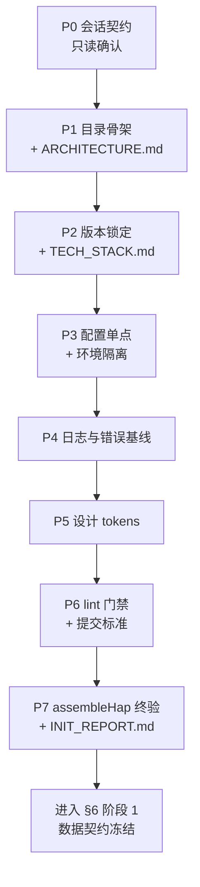

# 有径 · Qoder 工程初始化提示词集

> 用途：指导 Qoder 完成「有径」鸿蒙工程的根基搭建。配套文档：`Docs/有径·App开发文档.md`。
> 使用方式：按 P0 → P7 顺序，每次向 CodeX 粘贴一条提示词；每条末尾设有检查点，**人工确认验收通过后再发下一条**。P0 为会话契约，CodeX 新开会话时必须重发。

---

## 一、预防性约束总览（源自「有据」项目教训）

| # | 有据暴露的问题 | 本项目预防性约束 | 落位 | 检查点 |
|---|---|---|---|---|
| 1 | 配置散落：BASE_URL 硬编码在 api.ets，改动后漏重编 | 配置单点收敛 `common/config/`，文件头注明"修改后须全量重编" | P3 | 全源码 grep 无硬编码 URL/IP |
| 2 | hvigor `-p` 构建参数透传运行时开关无效（BUILD_MODE_NAME 教训） | 环境开关一律源码常量，release 前手动翻转并列入发布 checklist | P3 | IS_DEBUG 全工程单点定义 |
| 3 | ArkTS 严格模式编译错误（AppIcon.ets 类型缺失） | 禁 any / 禁解构 / 字面量必带具名 interface；每步静态检查 | P0 / P6 | linter 零 error |
| 4 | 模块耦合、跨层直连 | 分层单向依赖，UI 层不得直接触碰 RDB 与 LLM | P0 / P1 | ARCHITECTURE.md 依赖表 |
| 5 | 风格约定散乱、约定文档无限膨胀 | design tokens 即文档，单一事实源，禁止裸样式值 | P5 | 裸色值/字号扫描零命中 |
| 6 | 增删页面后 hvigor daemon 缓存假错（@Entry decorator 报错） | 标准重建流程固化为常规操作 | P7 | 流程写入 INIT_REPORT.md |
| 7 | 组件 id 冲突（cardMedia-{id}） | 组件标识统一「模块前缀-语义 id」 | P1 / P5 | 抽查组件标识 |
| 8 | 依赖随手引入、版本漂移 | 默认零运行时依赖；新增须四项评估登记；精确版本号 | P2 | lock 文件无 diff |
| 9 | 敏感信息入库风险 | .gitignore 先行；密钥后续走 HUKS，本阶段仅占位 | P3 | git status 无敏感文件 |
| 10 | AI 抢跑自主决策 | 决策点（包名/签名/依赖/目录/API）必须列方案等确认 | P0 | 每条提示词的检查点 |

---

## 二、提示词正文

### P0 会话契约（每次新会话必发，本步骤不改任何文件）

```text
你是「有径」（YouJing）鸿蒙原生 App 的工程初始化助手，工作目录为当前工程根目录（HarmonyProject2）。本次是初始化流程的第 0 步：读取契约并复述确认，本步骤不得修改任何文件。

【必读】先完整阅读 Docs/有径·App开发文档.md，掌握：核心模型（Trip/TripDay/Activity/Meal/Spot/Area）、三层数据分层策略、JSON Schema 三层防线、10 阶段开发路线（§6）。后续所有初始化步骤均建立在该文档之上。

【全局硬约束】以下 7 条贯穿 P1–P7 所有步骤，违反即返工：
1. ArkTS 严格模式：源码一律 .ets；禁止 any；禁止对象解构；对象字面量必须对应具名 interface；@State/@Prop 等状态变量名避开组件保留成员名（tabIndex、width、height 等）。
2. 分层单向依赖：pages → components → model/data/ai/utils → common。禁止反向引用，禁止跨层直连——页面不得直接操作 RDB 或发起 LLM 请求，必须经 data/、ai/ 层。
3. 配置单点：所有 URL、环境开关、阈值只能定义在 common/config/ 与 common/constants/，其余源码禁止出现硬编码地址、密钥、魔数。
4. 依赖最小化：默认不新增任何三方依赖，功能一律用系统 API（@kit 系列）实现；确需新增时，先列出「用途 / license / 维护状态 / 替代方案」等我确认，不得先斩后奏。
5. 决策不抢跑：凡涉及 bundleName、签名配置、目录结构变更、API 选型、SDK 版本变更，一律先列方案与影响面，等我确认后再动手。
6. 构建验证：每完成一步运行 ArkTS 静态检查并保证零 error；构建失败时先完整阅读错误日志定位根因，禁止盲改。
7. 改动最小化：只创建/修改当前步骤明确列出的文件；不顺手"优化"既有代码，不做步骤外的加法。

【补充约定】每步完成后按 type(scope): 中文摘要 格式提交（type 限定 feat/fix/refactor/docs/chore/test，scope 用目录名），单 commit 单意图。

【当前工程事实】工程为 DevEco 模板初始态：仅 pages/Index.ets（Hello World）、EntryAbility、EntryBackupAbility；bundleName 为 com.example.youjing（占位，不得擅自修改）；targetSdk/compatibleSdk 均 26.0.0；无签名配置；无权限声明；运行时依赖为零，devDependencies 仅 hypium 1.0.25 与 hamock 1.0.0。

【你的回应格式】
1. 一段话复述你对项目定位的理解；
2. 逐条确认上述 7 条约束；
3. 列出 P1–P7 执行计划（仅标题级）；
4. 等我确认后再执行 P1。
```

---

### P1 目录骨架与架构契约

```text
执行 P1：目录骨架与架构契约。依据 Docs/有径·App开发文档.md §5.4 落地工程结构，并补充配置层与设计层。

【任务】
1. 在 entry/src/main/ets/ 下创建以下空目录：pages/（已有 Index.ets，内容不动）、components/、model/、data/、ai/、mock/、utils/、design/、common/config/、common/error/、common/constants/。
2. 编写 Docs/ARCHITECTURE.md，包含四部分：
   a) 目录职责表：目录 / 职责 / 允许依赖 / 禁止依赖，逐目录一行，覆盖上述全部目录及 entryability/；
   b) 依赖方向规则：pages → components → model/data/ai/utils → common，禁止反向与跨层直连（页面不直接操作 RDB、不直接发 LLM 请求）；
   c) 与文档 §5.4 的差异说明：新增 common/（配置/错误/常量）与 design/（设计 tokens），写明新增理由——配置单点收敛与视觉常量统一；
   d) 命名与标识规范：组件/类/枚举 UpperCamelCase、变量/函数 lowerCamelCase、数组采用 T[] 风格、文件一律 .ets；需要 testKey 或 id 的组件统一用「模块前缀-语义 id」格式（如 spot-card-{spotId}），禁止裸数字 id。
3. 运行 ArkTS 静态检查，确保零 error。

【产出标准】目录全部创建；ARCHITECTURE.md 四部分齐全。
【验收条件】静态检查零 error；git status 变更仅限本步骤文件；ARCHITECTURE.md 目录表与实际目录一一对应。
【检查点】输出完整目录树与 diff 摘要，按约定格式提交，等我确认后进入 P2。
```

---

### P2 技术栈锁定与依赖基线

```text
执行 P2：技术栈版本锁定与依赖管理基线。目标：版本可追溯、依赖变更受控。

【任务】
1. 读取并记录工具链实际版本：build-profile.json5（targetSdkVersion/compatibleSdkVersion/modelVersion）、hvigor/hvigor-config.json5（modelVersion 及 hvigor 版本）、根 oh-package.json5 与 entry/oh-package.json5（现有依赖）、本机 DevEco Studio 安装路径。
2. 创建 Docs/TECH_STACK.md，包含：
   a) 版本锁定表：条目 / 当前值 / 来源文件，逐项注明出处；文档 §2.3 未声明 API 等级，以工程 26.0.0 为准，并在表下方注明这一决策；
   b) 依赖管理策略：
      - 运行时依赖默认为零，功能一律用系统 API（@kit 系列）实现；
      - 新增依赖须完成四项评估（用途 / license / 维护状态 / 替代方案）并登记到本文件后才可安装；
      - 版本号一律精确锁定（如 1.0.0），禁止 ^ 与 ~ 前缀；
      - 升级任何依赖前，先更新本文件并追加变更记录，再改 oh-package；
   c) 变更记录区：表格式（日期 / 内容 / 理由），初始为空。
3. 核对 oh-package-lock.json5 与 oh-package.json5 的一致性；如有漂移，列出差异待我确认，不得擅自 install 修复。

【产出标准】TECH_STACK.md 存在，版本表与实际配置逐项一致。
【验收条件】运行 ohpm install --all（或等效命令）后 oh-package-lock.json5 无 diff；版本表中每个值都能在来源文件中找到；运行时 dependencies 保持为空。
【检查点】输出版本锁定表与依赖核对结果，按约定格式提交，等我确认后进入 P3。
```

---

### P3 配置层与环境隔离

```text
执行 P3：配置层与开发/生产环境隔离。目标：可变配置单点收敛、环境切换可审计。

【任务】
1. 创建 common/constants/BuildConfig.ets：
   - 以具名 interface + 常量对象暴露 IS_DEBUG 与 BUILD_MODE_NAME，源码硬编码（当前值 debug）；
   - 文件头注释必须写明两条纪律：①禁止通过 hvigor -p 构建参数透传运行时开关（已验证不可靠）；②发布 release 前必须手动翻转此开关，并核对 Docs/INIT_REPORT.md 的发布 checklist。
2. 创建 common/config/ApiConfig.ets：
   - 集中定义 BASE_URL 与 LLM 相关端点常量（当前占位，具体值待后续阶段确定）；每项注释说明用途与取值来源；
   - 文件头注释：修改任何网络配置后必须全量重编并重装 HAP 才生效。
3. 创建 common/config/MockConfig.ets：USE_MOCK_DATA 开关（默认 true），注明数据路由将在后续阶段接 mock/MockTrip 时生效。
4. 核对并增补项目根 .gitignore，确保覆盖：.preview/、oh_modules/、.hvigor/、.idea/、local.properties、签名文件（*.p7b、*.cer、*.p12、*.csr）、密钥类文件；确认仓库中不存在以上敏感内容。
5. 运行 ArkTS 静态检查，确保零 error。

【产出标准】三个配置文件 + .gitignore 增补完成。
【验收条件】对 pages/components/model/data/ai/utils/mock/design 全量扫描，不得出现 http://、https://、IP 地址字面量（配置文件自身除外）；IS_DEBUG 与 BUILD_MODE_NAME 全工程仅 BuildConfig.ets 一处定义。
【检查点】展示三个配置文件全文与扫描结果，按约定格式提交，等我确认后进入 P4。
```

---

### P4 基础日志与错误处理机制

```text
执行 P4：日志与错误处理基线。目标：为文档 §4.3 的"解析失败重试/降级"预留统一出口，日志可按模块过滤。

【任务】
1. 创建 common/logger/Logger.ets：
   - 基于 hilog 封装，提供 debug/info/warn/error 四级；统一 tag 前缀 YouJing.，tag 按模块命名（如 YouJing.Data.TripDao）；
   - debug 级别仅在 BuildConfig.IS_DEBUG 为 true 时输出；
   - 全工程禁止直接调用 console.log / console.error（P6 由 lint 规则固化）。
2. 创建 common/error/AppError.ets：具名 class，字段 code/message/cause（可选）；提供从原生 Error 包装为 AppError 的静态方法。
3. 创建 common/error/ErrorCode.ets：错误码常量表按区段划分——1xxx 网络、2xxx JSON/解析、3xxx 存储（RDB）、4xxx 业务规则；每个码配一句中文说明；区段划分规则写入文件头注释；保证码值无重复。
4. 在 EntryAbility.ets 的 onError 回调中接入 Logger.error 记录未捕获异常（只加日志，不改其他逻辑）。
5. 运行 ArkTS 静态检查，确保零 error。

【产出标准】Logger / AppError / ErrorCode 三个文件 + EntryAbility 接入。
【验收条件】优先做动态验收：构建并启动 App，临时调用四个级别的 Logger，在 hilog 中按 YouJing. 前缀可过滤到全部输出，验毕删除临时代码。若当前无可用模拟器或签名，改用静态走查验收，并在 Docs/INIT_REPORT.md 标注"日志输出待真机补验"。
【检查点】展示 hilog 过滤结果（或静态走查结论）与 ErrorCode 表，按约定格式提交，等我确认后进入 P5。
```

---

### P5 设计 tokens 基线

```text
执行 P5：设计 tokens 基线。目标：视觉常量单一事实源，杜绝样式散落。

【任务】
1. 在 design/ 下创建四个 token 文件（.ets，具名 interface + 常量对象）：
   - ColorTokens.ets：语义化命名（如 bgPage、bgSurface、textPrimary、textSecondary、accentPrimary、divider），禁止物理命名（如 red1）；注明当前仅浅色值，暗色模式待接入 resources/dark 时扩展；
   - SpaceTokens.ets：xs/sm/md/lg/xl 间距档位；
   - FontTokens.ets：字号与字重档位；
   - MotionTokens.ets：动效时长与曲线常量，预留 spring 动画用法注释。
2. 在 Docs/ARCHITECTURE.md 追加「UI 约定」小节：
   - pages/components 中禁止裸写色值、字号、间距，一律引用 token；
   - 新增视觉常量必须先进 token 文件再使用；
   - 组件 testKey/id 按 P1 的「模块前缀-语义 id」规范执行。
3. 运行 ArkTS 静态检查，确保零 error。

【产出标准】四个 token 文件 + ARCHITECTURE.md 增补。
【验收条件】对 pages/、components/ 扫描裸色值（#RRGGBB 格式）：零命中；数值类命中（字号/间距）逐条注明是否属于布局百分比、动画参数等豁免类，无法归类的按违规处理；token 命名全部语义化。
【检查点】展示 token 表与扫描结果，按约定格式提交，等我确认后进入 P6。
```

---

### P6 质量门禁与提交标准

```text
执行 P6：代码规范与提交标准。目标：把 P0 的口头约束固化为可执行门禁。

【任务】
1. 强化 code-linter.json5：启用覆盖以下意图的规则——禁止 any、禁止未使用变量、要求显式类型、禁止 console 直接调用；在文件内注释列出实际启用的规则 ID 清单。
2. 创建 .gitmessage.txt（提交信息模板）：type(scope): 中文摘要 + 空行 + 正文（可选）；type 限定 feat/fix/refactor/docs/chore/test，scope 用目录名。
3. 创建零依赖的 .git/hooks/pre-commit shell 脚本：
   - 对本次改动的 .ets 文件运行 ArkTS 静态检查，失败则拒绝提交；
   - 脚本头注释写明：hooks 不随仓库分发，新克隆需手动启用（chmod +x）；
   - 不引入任何三方 hook 框架。
4. 创建 Docs/CONTRIBUTING.md：提交规范、分支策略（main 主干 + feature/xxx 短分支，合并后删除）、提交粒度（单 commit 单意图）、本地验收清单（静态检查通过 + 构建通过）。
5. 创建 CHANGELOG.md，按 Keep a Changelog 结构写入首个条目「工程基线初始化」，汇总 P1–P5 成果。
6. 运行 ArkTS 静态检查，确保零 error。

【产出标准】lint 配置 + 提交模板 + pre-commit hook + CONTRIBUTING.md + CHANGELOG.md。
【验收条件】门禁演示：构造一个含明显违规（如裸 console.log）的临时改动，验证 pre-commit 拦截生效，验毕还原；git log 符合 .gitmessage.txt 模板格式。
【检查点】展示拦截演示、启用的规则清单与 git log，按约定格式提交，等我确认后进入 P7。
```

---

### P7 全量构建终验与初始化报告

```text
执行 P7：全量构建终验与初始化报告。这是初始化流程的最后一步。

【任务】
1. 标准重建后全量构建：pkill -f hvigor → 删除 .preview → 执行 assembleHap 构建，必须成功。注明：此流程为标准重建流程，后续凡增删页面或遇到诡异的 @Entry decorator 报错，先执行此流程再排查代码。
2. 逐项核对最终验收清单：
   - 目录结构与 ARCHITECTURE.md 一致；
   - 配置单点扫描通过（P3 验收条件复跑）；
   - token 裸值扫描通过（P5 验收条件复跑）；
   - ErrorCode 码值无重复；
   - TECH_STACK.md 版本表与实际配置一致、lock 无 diff；
   - git log 符合提交规范。
3. 编写 Docs/INIT_REPORT.md：
   - 完成清单：文件/目录/配置逐项列出；
   - 工具链版本快照（引用 TECH_STACK.md，不重复罗列）；
   - 已知限制与待办：bundleName 仍为模板占位、签名未配置、应用名称未定（AppScope label 当前为 YouJing）、API 26 的最低兼容范围未评审、小艺 Skill 接入协议待调研、日志输出待真机补验（如 P4 走了静态验收）；
   - 发布前 checklist：BuildConfig.IS_DEBUG 翻转、MockConfig.USE_MOCK_DATA 关闭、网络配置变更后全量重编、签名配置就绪；
   - 下一步：进入 Docs/有径·App开发文档.md §6 阶段 1（数据契约冻结）。
4. 输出最终 git log 摘要与目录树。

【产出标准】assembleHap 构建成功 + INIT_REPORT.md + 验收清单全绿（不通过项必须落入"已知限制"）。
【验收条件】构建产物存在；验收清单逐项标注通过/不通过；INIT_REPORT.md 五个部分齐全。
【检查点】INIT_REPORT.md 交我审阅，审阅通过后初始化流程结束。
```

---

## 三、流程图



## 四、使用注意

1. **顺序不可调换**：P3 依赖 P1 的目录、P6 的 lint 依赖 P4 的"禁 console"约定、P7 汇总全部验收。
2. **检查点必须人工过**：每条提示词末尾的检查点是防抢跑机制，Qoder 输出确认结果后再发下一条。
3. **新会话重发 P0**：P0 之后的所有步骤都以 P0 的 7 条硬约束为前提，会话中断重开时先重发 P0 并说明"已完成到 Pn"。
4. **验收不通过的处理**：直接在当前步骤内让 Qoder 返工，不要带着未过的验收进入下一步。
5. 本提示词集与文档 §6 的关系：P1–P7 完成"阶段 0（工程根基）"，其产出（model/、ai/、data/ 骨架与错误码区段）直接服务阶段 1（数据契约冻结）。
